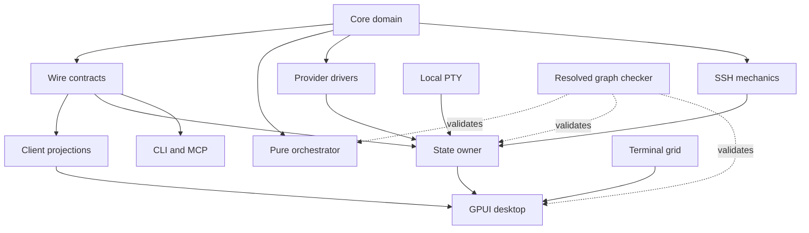

<!-- PAGE_ID: pandamux_01_overview -->
<details>
<summary>Relevant source files</summary>

The following files were used as evidence for this page:

- [README.md:1-280](../README.md#L1-L280)
- [CLAUDE.md:1-239](../CLAUDE.md#L1-L239)
- [Cargo.toml:1-48](../Cargo.toml#L1-L48)
- [crates/pandamux-desktop/src/main.rs:1-63](../crates/pandamux-desktop/src/main.rs#L1-L63)
- [crates/pandamux-server/src/main.rs:27-300](../crates/pandamux-server/src/main.rs#L27-L300)
- [crates/pandamux-cli/src/main.rs:1-85](../crates/pandamux-cli/src/main.rs#L1-L85)

</details>

# Overview

> **Related Pages**: [Getting Started](GETTING_STARTED.md), [Architecture](core/ARCHITECTURE.md)

---

<!-- BEGIN:AUTOGEN pandamux_01_overview_introduction -->
## Introduction

PandaMUX is a native, chat-first desktop for supervising local and remote AI coding agents. Its active implementation is a Rust workspace in which a GPUI desktop and an authenticated CLI consume one server-owned JSON-RPC control plane ([README.md:1-6](../README.md#L1-L6)).

The server is authoritative for durable state and provider execution, while the desktop presents client projections and renders terminal grids. The repository's former Electron and Iced implementations are not part of the active workspace ([README.md:4-6](../README.md#L4-L6)).

Sources: [README.md:1-6](../README.md#L1-L6)
<!-- END:AUTOGEN pandamux_01_overview_introduction -->

---

<!-- BEGIN:AUTOGEN pandamux_01_overview_product -->
## Product Model

PandaMUX centers work on durable chat threads and visible terminal sessions rather than embedding provider state in the desktop process. This separation lets the same Hub serve the GPUI desktop, the interactive CLI, and a separately scoped MCP adapter ([CLAUDE.md:215-239](../CLAUDE.md#L215-L239)).

| Concern | Owning component | Practical result |
|---|---|---|
| Threads, turns, events, settings, provider processes, PTYs | `pandamux-server` | Work survives desktop projection changes and clients submit intents rather than mutating canonical state ([CLAUDE.md:215-223](../CLAUDE.md#L215-L223)) |
| Chat, settings, side surfaces, timeline, terminal grid | `pandamux-desktop` | The native UI renders server state and terminal bytes with GPUI ([CLAUDE.md:188-215](../CLAUDE.md#L188-L215)) |
| Local automation and inspection | `pandamux-cli` | Commands use the same authenticated protocol as the desktop ([CLAUDE.md:200-200](../CLAUDE.md#L200-L200), [CLAUDE.md:225-233](../CLAUDE.md#L225-L233)) |
| Remote Linux execution | Hub plus node daemon | A Hub reaches the node through SSH and a private proxy rather than a public node listener ([README.md:258-260](../README.md#L258-L260)) |

- Provider instances are stored configurations, not interchangeable provider kinds.
- Local and remote execution environments are explicit routing targets.
- The MCP adapter receives a distinct read-only capability surface.
- FullAccess providers have host-user authority and are not process-isolated ([CLAUDE.md:235-237](../CLAUDE.md#L235-L237)).

Sources: [CLAUDE.md:188-239](../CLAUDE.md#L188-L239), [README.md:258-260](../README.md#L258-L260)
<!-- END:AUTOGEN pandamux_01_overview_product -->

---

<!-- BEGIN:AUTOGEN pandamux_01_overview_stack -->
## Technology Stack

The workspace uses Rust 2024, inherits one workspace version across all crates, declares Rust 1.89 as its scoped minimum, and pins Rust 1.98.1 for development and evidence ([Cargo.toml:25-30](../Cargo.toml#L25-L30), [README.md:204-209](../README.md#L204-L209)).

| Layer | Technology | Evidence |
|---|---|---|
| Desktop UI | GPUI through `gpui-kit` | The desktop entry point initializes GPUI Kit and opens the PandaMUX window ([main.rs:3-5](../crates/pandamux-desktop/src/main.rs#L3-L5), [main.rs:26-61](../crates/pandamux-desktop/src/main.rs#L26-L61)) |
| Terminal grid | `alacritty_terminal` | The desktop owns grid rendering rather than PTY processes ([CLAUDE.md:1-3](../CLAUDE.md#L1-L3), [CLAUDE.md:199-215](../CLAUDE.md#L199-L215)) |
| Local PTYs | `portable-pty` | PTY ownership stays behind the server ([CLAUDE.md:1-3](../CLAUDE.md#L1-L3), [CLAUDE.md:197-215](../CLAUDE.md#L197-L215)) |
| Durable store | SQLite through bundled `rusqlite` 0.33 | The shared manifest declares the database dependency and the server owns durable state ([Cargo.toml:32-46](../Cargo.toml#L32-L46), [CLAUDE.md:197-197](../CLAUDE.md#L197-L197)) |
| Remote composition | `russh` | The server composes SSH-connected Linux nodes through the remote crate ([CLAUDE.md:1-3](../CLAUDE.md#L1-L3), [CLAUDE.md:196-197](../CLAUDE.md#L196-L197)) |
| Async runtime | Tokio 1.52.3 | Shared workspace dependency with per-crate features ([Cargo.toml:32-48](../Cargo.toml#L32-L48)) |
| Wire and policy formats | Serde, JSON, JSON Schema, and typed YAML | Exact-pinned shared serialization dependencies support protocol values and the pure orchestrator boundary ([Cargo.toml:32-48](../Cargo.toml#L32-L48)) |

The dependency boundary is intentional: the server owns PTYs and remote composition, the desktop owns grid rendering and projections, and the orchestrator remains a pure serializable policy layer ([CLAUDE.md:188-219](../CLAUDE.md#L188-L219)).

Sources: [Cargo.toml:25-48](../Cargo.toml#L25-L48), [README.md:204-209](../README.md#L204-L209), [CLAUDE.md:188-219](../CLAUDE.md#L188-L219), [main.rs:3-61](../crates/pandamux-desktop/src/main.rs#L3-L61)
<!-- END:AUTOGEN pandamux_01_overview_stack -->

---

<!-- BEGIN:AUTOGEN pandamux_01_overview_layout -->
## Workspace Layout

The root manifest declares ten product crates plus one workspace validation tool and excludes the Phase 0 spikes ([Cargo.toml:1-23](../Cargo.toml#L1-L23)).

| Crate | Responsibility |
|---|---|
| `pandamux-core` | Framework-free domain types, policies, IDs, settings, threads, turns, and events |
| `pandamux-orchestrator` | Pure Phase 5 run-domain, compatibility, and policy-engine boundary |
| `pandamux-protocol` | Versioned JSON-RPC, subscriptions, terminal contracts, settings contracts, and proxy wire types |
| `pandamux-client` | Client-side event projections and rendering-oriented state |
| `pandamux-providers` | Provider drivers, profiles, parsing, and process supervision |
| `pandamux-remote` | SSH authentication, pooling, exec, SFTP, bootstrap, and tunnels |
| `pandamux-server` | SQLite single writer, routing, provider execution, PTYs, Hub runtime, and node runtime |
| `pandamux-term` | Feature-split terminal grid and local PTY primitives |
| `pandamux-cli` | Authenticated command client and MCP stdio adapter |
| `pandamux-desktop` | GPUI chat shell, timeline, settings, side surfaces, and terminal rendering |
| `pandamux-boundary-check` | Tooling crate that validates target-resolved dependency and feature ownership |

These responsibilities and their hard dependency boundaries are defined by the development guide and manifests ([CLAUDE.md:188-219](../CLAUDE.md#L188-L219)).



Sources: [Cargo.toml:1-23](../Cargo.toml#L1-L23), [CLAUDE.md:188-219](../CLAUDE.md#L188-L219)
<!-- END:AUTOGEN pandamux_01_overview_layout -->

---

<!-- BEGIN:AUTOGEN pandamux_01_overview_binaries -->
## Binaries and Entry Points

Three user-facing binaries form the active runtime. Each exposes a deliberately different entry point rather than combining UI, server ownership, and automation into one process.

```bash
cargo run -p pandamux-server
cargo run -p pandamux-desktop
cargo run -p pandamux-cli -- ping
```

These are the documented development entry points for the Hub, GPUI desktop, and command client ([CLAUDE.md:129-148](../CLAUDE.md#L129-L148)).

| Binary | Cargo package | Entry behavior |
|---|---|---|
| `pandamux` | `pandamux-desktop` | Opens the GPUI window by default; `--headless` performs a noninteractive theme check and `--smoke` opens, renders, then exits ([main.rs:7-24](../crates/pandamux-desktop/src/main.rs#L7-L24), [main.rs:26-61](../crates/pandamux-desktop/src/main.rs#L26-L61)) |
| `pandamux-server` | `pandamux-server` | Starts a Hub by default, a node with `daemon --role node`, or a Linux stdio bridge with `proxy` ([main.rs:27-57](../crates/pandamux-server/src/main.rs#L27-L57), [main.rs:141-232](../crates/pandamux-server/src/main.rs#L141-L232)) |
| `pandamux-cli` | `pandamux-cli` | Parses connectivity, identification, thread, notification, MCP, help, and version actions; command failures exit with status 1 ([main.rs:6-84](../crates/pandamux-cli/src/main.rs#L6-L84)) |

The server creates `data/hub.db` or `data/node.db` beside its runtime directory unless `--db` supplies an explicit database path ([main.rs:49-69](../crates/pandamux-server/src/main.rs#L49-L69)). It also writes discovery metadata before starting its IPC listeners and removes that runtime state during graceful shutdown ([main.rs:72-120](../crates/pandamux-server/src/main.rs#L72-L120)).

Sources: [main.rs:7-63](../crates/pandamux-desktop/src/main.rs#L7-L63), [main.rs:27-123](../crates/pandamux-server/src/main.rs#L27-L123), [main.rs:6-84](../crates/pandamux-cli/src/main.rs#L6-L84)
<!-- END:AUTOGEN pandamux_01_overview_binaries -->

---

<!-- BEGIN:AUTOGEN pandamux_01_overview_navigate -->
## Where to Start

Use the page that matches the boundary you need to change or operate.

| Goal | Start here |
|---|---|
| Build, run, or validate the workspace | [Getting Started](GETTING_STARTED.md) |
| Understand ownership and request flow | [Architecture](core/ARCHITECTURE.md) |
| Work with domain records and lifecycle states | [Core Domain](core/CORE_DOMAIN.md) |
| Configure settings, providers, organizations, or environments | [Configuration](core/CONFIGURATION.md) |
| Automate through the implemented command surface | [CLI Reference](api/CLI_REFERENCE.md) |
| Diagnose local authentication and IPC | [Local IPC and Security](features/NAMED_PIPE_IPC.md) |
| Operate remote Linux nodes | [SSH Remote Nodes](features/SSH_REMOTE.md) |
| Understand provider selection and failover | [Provider Routing and Capacity](features/PROVIDER_ROUTING.md) |
| Change Rust dependencies or toolchains | [Toolchain and Dependency Policy](operations/DEPENDENCIES.md) |
| Prepare artifacts or reason about release gates | [Release and Packaging](operations/RELEASE.md) |

Current implementation facts come from code and manifests first. The development guide then provides the authoritative workflow and boundary summary ([CLAUDE.md:188-219](../CLAUDE.md#L188-L219)).

Sources: [CLAUDE.md:188-219](../CLAUDE.md#L188-L219)
<!-- END:AUTOGEN pandamux_01_overview_navigate -->

---
