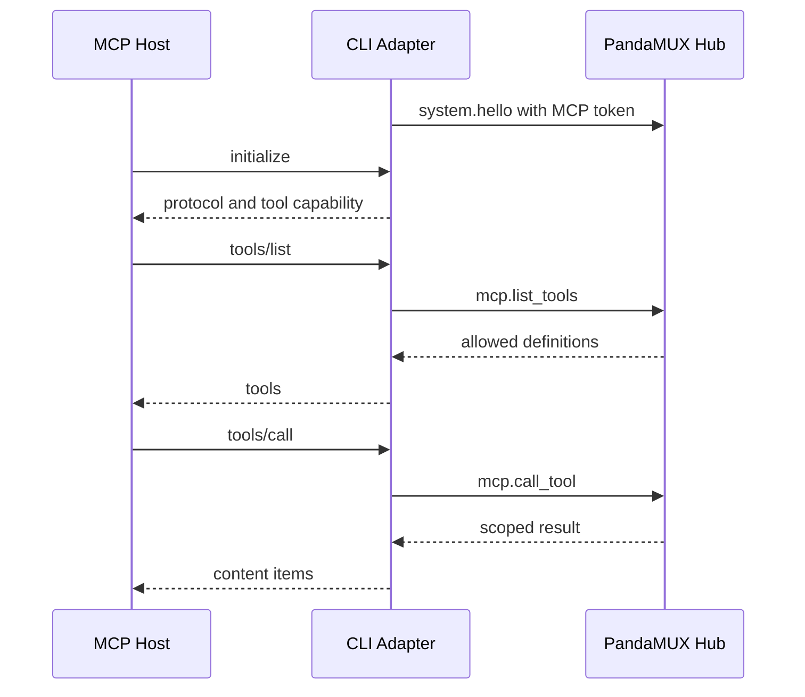

<!-- PAGE_ID: pandamux_09_cli-reference -->
<details>
<summary>Relevant source files</summary>

The following files were used as evidence for this page:

- [crates/pandamux-cli/src/main.rs:1-85](../../crates/pandamux-cli/src/main.rs#L1-L85)
- [crates/pandamux-cli/src/lib.rs:1-396](../../crates/pandamux-cli/src/lib.rs#L1-L396)
- [crates/pandamux-cli/src/commands.rs:1-325](../../crates/pandamux-cli/src/commands.rs#L1-L325)
- [crates/pandamux-cli/src/ipc.rs:1-289](../../crates/pandamux-cli/src/ipc.rs#L1-L289)
- [crates/pandamux-cli/tests/cli_contract_tests.rs:1-139](../../crates/pandamux-cli/tests/cli_contract_tests.rs#L1-L139)
- [crates/pandamux-protocol/src/mcp.rs:1-41](../../crates/pandamux-protocol/src/mcp.rs#L1-L41)

</details>

# CLI Reference

> **Related Pages**: [Getting Started](../GETTING_STARTED.md), [Local IPC and Security](../features/NAMED_PIPE_IPC.md)

---

<!-- BEGIN:AUTOGEN pandamux_09_cli-reference_invocation -->
## Invocation and Discovery

The command-line package is `pandamux-cli`. During development, invoke it through Cargo so the command after `--` is passed to the binary:

```bash
cargo run -p pandamux-cli -- --help
cargo run -p pandamux-cli -- ping
```

| Global option | Behavior |
|---|---|
| `--pipe <PATH>` | Uses the explicit Windows named pipe or Unix socket path; a missing value is a parse error ([lib.rs:62-71](../../crates/pandamux-cli/src/lib.rs#L62-L71)) |
| `--json` | Selects JSON output for commands that support it ([lib.rs:72-75](../../crates/pandamux-cli/src/lib.rs#L72-L75)) |
| `-h`, `--help`, `help` | Prints help and exits successfully ([lib.rs:76-77](../../crates/pandamux-cli/src/lib.rs#L76-L77), [main.rs:70-73](../../crates/pandamux-cli/src/main.rs#L70-L73)) |
| `-V`, `--version`, `version` | Prints the workspace package version ([lib.rs:77-77](../../crates/pandamux-cli/src/lib.rs#L77), [main.rs:75-78](../../crates/pandamux-cli/src/main.rs#L75-L78)) |

Without `--pipe`, the client first honors a nonempty `PANDAMUX_PIPE`, otherwise it reads `pipePath` from `server.json` ([ipc.rs:143-170](../../crates/pandamux-cli/src/ipc.rs#L143-L170)). The runtime record is searched under `%LOCALAPPDATA%\pandamux` and its `run` subdirectory on Windows, or `~/.pandamux` and its `run` subdirectory on Unix ([ipc.rs:223-260](../../crates/pandamux-cli/src/ipc.rs#L223-L260)).

For ordinary commands, connection setup selects the control token; MCP mode selects `mcpToken`. When a matching runtime record is present, the client also captures the expected server PID for Windows named-pipe validation ([ipc.rs:173-220](../../crates/pandamux-cli/src/ipc.rs#L173-L220)).

Sources: [lib.rs:51-83](../../crates/pandamux-cli/src/lib.rs#L51-L83), [ipc.rs:143-220](../../crates/pandamux-cli/src/ipc.rs#L143-L220), [ipc.rs:223-289](../../crates/pandamux-cli/src/ipc.rs#L223-L289)
<!-- END:AUTOGEN pandamux_09_cli-reference_invocation -->

---

<!-- BEGIN:AUTOGEN pandamux_09_cli-reference_system -->
## System and Thread Commands

System commands inspect the connected server. Thread commands list existing threads or submit a turn to one known thread ID.

| Command | Options | RPC and result |
|---|---|---|
| `ping` | `--pipe`, `--json` | Calls `system.ping`; text output includes measured client latency and server time ([commands.rs:14-39](../../crates/pandamux-cli/src/commands.rs#L14-L39)) |
| `hello` | `--pipe`, `--json` | Calls `system.hello` with the current protocol and CLI version, then reports server version, protocol, and role ([commands.rs:41-62](../../crates/pandamux-cli/src/commands.rs#L41-L62)) |
| `identify` or `id` | `--pipe`, `--json` | Calls `system.identify`; text output shows server version, protocol, role, platform, and environment ([lib.rs:89-95](../../crates/pandamux-cli/src/lib.rs#L89-L95), [commands.rs:64-82](../../crates/pandamux-cli/src/commands.rs#L64-L82)) |
| `thread list` or `thread ls` | `--status <STATUS>`, `--limit <N>`, global flags | Calls `thread.list`, filters by status server-side, truncates locally by limit, and renders a table or JSON ([lib.rs:96-128](../../crates/pandamux-cli/src/lib.rs#L96-L128), [commands.rs:84-131](../../crates/pandamux-cli/src/commands.rs#L84-L131)) |
| `thread send <ID> <PROMPT>` | `--model <MODEL>`, `--effort <EFFORT>`, global flags | Calls `thread.send_turn` without attachments and reports the returned turn ID and sequence ([lib.rs:130-170](../../crates/pandamux-cli/src/lib.rs#L130-L170), [commands.rs:133-166](../../crates/pandamux-cli/src/commands.rs#L133-L166)) |

Accepted status filters are `idle`, `working`, `awaiting_approval` plus its aliases, `errored` plus `error`, `paused`, and `archived`. Any other value is rejected before connection ([lib.rs:223-233](../../crates/pandamux-cli/src/lib.rs#L223-L233)).

The CLI contract test exercises real JSON-RPC calls for ping, identify, thread creation and listing against an in-memory server/router composition ([cli_contract_tests.rs:14-79](../../crates/pandamux-cli/tests/cli_contract_tests.rs#L14-L79), [cli_contract_tests.rs:105-129](../../crates/pandamux-cli/tests/cli_contract_tests.rs#L105-L129)).

Sources: [lib.rs:89-177](../../crates/pandamux-cli/src/lib.rs#L89-L177), [lib.rs:223-233](../../crates/pandamux-cli/src/lib.rs#L223-L233), [commands.rs:14-166](../../crates/pandamux-cli/src/commands.rs#L14-L166), [cli_contract_tests.rs:14-129](../../crates/pandamux-cli/tests/cli_contract_tests.rs#L14-L129)
<!-- END:AUTOGEN pandamux_09_cli-reference_system -->

---

<!-- BEGIN:AUTOGEN pandamux_09_cli-reference_terminal -->
## Terminal and Notification Commands

The current CLI parser exposes notification posting but no direct terminal command group. Terminal sessions remain a server protocol surface rather than an available `pandamux-cli terminal ...` syntax ([lib.rs:8-49](../../crates/pandamux-cli/src/lib.rs#L8-L49), [lib.rs:89-220](../../crates/pandamux-cli/src/lib.rs#L89-L220)).

```bash
cargo run -p pandamux-cli -- notify "Build complete" \
  --body "All checks passed" \
  --source build
```

| Notification argument | Required | Behavior |
|---|---|---|
| `<TITLE>` | Yes | All unflagged title words are joined with spaces; an empty title is rejected ([lib.rs:180-213](../../crates/pandamux-cli/src/lib.rs#L180-L213)) |
| `--body <BODY>` | No | Defaults to an empty string ([commands.rs:168-181](../../crates/pandamux-cli/src/commands.rs#L168-L181)) |
| `--source <SOURCE>` | No | Defaults to `generic`; help documents `build`, `agent`, `deploy`, `port`, and `generic` ([lib.rs:180-213](../../crates/pandamux-cli/src/lib.rs#L180-L213), [commands.rs:168-181](../../crates/pandamux-cli/src/commands.rs#L168-L181)) |
| `PANDAMUX_THREAD_ID` | No | When present and nonblank, adds `threadId` to the `notification.post` parameters ([commands.rs:182-186](../../crates/pandamux-cli/src/commands.rs#L182-L186)) |

The command calls `notification.post` and prints either the response JSON or a confirmation containing the title ([commands.rs:188-197](../../crates/pandamux-cli/src/commands.rs#L188-L197)). The integration test verifies both posting and listing a notification through the server contract ([cli_contract_tests.rs:80-103](../../crates/pandamux-cli/tests/cli_contract_tests.rs#L80-L103)).

Sources: [lib.rs:8-49](../../crates/pandamux-cli/src/lib.rs#L8-L49), [lib.rs:180-220](../../crates/pandamux-cli/src/lib.rs#L180-L220), [commands.rs:168-197](../../crates/pandamux-cli/src/commands.rs#L168-L197), [cli_contract_tests.rs:80-103](../../crates/pandamux-cli/tests/cli_contract_tests.rs#L80-L103)
<!-- END:AUTOGEN pandamux_09_cli-reference_terminal -->

---

<!-- BEGIN:AUTOGEN pandamux_09_cli-reference_output -->
## Output and Errors

Most commands support human-readable output and `--json`. MCP mode is different: it is a newline-delimited stdio JSON-RPC bridge and does not use the global JSON presentation flag.

| Condition | Observable behavior |
|---|---|
| Argument parse failure | Prints `Error: ...` to stderr and exits 1 ([main.rs:10-15](../../crates/pandamux-cli/src/main.rs#L10-L15)) |
| Command or transport failure | Prints `Error: ...` to stderr and exits 1 ([main.rs:81-84](../../crates/pandamux-cli/src/main.rs#L81-L84)) |
| RPC error response | Formats the server error as `<code>: <message>` ([ipc.rs:86-103](../../crates/pandamux-cli/src/ipc.rs#L86-L103)) |
| Missing runtime record | Reports the checked `server.json` path and suggests starting the server or desktop ([ipc.rs:151-159](../../crates/pandamux-cli/src/ipc.rs#L151-L159)) |
| Closed IPC stream | Returns `IPC connection closed unexpectedly` ([ipc.rs:86-104](../../crates/pandamux-cli/src/ipc.rs#L86-L104)) |
| Malformed MCP input | Emits JSON-RPC parse error `-32700` and continues reading stdin ([commands.rs:207-226](../../crates/pandamux-cli/src/commands.rs#L207-L226)) |

Each IPC request receives a monotonically increasing numeric ID. The client writes one JSON line, flushes it, ignores unrelated incoming lines, and returns only the response whose ID matches the request ([ipc.rs:68-104](../../crates/pandamux-cli/src/ipc.rs#L68-L104)). Typed calls additionally serialize request parameters and deserialize response results, turning schema mismatches into explicit errors ([ipc.rs:106-116](../../crates/pandamux-cli/src/ipc.rs#L106-L116)).

Sources: [main.rs:10-15](../../crates/pandamux-cli/src/main.rs#L10-L15), [main.rs:81-84](../../crates/pandamux-cli/src/main.rs#L81-L84), [ipc.rs:68-116](../../crates/pandamux-cli/src/ipc.rs#L68-L116), [commands.rs:207-226](../../crates/pandamux-cli/src/commands.rs#L207-L226)
<!-- END:AUTOGEN pandamux_09_cli-reference_output -->

---

<!-- BEGIN:AUTOGEN pandamux_09_cli-reference_mcp -->
## Restricted MCP Adapter

`mcp` starts a stdio adapter that connects with the runtime record's distinct MCP token and identifies itself as `pandamux-mcp` during `system.hello` ([ipc.rs:28-64](../../crates/pandamux-cli/src/ipc.rs#L28-L64), [ipc.rs:173-220](../../crates/pandamux-cli/src/ipc.rs#L173-L220)). The server remains authoritative for which tools that capability may list or call.



| Stdio method | Adapter behavior |
|---|---|
| `initialize` | Returns MCP protocol `2024-11-05`, server name/version, and tool capability ([commands.rs:233-247](../../crates/pandamux-cli/src/commands.rs#L233-L247)) |
| `ping` | Returns an empty successful result without a Hub round trip ([commands.rs:249-253](../../crates/pandamux-cli/src/commands.rs#L249-L253)) |
| `tools/list` | Calls Hub method `mcp.list_tools` and returns the definitions ([commands.rs:255-271](../../crates/pandamux-cli/src/commands.rs#L255-L271)) |
| `tools/call` | Converts the requested name and arguments to `McpCallToolParams`, calls `mcp.call_tool`, and returns structured content ([commands.rs:273-301](../../crates/pandamux-cli/src/commands.rs#L273-L301), [mcp.rs:12-28](../../crates/pandamux-protocol/src/mcp.rs#L12-L28)) |

MCP content is either text or a resource with URI, optional media type, and optional text. Results include an `isError` flag ([mcp.rs:21-41](../../crates/pandamux-protocol/src/mcp.rs#L21-L41)). The CLI contract test confirms that the server advertises at least the `read_settings` tool through this surface ([cli_contract_tests.rs:131-139](../../crates/pandamux-cli/tests/cli_contract_tests.rs#L131-L139)).

Sources: [ipc.rs:28-64](../../crates/pandamux-cli/src/ipc.rs#L28-L64), [ipc.rs:173-220](../../crates/pandamux-cli/src/ipc.rs#L173-L220), [commands.rs:199-325](../../crates/pandamux-cli/src/commands.rs#L199-L325), [mcp.rs:1-41](../../crates/pandamux-protocol/src/mcp.rs#L1-L41), [cli_contract_tests.rs:131-139](../../crates/pandamux-cli/tests/cli_contract_tests.rs#L131-L139)
<!-- END:AUTOGEN pandamux_09_cli-reference_mcp -->

---

<!-- BEGIN:AUTOGEN pandamux_09_cli-reference_examples -->
## Examples

These examples use only syntax implemented by `parse_cli_args`.

```bash
cargo run -p pandamux-cli -- ping --json

cargo run -p pandamux-cli -- --pipe /path/to/pandamux.sock identify

cargo run -p pandamux-cli -- thread list --status idle --limit 10

cargo run -p pandamux-cli -- thread send thread-123 \
  "Explain the failing test" --model default --effort high

cargo run -p pandamux-cli -- mcp
```

Prompt words are joined with spaces until parsed flags are removed; at least one prompt word is required ([lib.rs:130-170](../../crates/pandamux-cli/src/lib.rs#L130-L170)). `--limit` is parsed as an unsigned integer; if parsing fails, the current implementation leaves the limit unset rather than returning an error ([lib.rs:112-118](../../crates/pandamux-cli/src/lib.rs#L112-L118)). Unknown top-level commands and unknown thread subcommands are explicit parse failures ([lib.rs:173-177](../../crates/pandamux-cli/src/lib.rs#L173-L177), [lib.rs:217-219](../../crates/pandamux-cli/src/lib.rs#L217-L219)).

Sources: [lib.rs:89-220](../../crates/pandamux-cli/src/lib.rs#L89-L220)
<!-- END:AUTOGEN pandamux_09_cli-reference_examples -->

---
