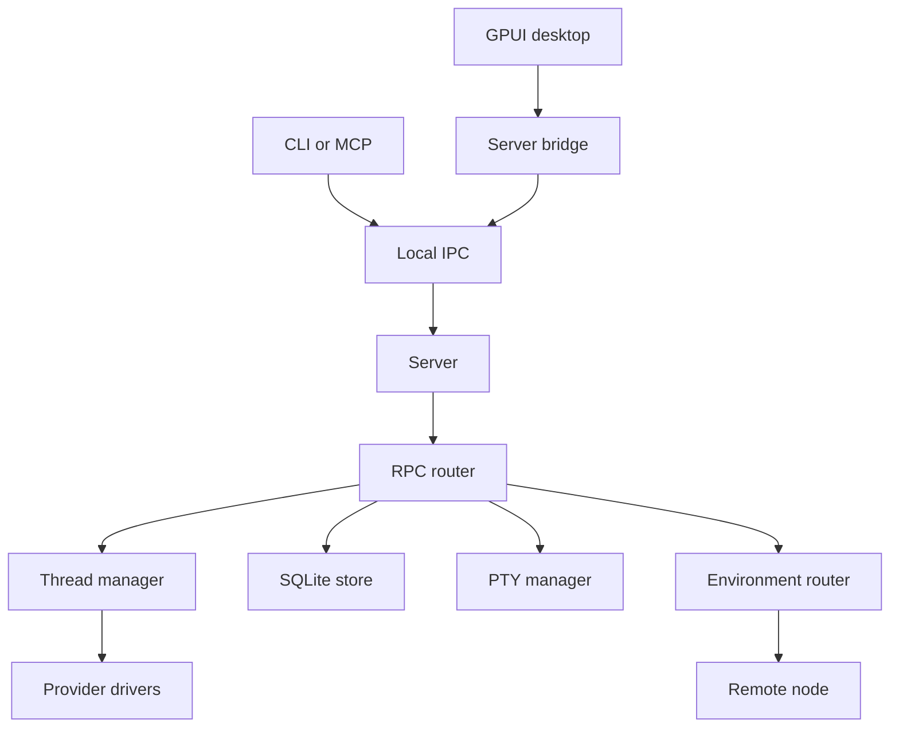
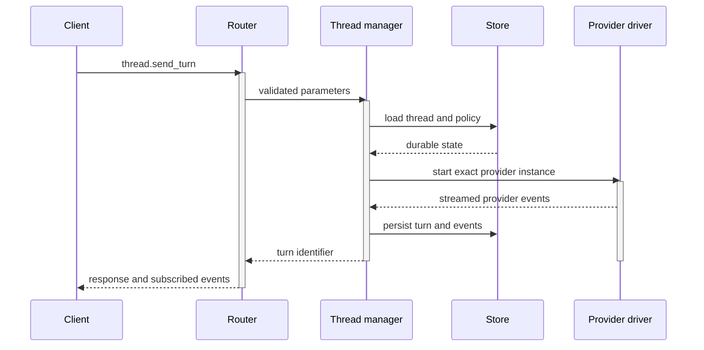

<!-- PAGE_ID: pandamux_07_app-runtime -->
<details>
<summary>Relevant source files</summary>

The following files were used as evidence for this page:

- [crates/pandamux-server/src/lib.rs:1-101](../../crates/pandamux-server/src/lib.rs#L1-L101)
- [crates/pandamux-server/src/runtime.rs:1-205](../../crates/pandamux-server/src/runtime.rs#L1-L205)
- [crates/pandamux-server/src/server.rs:1-735](../../crates/pandamux-server/src/server.rs#L1-L735)
- [crates/pandamux-server/src/router.rs:1-6626](../../crates/pandamux-server/src/router.rs#L1-L6626)
- [crates/pandamux-server/src/attachment.rs:1-438](../../crates/pandamux-server/src/attachment.rs#L1-L438)
- [crates/pandamux-server/src/checkpoint.rs:1-594](../../crates/pandamux-server/src/checkpoint.rs#L1-L594)
- [crates/pandamux-server/src/fs.rs:1-283](../../crates/pandamux-server/src/fs.rs#L1-L283)
- [crates/pandamux-server/src/git.rs:1-470](../../crates/pandamux-server/src/git.rs#L1-L470)
- [crates/pandamux-server/src/hark.rs:1-209](../../crates/pandamux-server/src/hark.rs#L1-L209)
- [crates/pandamux-server/src/mcp_server.rs:1-425](../../crates/pandamux-server/src/mcp_server.rs#L1-L425)
- [crates/pandamux-server/src/store/migrations.rs:1-1981](../../crates/pandamux-server/src/store/migrations.rs#L1-L1981)
- [crates/pandamux-server/src/terminal.rs:1-356](../../crates/pandamux-server/src/terminal.rs#L1-L356)
- [crates/pandamux-server/src/thread_manager.rs:1-3260](../../crates/pandamux-server/src/thread_manager.rs#L1-L3260)
- [crates/pandamux-server/src/store/mod.rs:1-6033](../../crates/pandamux-server/src/store/mod.rs#L1-L6033)
- [crates/pandamux-server/src/worktree.rs:1-260](../../crates/pandamux-server/src/worktree.rs#L1-L260)
- [crates/pandamux-client/src/client.rs:1-103](../../crates/pandamux-client/src/client.rs#L1-L103)
- [crates/pandamux-client/src/projections.rs:1-919](../../crates/pandamux-client/src/projections.rs#L1-L919)
- [crates/pandamux-client/src/token_queue.rs:1-186](../../crates/pandamux-client/src/token_queue.rs#L1-L186)
- [crates/pandamux-client/src/transport.rs:1-86](../../crates/pandamux-client/src/transport.rs#L1-L86)
- [crates/pandamux-client/src/usage.rs:1-861](../../crates/pandamux-client/src/usage.rs#L1-L861)
- [crates/pandamux-desktop/src/server_bridge.rs:1-616](../../crates/pandamux-desktop/src/server_bridge.rs#L1-L616)
- [crates/pandamux-protocol/src/hark_rpc.rs:1-58](../../crates/pandamux-protocol/src/hark_rpc.rs#L1-L58)
- [crates/pandamux-protocol/src/schedule_rpc.rs:1-39](../../crates/pandamux-protocol/src/schedule_rpc.rs#L1-L39)
- [crates/pandamux-protocol/src/settings_rpc.rs:1-363](../../crates/pandamux-protocol/src/settings_rpc.rs#L1-L363)
- [crates/pandamux-protocol/src/subscription.rs:1-47](../../crates/pandamux-protocol/src/subscription.rs#L1-L47)
- [crates/pandamux-protocol/src/terminal_rpc.rs:1-117](../../crates/pandamux-protocol/src/terminal_rpc.rs#L1-L117)

</details>

# Application Runtime

> **Related Pages**: [Architecture](ARCHITECTURE.md), [Local IPC and Security](../features/NAMED_PIPE_IPC.md), [Agent Orchestration](../features/AGENT_ORCHESTRATION.md)

---

<!-- BEGIN:AUTOGEN pandamux_07_app-runtime_composition -->
## Composition Roots

`pandamux-server` is the stateful composition root for both Hub and node roles. It assembles the SQLite store, RPC router, provider and thread managers, local terminals, attachments, remote-environment transport, MCP projections, and background usage services ([server.rs:21-63](../../crates/pandamux-server/src/server.rs#L21-L63), [router.rs:54-71](../../crates/pandamux-server/src/router.rs#L54-L71)).



| Component | Owns | Public seam |
|---|---|---|
| `Server` | Lifecycle, runtime record, store/router wiring, remote transports, scanner/sync services | `ServerConfig`, `Server::new`, shutdown and registration methods ([server.rs:21-84](../../crates/pandamux-server/src/server.rs#L21-L84)) |
| `Router` | Method dispatch and service composition | `handle_request_with_context` plus focused handlers ([router.rs:54-71](../../crates/pandamux-server/src/router.rs#L54-L71), [router.rs:1036-1058](../../crates/pandamux-server/src/router.rs#L1036-L1058)) |
| `ThreadManager` | Thread creation, turn execution, approvals, cancellation, continuation, Git and checkpoints | Public lifecycle methods on a server-owned manager ([thread_manager.rs:928-1127](../../crates/pandamux-server/src/thread_manager.rs#L928-L1127)) |
| `Store` | Single SQLite connection protected by a mutex | Durable domain operations and migrations ([store/mod.rs:155-185](../../crates/pandamux-server/src/store/mod.rs#L155-L185)) |
| `ServerBridgeHandle` | Desktop-side reconnect loop and request channel | GPUI-safe status, events, and command submission ([server_bridge.rs:91-169](../../crates/pandamux-desktop/src/server_bridge.rs#L91-L169)) |

Sources: [server.rs:21-84](../../crates/pandamux-server/src/server.rs#L21-L84), [router.rs:54-71](../../crates/pandamux-server/src/router.rs#L54-L71), [lib.rs:25-58](../../crates/pandamux-server/src/lib.rs#L25-L58)
<!-- END:AUTOGEN pandamux_07_app-runtime_composition -->

---

<!-- BEGIN:AUTOGEN pandamux_07_app-runtime_server -->
## Server Lifecycle

Server construction opens a configured SQLite database or an in-memory store, creates the router with the selected role and environment id, and initializes shutdown, remote-cursor, scanner, and synchronization state ([server.rs:39-63](../../crates/pandamux-server/src/server.rs#L39-L63)).

The runtime discovery record is written atomically as `server.json`. It includes PID, Hub/node role, RPC and server versions, environment and endpoint paths, distinct control and MCP capabilities, launcher ownership, and start time ([runtime.rs:7-27](../../crates/pandamux-server/src/runtime.rs#L7-L27), [runtime.rs:29-60](../../crates/pandamux-server/src/runtime.rs#L29-L60)).

```rust
conn.execute_batch(
    "PRAGMA journal_mode = WAL;
     PRAGMA synchronous = NORMAL;
     PRAGMA foreign_keys = ON;",
)?;
migrations::apply_migrations(conn)?;
```

The store initialization above is implemented at [store/mod.rs:178-185](../../crates/pandamux-server/src/store/mod.rs#L178-L185).

- Registering the runtime configures separate control and MCP grants before persisting the record ([server.rs:312-346](../../crates/pandamux-server/src/server.rs#L312-L346)).
- Remote environments are registered with a durable event cursor and can trigger usage synchronization after connection ([server.rs:142-184](../../crates/pandamux-server/src/server.rs#L142-L184)).
- Provider sessions and remote environments have explicit asynchronous shutdown paths ([server.rs:187-203](../../crates/pandamux-server/src/server.rs#L187-L203)).
- Final cleanup removes the runtime record and truncates the SQLite WAL ([server.rs:348-352](../../crates/pandamux-server/src/server.rs#L348-L352)).

Sources: [server.rs:39-63](../../crates/pandamux-server/src/server.rs#L39-L63), [server.rs:142-203](../../crates/pandamux-server/src/server.rs#L142-L203), [server.rs:291-352](../../crates/pandamux-server/src/server.rs#L291-L352), [runtime.rs:7-80](../../crates/pandamux-server/src/runtime.rs#L7-L80), [store/mod.rs:155-192](../../crates/pandamux-server/src/store/mod.rs#L155-L192)
<!-- END:AUTOGEN pandamux_07_app-runtime_server -->

---

<!-- BEGIN:AUTOGEN pandamux_07_app-runtime_routing -->
## RPC Routing

The router is the single dispatcher for authenticated JSON-RPC. It first authorizes the method against the server-owned request context, then either handles the request locally or forwards an environment-scoped request through the environment router ([router.rs:1036-1058](../../crates/pandamux-server/src/router.rs#L1036-L1058), [router.rs:1084-1208](../../crates/pandamux-server/src/router.rs#L1084-L1208)).

| Method family | Runtime owner | Examples |
|---|---|---|
| System/subscriptions | Router and store-backed event stream | `system.hello`, `system.ping`, `system.subscribe` ([router.rs:1208-1216](../../crates/pandamux-server/src/router.rs#L1208-L1216), [subscription.rs:5-47](../../crates/pandamux-protocol/src/subscription.rs#L5-L47)) |
| Threads/providers | `ThreadManager` and provider resolver | create/list/send/cancel/approve/continue plus health, models, and login ([router.rs:1216-1267](../../crates/pandamux-server/src/router.rs#L1216-L1267)) |
| Terminal | `TerminalServerManager` locally or remote environment transport | open/list/attach/input/resize/close ([router.rs:1268-1279](../../crates/pandamux-server/src/router.rs#L1268-L1279), [terminal_rpc.rs:5-117](../../crates/pandamux-protocol/src/terminal_rpc.rs#L5-L117)) |
| Files, Git, worktrees, attachments | Focused server modules | Typed operations validated against thread/project context ([lib.rs:1-23](../../crates/pandamux-server/src/lib.rs#L1-L23)) |
| Settings, schedules, Hark, usage | Store-backed services and narrow integrations | Contracts are separate protocol modules ([settings_rpc.rs:1-30](../../crates/pandamux-protocol/src/settings_rpc.rs#L1-L30), [schedule_rpc.rs:1-39](../../crates/pandamux-protocol/src/schedule_rpc.rs#L1-L39), [hark_rpc.rs:1-58](../../crates/pandamux-protocol/src/hark_rpc.rs#L1-L58)) |

Requests without an id are notifications and produce no response; request parsing failures are returned as JSON-RPC errors, while valid requests reach the router ([server.rs:354-374](../../crates/pandamux-server/src/server.rs#L354-L374)).

Sources: [router.rs:1036-1310](../../crates/pandamux-server/src/router.rs#L1036-L1310), [server.rs:354-374](../../crates/pandamux-server/src/server.rs#L354-L374), [subscription.rs:1-47](../../crates/pandamux-protocol/src/subscription.rs#L1-L47), [terminal_rpc.rs:1-117](../../crates/pandamux-protocol/src/terminal_rpc.rs#L1-L117)
<!-- END:AUTOGEN pandamux_07_app-runtime_routing -->

---

<!-- BEGIN:AUTOGEN pandamux_07_app-runtime_threads -->
## Thread and Provider Execution

Thread execution starts from a stored thread whose exact provider instance and environment have already been resolved. The manager rejects concurrent sends and approval-state conflicts, re-applies organization authorization where required, allocates the next turn sequence, persists lifecycle state, and streams resulting events ([thread_manager.rs:1106-1165](../../crates/pandamux-server/src/thread_manager.rs#L1106-L1165)).



Thread creation chooses an authorized provider for project policy or resolves the named/default instance, then persists an idle thread pinned to environment, provider instance, model, access mode, and workspace ([thread_manager.rs:928-1035](../../crates/pandamux-server/src/thread_manager.rs#L928-L1035)). Retrieval returns turns, attempts, and continuation records rather than only the top-level thread ([thread_manager.rs:1038-1071](../../crates/pandamux-server/src/thread_manager.rs#L1038-L1071)).

Execution-side helpers remain server-owned: attachments validate and materialize prompt inputs, checkpoints protect Git state, terminal sessions host interactive processes, worktree helpers create isolation, and Hark is exposed through a narrow bridge ([lib.rs:1-29](../../crates/pandamux-server/src/lib.rs#L1-L29), [attachment.rs:1-35](../../crates/pandamux-server/src/attachment.rs#L1-L35), [checkpoint.rs:1-35](../../crates/pandamux-server/src/checkpoint.rs#L1-L35), [worktree.rs:1-35](../../crates/pandamux-server/src/worktree.rs#L1-L35)).

Sources: [thread_manager.rs:928-1165](../../crates/pandamux-server/src/thread_manager.rs#L928-L1165), [attachment.rs:1-35](../../crates/pandamux-server/src/attachment.rs#L1-L35), [checkpoint.rs:1-35](../../crates/pandamux-server/src/checkpoint.rs#L1-L35), [worktree.rs:1-35](../../crates/pandamux-server/src/worktree.rs#L1-L35)
<!-- END:AUTOGEN pandamux_07_app-runtime_threads -->

---

<!-- BEGIN:AUTOGEN pandamux_07_app-runtime_store -->
## Durable Store

`Store` wraps one SQLite connection in `Arc<Mutex<_>>`, configures WAL, normal synchronous writes and foreign keys, and applies additive migrations when opened ([store/mod.rs:155-185](../../crates/pandamux-server/src/store/mod.rs#L155-L185)).

| Durable area | Representative operations | Recovery behavior |
|---|---|---|
| Threads and turns | Save/get/list thread and turn rows ([store/mod.rs:195-215](../../crates/pandamux-server/src/store/mod.rs#L195-L215), [store/mod.rs:403-441](../../crates/pandamux-server/src/store/mod.rs#L403-L441)) | Active turns are reconciled to interrupted and threads to idle after restart ([store/mod.rs:2802-2848](../../crates/pandamux-server/src/store/mod.rs#L2802-L2848)) |
| Events | Append monotonic per-thread events and query from `since_seq` ([store/mod.rs:2851-2907](../../crates/pandamux-server/src/store/mod.rs#L2851-L2907)) | Remote replay reads bounded pages in durable insertion order ([store/mod.rs:2909-2965](../../crates/pandamux-server/src/store/mod.rs#L2909-L2965)) |
| Native resume | Save/get/delete per-thread resume tokens ([store/mod.rs:2761-2800](../../crates/pandamux-server/src/store/mod.rs#L2761-L2800)) | Resume state survives process restart until explicitly cleared |
| Policy and settings | Organizations, provider authorization, schedules, settings | Transactions keep policy and settings updates consistent |
| Usage and capacity | Observations, scanner cursors, synchronization, pricing, quota revisions | Immutable facts and cursors support bounded reconciliation |
| Attachments | Metadata keyed to thread/turn ownership | Blob access is mediated by `AttachmentManager` |

Migration definitions are centralized and applied by store initialization rather than ad-hoc feature code ([store/mod.rs:178-185](../../crates/pandamux-server/src/store/mod.rs#L178-L185), [migrations.rs:1-34](../../crates/pandamux-server/src/store/migrations.rs#L1-L34)). Graceful cleanup checkpoints and truncates the WAL after other services stop ([server.rs:348-352](../../crates/pandamux-server/src/server.rs#L348-L352)).

Sources: [store/mod.rs:155-215](../../crates/pandamux-server/src/store/mod.rs#L155-L215), [store/mod.rs:2747-2965](../../crates/pandamux-server/src/store/mod.rs#L2747-L2965), [migrations.rs:1-34](../../crates/pandamux-server/src/store/migrations.rs#L1-L34), [server.rs:348-352](../../crates/pandamux-server/src/server.rs#L348-L352)
<!-- END:AUTOGEN pandamux_07_app-runtime_store -->

---

<!-- BEGIN:AUTOGEN pandamux_07_app-runtime_clients -->
## Client Projection and Desktop Bridge

The client crate turns ordered `EventEnvelope` values into rendering-oriented projections. `PandamuxClient` authenticates, tracks thread projections, ignores already-seen sequence numbers, and prepares `system.subscribe` with a `sinceSeq` cursor for reconnect replay ([client.rs:10-30](../../crates/pandamux-client/src/client.rs#L10-L30), [client.rs:32-99](../../crates/pandamux-client/src/client.rs#L32-L99)).

`ThreadProjection::apply_event` is the central reducer for thread status, turns, timeline items, approvals, sub-agents, usage, and changed files ([projections.rs:12-42](../../crates/pandamux-client/src/projections.rs#L12-L42)). Presentation-specific smoothing and usage classification stay in the client layer rather than the protocol or server ([token_queue.rs:1-35](../../crates/pandamux-client/src/token_queue.rs#L1-L35), [usage.rs:1-45](../../crates/pandamux-client/src/usage.rs#L1-L45)).

The desktop bridge follows a reconnectable sequence:

1. Discover or start the sibling server and load its runtime record ([server_bridge.rs:169-257](../../crates/pandamux-desktop/src/server_bridge.rs#L169-L257)).
2. Send `system.hello` with the private capability ([server_bridge.rs:258-288](../../crates/pandamux-desktop/src/server_bridge.rs#L258-L288)).
3. Subscribe with the last observed sequence so durable events can be replayed ([server_bridge.rs:289-340](../../crates/pandamux-desktop/src/server_bridge.rs#L289-L340)).
4. Correlate responses to pending requests while forwarding event envelopes and status changes over channels ([server_bridge.rs:340-434](../../crates/pandamux-desktop/src/server_bridge.rs#L340-L434)).
5. On drop or disconnect, signal shutdown and fail pending requests instead of leaving callers waiting ([server_bridge.rs:77-89](../../crates/pandamux-desktop/src/server_bridge.rs#L77-L89), [server_bridge.rs:145-167](../../crates/pandamux-desktop/src/server_bridge.rs#L145-L167)).

For unit testing, the client transport module supplies an in-memory request/response pair with the same line-oriented behavior ([transport.rs:37-81](../../crates/pandamux-client/src/transport.rs#L37-L81)).

Sources: [client.rs:10-103](../../crates/pandamux-client/src/client.rs#L10-L103), [projections.rs:12-42](../../crates/pandamux-client/src/projections.rs#L12-L42), [server_bridge.rs:77-434](../../crates/pandamux-desktop/src/server_bridge.rs#L77-L434), [transport.rs:37-81](../../crates/pandamux-client/src/transport.rs#L37-L81)
<!-- END:AUTOGEN pandamux_07_app-runtime_clients -->

---
