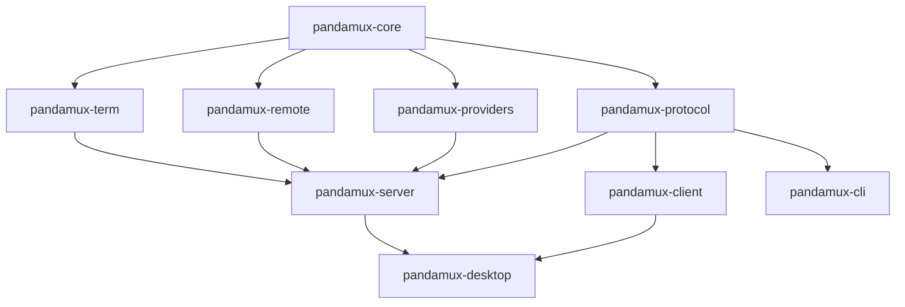
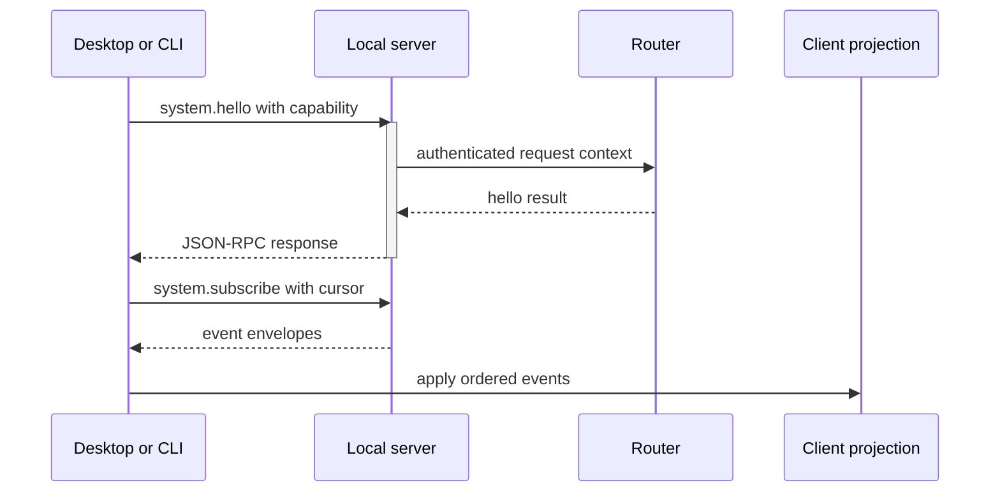
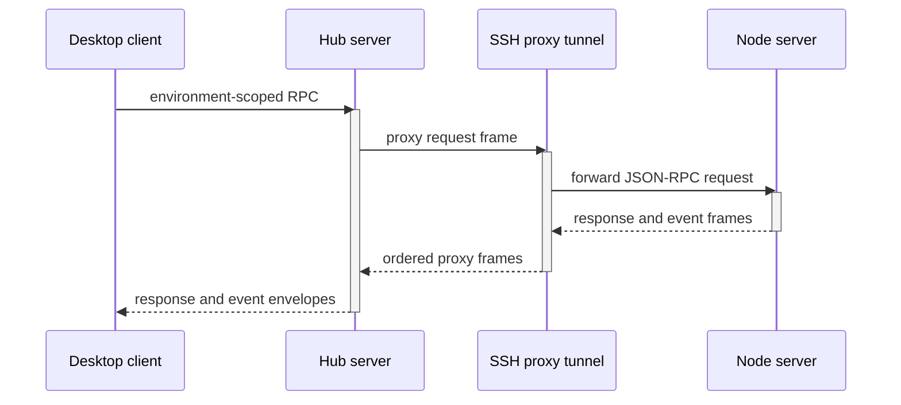

<!-- PAGE_ID: pandamux_03_architecture -->
<details>
<summary>Relevant source files</summary>

The following files were used as evidence for this page:

- [Cargo.toml:1-40](../../Cargo.toml#L1-L40)
- [CLAUDE.md:172-215](../../CLAUDE.md#L172-L215)
- [crates/pandamux-client/src/lib.rs:1-702](../../crates/pandamux-client/src/lib.rs#L1-L702)
- [crates/pandamux-desktop/src/lib.rs:1-558](../../crates/pandamux-desktop/src/lib.rs#L1-L558)
- [crates/pandamux-protocol/src/lib.rs:1-245](../../crates/pandamux-protocol/src/lib.rs#L1-L245)
- [crates/pandamux-server/src/lib.rs:1-101](../../crates/pandamux-server/src/lib.rs#L1-L101)
- [scripts/check-rust-boundaries.ps1:1-60](../../scripts/check-rust-boundaries.ps1#L1-L60)

</details>

# Architecture

> **Related Pages**: [Core Domain](CORE_DOMAIN.md), [Application Runtime](APP_RUNTIME.md), [Local IPC and Security](../features/NAMED_PIPE_IPC.md)

---

<!-- BEGIN:AUTOGEN pandamux_03_architecture_crates -->
## Workspace and Crate Boundaries

PandaMUX is a nine-crate Rust workspace. Domain and wire contracts sit below server, client, CLI, and desktop composition; terminal and SSH implementation details remain in dedicated crates rather than leaking into those contracts ([Cargo.toml:1-12](../../Cargo.toml#L1-L12), [check-rust-boundaries.ps1:7-43](../../scripts/check-rust-boundaries.ps1#L7-L43)).

| Crate | Primary responsibility | Boundary evidence |
|---|---|---|
| `pandamux-core` | Framework-free IDs, threads, events, policy, settings, routing, and usage types | Cannot depend on Iced, the terminal grid, or SQLite ([check-rust-boundaries.ps1:8-11](../../scripts/check-rust-boundaries.ps1#L8-L11)) |
| `pandamux-protocol` | Versioned JSON-RPC, subscriptions, terminal, settings, usage, and proxy messages | Cannot depend on implementation crates or SQLite ([check-rust-boundaries.ps1:21-23](../../scripts/check-rust-boundaries.ps1#L21-L23)) |
| `pandamux-providers` | Provider drivers and process supervision | Cannot absorb UI, terminal, SSH, or storage frameworks ([check-rust-boundaries.ps1:33-35](../../scripts/check-rust-boundaries.ps1#L33-L35)) |
| `pandamux-remote` | SSH pool, bootstrap, command execution, SFTP, proxy tunnels, and worktree bundles | Cannot depend on UI, terminal-grid, or SQLite implementations ([check-rust-boundaries.ps1:17-19](../../scripts/check-rust-boundaries.ps1#L17-L19)) |
| `pandamux-term` | Feature-split grid and PTY primitives | Cannot depend on Iced or SQLite ([check-rust-boundaries.ps1:13-15](../../scripts/check-rust-boundaries.ps1#L13-L15)) |
| `pandamux-server` | Store, router, providers, terminals, remote environments, and Hub/node runtime | Exposes the production composition surface ([lib.rs:1-58](../../crates/pandamux-server/src/lib.rs#L1-L58)) |
| `pandamux-client` | Event projections, client state, usage presentation, and transport seam | Exports projections and a mockable transport without UI types ([lib.rs:1-19](../../crates/pandamux-client/src/lib.rs#L1-L19)) |
| `pandamux-desktop` | GPUI shell and the server bridge | Re-exports view state and bridge types from focused modules ([lib.rs:3-60](../../crates/pandamux-desktop/src/lib.rs#L3-L60)) |
| `pandamux-cli` | Authenticated command-line and MCP adapter | Kept free of UI, terminal, SSH, and SQLite implementation dependencies ([check-rust-boundaries.ps1:41-43](../../scripts/check-rust-boundaries.ps1#L41-L43)) |



Sources: [Cargo.toml:1-40](../../Cargo.toml#L1-L40), [lib.rs:1-58](../../crates/pandamux-server/src/lib.rs#L1-L58), [check-rust-boundaries.ps1:7-43](../../scripts/check-rust-boundaries.ps1#L7-L43)
<!-- END:AUTOGEN pandamux_03_architecture_crates -->

---

<!-- BEGIN:AUTOGEN pandamux_03_architecture_ownership -->
## State and Process Ownership

The server owns durable and executable state; clients own projections and presentation state. This prevents the desktop from becoming a second authority for threads, provider processes, terminals, event ordering, or remote routing ([CLAUDE.md:189-199](../../CLAUDE.md#L189-L199)).

| Owner | State or process | Client-facing consequence |
|---|---|---|
| Server | SQLite store, provider drivers, terminal manager, attachments, environment router, usage services | Mutations are submitted as RPC requests; state is not written directly by the desktop ([lib.rs:25-58](../../crates/pandamux-server/src/lib.rs#L25-L58)) |
| Client crate | Thread/run projections, token smoothing, usage view state | Rendering state is derived from server events and can be rebuilt ([lib.rs:7-19](../../crates/pandamux-client/src/lib.rs#L7-L19)) |
| Desktop | GPUI views, composer, picker, terminal view, tray, and bridge handle | UI modules consume projections and send commands through the bridge ([lib.rs:21-60](../../crates/pandamux-desktop/src/lib.rs#L21-L60)) |
| Protocol | Serializable request, response, event, and proxy contracts | Both sides share data types without importing the other's implementation ([lib.rs:1-22](../../crates/pandamux-protocol/src/lib.rs#L1-L22)) |

The server's public composition surface makes these responsibilities explicit: `Store`, `Router`, `ThreadManager`, `TerminalServerManager`, `EnvironmentRouter`, and `ProxyEnvironmentTransport` are server exports, while the client exports projection and formatting types ([lib.rs:31-58](../../crates/pandamux-server/src/lib.rs#L31-L58), [lib.rs:7-19](../../crates/pandamux-client/src/lib.rs#L7-L19)).

Sources: [CLAUDE.md:187-199](../../CLAUDE.md#L187-L199), [lib.rs:25-58](../../crates/pandamux-server/src/lib.rs#L25-L58), [lib.rs:7-19](../../crates/pandamux-client/src/lib.rs#L7-L19)
<!-- END:AUTOGEN pandamux_03_architecture_ownership -->

---

<!-- BEGIN:AUTOGEN pandamux_03_architecture_local-flow -->
## Local Request and Event Flow

Local desktop and CLI traffic uses versioned JSON-RPC. The protocol crate exports the request/response types, `system.hello` contracts, subscriptions, and event envelopes; the server authenticates and routes them, and the client reduces returned events into projections ([lib.rs:48-76](../../crates/pandamux-protocol/src/lib.rs#L48-L76), [lib.rs:7-13](../../crates/pandamux-client/src/lib.rs#L7-L13)).



The shared wire surface includes thread, provider, terminal, settings, schedule, attachment, filesystem, Git, usage, and worktree contracts. `EventEnvelope` adds environment identity and sequence information around domain events, allowing projections to remain transport-agnostic ([lib.rs:24-96](../../crates/pandamux-protocol/src/lib.rs#L24-L96)).

Sources: [lib.rs:24-96](../../crates/pandamux-protocol/src/lib.rs#L24-L96), [lib.rs:7-19](../../crates/pandamux-client/src/lib.rs#L7-L19), [lib.rs:36-39](../../crates/pandamux-desktop/src/lib.rs#L36-L39)
<!-- END:AUTOGEN pandamux_03_architecture_local-flow -->

---

<!-- BEGIN:AUTOGEN pandamux_03_architecture_remote-flow -->
## Remote Node Flow

The same server binary composes a desktop-machine Hub and remote Linux nodes. The Hub owns environment routing and connects to a node through the SSH-backed proxy transport; protocol contracts remain identical on either side ([CLAUDE.md:197-203](../../CLAUDE.md#L197-L203), [lib.rs:31-47](../../crates/pandamux-server/src/lib.rs#L31-L47)).



`pandamux-server` exposes both sides of this boundary: `serve_proxy_connection` runs on the node, while `ProxyEnvironmentTransport` and `EnvironmentRouter` run on the Hub ([lib.rs:31-47](../../crates/pandamux-server/src/lib.rs#L31-L47)). The protocol crate carries the proxy envelope and environment-scoped RPC types without importing the SSH implementation ([lib.rs:4-22](../../crates/pandamux-protocol/src/lib.rs#L4-L22)).

Sources: [CLAUDE.md:197-203](../../CLAUDE.md#L197-L203), [lib.rs:31-47](../../crates/pandamux-server/src/lib.rs#L31-L47), [lib.rs:1-22](../../crates/pandamux-protocol/src/lib.rs#L1-L22)
<!-- END:AUTOGEN pandamux_03_architecture_remote-flow -->

---

<!-- BEGIN:AUTOGEN pandamux_03_architecture_persistence -->
## Durability and Replay

Durable state and event ordering belong to the server, while the client projection is deliberately reconstructable. This split lets local reconnects and remote proxy reconnects resume from sequence cursors instead of treating the desktop's in-memory view as canonical ([CLAUDE.md:194-201](../../CLAUDE.md#L194-L201)).

| Durable concern | Authority | Replay consumer |
|---|---|---|
| Threads, turns, events, settings, schedules, usage, and attachments | Server `Store` ([lib.rs:47-58](../../crates/pandamux-server/src/lib.rs#L47-L58)) | Desktop/client projections |
| Thread and run timeline state | Ordered protocol event envelopes ([lib.rs:67-95](../../crates/pandamux-protocol/src/lib.rs#L67-L95)) | `ThreadProjection` and `RunProjection` |
| Remote event cursor | Hub-side environment transport ([lib.rs:31-47](../../crates/pandamux-server/src/lib.rs#L31-L47)) | Reconnected node proxy |
| Terminal attachment state | Server terminal manager and terminal RPC offsets ([lib.rs:73-77](../../crates/pandamux-protocol/src/lib.rs#L73-L77)) | Reattached desktop terminal grid |

The protocol test surface verifies that event envelopes retain their subscription id and sequence across serialization, and that terminal attach responses preserve replay offset and truncation state ([lib.rs:129-155](../../crates/pandamux-protocol/src/lib.rs#L129-L155), [lib.rs:213-243](../../crates/pandamux-protocol/src/lib.rs#L213-L243)).

Sources: [CLAUDE.md:194-201](../../CLAUDE.md#L194-L201), [lib.rs:67-95](../../crates/pandamux-protocol/src/lib.rs#L67-L95), [lib.rs:129-155](../../crates/pandamux-protocol/src/lib.rs#L129-L155), [lib.rs:213-243](../../crates/pandamux-protocol/src/lib.rs#L213-L243)
<!-- END:AUTOGEN pandamux_03_architecture_persistence -->

---

<!-- BEGIN:AUTOGEN pandamux_03_architecture_invariants -->
## Architectural Invariants

The repository encodes its most important boundaries as build-time checks and narrow public APIs rather than relying only on convention.

- `pandamux-core` stays independent of UI, terminal-grid, and database implementations ([check-rust-boundaries.ps1:8-11](../../scripts/check-rust-boundaries.ps1#L8-L11)).
- `pandamux-protocol` contains wire contracts and cannot import server, terminal, remote, UI, or SQLite implementations ([check-rust-boundaries.ps1:21-23](../../scripts/check-rust-boundaries.ps1#L21-L23)).
- `pandamux-server` is the production composition owner for SSH remoting, PTYs, provider execution, persistence, and routing ([CLAUDE.md:189-199](../../CLAUDE.md#L189-L199)).
- Desktop code holds rendering-oriented state and sends intents; it is not a durable-state writer ([CLAUDE.md:192-195](../../CLAUDE.md#L192-L195)).
- Request identity and capability scope are assigned by the accepting server transport, not accepted from request JSON ([CLAUDE.md:201-209](../../CLAUDE.md#L201-L209)).
- Full-access providers have host-user authority; the local boundary is per OS user and is not hostile same-user process isolation ([CLAUDE.md:211-215](../../CLAUDE.md#L211-L215)).
- The boundary check examines each crate manifest and fails on a forbidden direct dependency ([check-rust-boundaries.ps1:46-60](../../scripts/check-rust-boundaries.ps1#L46-L60)).

```powershell
pwsh -File scripts/check-rust-boundaries.ps1
```

The command above is the repository's explicit architecture guard and is part of the documented validation set ([CLAUDE.md:142-152](../../CLAUDE.md#L142-L152)).

Sources: [CLAUDE.md:142-215](../../CLAUDE.md#L142-L215), [check-rust-boundaries.ps1:46-60](../../scripts/check-rust-boundaries.ps1#L46-L60)
<!-- END:AUTOGEN pandamux_03_architecture_invariants -->

---
