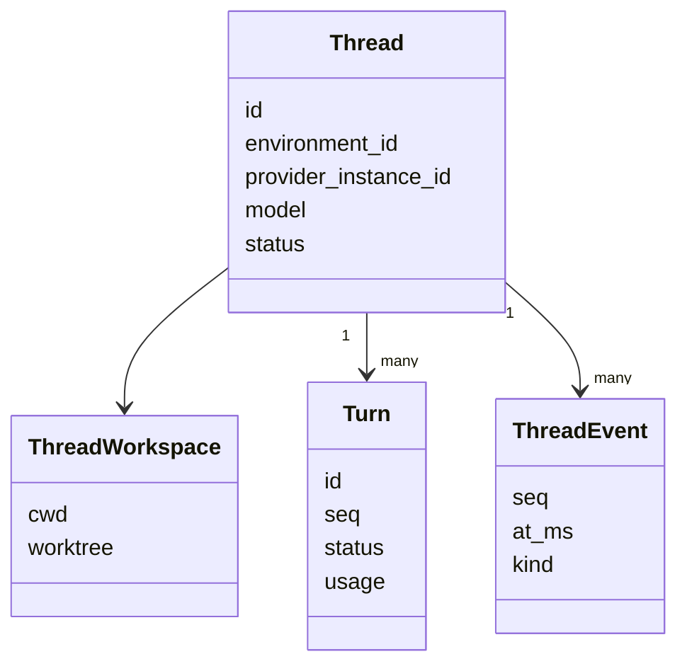

<!-- PAGE_ID: pandamux_04_core-domain -->
<details>
<summary>Relevant source files</summary>

The following files were used as evidence for this page:

- [crates/pandamux-core/src/lib.rs:1-114](../../crates/pandamux-core/src/lib.rs#L1-L114)
- [crates/pandamux-core/src/thread.rs:1-235](../../crates/pandamux-core/src/thread.rs#L1-L235)
- [crates/pandamux-core/src/event.rs:1-196](../../crates/pandamux-core/src/event.rs#L1-L196)
- [crates/pandamux-core/src/agent_def.rs:1-86](../../crates/pandamux-core/src/agent_def.rs#L1-L86)
- [crates/pandamux-orchestrator/src/lib.rs:1-13](../../crates/pandamux-orchestrator/src/lib.rs#L1-L13)
- [crates/pandamux-orchestrator/src/compatibility.rs:1-115](../../crates/pandamux-orchestrator/src/compatibility.rs#L1-L115)
- [crates/pandamux-orchestrator/tests/compatibility_fixtures.rs:1-50](../../crates/pandamux-orchestrator/tests/compatibility_fixtures.rs#L1-L50)
- [crates/pandamux-core/src/ast_diff.rs:1-533](../../crates/pandamux-core/src/ast_diff.rs#L1-L533)
- [crates/pandamux-core/src/attachment.rs:1-240](../../crates/pandamux-core/src/attachment.rs#L1-L240)
- [crates/pandamux-core/src/home.rs:1-188](../../crates/pandamux-core/src/home.rs#L1-L188)
- [crates/pandamux-core/src/i18n.rs:1-135](../../crates/pandamux-core/src/i18n.rs#L1-L135)
- [crates/pandamux-core/src/ids.rs:1-63](../../crates/pandamux-core/src/ids.rs#L1-L63)
- [crates/pandamux-core/src/notification.rs:1-238](../../crates/pandamux-core/src/notification.rs#L1-L238)
- [crates/pandamux-core/src/organization.rs:1-755](../../crates/pandamux-core/src/organization.rs#L1-L755)
- [crates/pandamux-core/src/provider_config.rs:1-149](../../crates/pandamux-core/src/provider_config.rs#L1-L149)
- [crates/pandamux-core/src/project_registry.rs:1-416](../../crates/pandamux-core/src/project_registry.rs#L1-L416)
- [crates/pandamux-core/src/routing.rs:1-585](../../crates/pandamux-core/src/routing.rs#L1-L585)
- [crates/pandamux-core/src/run.rs:1-121](../../crates/pandamux-core/src/run.rs#L1-L121)
- [crates/pandamux-core/src/schedule.rs:1-230](../../crates/pandamux-core/src/schedule.rs#L1-L230)
- [crates/pandamux-core/src/secrets.rs:1-267](../../crates/pandamux-core/src/secrets.rs#L1-L267)
- [crates/pandamux-core/src/terminal.rs:1-45](../../crates/pandamux-core/src/terminal.rs#L1-L45)
- [crates/pandamux-core/src/usage.rs:1-1355](../../crates/pandamux-core/src/usage.rs#L1-L1355)
- [crates/pandamux-core/src/project.rs:1-441](../../crates/pandamux-core/src/project.rs#L1-L441)

</details>

# Core Domain

> **Related Pages**: [Architecture](ARCHITECTURE.md), [Agent Orchestration](../features/AGENT_ORCHESTRATION.md), [Provider Routing](../features/PROVIDER_ROUTING.md)

---

<!-- BEGIN:AUTOGEN pandamux_04_core-domain_modules -->
## Module Map

`pandamux-core` defines serializable, framework-free domain data and pure policy helpers. The crate root is the canonical inventory of public modules and re-exports ([lib.rs:1-24](../../crates/pandamux-core/src/lib.rs#L1-L24), [lib.rs:25-114](../../crates/pandamux-core/src/lib.rs#L25-L114)).

| Area | Modules | Representative public types |
|---|---|---|
| Conversation | `thread`, `event`, `attachment` | `Thread`, `Turn`, `ThreadEvent`, `AttachmentRecord` ([lib.rs:33-43](../../crates/pandamux-core/src/lib.rs#L33-L43), [lib.rs:103-106](../../crates/pandamux-core/src/lib.rs#L103-L106)) |
| Identity and policy | `ids`, `organization`, `provider_config`, `routing` | Typed IDs, `OrganizationPolicy`, `ProviderInstanceConfig`, `RoutingDecision` ([lib.rs:46-57](../../crates/pandamux-core/src/lib.rs#L46-L57), [lib.rs:69-83](../../crates/pandamux-core/src/lib.rs#L69-L83)) |
| Projects and automation | `project`, `project_registry`, `run`, `schedule` | `ProjectSpec`, `ProjectRecord`, `Run`, `ScheduleRecord` ([lib.rs:58-68](../../crates/pandamux-core/src/lib.rs#L58-L68), [lib.rs:84-89](../../crates/pandamux-core/src/lib.rs#L84-L89)) |
| Agent presentation | `agent_def`, `ast_diff`, `home`, `i18n`, `notification` | Agent definitions, structured diffs, home layout, localization, notices ([lib.rs:25-32](../../crates/pandamux-core/src/lib.rs#L25-L32), [lib.rs:44-52](../../crates/pandamux-core/src/lib.rs#L44-L52)) |
| Local safety | `secrets`, `terminal` | `SecretStore`, redaction helpers, ring-buffer configuration ([lib.rs:90-102](../../crates/pandamux-core/src/lib.rs#L90-L102)) |
| Cost and quota | `usage` | Usage observations, integer pricing, capacity snapshots and projections ([lib.rs:107-114](../../crates/pandamux-core/src/lib.rs#L107-L114)) |

The core crate does not own persistence, process launch, network transport, or rendering. The new pure orchestrator consumes retained core shapes through an explicit compatibility boundary: recognized unversioned run, agent-definition, memory, and schedule records are classified as migration input and rejected with stable next actions until their versioned adapters exist ([compatibility.rs:5-43](../../crates/pandamux-orchestrator/src/compatibility.rs#L5-L43), [compatibility.rs:69-115](../../crates/pandamux-orchestrator/src/compatibility.rs#L69-L115)). Fixture tests prove those historical shapes cannot silently become canonical Phase 5 state and malformed input is not echoed into diagnostics ([compatibility_fixtures.rs:3-50](../../crates/pandamux-orchestrator/tests/compatibility_fixtures.rs#L3-L50)).

Sources: [lib.rs:1-114](../../crates/pandamux-core/src/lib.rs#L1-L114), [compatibility.rs:5-115](../../crates/pandamux-orchestrator/src/compatibility.rs#L5-L115), [compatibility_fixtures.rs:3-50](../../crates/pandamux-orchestrator/tests/compatibility_fixtures.rs#L3-L50)
<!-- END:AUTOGEN pandamux_04_core-domain_modules -->

---

<!-- BEGIN:AUTOGEN pandamux_04_core-domain_threads -->
## Threads, Turns, and Events

A `Thread` pins project/environment identity, an exact provider instance and model, access ceiling, workspace, status, origin, and timestamps. Each `Turn` belongs to one thread and records its own sequence, input, lifecycle, optional usage, and checkpoint references ([thread.rs:6-35](../../crates/pandamux-core/src/thread.rs#L6-L35), [thread.rs:128-150](../../crates/pandamux-core/src/thread.rs#L128-L150)).



The workspace chooses an isolated worktree path when present and otherwise uses the ordinary `cwd` ([thread.rs:49-67](../../crates/pandamux-core/src/thread.rs#L49-L67)). Access modes have a stable security ordering from read-only through full access, allowing provider capability checks to compare permission ceilings ([thread.rs:37-47](../../crates/pandamux-core/src/thread.rs#L37-L47), [thread.rs:69-80](../../crates/pandamux-core/src/thread.rs#L69-L80)).

```rust
pub enum TurnStatus {
    Requested,
    Running,
    AwaitingApproval,
    Completed,
    Failed,
    Interrupted,
    InterruptedForCapacity,
}
```

Turn status values are defined at [thread.rs:167-179](../../crates/pandamux-core/src/thread.rs#L167-L179). The append-only `ThreadEventKind` covers provider text and reasoning, tools and commands, file changes, approvals, plans, usage, capacity interruption, errors, settlement, and sub-agent activity ([event.rs:5-18](../../crates/pandamux-core/src/event.rs#L5-L18), [event.rs:19-130](../../crates/pandamux-core/src/event.rs#L19-L130)).

Sources: [thread.rs:6-235](../../crates/pandamux-core/src/thread.rs#L6-L235), [event.rs:5-196](../../crates/pandamux-core/src/event.rs#L5-L196)
<!-- END:AUTOGEN pandamux_04_core-domain_threads -->

---

<!-- BEGIN:AUTOGEN pandamux_04_core-domain_orgs -->
## Organizations and Environments

Organization policy is the durable authorization and budget boundary. It names allowed projects, provider instances, subscription keys, failover pools, default tier mappings, concurrency, daily spend, and optional Broadside sharing policy ([organization.rs:168-195](../../crates/pandamux-core/src/organization.rs#L168-L195)).

| Policy type | Purpose | Important validation |
|---|---|---|
| `TierMapping` / `ModelTarget` | Maps an abstract tier to an exact provider instance, model, and optional effort | Target identity is explicit ([organization.rs:8-24](../../crates/pandamux-core/src/organization.rs#L8-L24)) |
| `FailoverPool` | Names eligible provider/subscription/model members and shared capability requirements | Rejects empty pools, duplicates, zero revisions, invalid preference, and capability mismatch ([organization.rs:36-77](../../crates/pandamux-core/src/organization.rs#L36-L77), [organization.rs:112-165](../../crates/pandamux-core/src/organization.rs#L112-L165)) |
| `OrganizationPolicy` | Binds projects to providers, subscriptions, budgets, and failover pools | Provider runtime identity and quota identity remain separate ([organization.rs:168-195](../../crates/pandamux-core/src/organization.rs#L168-L195)) |
| `BroadsidePolicy` | Opt-in artifact and transcript sharing | Both flags default off ([organization.rs:26-34](../../crates/pandamux-core/src/organization.rs#L26-L34)) |

Typed IDs prevent accidental interchange between organization, project, environment, provider, subscription, thread, turn, run, schedule, and capacity identities ([lib.rs:46-51](../../crates/pandamux-core/src/lib.rs#L46-L51)). Organization selection is therefore a policy lookup keyed by explicit identities rather than display names.

Sources: [organization.rs:8-195](../../crates/pandamux-core/src/organization.rs#L8-L195), [ids.rs:1-63](../../crates/pandamux-core/src/ids.rs#L1-L63)
<!-- END:AUTOGEN pandamux_04_core-domain_orgs -->

---

<!-- BEGIN:AUTOGEN pandamux_04_core-domain_providers -->
## Provider Instances and Routing

Provider configuration separates provider kind from provider instance identity. An instance stores its profile directory, optional environment binding and binary override, concurrency limit, environment overrides, arbitrary driver settings, enabled state, and a structured disabled reason ([provider_config.rs:6-27](../../crates/pandamux-core/src/provider_config.rs#L6-L27), [provider_config.rs:59-81](../../crates/pandamux-core/src/provider_config.rs#L59-L81)).

```rust
pub struct ProviderEnvironmentOverride {
    pub enabled: Option<bool>,
    pub binary_path: Option<String>,
    pub concurrency_limit: Option<u32>,
    pub env_overrides: BTreeMap<String, String>,
    pub settings: Option<serde_json::Value>,
}
```

The override contract is defined at [provider_config.rs:43-57](../../crates/pandamux-core/src/provider_config.rs#L43-L57). Resolution clones the stored instance, applies only supplied overrides, and pins the target environment onto the result ([provider_config.rs:83-113](../../crates/pandamux-core/src/provider_config.rs#L83-L113)).

Routing is a pure evaluation over already-resolved candidates. Eligibility includes policy, subscription, model, installation, authentication, health, capacity, concurrency, locality, user preference, and local hard blocks ([routing.rs:78-107](../../crates/pandamux-core/src/routing.rs#L78-L107)). Capability requirements reject candidates missing instruction delivery, tools, approvals, reasoning, or the requested access ceiling before scoring ([routing.rs:8-45](../../crates/pandamux-core/src/routing.rs#L8-L45)).

| Routing output | Meaning |
|---|---|
| `RoutingEvaluation` | Per-candidate eligibility, rejection codes, optional score, and explanation ([routing.rs:120-132](../../crates/pandamux-core/src/routing.rs#L120-L132)) |
| `RoutingDecision` | Selected target plus all candidate evaluations ([routing.rs:134-143](../../crates/pandamux-core/src/routing.rs#L134-L143)) |
| `RoutingScore` | Capacity, health, concurrency, locality, preference, and total components ([routing.rs:109-118](../../crates/pandamux-core/src/routing.rs#L109-L118)) |

Sources: [provider_config.rs:6-149](../../crates/pandamux-core/src/provider_config.rs#L6-L149), [routing.rs:8-180](../../crates/pandamux-core/src/routing.rs#L8-L180)
<!-- END:AUTOGEN pandamux_04_core-domain_providers -->

---

<!-- BEGIN:AUTOGEN pandamux_04_core-domain_projects -->
## Projects and Workspaces

Projects are identified independently from where they run. `ProjectLocation` distinguishes local and remote paths, and `ProjectSpec` couples a display name to that location ([project.rs:12-33](../../crates/pandamux-core/src/project.rs#L12-L33)).

| Type | Role | Key behavior |
|---|---|---|
| `ProjectKey` | Normalized identity derived from a project location | Provides a stable string key ([project.rs:35-61](../../crates/pandamux-core/src/project.rs#L35-L61)) |
| `FolderListing` | Cross-platform directory browser result | Carries canonical path, parent, breadcrumbs, and directory entries ([project.rs:63-86](../../crates/pandamux-core/src/project.rs#L63-L86)) |
| `ProjectRecord` | Saved registry entry | Stores matchers and launch configuration ([project_registry.rs:54-99](../../crates/pandamux-core/src/project_registry.rs#L54-L99)) |
| `SessionType` | Launch behavior | Separates ordinary sessions from orchestrator-style work ([project_registry.rs:23-52](../../crates/pandamux-core/src/project_registry.rs#L23-L52)) |
| `WorktreeRef` | Thread-specific Git isolation | Records path, branch, and base ref ([thread.rs:82-89](../../crates/pandamux-core/src/thread.rs#L82-L89)) |

Project helpers normalize Windows and POSIX paths, build breadcrumbs, calculate parents, sort directory results, and classify user-facing errors without importing filesystem or UI frameworks ([lib.rs:58-63](../../crates/pandamux-core/src/lib.rs#L58-L63)). Registry helpers normalize Git remotes and folder names before resolving a saved project id ([lib.rs:64-68](../../crates/pandamux-core/src/lib.rs#L64-L68)).

Sources: [project.rs:12-150](../../crates/pandamux-core/src/project.rs#L12-L150), [project_registry.rs:23-140](../../crates/pandamux-core/src/project_registry.rs#L23-L140), [thread.rs:49-89](../../crates/pandamux-core/src/thread.rs#L49-L89)
<!-- END:AUTOGEN pandamux_04_core-domain_projects -->

---

<!-- BEGIN:AUTOGEN pandamux_04_core-domain_usage -->
## Usage and Capacity Types

Usage is modeled as immutable facts and integer arithmetic. `UsageObservation` records provenance, exact provider instance and subscription identities, optional model and turn linkage, categorized token counts, unknown fields, provider-reported spend, and fact kind; validation rejects empty identities, zero parser/source counts, blank optional model values, overflow, and observations with neither tokens nor spend ([usage.rs:480-516](../../crates/pandamux-core/src/usage.rs#L480-L516), [usage.rs:518-595](../../crates/pandamux-core/src/usage.rs#L518-L595)).

| Type | Units and semantics | Safety property |
|---|---|---|
| `TokenCounts` | Integer counts for input, cached input, cache write, output, reasoning, and provider-specific categories | Addition and totals are checked for overflow ([usage.rs:216-318](../../crates/pandamux-core/src/usage.rs#L216-L318)) |
| `UsagePricingRates` | Integer micro-USD per million tokens; absent means unknown, zero means known-free | Avoids floating-point price ambiguity ([usage.rs:320-346](../../crates/pandamux-core/src/usage.rs#L320-L346)) |
| `UsageSubscription` | User-named quota boundary with optional masked account label | Keeps quota identity distinct from provider runtime identity ([usage.rs:602-611](../../crates/pandamux-core/src/usage.rs#L602-L611)) |
| `CapacitySnapshot` | Versioned quota-window evidence using millionths and explicit freshness inputs | Fractions must be within bounds and hard limits require zero remaining plus a reset ([usage.rs:622-690](../../crates/pandamux-core/src/usage.rs#L622-L690), [usage.rs:692-754](../../crates/pandamux-core/src/usage.rs#L692-L754)) |
| `CapacityProjection` | Conservative effective view across revisions | Carries freshness, conflict state, evidence count, and reasons ([usage.rs:757-779](../../crates/pandamux-core/src/usage.rs#L757-L779)) |

- Evidence scope distinguishes observations produced locally from revisions received from the Hub ([usage.rs:633-642](../../crates/pandamux-core/src/usage.rs#L633-L642)).
- Freshness explicitly represents fresh, aging, stale, reset, clock-skewed, and hard-limited states ([usage.rs:644-654](../../crates/pandamux-core/src/usage.rs#L644-L654)).
- Pricing revisions are source-dated and effective-dated, and validate unique non-empty model identifiers ([usage.rs:338-380](../../crates/pandamux-core/src/usage.rs#L338-L380)).

Sources: [usage.rs:210-380](../../crates/pandamux-core/src/usage.rs#L210-L380), [usage.rs:480-779](../../crates/pandamux-core/src/usage.rs#L480-L779)
<!-- END:AUTOGEN pandamux_04_core-domain_usage -->

---
