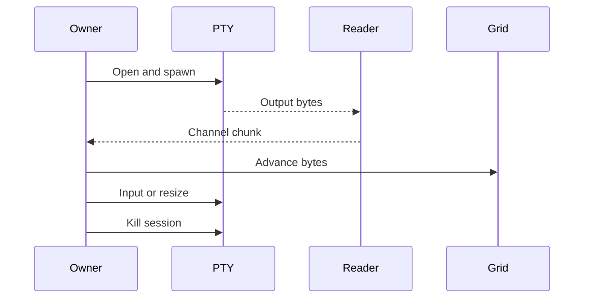

<!-- PAGE_ID: pandamux_05_terminal-engine -->

Relevant source files

The following files were used as evidence for this page:

- [Cargo.toml:1-19](../../crates/pandamux-term/Cargo.toml#L1-L19)
- [lib.rs:1-36](../../crates/pandamux-term/src/lib.rs#L1-L36)
- [byte_session.rs:1-231](../../crates/pandamux-term/src/byte_session.rs#L1-L231)
- [clipboard.rs:1-97](../../crates/pandamux-term/src/clipboard.rs#L1-L97)
- [cwd.rs:1-199](../../crates/pandamux-term/src/cwd.rs#L1-L199)
- [grid.rs:14-561](../../crates/pandamux-term/src/grid.rs#L14-L561)
- [links.rs:1-159](../../crates/pandamux-term/src/links.rs#L1-L159)
- [pty.rs:16-202](../../crates/pandamux-term/src/pty.rs#L16-L202)
- [ring_buffer.rs:1-134](../../crates/pandamux-term/src/ring_buffer.rs#L1-L134)
- [search.rs:1-192](../../crates/pandamux-term/src/search.rs#L1-L192)
- [session.rs:14-485](../../crates/pandamux-term/src/session.rs#L14-L485)
- [shell.rs:1-273](../../crates/pandamux-term/src/shell.rs#L1-L273)
- [size.rs:1-11](../../crates/pandamux-term/src/size.rs#L1-L11)

# Terminal Engine

> **Related Pages**: [GPUI Desktop](UI_SHELL.md), [Application Runtime](APP_RUNTIME.md)

---

<!-- BEGIN:AUTOGEN pandamux_05_terminal-engine_features -->
## Feature Boundary

`pandamux-term` separates terminal parsing from pseudoterminal ownership with two optional Cargo features. The default enables both, while production consumers can select only `grid` or `pty` ([Cargo.toml:9-19](../../crates/pandamux-term/Cargo.toml#L9-L19)).

| Feature | Optional dependency | Exported responsibility |
|---|---|---|
| `grid` | `alacritty_terminal` | ANSI parsing, styled cells, selection, scrollback, search, and link projection ([lib.rs:5-6](../../crates/pandamux-term/src/lib.rs#L5-L6), [lib.rs:21-25](../../crates/pandamux-term/src/lib.rs#L21-L25)) |
| `pty` | `portable-pty` | Byte sessions, shell commands, and server-owned PTY processes ([lib.rs:1-2](../../crates/pandamux-term/src/lib.rs#L1-L2), [lib.rs:8-9](../../crates/pandamux-term/src/lib.rs#L8-L9), [lib.rs:17-18](../../crates/pandamux-term/src/lib.rs#L17-L18)) |
| `grid` + `pty` | both | Combined capture and `PtySessionManager` APIs used when one process owns both the PTY and rendered grid ([lib.rs:12-13](../../crates/pandamux-term/src/lib.rs#L12-L13), [lib.rs:27-34](../../crates/pandamux-term/src/lib.rs#L27-L34)) |
| always available | none | Clipboard policy, cwd scanning, links, ring buffers, search, shell helpers, and `GridSize` ([lib.rs:3-15](../../crates/pandamux-term/src/lib.rs#L3-L15)) |

This split is the ownership boundary used by the wider workspace: the server can own PTYs without linking the renderer, while the desktop can render terminal bytes without spawning processes. Public exports use PandaMUX-owned types such as `GridSize`, `ScreenCells`, and `TerminalRingBuffer` instead of leaking implementation types ([lib.rs:17-36](../../crates/pandamux-term/src/lib.rs#L17-L36)).

Sources: [Cargo.toml:9-19](../../crates/pandamux-term/Cargo.toml#L9-L19), [lib.rs:1-36](../../crates/pandamux-term/src/lib.rs#L1-L36)
<!-- END:AUTOGEN pandamux_05_terminal-engine_features -->

---

<!-- BEGIN:AUTOGEN pandamux_05_terminal-engine_grid -->
## Grid and Rendering Data

`TerminalGrid` owns an Alacritty ANSI processor, terminal state, and a synchronized queue of OSC 52 clipboard-store requests ([grid.rs:169-202](../../crates/pandamux-term/src/grid.rs#L169-L202)). Its default viewport is 120 by 30 cells with 10,000 scrollback lines, and resize delegates to Alacritty reflow so content and history remain intact ([grid.rs:14-20](../../crates/pandamux-term/src/grid.rs#L14-L20), [grid.rs:204-241](../../crates/pandamux-term/src/grid.rs#L204-L241)).

| Projection | Contents | Consumer behavior |
|---|---|---|
| `StyledCell` | Character, symbolic foreground/background color, bold flag | Reverse video is normalized by swapping colors before the UI sees the cell ([grid.rs:38-46](../../crates/pandamux-term/src/grid.rs#L38-L46), [grid.rs:473-484](../../crates/pandamux-term/src/grid.rs#L473-L484)) |
| `ScreenCells` | Visible rows, cursor, cursor visibility, scroll offset, history size, selection spans, terminal modes | Rows retain their width so line-ending backgrounds render correctly ([grid.rs:88-106](../../crates/pandamux-term/src/grid.rs#L88-L106), [grid.rs:434-505](../../crates/pandamux-term/src/grid.rs#L434-L505)) |
| `TermModes` | Alternate screen, mouse reporting, alternate scroll, application cursor, bracketed paste | Lets the UI route input without importing Alacritty mode types ([grid.rs:58-67](../../crates/pandamux-term/src/grid.rs#L58-L67)) |
| Serialized text | Scrollback followed by the visible screen | Supports screen reads and full-buffer search ([grid.rs:520-557](../../crates/pandamux-term/src/grid.rs#L520-L557)) |

Incoming bytes advance the parser; visible text collapses wide-character spacer cells, while `visible_cells` additionally resolves colors, selection spans, cursor state, and terminal modes ([grid.rs:403-431](../../crates/pandamux-term/src/grid.rs#L403-L431), [grid.rs:434-505](../../crates/pandamux-term/src/grid.rs#L434-L505)). Grid configuration permits OSC 52 copy requests but denies clipboard-load queries with `Osc52::OnlyCopy` ([grid.rs:193-202](../../crates/pandamux-term/src/grid.rs#L193-L202)).

Sources: [grid.rs:14-119](../../crates/pandamux-term/src/grid.rs#L14-L119), [grid.rs:169-259](../../crates/pandamux-term/src/grid.rs#L169-L259), [grid.rs:403-561](../../crates/pandamux-term/src/grid.rs#L403-L561)
<!-- END:AUTOGEN pandamux_05_terminal-engine_grid -->

---

<!-- BEGIN:AUTOGEN pandamux_05_terminal-engine_pty -->
## Local PTY Lifecycle

The crate provides three PTY shapes: one-shot marker capture, a byte-only session manager, and a combined PTY-plus-grid session manager. All open a `portable-pty` pair, move blocking reads to a dedicated thread, and pass chunks back through an `mpsc` channel ([pty.rs:91-146](../../crates/pandamux-term/src/pty.rs#L91-L146), [byte_session.rs:34-90](../../crates/pandamux-term/src/byte_session.rs#L34-L90), [session.rs:48-105](../../crates/pandamux-term/src/session.rs#L48-L105)).

| API | Intended use | Important behavior |
|---|---|---|
| `capture_pty_command` | Bounded shell probing | Waits for an exact marker, answers the first CPR query, kills on timeout, and rejects unsuccessful exit status ([pty.rs:91-202](../../crates/pandamux-term/src/pty.rs#L91-L202)) |
| `PtyByteSessionManager` | Server-side terminal byte ownership | Drains only bytes not previously returned and omits a rendering grid ([byte_session.rs:11-25](../../crates/pandamux-term/src/byte_session.rs#L11-L25), [byte_session.rs:131-144](../../crates/pandamux-term/src/byte_session.rs#L131-L144)) |
| `PtySessionManager` | Combined PTY and local grid | Polls before text/cell projections and performs content-preserving grid resize with the PTY ([session.rs:14-30](../../crates/pandamux-term/src/session.rs#L14-L30), [session.rs:134-182](../../crates/pandamux-term/src/session.rs#L134-L182)) |

Large writes are split and flushed in bounded chunks; same-size resize requests are ignored to avoid unnecessary prompt redraws ([byte_session.rs:93-129](../../crates/pandamux-term/src/byte_session.rs#L93-L129), [session.rs:114-154](../../crates/pandamux-term/src/session.rs#L114-L154)). Both long-lived managers tree-kill child processes on Windows before killing the PTY child, and their `Drop` implementations clean up remaining sessions ([byte_session.rs:146-181](../../crates/pandamux-term/src/byte_session.rs#L146-L181), [byte_session.rs:208-231](../../crates/pandamux-term/src/byte_session.rs#L208-L231), [session.rs:374-385](../../crates/pandamux-term/src/session.rs#L374-L385), [session.rs:466-485](../../crates/pandamux-term/src/session.rs#L466-L485)).

Sources: [pty.rs:91-202](../../crates/pandamux-term/src/pty.rs#L91-L202), [byte_session.rs:11-231](../../crates/pandamux-term/src/byte_session.rs#L11-L231), [session.rs:14-182](../../crates/pandamux-term/src/session.rs#L14-L182)
<!-- END:AUTOGEN pandamux_05_terminal-engine_pty -->

---

<!-- BEGIN:AUTOGEN pandamux_05_terminal-engine_replay -->
## Byte Replay and Ring Buffers

`TerminalRingBuffer` is a bounded circular byte buffer addressed by monotonically increasing offsets. Its default capacity is 4 MiB; writes evict the oldest bytes while preserving `head_offset` as the next global byte position and advancing `tail_offset` to the oldest retained byte ([ring_buffer.rs:3-19](../../crates/pandamux-term/src/ring_buffer.rs#L3-L19), [ring_buffer.rs:64-88](../../crates/pandamux-term/src/ring_buffer.rs#L64-L88)).

| Client cursor | Result from `read_since` | Meaning |
|---|---|---|
| Below `tail_offset` | All retained bytes, `truncated = true` | The client must reset its grid because requested history was evicted ([ring_buffer.rs:90-106](../../crates/pandamux-term/src/ring_buffer.rs#L90-L106)) |
| Between tail and head | Only bytes after the cursor, `truncated = false` | Normal incremental replay ([ring_buffer.rs:107-122](../../crates/pandamux-term/src/ring_buffer.rs#L107-L122)) |
| Above `head_offset` | Empty bytes, `truncated = false` | The supplied client cursor is ahead of available output ([ring_buffer.rs:123-125](../../crates/pandamux-term/src/ring_buffer.rs#L123-L125)) |

Writes larger than the capacity retain only their trailing slice but advance the head by the complete input length, so offsets continue to describe the original byte stream rather than the retained window ([ring_buffer.rs:64-77](../../crates/pandamux-term/src/ring_buffer.rs#L64-L77)). `clear` resets both storage and offsets to zero; callers must therefore treat it as a new replay epoch ([ring_buffer.rs:128-133](../../crates/pandamux-term/src/ring_buffer.rs#L128-L133)).

Sources: [ring_buffer.rs:1-134](../../crates/pandamux-term/src/ring_buffer.rs#L1-L134)
<!-- END:AUTOGEN pandamux_05_terminal-engine_replay -->

---

<!-- BEGIN:AUTOGEN pandamux_05_terminal-engine_interaction -->
## Input, Search, Links, and Clipboard

The grid exposes the interaction state required by a terminal surface without owning desktop events. Selection maps simple, word, and line gestures into Alacritty selection types, supports drag updates and whole-buffer selection, and returns selected text through a PandaMUX API ([grid.rs:276-329](../../crates/pandamux-term/src/grid.rs#L276-L329)).

| Interaction | Terminal API | Scope |
|---|---|---|
| Scroll | `scroll_display` | Lines, pages, top, or bottom within retained history ([grid.rs:245-259](../../crates/pandamux-term/src/grid.rs#L245-L259)) |
| Search | `search` | Full serialized scrollback plus visible screen ([grid.rs:520-553](../../crates/pandamux-term/src/grid.rs#L520-L553)) |
| Link detection | `links` | Current visible rows ([grid.rs:555-557](../../crates/pandamux-term/src/grid.rs#L555-L557)) |
| Clipboard store | `take_clipboard_stores` | Drains captured OSC 52 writes for the caller to apply under policy ([grid.rs:351-359](../../crates/pandamux-term/src/grid.rs#L351-L359)) |
| Paste mode | `bracketed_paste_active` | Reports DECSET 2004 for caller-side paste wrapping ([grid.rs:361-365](../../crates/pandamux-term/src/grid.rs#L361-L365)) |

`PtySessionManager` polls before searching or extracting selection text, making those results reflect all channel data already available at the time of the call ([session.rs:232-253](../../crates/pandamux-term/src/session.rs#L232-L253), [session.rs:343-356](../../crates/pandamux-term/src/session.rs#L343-L356)). The manager also exposes modes, clipboard-store events, cursor, viewport scrolling, clear-buffer behavior, and cwd updates without exposing its internal session objects ([session.rs:256-286](../../crates/pandamux-term/src/session.rs#L256-L286), [session.rs:359-407](../../crates/pandamux-term/src/session.rs#L359-L407)).

Sources: [grid.rs:245-371](../../crates/pandamux-term/src/grid.rs#L245-L371), [grid.rs:520-557](../../crates/pandamux-term/src/grid.rs#L520-L557), [session.rs:232-407](../../crates/pandamux-term/src/session.rs#L232-L407)
<!-- END:AUTOGEN pandamux_05_terminal-engine_interaction -->

---

<!-- BEGIN:AUTOGEN pandamux_05_terminal-engine_boundaries -->
## Ownership and Safety Boundaries

Terminal parsing, process ownership, replay, and OS integration remain deliberately separate. The crate captures OSC 52 store requests but the app layer decides whether to write them to the OS clipboard; the grid rejects clipboard reads at the parser configuration boundary ([grid.rs:193-202](../../crates/pandamux-term/src/grid.rs#L193-L202), [grid.rs:351-359](../../crates/pandamux-term/src/grid.rs#L351-L359)).

- PTY reader threads only send owned byte chunks or error strings; state mutation stays with the manager on its owning thread ([byte_session.rs:57-74](../../crates/pandamux-term/src/byte_session.rs#L57-L74), [session.rs:71-88](../../crates/pandamux-term/src/session.rs#L71-L88)).
- DA1 and the first CPR probe are answered in-process during polling so startup tooling does not stall or paint protocol replies into the visible terminal ([byte_session.rs:184-205](../../crates/pandamux-term/src/byte_session.rs#L184-L205), [session.rs:437-463](../../crates/pandamux-term/src/session.rs#L437-L463)).
- Unknown byte-session ids produce errors, while dying-grid interaction methods such as scrolling are intentionally safe no-ops ([byte_session.rs:93-97](../../crates/pandamux-term/src/byte_session.rs#L93-L97), [session.rs:284-286](../../crates/pandamux-term/src/session.rs#L284-L286)).
- Per-session PTY dimensions and grid dimensions change together only in the combined manager; the byte-only manager leaves rendering to its consumer ([byte_session.rs:113-129](../../crates/pandamux-term/src/byte_session.rs#L113-L129), [session.rs:134-154](../../crates/pandamux-term/src/session.rs#L134-L154)).
- Offset truncation is explicit rather than silent, so a remote renderer can discard invalid incremental state before replaying retained bytes ([ring_buffer.rs:90-106](../../crates/pandamux-term/src/ring_buffer.rs#L90-L106)).

Sources: [byte_session.rs:57-231](../../crates/pandamux-term/src/byte_session.rs#L57-L231), [grid.rs:193-202](../../crates/pandamux-term/src/grid.rs#L193-L202), [ring_buffer.rs:90-106](../../crates/pandamux-term/src/ring_buffer.rs#L90-L106), [session.rs:134-154](../../crates/pandamux-term/src/session.rs#L134-L154), [session.rs:437-485](../../crates/pandamux-term/src/session.rs#L437-L485)
<!-- END:AUTOGEN pandamux_05_terminal-engine_boundaries -->

---
