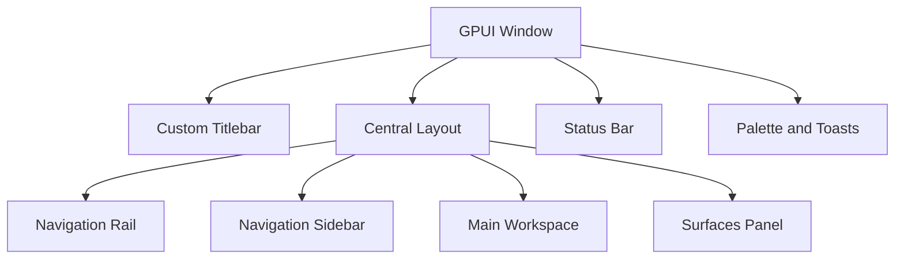

<!-- PAGE_ID: pandamux_06_ui-shell -->

Relevant source files

The following files were used as evidence for this page:

- [lib.rs:1-60](../../crates/pandamux-desktop/src/lib.rs#L1-L60)
- [app_view.rs:89-2670](../../crates/pandamux-desktop/src/app_view.rs#L89-L2670)
- [command_palette.rs:1-605](../../crates/pandamux-desktop/src/command_palette.rs#L1-L605)
- [composer.rs:12-279](../../crates/pandamux-desktop/src/composer.rs#L12-L279)
- [diff_view.rs:1-1712](../../crates/pandamux-desktop/src/diff_view.rs#L1-L1712)
- [notification.rs:1-210](../../crates/pandamux-desktop/src/notification.rs#L1-L210)
- [picker.rs:1-267](../../crates/pandamux-desktop/src/picker.rs#L1-L267)
- [scratchpad.rs:1-332](../../crates/pandamux-desktop/src/scratchpad.rs#L1-L332)
- [sidebar.rs:1-1324](../../crates/pandamux-desktop/src/sidebar.rs#L1-L1324)
- [timeline.rs:22-2175](../../crates/pandamux-desktop/src/timeline.rs#L22-L2175)
- [surfaces_panel.rs:18-1568](../../crates/pandamux-desktop/src/surfaces_panel.rs#L18-L1568)
- [terminal_view.rs:22-650](../../crates/pandamux-desktop/src/terminal_view.rs#L22-L650)
- [settings_view.rs:19-815](../../crates/pandamux-desktop/src/settings_view.rs#L19-L815)
- [theme.rs:1-237](../../crates/pandamux-desktop/src/theme.rs#L1-L237)
- [titlebar.rs:1-207](../../crates/pandamux-desktop/src/titlebar.rs#L1-L207)
- [tray.rs:1-126](../../crates/pandamux-desktop/src/tray.rs#L1-L126)
- [usage_view.rs:23-260](../../crates/pandamux-desktop/src/usage_view.rs#L23-L260)

# GPUI Desktop

> **Related Pages**: [Terminal Engine](TERMINAL_ENGINE.md), [Application Runtime](APP_RUNTIME.md), [Provider Routing and Capacity](../features/PROVIDER_ROUTING.md)

---

<!-- BEGIN:AUTOGEN pandamux_06_ui-shell_composition -->
## Window Composition

The desktop crate is the GPUI presentation client. It exports the application view plus focused modules for the composer, timeline, settings, usage, terminal, sidebars, notifications, command palette, and other presentation surfaces ([lib.rs:3-60](../../crates/pandamux-desktop/src/lib.rs#L3-L60)).

`AppView` owns client projections and view-local state: active thread and rail selection, composer and picker state, settings, usage, surfaces, timeline virtualization, notifications, terminal focus, and the server bridge ([app_view.rs:89-125](../../crates/pandamux-desktop/src/app_view.rs#L89-L125)). Its renderer composes a custom titlebar over the rail/sidebar/workspace/surfaces layout and defers terminal focus until the terminal panel is actually rendered ([app_view.rs:2188-2275](../../crates/pandamux-desktop/src/app_view.rs#L2188-L2275)). The titlebar receives the current panel state, marks the control selected while open, and changes its label and accessible action between opening and closing Surfaces ([titlebar.rs:12-18](../../crates/pandamux-desktop/src/titlebar.rs#L12-L18), [titlebar.rs:175-184](../../crates/pandamux-desktop/src/titlebar.rs#L175-L184)).

| Region | Primary responsibility |
|---|---|
| Titlebar | Server status, active title, command palette, theme, settings, and state-aware surface-panel controls ([app_view.rs:2235-2256](../../crates/pandamux-desktop/src/app_view.rs#L2235-L2256)) |
| Rail and sidebar | Switch top-level destinations and select threads, agents, or settings categories ([app_view.rs:2257-2302](../../crates/pandamux-desktop/src/app_view.rs#L2257-L2302)) |
| Main workspace | Thread metadata, virtualized timeline, composer, attachments, and git actions ([app_view.rs:2411-2578](../../crates/pandamux-desktop/src/app_view.rs#L2411-L2578)) |
| Status bar | Connected server version/PID/path or reconnect/error state ([app_view.rs:2614-2628](../../crates/pandamux-desktop/src/app_view.rs#L2614-L2628)) |

Sources: [lib.rs:3-60](../../crates/pandamux-desktop/src/lib.rs#L3-L60), [app_view.rs:89-125](../../crates/pandamux-desktop/src/app_view.rs#L89-L125), [app_view.rs:2188-2302](../../crates/pandamux-desktop/src/app_view.rs#L2188-L2302), [app_view.rs:2411-2628](../../crates/pandamux-desktop/src/app_view.rs#L2411-L2628), [titlebar.rs:12-184](../../crates/pandamux-desktop/src/titlebar.rs#L12-L184)
<!-- END:AUTOGEN pandamux_06_ui-shell_composition -->

---

<!-- BEGIN:AUTOGEN pandamux_06_ui-shell_threads -->
## Threads, Composer, and Timeline

The desktop creates threads from the exact selected provider instance, discovered model, and optional effort. When that tuple is incomplete it opens Provider Settings with an actionable error instead of fabricating a route ([app_view.rs:459-526](../../crates/pandamux-desktop/src/app_view.rs#L459-L526)).

`ComposerState` stores text and de-duplicated attachment records; clearing after dispatch removes both, and the renderer exposes provider, model, effort, attachment, clear, and send controls through callbacks ([composer.rs:12-74](../../crates/pandamux-desktop/src/composer.rs#L12-L74)). `send_composer_turn` refuses empty input, supplies a text prompt for attachment-only turns, sends selected model and effort through `thread.send_turn`, and clears the composer before awaiting the response ([app_view.rs:549-588](../../crates/pandamux-desktop/src/app_view.rs#L549-L588)).

| Timeline behavior | Implementation |
|---|---|
| Event ingestion | Applies each sequenced server envelope to its `ThreadProjection` and updates the virtualized item count ([app_view.rs:253-265](../../crates/pandamux-desktop/src/app_view.rs#L253-L265)) |
| User-visible alerts | Turn completion, approval, capacity interruption, and error events raise level-specific notifications ([app_view.rs:267-311](../../crates/pandamux-desktop/src/app_view.rs#L267-L311)) |
| Virtualization | Computes visible item range plus top/bottom spacer heights from scroll state ([timeline.rs:1991-2105](../../crates/pandamux-desktop/src/timeline.rs#L1991-L2105)) |
| Interaction | Timeline callbacks answer approvals, request safe continuation after capacity interruption, select text, and jump to the tail ([app_view.rs:2504-2532](../../crates/pandamux-desktop/src/app_view.rs#L2504-L2532)) |

Sources: [app_view.rs:253-311](../../crates/pandamux-desktop/src/app_view.rs#L253-L311), [app_view.rs:459-588](../../crates/pandamux-desktop/src/app_view.rs#L459-L588), [app_view.rs:2413-2577](../../crates/pandamux-desktop/src/app_view.rs#L2413-L2577), [composer.rs:12-74](../../crates/pandamux-desktop/src/composer.rs#L12-L74), [timeline.rs:1991-2175](../../crates/pandamux-desktop/src/timeline.rs#L1991-L2175)
<!-- END:AUTOGEN pandamux_06_ui-shell_threads -->

---

<!-- BEGIN:AUTOGEN pandamux_06_ui-shell_surfaces -->
## Surfaces and Terminal

The right-side panel groups thread-adjacent surfaces rather than owning their durable data. Tabs cover agents, diffs, files, pull requests, terminal, floor-plan data, and artifacts, each with a stable label, shortcut, and icon ([surfaces_panel.rs:18-80](../../crates/pandamux-desktop/src/surfaces_panel.rs#L18-L80)).

`SurfacesPanelState` retains per-thread active tabs and terminal views, restores those choices when a thread is selected, and toggles terminal polling/focus only while the terminal tab is visible ([surfaces_panel.rs:117-246](../../crates/pandamux-desktop/src/surfaces_panel.rs#L117-L246), [app_view.rs:833-884](../../crates/pandamux-desktop/src/app_view.rs#L833-L884)). `show_terminal` installs the terminal, opens the panel, and selects its Terminal tab as one state transition; provider login uses that path and tells the user the terminal is visible on the right ([surfaces_panel.rs:184-192](../../crates/pandamux-desktop/src/surfaces_panel.rs#L184-L192), [app_view.rs:1826-1853](../../crates/pandamux-desktop/src/app_view.rs#L1826-L1853)). The panel keeps its configured width instead of shrinking out of the central flex layout ([surfaces_panel.rs:248-285](../../crates/pandamux-desktop/src/surfaces_panel.rs#L248-L285)). The desktop terminal consumes server-owned byte replay into its own grid: `feed_bytes` clears stale grid state when replay is truncated, advances current bytes, and stores the next offset ([terminal_view.rs:198-301](../../crates/pandamux-desktop/src/terminal_view.rs#L198-L301)).

| Terminal concern | Desktop responsibility |
|---|---|
| Attach/open/input/resize | Build typed protocol parameters carrying terminal id, environment, offsets, data, and dimensions ([terminal_view.rs:301-377](../../crates/pandamux-desktop/src/terminal_view.rs#L301-L377)) |
| Rendering | Batch grid cells into styled spans and render header, screen grid, cursor, selection, and scrollbar ([terminal_view.rs:112-196](../../crates/pandamux-desktop/src/terminal_view.rs#L112-L196), [terminal_view.rs:514-650](../../crates/pandamux-desktop/src/terminal_view.rs#L514-L650)) |
| Keyboard input | Convert named keys, Ctrl chords, Alt prefixes, and character input into terminal byte sequences ([terminal_view.rs:437-512](../../crates/pandamux-desktop/src/terminal_view.rs#L437-L512)) |
| View state | Track running/exit state, errors, cached cells, dimensions, remote environment, offset, and focus mode ([terminal_view.rs:198-421](../../crates/pandamux-desktop/src/terminal_view.rs#L198-L421)) |

Sources: [app_view.rs:833-884](../../crates/pandamux-desktop/src/app_view.rs#L833-L884), [app_view.rs:1826-1853](../../crates/pandamux-desktop/src/app_view.rs#L1826-L1853), [surfaces_panel.rs:18-285](../../crates/pandamux-desktop/src/surfaces_panel.rs#L18-L285), [terminal_view.rs:112-650](../../crates/pandamux-desktop/src/terminal_view.rs#L112-L650)
<!-- END:AUTOGEN pandamux_06_ui-shell_surfaces -->

---

<!-- BEGIN:AUTOGEN pandamux_06_ui-shell_settings -->
## Settings and Provider Controls

Settings is a top-level surface with six categories: providers, organizations, environments, terminal, general appearance, and advanced engine diagnostics ([settings_view.rs:19-73](../../crates/pandamux-desktop/src/settings_view.rs#L19-L73)). `SettingsViewState` combines editable `UserSettings` with provider health reports, environments, save/check progress, status banners, and explicit login-preview state ([settings_view.rs:76-114](../../crates/pandamux-desktop/src/settings_view.rs#L76-L114)).

| Provider action | Desktop flow |
|---|---|
| Load models | Fetch server-backed provider models and update picker routes, rather than using a static list ([app_view.rs:1360-1383](../../crates/pandamux-desktop/src/app_view.rs#L1360-L1383)) |
| Save settings | Submit the edited settings and surface success/error state in the settings banner ([app_view.rs:1660-1692](../../crates/pandamux-desktop/src/app_view.rs#L1660-L1692)) |
| Check health | Request all or one provider instance, then replace the health report collection ([app_view.rs:1693-1753](../../crates/pandamux-desktop/src/app_view.rs#L1693-L1753)) |
| Login | Preview the exact provider/environment command before launching it in the visible right-side Terminal surface; cancel clears preview state ([app_view.rs:1754-1869](../../crates/pandamux-desktop/src/app_view.rs#L1754-L1869)) |

The settings renderer receives callbacks for save, health, preview, launch, cancel, and mutation, and presents status banners as polite status or assertive alert live regions depending on success/error state. The provider login confirmation is pinned between that banner and the scrolling category body, so asynchronous preview completion cannot leave the confirmation below the current scroll position ([settings_view.rs:382-534](../../crates/pandamux-desktop/src/settings_view.rs#L382-L534), [settings_view.rs:675-734](../../crates/pandamux-desktop/src/settings_view.rs#L675-L734)). Provider health cards expose status, version, authentication, freshness, last-success time, reason, and optional account badge as one accessible description ([settings_view.rs:641-669](../../crates/pandamux-desktop/src/settings_view.rs#L641-L669)).

Sources: [app_view.rs:1360-1383](../../crates/pandamux-desktop/src/app_view.rs#L1360-L1383), [app_view.rs:1660-1869](../../crates/pandamux-desktop/src/app_view.rs#L1660-L1869), [settings_view.rs:19-114](../../crates/pandamux-desktop/src/settings_view.rs#L19-L114), [settings_view.rs:382-534](../../crates/pandamux-desktop/src/settings_view.rs#L382-L534), [settings_view.rs:641-734](../../crates/pandamux-desktop/src/settings_view.rs#L641-L734)
<!-- END:AUTOGEN pandamux_06_ui-shell_settings -->

---

<!-- BEGIN:AUTOGEN pandamux_06_ui-shell_usage -->
## Usage and Capacity Views

Usage is a top-level rail destination with filters for date, environment, provider, named subscription, agent, schedule, model, and source ([usage_view.rs:23-57](../../crates/pandamux-desktop/src/usage_view.rs#L23-L57)). Its editor target uses provider-instance and environment identities internally while showing a provider display name and accepting user-managed subscription presentation ([usage_view.rs:60-67](../../crates/pandamux-desktop/src/usage_view.rs#L60-L67)).

The view presents token totals and coverage before detailed rows, then capacity cards and the subscription editor. It keeps shared scroll handles for focus restoration and shows retryable failures in an assertive alert ([usage_view.rs:75-97](../../crates/pandamux-desktop/src/usage_view.rs#L75-L97), [usage_view.rs:98-229](../../crates/pandamux-desktop/src/usage_view.rs#L98-L229)).

| View state | Presentation intent |
|---|---|
| Ready | Current data is available |
| Loading | A request is in flight |
| Empty | Query completed with no matching facts |
| Partial, stale, or migration quarantine | Data is usable only with an explicit caution |
| Offline, malformed source, or server error | Error presentation with retry action |

These status families use distinct accessible labels and live-region urgency instead of conveying state by color alone ([usage_view.rs:231-257](../../crates/pandamux-desktop/src/usage_view.rs#L231-L257)). `AppView` reloads usage when entering the rail destination, cycles individual filters, clears them, and manages editor focus and save/cancel state ([app_view.rs:1384-1577](../../crates/pandamux-desktop/src/app_view.rs#L1384-L1577)).

Sources: [app_view.rs:1384-1577](../../crates/pandamux-desktop/src/app_view.rs#L1384-L1577), [usage_view.rs:23-260](../../crates/pandamux-desktop/src/usage_view.rs#L23-L260)
<!-- END:AUTOGEN pandamux_06_ui-shell_usage -->

---

<!-- BEGIN:AUTOGEN pandamux_06_ui-shell_accessibility -->
## Focus and Accessibility

The desktop carries explicit focus handles for usage tables and terminal interaction. Terminal focus is deferred until render, and a window-level keystroke interceptor recognizes F6 even when Windows UI Automation reports the application root rather than the terminal descendant ([app_view.rs:117-124](../../crates/pandamux-desktop/src/app_view.rs#L117-L124), [app_view.rs:166-185](../../crates/pandamux-desktop/src/app_view.rs#L166-L185), [app_view.rs:2188-2200](../../crates/pandamux-desktop/src/app_view.rs#L2188-L2200)).

Terminal output has a bounded semantic representation: text is assembled from the visible grid and limited to 4,096 characters so assistive technology receives current output without an unbounded accessibility tree ([terminal_view.rs:22-50](../../crates/pandamux-desktop/src/terminal_view.rs#L22-L50)). The terminal view distinguishes input focus from output-reading mode, while the surfaces panel exposes the corresponding focus targets ([surfaces_panel.rs:1242-1297](../../crates/pandamux-desktop/src/surfaces_panel.rs#L1242-L1297), [terminal_view.rs:198-227](../../crates/pandamux-desktop/src/terminal_view.rs#L198-L227)).

- Settings success banners use `Role::Status` with polite live updates; errors use `Role::Alert` with assertive updates ([settings_view.rs:424-477](../../crates/pandamux-desktop/src/settings_view.rs#L424-L477)).
- Usage errors include the recovery instruction in the accessible alert, and status badges announce all reducer states ([usage_view.rs:171-193](../../crates/pandamux-desktop/src/usage_view.rs#L171-L193), [usage_view.rs:231-257](../../crates/pandamux-desktop/src/usage_view.rs#L231-L257)).
- Every usage filter has a purpose-specific accessible name rather than relying on its short visual label ([usage_view.rs:34-57](../../crates/pandamux-desktop/src/usage_view.rs#L34-L57)).
- Provider health is summarized as text containing status, authentication, freshness, evidence time, reason, and account badge ([settings_view.rs:641-669](../../crates/pandamux-desktop/src/settings_view.rs#L641-L669)).
- Terminal keyboard conversion preserves platform shortcuts for the application and translates only terminal-intended keystrokes ([terminal_view.rs:437-493](../../crates/pandamux-desktop/src/terminal_view.rs#L437-L493)).

Sources: [app_view.rs:117-185](../../crates/pandamux-desktop/src/app_view.rs#L117-L185), [app_view.rs:2188-2200](../../crates/pandamux-desktop/src/app_view.rs#L2188-L2200), [settings_view.rs:424-477](../../crates/pandamux-desktop/src/settings_view.rs#L424-L477), [settings_view.rs:641-669](../../crates/pandamux-desktop/src/settings_view.rs#L641-L669), [surfaces_panel.rs:1242-1297](../../crates/pandamux-desktop/src/surfaces_panel.rs#L1242-L1297), [terminal_view.rs:22-50](../../crates/pandamux-desktop/src/terminal_view.rs#L22-L50), [terminal_view.rs:437-493](../../crates/pandamux-desktop/src/terminal_view.rs#L437-L493), [usage_view.rs:34-57](../../crates/pandamux-desktop/src/usage_view.rs#L34-L57), [usage_view.rs:171-257](../../crates/pandamux-desktop/src/usage_view.rs#L171-L257)
<!-- END:AUTOGEN pandamux_06_ui-shell_accessibility -->

---
