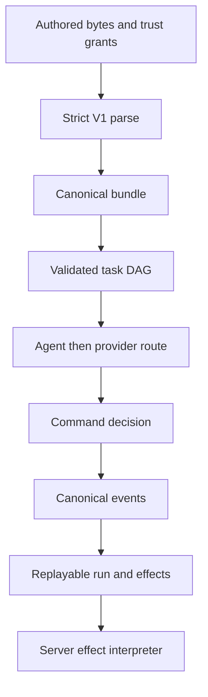
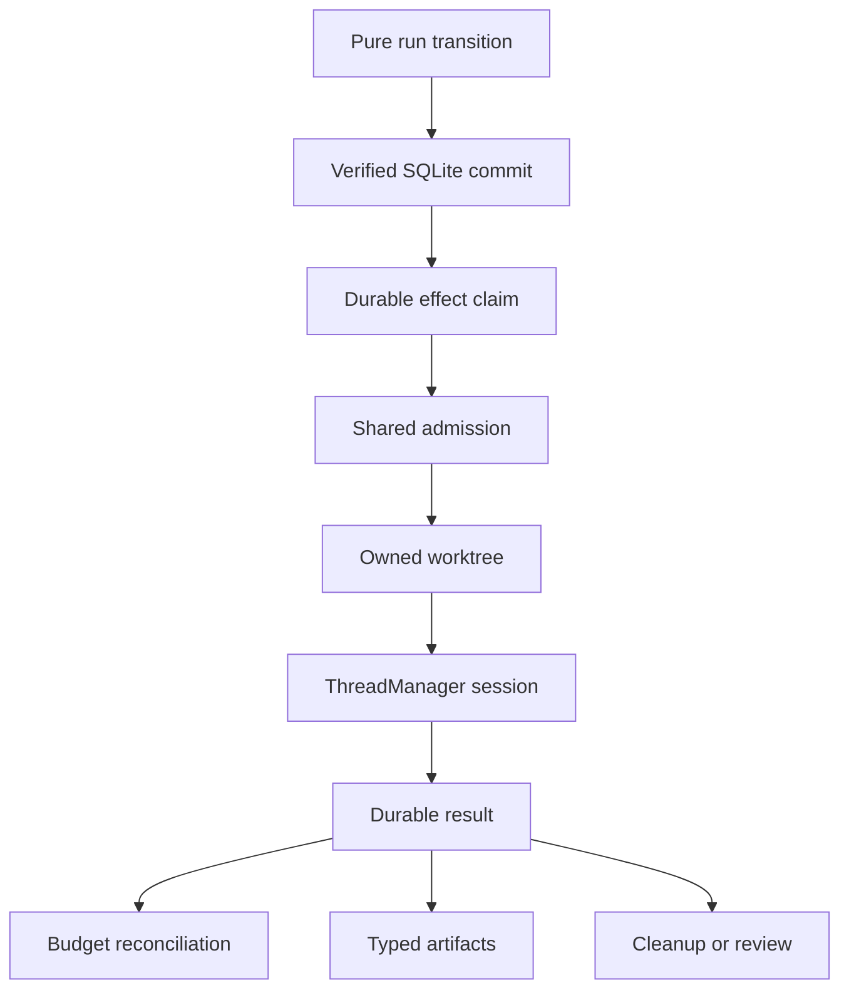
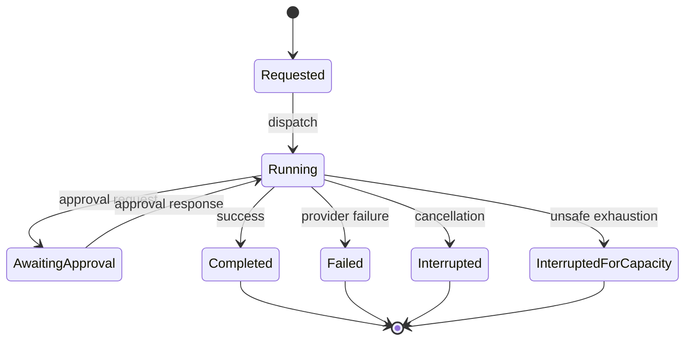
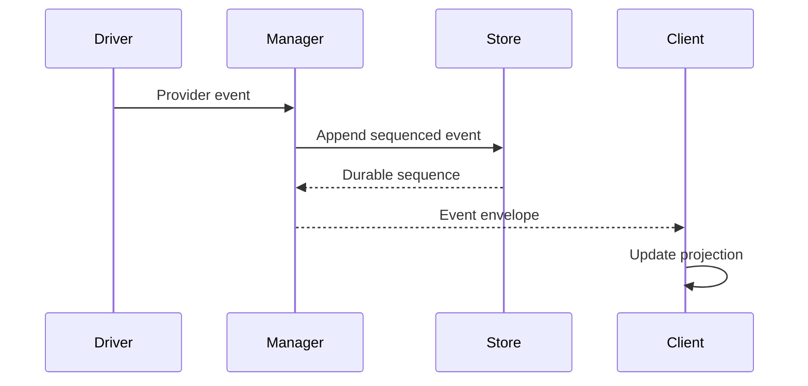

<!-- PAGE_ID: pandamux_12_agent-orchestration -->

Relevant source files

The following files were used as evidence for this page:

- [thread.rs:1-235](../../crates/pandamux-core/src/thread.rs#L1-L235)
- [event.rs:1-196](../../crates/pandamux-core/src/event.rs#L1-L196)
- [agent_def.rs:1-154](../../crates/pandamux-core/src/agent_def.rs#L1-L154)
- [run.rs:1-1139](../../crates/pandamux-core/src/run.rs#L1-L1139)
- [instruction_bundle.rs:1-165](../../crates/pandamux-core/src/instruction_bundle.rs#L1-L165)
- [lib.rs:1-55](../../crates/pandamux-orchestrator/src/lib.rs#L1-L55)
- [schema/mod.rs:1-1022](../../crates/pandamux-orchestrator/src/schema/mod.rs#L1-L1022)
- [schema/v1.rs:1-308](../../crates/pandamux-orchestrator/src/schema/v1.rs#L1-L308)
- [diagnostics.rs:1-446](../../crates/pandamux-orchestrator/src/diagnostics.rs#L1-L446)
- [bundle.rs:1-1157](../../crates/pandamux-orchestrator/src/bundle.rs#L1-L1157)
- [dag.rs:1-742](../../crates/pandamux-orchestrator/src/dag.rs#L1-L742)
- [policy.rs:1-402](../../crates/pandamux-orchestrator/src/policy.rs#L1-L402)
- [routing.rs:1-371](../../crates/pandamux-orchestrator/src/routing.rs#L1-L371)
- [model_output.rs:1-327](../../crates/pandamux-orchestrator/src/model_output.rs#L1-L327)
- [state.rs:1-2462](../../crates/pandamux-orchestrator/src/state.rs#L1-L2462)
- [orchestration_execution.rs:1-230](../../crates/pandamux-protocol/src/orchestration_execution.rs#L1-L230)
- [thread_rpc.rs:1-156](../../crates/pandamux-protocol/src/thread_rpc.rs#L1-L156)
- [subagent_rpc.rs:1-47](../../crates/pandamux-protocol/src/subagent_rpc.rs#L1-L47)
- [attachment_rpc.rs:1-69](../../crates/pandamux-protocol/src/attachment_rpc.rs#L1-L69)
- [checkpoint_rpc.rs:1-37](../../crates/pandamux-protocol/src/checkpoint_rpc.rs#L1-L37)
- [traits.rs:1-72](../../crates/pandamux-providers/src/traits.rs#L1-L72)
- [models.rs:93-292](../../crates/pandamux-providers/src/models.rs#L93-L292)
- [thread_manager.rs:107-4447](../../crates/pandamux-server/src/thread_manager.rs#L107-L4447)
- [attempt_watchdog.rs:11-230](../../crates/pandamux-server/src/attempt_watchdog.rs#L11-L230)
- [run_execution_service.rs](../../crates/pandamux-server/src/run_execution_service.rs)
- [execution_admission.rs](../../crates/pandamux-server/src/execution_admission.rs)
- [execution_budget.rs](../../crates/pandamux-server/src/execution_budget.rs)
- [attempt_worktree.rs](../../crates/pandamux-server/src/attempt_worktree.rs)
- [blackboard_store.rs:20-370](../../crates/pandamux-server/src/blackboard_store.rs#L20-L370)
- [remote_execution.rs:101-851](../../crates/pandamux-server/src/remote_execution.rs#L101-L851)
- [run_recovery.rs:37-225](../../crates/pandamux-server/src/run_recovery.rs#L37-L225)
- [orchestration_phase5c.rs](../../crates/pandamux-server/src/store/orchestration_phase5c.rs)
- [attempt_worktrees.rs](../../crates/pandamux-server/tests/attempt_worktrees.rs)
- [execution_admission.rs](../../crates/pandamux-server/tests/execution_admission.rs)
- [blackboard_dag.rs](../../crates/pandamux-server/tests/blackboard_dag.rs)
- [run_recovery.rs](../../crates/pandamux-server/tests/run_recovery.rs)
- [run_shutdown.rs](../../crates/pandamux-server/tests/run_shutdown.rs)

# Agent Orchestration

> **Related Pages**: [Core Domain](../core/CORE_DOMAIN.md), [Application Runtime](../core/APP_RUNTIME.md), [Provider Routing and Capacity](PROVIDER_ROUTING.md)

---

<!-- BEGIN:AUTOGEN pandamux_12_agent-orchestration_phase5a -->
## Phase 5A Pure Orchestration Engine

Phase 5A is a pure value-to-value engine. It accepts authored bytes, server-issued trust and policy snapshots, explicit identities, and timestamps; it returns validated records, events, and effects without reading files, observing clocks, opening a database, contacting a provider, or mutating external state. Its public API exposes parsing, compilation, plan validation, routing, command decision, event application, and replay as separate operations ([lib.rs:9-55](../../crates/pandamux-orchestrator/src/lib.rs#L9-L55)).

| Stage | Implemented contract |
|---|---|
| Authored schemas | Confined logical paths and published file, aggregate, depth, item, and scalar bounds precede strict V1 decoding ([schema/mod.rs:16-30](../../crates/pandamux-orchestrator/src/schema/mod.rs#L16-L30), [schema/mod.rs:153-215](../../crates/pandamux-orchestrator/src/schema/mod.rs#L153-L215)). Every orchestrator, project, agent, knowledge, and prompt record carries an exact version and kind; unknown fields are denied ([schema/v1.rs:5-38](../../crates/pandamux-orchestrator/src/schema/v1.rs#L5-L38), [schema/v1.rs:187-298](../../crates/pandamux-orchestrator/src/schema/v1.rs#L187-L298)). |
| Bundle compilation | Trusted layer grants are supplied separately from repository content. Sources are stably ordered, references resolve before merge, value origins remain visible, and the canonical payload digest binds every compiled agent ([policy.rs:15-33](../../crates/pandamux-orchestrator/src/policy.rs#L15-L33), [bundle.rs:56-125](../../crates/pandamux-orchestrator/src/bundle.rs#L56-L125), [bundle.rs:185-244](../../crates/pandamux-orchestrator/src/bundle.rs#L185-L244)). |
| DAG validation | Task and edge caps, identities, cycles, project and organization policy, typed contracts, checked budgets, and capability feasibility are evaluated in a fixed order before a `ValidatedPlan` exists ([dag.rs:14-100](../../crates/pandamux-orchestrator/src/dag.rs#L14-L100), [dag.rs:100-165](../../crates/pandamux-orchestrator/src/dag.rs#L100-L165)). |
| Routing and approvals | Task-to-agent filters and stable tie-breaks compose the existing provider selector; recorded routes are reused. Auto and Approve-first share one revision- and action-digest-bound reconciler, and only ordinary explicitly permitted work can bypass a pending approval ([routing.rs:52-118](../../crates/pandamux-orchestrator/src/routing.rs#L52-L118), [policy.rs:37-100](../../crates/pandamux-orchestrator/src/policy.rs#L37-L100), [policy.rs:100-188](../../crates/pandamux-orchestrator/src/policy.rs#L100-L188)). |
| Model proposals | One JSON object is bounded to 1 MiB and structural limits. Invalid content gets at most one parse-only retry; timeout or transport failures do not consume that retry path and never dispatch ([model_output.rs:9-29](../../crates/pandamux-orchestrator/src/model_output.rs#L9-L29), [model_output.rs:74-124](../../crates/pandamux-orchestrator/src/model_output.rs#L74-L124)). |
| Run state | `decide` rejects illegal commands, `apply` enforces exact sequencing and canonical identity receipts, and `replay` rebuilds state while deterministic effect identifiers prevent duplicate work ([state.rs:55-204](../../crates/pandamux-orchestrator/src/state.rs#L55-L204), [state.rs:206-320](../../crates/pandamux-orchestrator/src/state.rs#L206-L320), [state.rs:322-356](../../crates/pandamux-orchestrator/src/state.rs#L322-L356)). |

The pure engine itself still performs no I/O. Phase 5C now persists and
interprets its transitions in the server, but the event vocabulary, effect
identity, readiness, retry boundary, artifact validation, and replay behavior
remain pure. Public run RPC, CLI, and desktop orchestration behavior remain
Phase 5D work ([2026-10-09-phase-5c-execution-owner.md:1209-1223](../../tasks/2026-10-09-phase-5c-execution-owner.md#L1209-L1223)).

Sources: [lib.rs:9-55](../../crates/pandamux-orchestrator/src/lib.rs#L9-L55), [schema/mod.rs:16-215](../../crates/pandamux-orchestrator/src/schema/mod.rs#L16-L215), [bundle.rs:56-244](../../crates/pandamux-orchestrator/src/bundle.rs#L56-L244), [dag.rs:14-165](../../crates/pandamux-orchestrator/src/dag.rs#L14-L165), [routing.rs:52-118](../../crates/pandamux-orchestrator/src/routing.rs#L52-L118), [policy.rs:37-188](../../crates/pandamux-orchestrator/src/policy.rs#L37-L188), [model_output.rs:9-124](../../crates/pandamux-orchestrator/src/model_output.rs#L9-L124), [state.rs:55-356](../../crates/pandamux-orchestrator/src/state.rs#L55-L356)
<!-- END:AUTOGEN pandamux_12_agent-orchestration_phase5a -->

---

<!-- BEGIN:AUTOGEN pandamux_12_agent-orchestration_phase5c-foundation -->
## Phase 5C Durable Execution Runtime

Phase 5C checkpoints C-A through C-J connect the pure run model to one private,
server-owned execution runtime. Migration 14 stores canonical
snapshots, immutable events, derived effects, queue and lease records,
attempt-owned worktrees, budgets, artifacts, progress, recovery reviews, and
node receipts. Verified loads replay the event log and compare its canonical
bytes and derived effects with the stored rows before returning state
([migrations.rs:1711-2084](../../crates/pandamux-server/src/store/migrations.rs#L1711-L2084), [orchestration_phase5c.rs:648-933](../../crates/pandamux-server/src/store/orchestration_phase5c.rs#L648-L933)).

`RunExecutionService` is the single adapter for canonical transitions and the
effect outbox. It broadcasts only post-commit identity and digest notices;
claims, preparation, dispatch markers, outcomes, and acknowledgements remain
durable and replay-safe
([run_execution_service.rs:253-330](../../crates/pandamux-server/src/run_execution_service.rs#L253-L330), [orchestration_phase5c.rs:648-933](../../crates/pandamux-server/src/store/orchestration_phase5c.rs#L648-L933)).

Each execution attempt can now bind exactly one app-owned worktree. The service
derives the path and full branch ref from canonical repository, run, task, and
attempt identities; records the worktree lease and ambiguous ownership intent
before Git; and then materializes only the requested commit. Repository hooks,
global attributes, system configuration, submodule recursion, and custom
content filters are disabled or rejected. Blocking filesystem and Git work run
on a bounded blocking pool, and Windows child processes use
`CREATE_NO_WINDOW`
([attempt_worktree.rs](../../crates/pandamux-server/src/attempt_worktree.rs)).

Before, after, and recovery checkpoints use a private temporary index and a
stable checkpoint ref, leaving both the user checkout and the attempt index
unchanged. Crash recovery distinguishes durable intent from Git completion and
rejects changed-byte identity reuse. Cleanup is automatic only for a terminal,
review-free attempt with verified process-death and retained-evidence digests,
complete checkpoint receipts, and a clean unlocked tree; removal uses ordinary
non-forced `git worktree remove`. Dirty, locked, foreign, or ambiguous trees are
retained
([attempt_worktrees.rs](../../crates/pandamux-server/tests/attempt_worktrees.rs)).

`ExecutionAdmissionService` is now the one durable admission path for manual
and orchestrated starts. An immediate SQLite transaction orders eligible work,
checks run, agent, provider, environment, organization, and global limits, and
creates an owner, TTL, and compare-and-swap capacity lease. Orchestrated claims
also reserve the exact attempt budget and UTC daily-ledger amount and append
`BudgetReserved` plus `DispatchRequested` before commit. Separate SQLite
connections cannot overclaim the same capacity
([execution_admission.rs:101-391](../../crates/pandamux-server/src/execution_admission.rs#L101-L391), [orchestration_phase5c.rs:3040-4140](../../crates/pandamux-server/src/store/orchestration_phase5c.rs#L3040-L4140)).

Queue selection preserves `(enqueued_at, run, task, attempt)` order within each
class while bypassing a resource-blocked head. Global and per-environment caps
of at least two retain one interactive slot; at cap one, an orchestrated item
wins after at most four consecutive interactive claims. Cap decreases leave
active owners intact and block new claims until capacity drains. Expired claims
can be requeued only by exact owner and lease identity with bounded backoff
([execution_admission.rs:217-401](../../crates/pandamux-server/src/execution_admission.rs#L217-L401), [execution_admission.rs:531-1165](../../crates/pandamux-server/tests/execution_admission.rs#L531-L1165)).

`ExecutionBudgetService` plans the exact attempt reservation without mutating
state; the shared admission transaction then repeats the authoritative task,
run, compiled-agent, and organization UTC-day checks before it creates a
dispatch effect. With no trusted smaller estimate, the plan reserves the
task's remaining ceiling, and retries can reserve only the unreconciled
remainder. The UTC ledger date is fixed at claim even when reconciliation
crosses midnight
([execution_budget.rs](../../crates/pandamux-server/src/execution_budget.rs),
[orchestration_phase5c.rs](../../crates/pandamux-server/src/store/orchestration_phase5c.rs)).

One-time supplemental grants require connected local control and an approved,
unexpired action digest bound to the exact grant identity, run, task, attempt,
dimension, amount, policy revision, and expiry. Reconciliation reads only the
exact settled turn-attempt and its durable managed-turn facts. Provider-reported
micro-USD wins; otherwise effective-dated integer pricing supplies an
API-equivalent estimate. Unknown cost remains reserved and incomplete, while
representable actual overage is retained and pauses further dispatch.
Conservation compares run, reservation, agent, and UTC-day totals, but a
balanced result is explicitly source-unverified rather than a replacement for
usage facts. Grant, reconciliation, and pre-dispatch release transactions have
before/after-commit recovery fixtures.

`ThreadManager` remains the sole provider-session owner. Every new manual
session now commits an interactive admission before
`ProviderResolver::acquire_execution`; start failures, losing session races,
cancellation, terminal failure, and shutdown release the exact claim. A
successful reusable session keeps its existing process-lifetime claim. For an
orchestrated attempt, `RunExecutionService` writes the dispatch marker first,
then asks `ThreadManager` to dispatch the already persisted thread and turn and
retains explicit completion, cancellation, watchdog, renewal, and observer
join handles ([thread_manager.rs:174-385](../../crates/pandamux-server/src/thread_manager.rs#L174-L385), [run_execution_service.rs:939-1125](../../crates/pandamux-server/src/run_execution_service.rs#L939-L1125)).

The local path derives instructions and tool policy from the run-pinned
immutable bundle and preserves the existing Phase 4 provider event loop, tool
ledger, continuation, and `AttemptBoundary` as retry authority. Only a typed
not-started result with verified cleanup can release capacity and budget for
one bounded fallback; response loss, output, approval interaction, unresolved
tools, or an external commit remain ambiguous or review-required
([run_execution_service_tests.rs:440-869](../../crates/pandamux-server/src/run_execution_service_tests.rs#L440-L869)).

Remote execution uses private, environment-bound protocol records for
repository prepare, attempt prepare, dispatch, exact status, cancellation,
ordered events, and acknowledgement. Both stores persist prepare and dispatch
authority, and a lost response queries the same attempt receipt rather than
starting a replacement ([orchestration_execution.rs:9-230](../../crates/pandamux-protocol/src/orchestration_execution.rs#L9-L230), [remote_execution.rs:101-851](../../crates/pandamux-server/src/remote_execution.rs#L101-L851)).

Successful tasks publish canonical, content-hashed artifacts and required
server-derived evidence in the same transition that advances readiness.
Per-task, per-run, byte, depth, container, string, version, producer, consumer,
schema, and aggregate bounds are enforced before settlement; the app-owned
cache is verified derived data and artifact text never changes access, tools,
routing, budget, or approval authority ([run.rs:15-21](../../crates/pandamux-core/src/run.rs#L15-L21), [blackboard_store.rs:20-370](../../crates/pandamux-server/src/blackboard_store.rs#L20-L370), [state.rs:1621-1889](../../crates/pandamux-orchestrator/src/state.rs#L1621-L1889)).

Meaningful progress can extend the stall deadline but never the absolute run
deadline. Cancellation persists intent before interrupt, then performs bounded
drain, supervised escalation, positive death verification, settlement,
worktree cleanup, lease release, sender closure, and writer joins; failure at
any boundary quarantines retained debt ([attempt_watchdog.rs:11-230](../../crates/pandamux-server/src/attempt_watchdog.rs#L11-L230)). Startup holds one incarnation lock, verifies nonterminal replay and owned resources, reclaims only exact expired local ownership, reattaches only an exact live attempt, and deduplicates ambiguous or unverifiable cases into human review ([run_recovery.rs:37-225](../../crates/pandamux-server/src/run_recovery.rs#L37-L225)).

Phase 5C is an internal runtime checkpoint. Exact 0.60.101 passes the native
Linux process-group and real Git worktree rows; its documentation-only 0.60.102
follow-up tree passes the complete portable matrix.
Windows and macOS native rows, a physical remote node, live providers, and the
controlled external-effect row remain unrun. Public run RPC, CLI, desktop
orchestration surfaces, and the user-facing recovery-review resolver remain
out of scope ([2026-10-09-phase-5c-execution-owner.md:1116-1134](../../tasks/2026-10-09-phase-5c-execution-owner.md#L1116-L1134), [2026-10-09-phase-5c-execution-owner.md:1209-1223](../../tasks/2026-10-09-phase-5c-execution-owner.md#L1209-L1223)).

Sources: [migrations.rs:1711-2084](../../crates/pandamux-server/src/store/migrations.rs#L1711-L2084), [orchestration_phase5c.rs:648-933](../../crates/pandamux-server/src/store/orchestration_phase5c.rs#L648-L933), [attempt_worktree.rs:141-239](../../crates/pandamux-server/src/attempt_worktree.rs#L141-L239), [execution_admission.rs:119-390](../../crates/pandamux-server/src/execution_admission.rs#L119-L390), [execution_budget.rs:37-126](../../crates/pandamux-server/src/execution_budget.rs#L37-L126), [run_execution_service.rs:253-330](../../crates/pandamux-server/src/run_execution_service.rs#L253-L330), [orchestration_execution.rs:9-230](../../crates/pandamux-protocol/src/orchestration_execution.rs#L9-L230), [remote_execution.rs:101-851](../../crates/pandamux-server/src/remote_execution.rs#L101-L851), [blackboard_store.rs:20-370](../../crates/pandamux-server/src/blackboard_store.rs#L20-L370), [attempt_watchdog.rs:11-230](../../crates/pandamux-server/src/attempt_watchdog.rs#L11-L230), [run_recovery.rs:37-225](../../crates/pandamux-server/src/run_recovery.rs#L37-L225)
<!-- END:AUTOGEN pandamux_12_agent-orchestration_phase5c-foundation -->

---

<!-- BEGIN:AUTOGEN pandamux_12_agent-orchestration_threads -->
## Thread and Turn Lifecycle

A thread binds one environment, exact provider instance, model, access ceiling, workspace, and optional agent identity to a durable conversation. It may be manual, orchestrator-created, or schedule-created, and it records timestamps and a high-level status independently from individual turns ([thread.rs:6-35](../../crates/pandamux-core/src/thread.rs#L6-L35), [thread.rs:99-126](../../crates/pandamux-core/src/thread.rs#L99-L126)).

`ThreadCreateParams` makes project, environment, provider instance, model, effort, access, agent, cwd, and worktree explicit optional inputs ([thread_rpc.rs:8-32](../../crates/pandamux-protocol/src/thread_rpc.rs#L8-L32)). Creation validates organization policy when a project is present, resolves an allowed exact provider instance, constructs an idle thread, and saves it before returning ([thread_manager.rs:928-1035](../../crates/pandamux-server/src/thread_manager.rs#L928-L1035)).

| Turn state | Meaning |
|---|---|
| `Requested` | Durable turn exists but execution has not started |
| `Running` | Provider execution is active |
| `AwaitingApproval` | Provider is paused on a user decision |
| `Completed` / `Failed` | Terminal outcome |
| `Interrupted` | User or recovery path stopped execution |
| `InterruptedForCapacity` | Provider capacity stopped an attempt after safe retry was no longer possible |

The state set is defined by `TurnStatus`, while each turn also preserves input, route identity, sequence, usage, and before/after checkpoints ([thread.rs:128-179](../../crates/pandamux-core/src/thread.rs#L128-L179)).

Sources: [thread.rs:6-179](../../crates/pandamux-core/src/thread.rs#L6-L179), [thread_rpc.rs:8-32](../../crates/pandamux-protocol/src/thread_rpc.rs#L8-L32), [thread_manager.rs:928-1035](../../crates/pandamux-server/src/thread_manager.rs#L928-L1035)
<!-- END:AUTOGEN pandamux_12_agent-orchestration_threads -->

---

<!-- BEGIN:AUTOGEN pandamux_12_agent-orchestration_sessions -->
## Provider Sessions

Provider drivers expose side-effect-free probe and model-list operations separately from `start_session`. Starting a session requires the resolved instance configuration plus a `SessionSpec` carrying cwd, model, effort, access, injected instructions, tool policy, and an optional native resume token ([traits.rs:15-42](../../crates/pandamux-providers/src/traits.rs#L15-L42), [models.rs:99-109](../../crates/pandamux-providers/src/models.rs#L99-L109)).

| Session operation | Contract |
|---|---|
| `send_turn` | Send prompt and attachments to the active provider session ([traits.rs:44-48](../../crates/pandamux-providers/src/traits.rs#L44-L48)) |
| `events` / `take_event_receiver` | Stream provider events, with an optional receiver handoff for lock-free ingestion ([traits.rs:49-55](../../crates/pandamux-providers/src/traits.rs#L49-L55)) |
| `respond_approval` | Return an approval decision for a specific pending request ([traits.rs:57-62](../../crates/pandamux-providers/src/traits.rs#L57-L62)) |
| `interrupt` | Stop the active turn without killing the reusable session ([traits.rs:64-65](../../crates/pandamux-providers/src/traits.rs#L64-L65)) |
| `resume_token` | Expose provider-native continuation identity when supported ([traits.rs:67-68](../../crates/pandamux-providers/src/traits.rs#L67-L68)) |
| `shutdown` | Gracefully end the session and child processes ([traits.rs:70-71](../../crates/pandamux-providers/src/traits.rs#L70-L71)) |

`ThreadManager` keeps active sessions keyed by thread together with their provider instance, generation, event-writer lock, process permit, and mutable provider session ([thread_manager.rs:107-115](../../crates/pandamux-server/src/thread_manager.rs#L107-L115)). Reuse is guarded by the requested route and resume behavior; replacement shuts down the prior session before a new generation becomes active ([thread_manager.rs:812-927](../../crates/pandamux-server/src/thread_manager.rs#L812-L927)).

Sources: [traits.rs:15-72](../../crates/pandamux-providers/src/traits.rs#L15-L72), [models.rs:99-109](../../crates/pandamux-providers/src/models.rs#L99-L109), [thread_manager.rs:107-151](../../crates/pandamux-server/src/thread_manager.rs#L107-L151), [thread_manager.rs:812-927](../../crates/pandamux-server/src/thread_manager.rs#L812-L927)
<!-- END:AUTOGEN pandamux_12_agent-orchestration_sessions -->

---

<!-- BEGIN:AUTOGEN pandamux_12_agent-orchestration_streaming -->
## Streaming Events

Provider sessions stream a provider-specific event vocabulary that the server projects into monotonic thread events. Provider events cover output deltas, reasoning, tool calls, approvals, subagents, completion, errors, rate limits, capacity exhaustion, and notices ([models.rs:183-238](../../crates/pandamux-providers/src/models.rs#L183-L238)).

Before forwarding visible output or side-effect-bearing activity, `forward_provider_event` emits the corresponding attempt-boundary advance; it also promotes qualifying rate-limit evidence to a capacity-exhausted event before forwarding the original event ([models.rs:240-291](../../crates/pandamux-providers/src/models.rs#L240-L291)). This ordering lets the durable attempt state become unsafe-to-retry before downstream consumers observe output or tool activity.

Thread events are append-only and sequence-numbered. Their domain vocabulary includes requested/started/completed turns, assistant and reasoning text, commands, files, approvals, usage, plans, capacity interruption, notices, errors, settled changes, and subagent lifecycle events ([event.rs:5-130](../../crates/pandamux-core/src/event.rs#L5-L130)).

Sources: [event.rs:5-130](../../crates/pandamux-core/src/event.rs#L5-L130), [models.rs:183-291](../../crates/pandamux-providers/src/models.rs#L183-L291)
<!-- END:AUTOGEN pandamux_12_agent-orchestration_streaming -->

---

<!-- BEGIN:AUTOGEN pandamux_12_agent-orchestration_tools -->
## Tools and Approvals

Tool events have explicit pending, executing, success, failed, and cancelled states; approval requests separately classify command execution, file edit, network access, generic tool calls, and full-access escalation ([event.rs:132-167](../../crates/pandamux-core/src/event.rs#L132-L167)). Provider event forwarding marks tool activity as `ToolSideEffectBegun` and approval interaction as `ExternallyCommitted` before those events are delivered ([models.rs:240-259](../../crates/pandamux-providers/src/models.rs#L240-L259)).

| Control | Durable identity | Safety effect |
|---|---|---|
| Tool start/result | Provider item id plus turn attempt | Prevents treating side effects as safe pre-output work |
| Approval request | Request id | Allows an exact user decision to be returned to the active session |
| Approval response | Thread id, request id, decision | Detects replay and conflicts using a payload digest and delivery record ([thread_manager.rs:2763-2844](../../crates/pandamux-server/src/thread_manager.rs#L2763-L2844)) |
| Access ceiling | `AccessMode` | Orders permissions from read-only through full host-user access ([thread.rs:37-80](../../crates/pandamux-core/src/thread.rs#L37-L80)) |

The approval handler refuses delivery when no matching active session or awaiting turn exists, except when it can identify and safely return the already-recorded result of an identical replay ([thread_manager.rs:2771-2844](../../crates/pandamux-server/src/thread_manager.rs#L2771-L2844)). Provider tool policy is an explicit allowed/disallowed list passed at session creation rather than inferred from UI state ([models.rs:148-153](../../crates/pandamux-providers/src/models.rs#L148-L153)).

Sources: [event.rs:132-167](../../crates/pandamux-core/src/event.rs#L132-L167), [models.rs:148-153](../../crates/pandamux-providers/src/models.rs#L148-L153), [models.rs:240-259](../../crates/pandamux-providers/src/models.rs#L240-L259), [thread.rs:37-80](../../crates/pandamux-core/src/thread.rs#L37-L80), [thread_manager.rs:2763-2844](../../crates/pandamux-server/src/thread_manager.rs#L2763-L2844)
<!-- END:AUTOGEN pandamux_12_agent-orchestration_tools -->

---

<!-- BEGIN:AUTOGEN pandamux_12_agent-orchestration_subagents -->
## Subagents and Definitions

Agent definitions are portable domain records containing identity, scope, author, version, description, system prompt, tool allow/deny lists, and an optional turn cap. Scopes distinguish team, project, personal, and built-in definitions; authored changes record whether they widen access and move through proposed, approved, applied, rejected, or reverted status ([agent_def.rs:4-61](../../crates/pandamux-core/src/agent_def.rs#L4-L61)).

Subagents are represented in the thread event stream rather than as an independent UI-only registry. Spawn events carry stable subagent and parent identities, title, type, model, and effort; activity, usage, and finished events carry progress and terminal outcome data ([event.rs:102-129](../../crates/pandamux-core/src/event.rs#L102-L129)).

| `subagent.tree` projection field | Purpose |
|---|---|
| `sub_agent_id` | Stable lane identity |
| `parent_sub_agent_id` / `parent_item_id` | Reconstruct nested execution |
| `title`, `agent_type`, `model`, `effort` | Present the configured worker |
| `status`, `activity_preview` | Show current progress |
| `tokens`, `tool_calls`, `elapsed_ms`, `summary` | Report accumulated and terminal facts |

The RPC projection defines those fields and returns a bounded list for one parent thread ([subagent_rpc.rs:1-47](../../crates/pandamux-protocol/src/subagent_rpc.rs#L1-L47)). Agent memory is likewise a domain record with project or agent-wide scope, optional embeddings, timestamps, source run, and tombstone state ([agent_def.rs:63-86](../../crates/pandamux-core/src/agent_def.rs#L63-L86)).

Sources: [agent_def.rs:4-86](../../crates/pandamux-core/src/agent_def.rs#L4-L86), [event.rs:102-129](../../crates/pandamux-core/src/event.rs#L102-L129), [subagent_rpc.rs:1-47](../../crates/pandamux-protocol/src/subagent_rpc.rs#L1-L47)
<!-- END:AUTOGEN pandamux_12_agent-orchestration_subagents -->

---

<!-- BEGIN:AUTOGEN pandamux_12_agent-orchestration_recovery -->
## Cancellation and Recovery

Manual-thread cancellation removes the active session generation, serializes
event writing, interrupts and shuts down the provider, resets the thread to
idle, and marks any requested, running, or awaiting turn as interrupted with a
completion checkpoint when possible ([thread_manager.rs:4121-4273](../../crates/pandamux-server/src/thread_manager.rs#L4121-L4273)). Phase 5C orchestration cancellation adds durable run intent, bounded lifecycle phases, explicit task joins, worktree cleanup ownership, capacity and budget reconciliation, and quarantine when death or cleanup cannot be proved ([attempt_watchdog.rs:141-230](../../crates/pandamux-server/src/attempt_watchdog.rs#L141-L230), [run_execution_service.rs:1271-1490](../../crates/pandamux-server/src/run_execution_service.rs#L1271-L1490)).

- `thread.get` reloads the thread together with turns, attempts, and continuations, so recovery surfaces can reconstruct more than the transcript ([thread_manager.rs:1895-1927](../../crates/pandamux-server/src/thread_manager.rs#L1895-L1927)).
- `thread.resume` returns the persisted provider-native resume token for a known thread without starting a turn ([thread_manager.rs:4276-4297](../../crates/pandamux-server/src/thread_manager.rs#L4276-L4297)).
- A new turn is rejected while its thread is already working or awaiting an approval, preventing concurrent execution against one thread state ([thread_manager.rs:1994-2012](../../crates/pandamux-server/src/thread_manager.rs#L1994-L2012)).
- Attachments are resolved against the target thread and size-validated before provider dispatch ([thread_manager.rs:2043-2065](../../crates/pandamux-server/src/thread_manager.rs#L2043-L2065)).
- Startup recovery keeps intake closed until verified replay completes; ambiguous dispatch, resource, or clock states become deduplicated reviews instead of replacement provider turns ([run_recovery.rs:181-225](../../crates/pandamux-server/src/run_recovery.rs#L181-L225)).

The public protocol separates cancel, approval response, capacity continuation, and resume into distinct typed requests, which keeps recovery actions explicit and auditable ([thread_rpc.rs:80-156](../../crates/pandamux-protocol/src/thread_rpc.rs#L80-L156)).

Sources: [thread_rpc.rs:80-156](../../crates/pandamux-protocol/src/thread_rpc.rs#L80-L156), [thread_manager.rs:1895-1927](../../crates/pandamux-server/src/thread_manager.rs#L1895-L1927), [thread_manager.rs:1994-2065](../../crates/pandamux-server/src/thread_manager.rs#L1994-L2065), [thread_manager.rs:4121-4297](../../crates/pandamux-server/src/thread_manager.rs#L4121-L4297), [attempt_watchdog.rs:141-230](../../crates/pandamux-server/src/attempt_watchdog.rs#L141-L230), [run_execution_service.rs:1271-1490](../../crates/pandamux-server/src/run_execution_service.rs#L1271-L1490), [run_recovery.rs:181-225](../../crates/pandamux-server/src/run_recovery.rs#L181-L225)
<!-- END:AUTOGEN pandamux_12_agent-orchestration_recovery -->

---
