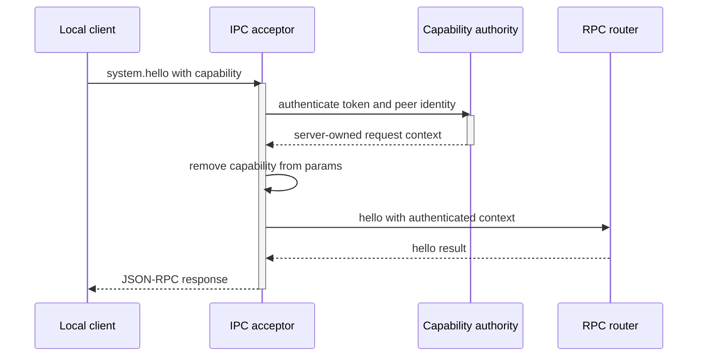

<!-- PAGE_ID: pandamux_10_local-ipc -->
<details>
<summary>Relevant source files</summary>

The following files were used as evidence for this page:

- [crates/pandamux-protocol/src/jsonrpc.rs:1-160](../../crates/pandamux-protocol/src/jsonrpc.rs#L1-L160)
- [crates/pandamux-protocol/src/system.rs:1-60](../../crates/pandamux-protocol/src/system.rs#L1-L60)
- [crates/pandamux-protocol/src/windows_security.rs:1-111](../../crates/pandamux-protocol/src/windows_security.rs#L1-L111)
- [crates/pandamux-protocol/src/mcp.rs:1-41](../../crates/pandamux-protocol/src/mcp.rs#L1-L41)
- [crates/pandamux-server/src/request_context.rs:1-364](../../crates/pandamux-server/src/request_context.rs#L1-L364)
- [crates/pandamux-server/src/windows_security.rs:1-253](../../crates/pandamux-server/src/windows_security.rs#L1-L253)
- [crates/pandamux-server/src/server.rs:1-735](../../crates/pandamux-server/src/server.rs#L1-L735)
- [crates/pandamux-cli/src/ipc.rs:1-289](../../crates/pandamux-cli/src/ipc.rs#L1-L289)

</details>

# Local IPC and Security

> **Related Pages**: [Architecture](../core/ARCHITECTURE.md), [CLI Reference](../api/CLI_REFERENCE.md), [SSH Remote Nodes](SSH_REMOTE.md)

---

<!-- BEGIN:AUTOGEN pandamux_10_local-ipc_transport -->
## Endpoint and Transport

Local control is newline-delimited JSON-RPC 2.0 over a Windows named pipe or Unix domain socket. Requests carry an optional number/string id, method, and JSON params; notifications omit the id, while responses contain either a result or a structured error ([jsonrpc.rs:4-65](../../crates/pandamux-protocol/src/jsonrpc.rs#L4-L65), [jsonrpc.rs:67-110](../../crates/pandamux-protocol/src/jsonrpc.rs#L67-L110)).

| Platform | Endpoint discovery | Client verification |
|---|---|---|
| Windows | `server.json` supplies `pipePath`, capabilities, and expected PID; `PANDAMUX_PIPE` can override only the path lookup ([ipc.rs:143-220](../../crates/pandamux-cli/src/ipc.rs#L143-L220)) | The opened pipe's kernel-reported server PID must match the runtime record when available, and the image must be `pandamux-server.exe` ([windows_security.rs:34-96](../../crates/pandamux-protocol/src/windows_security.rs#L34-L96)) |
| Unix | `server.json` is sought under `~/.pandamux` and `~/.pandamux/run`; the endpoint is opened as a Unix socket ([ipc.rs:223-259](../../crates/pandamux-cli/src/ipc.rs#L223-L259), [ipc.rs:281-288](../../crates/pandamux-cli/src/ipc.rs#L281-L288)) | The runtime record and socket are protected by the server runtime directory policy |

`IpcClient` splits the stream into a line reader and writer, assigns monotonically increasing request ids, flushes one serialized request per line, and waits until it receives the matching response id ([ipc.rs:15-20](../../crates/pandamux-cli/src/ipc.rs#L15-L20), [ipc.rs:68-104](../../crates/pandamux-cli/src/ipc.rs#L68-L104)).

```json
{"jsonrpc":"2.0","id":1,"method":"system.ping"}
```

Sources: [jsonrpc.rs:4-110](../../crates/pandamux-protocol/src/jsonrpc.rs#L4-L110), [ipc.rs:15-104](../../crates/pandamux-cli/src/ipc.rs#L15-L104), [ipc.rs:143-289](../../crates/pandamux-cli/src/ipc.rs#L143-L289), [windows_security.rs:34-96](../../crates/pandamux-protocol/src/windows_security.rs#L34-L96)
<!-- END:AUTOGEN pandamux_10_local-ipc_transport -->

---

<!-- BEGIN:AUTOGEN pandamux_10_local-ipc_handshake -->
## Hello and Capability Handshake

Protocol version 3 requires the first request on a local connection to be `system.hello`. `HelloParams` carries protocol version, client kind/version, and an optional capability token; the reply reports server version, negotiated protocol, Hub/node role, and feature flags ([system.rs:3-24](../../crates/pandamux-protocol/src/system.rs#L3-L24), [system.rs:26-41](../../crates/pandamux-protocol/src/system.rs#L26-L41)).



The acceptor rejects any other first method, missing capability params, invalid/expired grants, or authentication failure, then closes the connection. On success it removes the capability from request params and routes every subsequent request with the authenticated context ([server.rs:376-460](../../crates/pandamux-server/src/server.rs#L376-L460)). The CLI performs this handshake automatically after discovery, selecting the control or MCP token and client kind for the requested scope ([ipc.rs:23-65](../../crates/pandamux-cli/src/ipc.rs#L23-L65)).

Sources: [system.rs:3-41](../../crates/pandamux-protocol/src/system.rs#L3-L41), [server.rs:376-460](../../crates/pandamux-server/src/server.rs#L376-L460), [ipc.rs:23-65](../../crates/pandamux-cli/src/ipc.rs#L23-L65)
<!-- END:AUTOGEN pandamux_10_local-ipc_handshake -->

---

<!-- BEGIN:AUTOGEN pandamux_10_local-ipc_context -->
## Server-Owned Request Context

The accepting transport constructs `RequestContext`; callers cannot select these fields in request JSON. It binds a peer role, authenticated environment, kernel/process-derived client identity, and capability scope ([request_context.rs:9-45](../../crates/pandamux-server/src/request_context.rs#L9-L45)).

| Context field | Source of truth | Security use |
|---|---|---|
| `peer_role` | Capability grant or explicit in-process construction | Distinguishes internal, control, MCP, provider-child, and node-proxy callers ([request_context.rs:9-16](../../crates/pandamux-server/src/request_context.rs#L9-L16)) |
| `authenticated_environment_id` | Server capability authority or proxy connection | Prevents a request from upgrading its environment by parameters ([request_context.rs:40-45](../../crates/pandamux-server/src/request_context.rs#L40-L45)) |
| `client_identity` | Accepting transport | Retains description, process id, user id, and executable evidence ([request_context.rs:18-24](../../crates/pandamux-server/src/request_context.rs#L18-L24)) |
| `capability_scope` | Token lookup in `CapabilityAuthority` | Drives method- and resource-level authorization ([request_context.rs:26-37](../../crates/pandamux-server/src/request_context.rs#L26-L37)) |

`CapabilityAuthority` stores opaque-token grants and replaces local control/MCP grants when a runtime endpoint is configured. Authentication clones the grant and attaches the observed client identity; expired provider-child grants are revoked during authentication ([request_context.rs:120-192](../../crates/pandamux-server/src/request_context.rs#L120-L192)).

Sources: [request_context.rs:9-45](../../crates/pandamux-server/src/request_context.rs#L9-L45), [request_context.rs:120-192](../../crates/pandamux-server/src/request_context.rs#L120-L192), [server.rs:400-456](../../crates/pandamux-server/src/server.rs#L400-L456)
<!-- END:AUTOGEN pandamux_10_local-ipc_context -->

---

<!-- BEGIN:AUTOGEN pandamux_10_local-ipc_scopes -->
## Capability Scopes

Authorization is fail-closed per scope. The method and relevant resource identity are checked against the authenticated context before routing ([request_context.rs:69-117](../../crates/pandamux-server/src/request_context.rs#L69-L117)).

| Scope | Allowed boundary | Explicit restriction |
|---|---|---|
| `Internal` | All methods | Constructed only in-process ([request_context.rs:47-58](../../crates/pandamux-server/src/request_context.rs#L47-L58)) |
| `Control` | Local control methods | Excludes all `mcp.*` methods and Hub usage export/backfill/ack methods ([request_context.rs:70-75](../../crates/pandamux-server/src/request_context.rs#L70-L75)) |
| `Mcp` | `system.hello`, `system.ping`, `mcp.list_tools`, `mcp.call_tool` | Cannot invoke ordinary control mutations ([request_context.rs:76-79](../../crates/pandamux-server/src/request_context.rs#L76-L79)) |
| `ProviderChild` | `system.hello` plus an issued method set | Must be unexpired and every allowed call must carry the exact bound thread id ([request_context.rs:80-93](../../crates/pandamux-server/src/request_context.rs#L80-L93)) |
| `NodeProxy` | Non-MCP methods for its authenticated environment | Any supplied environment id must equal the context environment ([request_context.rs:94-103](../../crates/pandamux-server/src/request_context.rs#L94-L103)) |

Provider-child tokens are random, time-limited grants issued for one thread and a caller-specific method set; they can be revoked explicitly ([request_context.rs:194-229](../../crates/pandamux-server/src/request_context.rs#L194-L229)). Denials use JSON-RPC code `-32001` with a machine-readable `capability_scope_denied` reason ([request_context.rs:104-116](../../crates/pandamux-server/src/request_context.rs#L104-L116)).

Sources: [request_context.rs:47-117](../../crates/pandamux-server/src/request_context.rs#L47-L117), [request_context.rs:194-229](../../crates/pandamux-server/src/request_context.rs#L194-L229), [jsonrpc.rs:129-159](../../crates/pandamux-protocol/src/jsonrpc.rs#L129-L159)
<!-- END:AUTOGEN pandamux_10_local-ipc_scopes -->

---

<!-- BEGIN:AUTOGEN pandamux_10_local-ipc_windows -->
## Windows Identity Enforcement

Windows adds kernel-backed checks around the capability handshake. The server derives a role-specific pipe name from the current user's SID and constructs a protected DACL granting access only to that SID ([windows_security.rs:43-82](../../crates/pandamux-server/src/windows_security.rs#L43-L82), [windows_security.rs:95-147](../../crates/pandamux-server/src/windows_security.rs#L95-L147)).

- The server queries the connecting client's PID from the pipe handle, opens that process, resolves its image, and permits only `pandamux.exe` or `pandamux-cli.exe` ([windows_security.rs:149-197](../../crates/pandamux-server/src/windows_security.rs#L149-L197)).
- The client independently queries the named-pipe server PID, compares it with the signed runtime record when present, and permits only `pandamux-server.exe` ([windows_security.rs:34-96](../../crates/pandamux-protocol/src/windows_security.rs#L34-L96)).
- Server options use first-instance ownership and remote-client rejection; a second first-instance creation must fail, preventing a later process from silently acquiring the protected name ([windows_security.rs:220-252](../../crates/pandamux-server/src/windows_security.rs#L220-L252)).
- The DACL security descriptor is non-inheritable and releases its native allocation on drop ([windows_security.rs:54-92](../../crates/pandamux-server/src/windows_security.rs#L54-L92)).

These checks establish a per-user local boundary and product-image allowlist. They do not turn a full-access provider process into a hostile same-user sandbox.

Sources: [windows_security.rs:43-197](../../crates/pandamux-server/src/windows_security.rs#L43-L197), [windows_security.rs:220-252](../../crates/pandamux-server/src/windows_security.rs#L220-L252), [windows_security.rs:34-96](../../crates/pandamux-protocol/src/windows_security.rs#L34-L96)
<!-- END:AUTOGEN pandamux_10_local-ipc_windows -->

---

<!-- BEGIN:AUTOGEN pandamux_10_local-ipc_mcp -->
## MCP Isolation and Redaction

MCP uses a capability distinct from ordinary control. The CLI selects `mcpToken` from the runtime record, advertises `pandamux-mcp` as its client kind, and otherwise follows the same authenticated hello sequence ([ipc.rs:28-64](../../crates/pandamux-cli/src/ipc.rs#L28-L64), [ipc.rs:209-220](../../crates/pandamux-cli/src/ipc.rs#L209-L220)).

The isolation boundary is intentionally narrow:

- An MCP-scoped context can call only hello, ping, tool discovery, and tool execution ([request_context.rs:76-79](../../crates/pandamux-server/src/request_context.rs#L76-L79)).
- A control token cannot call `mcp.*`, so control and tool-adapter identities are not interchangeable ([request_context.rs:70-79](../../crates/pandamux-server/src/request_context.rs#L70-L79)).
- MCP tool definitions expose only a name, description, and JSON input schema ([mcp.rs:3-10](../../crates/pandamux-protocol/src/mcp.rs#L3-L10)).
- Tool calls carry only a tool name and JSON arguments, and results are explicit text/resource items plus an error flag ([mcp.rs:12-41](../../crates/pandamux-protocol/src/mcp.rs#L12-L41)).
- The wire types do not perform redaction themselves; producers must construct purpose-built result content before it crosses this boundary. Arbitrary server methods remain inaccessible even if a caller places method-like fields inside MCP arguments ([request_context.rs:69-117](../../crates/pandamux-server/src/request_context.rs#L69-L117)).

Because capability authorization happens before dispatch, MCP arguments cannot promote the connection to control, provider-child, internal, or node-proxy scope.

Sources: [request_context.rs:69-117](../../crates/pandamux-server/src/request_context.rs#L69-L117), [mcp.rs:3-41](../../crates/pandamux-protocol/src/mcp.rs#L3-L41), [ipc.rs:28-64](../../crates/pandamux-cli/src/ipc.rs#L28-L64), [ipc.rs:209-220](../../crates/pandamux-cli/src/ipc.rs#L209-L220)
<!-- END:AUTOGEN pandamux_10_local-ipc_mcp -->

---
