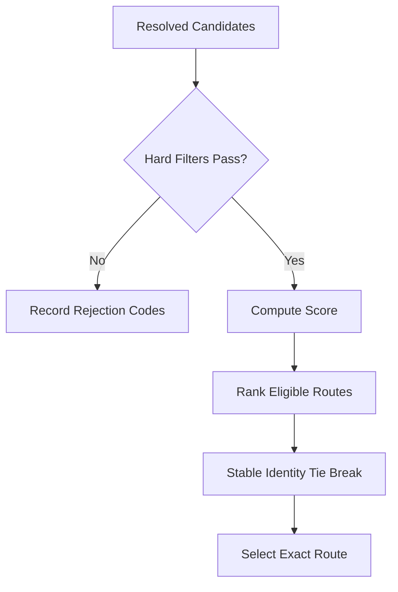
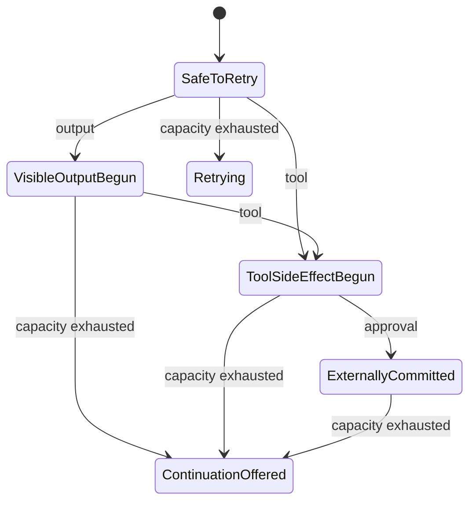

<!-- PAGE_ID: pandamux_13_provider-routing -->

Relevant source files

The following files were used as evidence for this page:

- [routing.rs:1-462](../../crates/pandamux-core/src/routing.rs#L1-L462)
- [usage.rs:484-845](../../crates/pandamux-core/src/usage.rs#L484-L845)
- [lib.rs:1-68](../../crates/pandamux-providers/src/lib.rs#L1-L68)
- [acp.rs:1-790](../../crates/pandamux-providers/src/acp.rs#L1-L790)
- [antigravity.rs:1-322](../../crates/pandamux-providers/src/antigravity.rs#L1-L322)
- [antigravity_auth.rs:1-2135](../../crates/pandamux-providers/src/antigravity_auth.rs#L1-L2135)
- [antigravity_release.rs:1-1174](../../crates/pandamux-providers/src/antigravity_release.rs#L1-L1174)
- [claude.rs:1-1207](../../crates/pandamux-providers/src/claude.rs#L1-L1207)
- [codex.rs:1-1559](../../crates/pandamux-providers/src/codex.rs#L1-L1559)
- [cursor.rs:1-455](../../crates/pandamux-providers/src/cursor.rs#L1-L455)
- [error.rs:1-119](../../crates/pandamux-providers/src/error.rs#L1-L119)
- [grok.rs:1-496](../../crates/pandamux-providers/src/grok.rs#L1-L496)
- [mock.rs:1-581](../../crates/pandamux-providers/src/mock.rs#L1-L581)
- [opencode.rs:1-576](../../crates/pandamux-providers/src/opencode.rs#L1-L576)
- [shim_resolver.rs:1-132](../../crates/pandamux-providers/src/shim_resolver.rs#L1-L132)
- [supervision.rs:1-203](../../crates/pandamux-providers/src/supervision.rs#L1-L203)
- [usage_transcript.rs:1-714](../../crates/pandamux-providers/src/usage_transcript.rs#L1-L714)
- [traits.rs:1-72](../../crates/pandamux-providers/src/traits.rs#L1-L72)
- [models.rs:11-292](../../crates/pandamux-providers/src/models.rs#L11-L292)
- [antigravity_rpc.rs:1-141](../../crates/pandamux-protocol/src/antigravity_rpc.rs#L1-L141)
- [provider_rpc.rs:1-63](../../crates/pandamux-protocol/src/provider_rpc.rs#L1-L63)
- [usage_rpc.rs:1-810](../../crates/pandamux-protocol/src/usage_rpc.rs#L1-L810)
- [driver_registry.rs:1-80](../../crates/pandamux-server/src/driver_registry.rs#L1-L80)
- [provider_resolver.rs:17-427](../../crates/pandamux-server/src/provider_resolver.rs#L17-L427)
- [capacity_phase4d.rs:1-155](../../crates/pandamux-server/src/store/capacity_phase4d.rs#L1-L155)
- [failover_phase4f.rs:1-968](../../crates/pandamux-server/src/store/failover_phase4f.rs#L1-L968)
- [usage_phase4c.rs:1-1874](../../crates/pandamux-server/src/store/usage_phase4c.rs#L1-L1874)
- [usage_query_phase4c.rs:1-551](../../crates/pandamux-server/src/store/usage_query_phase4c.rs#L1-L551)
- [usage_scanner.rs:22-443](../../crates/pandamux-server/src/usage_scanner.rs#L22-L443)
- [usage_sync.rs:1-1049](../../crates/pandamux-server/src/usage_sync.rs#L1-L1049)

# Provider Routing and Capacity

> **Related Pages**: [Configuration](../core/CONFIGURATION.md), [SSH Remote Nodes](SSH_REMOTE.md), [Agent Orchestration](AGENT_ORCHESTRATION.md)

---

<!-- BEGIN:AUTOGEN pandamux_13_provider-routing_drivers -->
## Drivers and Provider Instances

The provider crate exposes concrete adapters for Claude, Codex, Antigravity, Cursor, Grok, OpenCode, ACP-compatible sessions, and a mock used by tests, along with shared profile, supervision, and transcript-parsing infrastructure ([lib.rs:1-68](../../crates/pandamux-providers/src/lib.rs#L1-L68)). Production execution begins from a stored provider instance, not from a provider kind alone.

| Driver contract | Responsibility |
|---|---|
| `metadata` | Declare provider kind, capabilities, and static model metadata ([traits.rs:15-18](../../crates/pandamux-providers/src/traits.rs#L15-L18), [models.rs:24-46](../../crates/pandamux-providers/src/models.rs#L24-L46)) |
| `probe` | Side-effect-free installation, version, authentication, and health evidence ([traits.rs:20-22](../../crates/pandamux-providers/src/traits.rs#L20-L22)) |
| `list_models` | Discover models for the exact configured instance ([traits.rs:24-28](../../crates/pandamux-providers/src/traits.rs#L24-L28)) |
| `usage_limits` | Return defensible quota evidence when the provider supports it ([traits.rs:30-34](../../crates/pandamux-providers/src/traits.rs#L30-L34)) |
| `start_session` | Start a supervised process from exact configuration and a typed session spec ([traits.rs:36-41](../../crates/pandamux-providers/src/traits.rs#L36-L41)) |

`ProviderResolver` joins the durable settings store to a driver registry and tracks active process counts by environment plus provider-instance id ([provider_resolver.rs:17-47](../../crates/pandamux-server/src/provider_resolver.rs#L17-L47)). Exact-kind resolution fails when no configured instance exists or when several candidates make kind-only selection ambiguous ([provider_resolver.rs:110-164](../../crates/pandamux-server/src/provider_resolver.rs#L110-L164)). An acquired execution includes the resolved configuration, driver, capabilities, models, fresh probe snapshot, and a permit held until the execution object is dropped ([provider_resolver.rs:25-36](../../crates/pandamux-server/src/provider_resolver.rs#L25-L36), [provider_resolver.rs:167-185](../../crates/pandamux-server/src/provider_resolver.rs#L167-L185), [provider_resolver.rs:359-368](../../crates/pandamux-server/src/provider_resolver.rs#L359-L368)).

Sources: [lib.rs:1-68](../../crates/pandamux-providers/src/lib.rs#L1-L68), [traits.rs:15-41](../../crates/pandamux-providers/src/traits.rs#L15-L41), [models.rs:24-46](../../crates/pandamux-providers/src/models.rs#L24-L46), [provider_resolver.rs:17-185](../../crates/pandamux-server/src/provider_resolver.rs#L17-L185), [provider_resolver.rs:359-368](../../crates/pandamux-server/src/provider_resolver.rs#L359-L368)
<!-- END:AUTOGEN pandamux_13_provider-routing_drivers -->

---

<!-- BEGIN:AUTOGEN pandamux_13_provider-routing_discovery -->
## Health and Model Discovery

Provider health is a time-bounded snapshot rather than a Boolean. It records installation, resolved executable, version, authentication state and confidence, health, runtime code, check time, and expiry; the standard snapshot TTL is five minutes ([models.rs:11-21](../../crates/pandamux-providers/src/models.rs#L11-L21), [models.rs:48-97](../../crates/pandamux-providers/src/models.rs#L48-L97)).

| Evidence | Eligible execution state |
|---|---|
| Installed | Must be true |
| Health | Healthy or degraded; unavailable fails |
| Authentication | Authenticated or configured; unauthenticated and unknown fail |
| Capacity permit | Active count must remain below the configured instance limit |

Those gates are applied by `acquire_execution`: resolve the exact instance, probe it, validate the snapshot, then acquire the per-instance permit ([provider_resolver.rs:167-185](../../crates/pandamux-server/src/provider_resolver.rs#L167-L185), [provider_resolver.rs:371-411](../../crates/pandamux-server/src/provider_resolver.rs#L371-L411)). Health reports are persisted only with nonempty environment/instance identities and a valid check-to-expiry interval; newer checks replace older ones for the same identity ([capacity_phase4d.rs:81-142](../../crates/pandamux-server/src/store/capacity_phase4d.rs#L81-L142)).

Model discovery remains an instance operation through `list_models`; `ModelInfo` carries id, display name, optional context/output limits, and reasoning support ([traits.rs:24-28](../../crates/pandamux-providers/src/traits.rs#L24-L28), [models.rs:34-46](../../crates/pandamux-providers/src/models.rs#L34-L46)). Missing or ambiguous instance selection is reported as a structured provider error containing the environment, optional instance, and reason code ([provider_resolver.rs:73-164](../../crates/pandamux-server/src/provider_resolver.rs#L73-L164), [provider_resolver.rs:414-427](../../crates/pandamux-server/src/provider_resolver.rs#L414-L427)).

Sources: [traits.rs:20-34](../../crates/pandamux-providers/src/traits.rs#L20-L34), [models.rs:11-97](../../crates/pandamux-providers/src/models.rs#L11-L97), [provider_resolver.rs:73-185](../../crates/pandamux-server/src/provider_resolver.rs#L73-L185), [provider_resolver.rs:371-427](../../crates/pandamux-server/src/provider_resolver.rs#L371-L427), [capacity_phase4d.rs:81-142](../../crates/pandamux-server/src/store/capacity_phase4d.rs#L81-L142)
<!-- END:AUTOGEN pandamux_13_provider-routing_discovery -->

---

<!-- BEGIN:AUTOGEN pandamux_13_provider-routing_usage -->
## Usage Evidence

Usage observations normalize managed turns and provider transcripts into identity-rich facts. Each fact names its source/parser version, provider, exact provider instance, subscription, optional native/session/model/thread/turn/agent/schedule identities, token categories, unknown fields, provider-reported spend, source record count, and fact kind ([usage.rs:484-516](../../crates/pandamux-core/src/usage.rs#L484-L516)). Validation rejects empty identities, zero parser/source counts, empty optional models, arithmetic overflow, and observations with neither tokens nor spend ([usage.rs:518-595](../../crates/pandamux-core/src/usage.rs#L518-L595)).

The server scanner is bounded by explicit limits: directory/file counts, per-file and total bytes, record size/count, managed-turn backfill, quarantine count, and wall-clock duration ([usage_scanner.rs:22-50](../../crates/pandamux-server/src/usage_scanner.rs#L22-L50)). It is driven by startup, turn-completed, periodic, or manual triggers through a bounded queue and a joined worker thread ([usage_scanner.rs:53-82](../../crates/pandamux-server/src/usage_scanner.rs#L53-L82), [usage_scanner.rs:126-218](../../crates/pandamux-server/src/usage_scanner.rs#L126-L218)).

| Scanner evidence | Purpose |
|---|---|
| Platform file identity | Stable Unix device/inode or Windows volume/file index cursor ([usage_scanner.rs:84-100](../../crates/pandamux-server/src/usage_scanner.rs#L84-L100)) |
| Provider/subscription mapping | Binds Claude `projects` or Codex `sessions` data to one configured instance and named subscription ([usage_scanner.rs:312-375](../../crates/pandamux-server/src/usage_scanner.rs#L312-L375)) |
| Run report | Counts scanned sources/files/bytes, inserts, duplicates, reconciliations, quarantines, and a safe error code ([usage_scanner.rs:102-124](../../crates/pandamux-server/src/usage_scanner.rs#L102-L124)) |
| Managed-first reconciliation | Backfills managed turn usage before scanning configured transcript sources ([usage_scanner.rs:377-431](../../crates/pandamux-server/src/usage_scanner.rs#L377-L431)) |

Sources: [usage.rs:484-595](../../crates/pandamux-core/src/usage.rs#L484-L595), [usage_scanner.rs:22-218](../../crates/pandamux-server/src/usage_scanner.rs#L22-L218), [usage_scanner.rs:312-443](../../crates/pandamux-server/src/usage_scanner.rs#L312-L443)
<!-- END:AUTOGEN pandamux_13_provider-routing_usage -->

---

<!-- BEGIN:AUTOGEN pandamux_13_provider-routing_capacity -->
## Capacity Projection

Capacity evidence uses integer millionths rather than floating-point percentages. A snapshot identifies a subscription and optional environment, provider instance, named/window interval, used and remaining fractions, reset, source, confidence, local-or-Hub scope, hard-limit state, provider version, evidence time, and maximum age ([usage.rs:605-690](../../crates/pandamux-core/src/usage.rs#L605-L690)).

| Validation rule | Safety intent |
|---|---|
| Schema version equals 1 | Reject unknown evidence contracts |
| Used/remaining each ≤ 1,000,000 | Keep fractions bounded |
| Both present total exactly 1,000,000 | Prevent contradictory arithmetic |
| Window end does not precede start | Preserve time ordering |
| Hard limit has zero remaining and a verified reset | Prevent indefinite or speculative blocking |

These checks are enforced before projection ([usage.rs:692-754](../../crates/pandamux-core/src/usage.rs#L692-L754)). Projection selects the latest revision for each evidence identity, groups equivalent windows, preserves a local hard limit until its verified reset, and otherwise chooses conservative evidence when revisions conflict ([usage.rs:757-843](../../crates/pandamux-core/src/usage.rs#L757-L843)).

The store returns only the newest revision per subscription/provider/window/scope/source identity and sorts the result deterministically before use ([capacity_phase4d.rs:20-78](../../crates/pandamux-server/src/store/capacity_phase4d.rs#L20-L78)). Confidence is explicitly `Reported`, `Estimated`, or `Unknown`, while freshness distinguishes fresh, aging, stale, reset, clock-skewed, and hard-limited states ([usage.rs:613-654](../../crates/pandamux-core/src/usage.rs#L613-L654)).

Sources: [usage.rs:605-843](../../crates/pandamux-core/src/usage.rs#L605-L843), [capacity_phase4d.rs:20-78](../../crates/pandamux-server/src/store/capacity_phase4d.rs#L20-L78)
<!-- END:AUTOGEN pandamux_13_provider-routing_capacity -->

---

<!-- BEGIN:AUTOGEN pandamux_13_provider-routing_selection -->
## Deterministic Route Selection

Routing is a pure hard-filter-first decision over fully resolved candidates. Requirements cover system instructions, tool calls, approvals, reasoning, and the thread access ceiling; incompatibility produces a reason before any score is considered ([routing.rs:8-45](../../crates/pandamux-core/src/routing.rs#L8-L45)).

Candidates are rejected for organization or subscription denial, capability/model mismatch, missing installation, unverified authentication, unavailable health, hard capacity limit, exhausted concurrency, or local hard blocks ([routing.rs:187-237](../../crates/pandamux-core/src/routing.rs#L187-L237)). Eligible candidates receive additive capacity, health, concurrency, locality, and user-preference components ([routing.rs:240-287](../../crates/pandamux-core/src/routing.rs#L240-L287)).

`select_route` sorts evaluations by provider and subscription identity, selects the highest score, and uses stable identity ordering to break equal scores; the result retains every evaluation and explanation alongside the selected provider, subscription, and model ([routing.rs:120-185](../../crates/pandamux-core/src/routing.rs#L120-L185)). This makes both success and no-route outcomes explainable without rerunning provider processes.

Sources: [routing.rs:8-45](../../crates/pandamux-core/src/routing.rs#L8-L45), [routing.rs:78-287](../../crates/pandamux-core/src/routing.rs#L78-L287)
<!-- END:AUTOGEN pandamux_13_provider-routing_selection -->

---

<!-- BEGIN:AUTOGEN pandamux_13_provider-routing_failover -->
## Failover and Side-Effect Boundaries

Automatic retry is governed by a monotonic attempt boundary: `SafeToRetry`, `VisibleOutputBegun`, `ToolSideEffectBegun`, then `ExternallyCommitted` ([routing.rs:291-299](../../crates/pandamux-core/src/routing.rs#L291-L299)). Provider forwarding advances that boundary before output, tool, subagent, or approval events reach the server ([models.rs:240-291](../../crates/pandamux-providers/src/models.rs#L240-L291)).

| Durable record | Safety role |
|---|---|
| `TurnAttempt` | Freezes route, execution evidence, checkpoint, partial output, capacity evidence, timing, status, and boundary ([routing.rs:326-365](../../crates/pandamux-core/src/routing.rs#L326-L365)) |
| `ToolLedgerEntry` | Records each provider item as started, succeeded, or failed with immutable identity ([routing.rs:367-390](../../crates/pandamux-core/src/routing.rs#L367-L390)) |
| `ContinuationRecord` | Carries a bounded handoff from offered through claimed/running to completed/failed ([routing.rs:392-421](../../crates/pandamux-core/src/routing.rs#L392-L421)) |
| `ContinuationDelivery` | Makes approval and tool-result delivery pending/delivered and digest-addressed ([routing.rs:423-454](../../crates/pandamux-core/src/routing.rs#L423-L454)) |

Store validation prevents attempt timestamps from moving backward, restricts attempt-status transitions, limits continuation handoffs to 16 KiB, and forbids continuation state regression ([failover_phase4f.rs:13-13](../../crates/pandamux-server/src/store/failover_phase4f.rs#L13), [failover_phase4f.rs:881-942](../../crates/pandamux-server/src/store/failover_phase4f.rs#L881-L942)). Terminal tool-result persistence commits the ledger transition, thread event, and delivered marker in one transaction; identical delivered replay returns without creating another event ([failover_phase4f.rs:668-799](../../crates/pandamux-server/src/store/failover_phase4f.rs#L668-L799)).

Sources: [routing.rs:291-454](../../crates/pandamux-core/src/routing.rs#L291-L454), [models.rs:240-291](../../crates/pandamux-providers/src/models.rs#L240-L291), [failover_phase4f.rs:13](../../crates/pandamux-server/src/store/failover_phase4f.rs#L13), [failover_phase4f.rs:668-799](../../crates/pandamux-server/src/store/failover_phase4f.rs#L668-L799), [failover_phase4f.rs:881-968](../../crates/pandamux-server/src/store/failover_phase4f.rs#L881-L968)
<!-- END:AUTOGEN pandamux_13_provider-routing_failover -->

---
