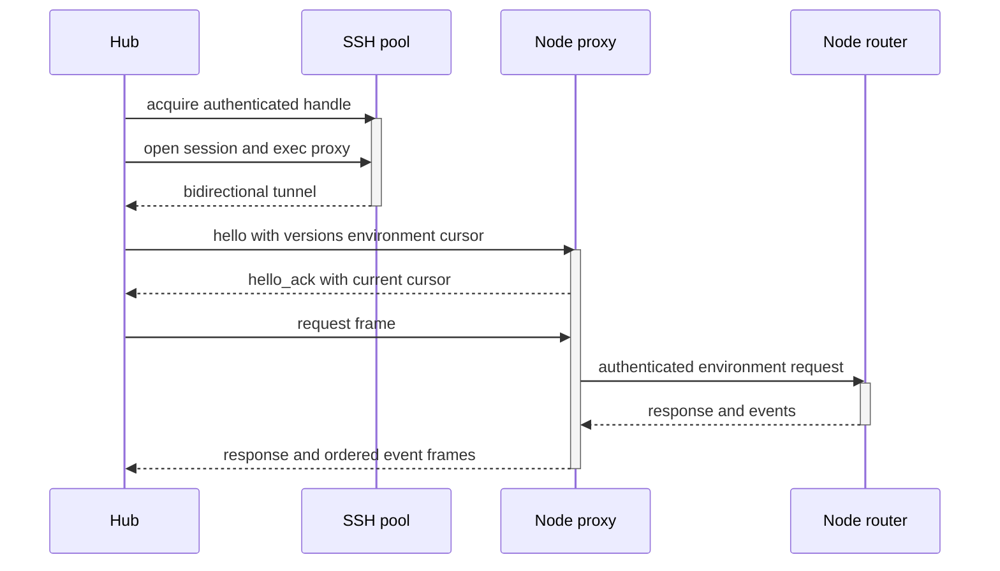

<!-- PAGE_ID: pandamux_11_ssh-remote -->
<details>
<summary>Relevant source files</summary>

The following files were used as evidence for this page:

- [crates/pandamux-core/src/ssh.rs:1-457](../../crates/pandamux-core/src/ssh.rs#L1-L457)
- [crates/pandamux-core/src/remote_manifest.rs:1-266](../../crates/pandamux-core/src/remote_manifest.rs#L1-L266)
- [crates/pandamux-remote/src/lib.rs:1-22](../../crates/pandamux-remote/src/lib.rs#L1-L22)
- [crates/pandamux-remote/src/bootstrap.rs:1-617](../../crates/pandamux-remote/src/bootstrap.rs#L1-L617)
- [crates/pandamux-remote/src/exec.rs:1-117](../../crates/pandamux-remote/src/exec.rs#L1-L117)
- [crates/pandamux-remote/src/pool.rs:1-553](../../crates/pandamux-remote/src/pool.rs#L1-L553)
- [crates/pandamux-remote/src/proxy.rs:1-109](../../crates/pandamux-remote/src/proxy.rs#L1-L109)
- [crates/pandamux-remote/src/sftp.rs:1-269](../../crates/pandamux-remote/src/sftp.rs#L1-L269)
- [crates/pandamux-remote/src/worktree_sync.rs:1-191](../../crates/pandamux-remote/src/worktree_sync.rs#L1-L191)
- [crates/pandamux-protocol/src/environment_rpc.rs:1-41](../../crates/pandamux-protocol/src/environment_rpc.rs#L1-L41)
- [crates/pandamux-protocol/src/fs_rpc.rs:1-96](../../crates/pandamux-protocol/src/fs_rpc.rs#L1-L96)
- [crates/pandamux-protocol/src/git_rpc.rs:1-117](../../crates/pandamux-protocol/src/git_rpc.rs#L1-L117)
- [crates/pandamux-protocol/src/proxy.rs:1-106](../../crates/pandamux-protocol/src/proxy.rs#L1-L106)
- [crates/pandamux-protocol/src/worktree_rpc.rs:1-30](../../crates/pandamux-protocol/src/worktree_rpc.rs#L1-L30)
- [crates/pandamux-server/src/environment_router.rs:1-442](../../crates/pandamux-server/src/environment_router.rs#L1-L442)
- [crates/pandamux-server/src/proxy_connection.rs:1-408](../../crates/pandamux-server/src/proxy_connection.rs#L1-L408)
- [crates/pandamux-server/src/proxy_transport.rs:1-555](../../crates/pandamux-server/src/proxy_transport.rs#L1-L555)

</details>

# SSH Remote Nodes

> **Related Pages**: [Configuration](../core/CONFIGURATION.md), [Local IPC and Security](NAMED_PIPE_IPC.md), [Provider Routing](PROVIDER_ROUTING.md)

---

<!-- BEGIN:AUTOGEN pandamux_11_ssh-remote_model -->
## Remote Node Model

A remote environment is a Linux PandaMUX node reached through an SSH-authenticated channel from the Hub. Persistent host profiles are secretless: they store address, user, port, auth kind, and optional ProxyJump target, while password profiles record only that an interactive secret is required ([ssh.rs:1-24](../../crates/pandamux-core/src/ssh.rs#L1-L24), [ssh.rs:26-43](../../crates/pandamux-core/src/ssh.rs#L26-L43)).

| Model | Purpose | Key fields or behavior |
|---|---|---|
| `SshHostProfile` | Stable saved connection identity | Generated id, editable display name, host, port 22 default, user, auth kind, optional jump host ([ssh.rs:26-57](../../crates/pandamux-core/src/ssh.rs#L26-L57)) |
| `SshProfiles` | Registry keyed by stable id | Upsert/remove by id; compatibility helpers match names case-insensitively ([ssh.rs:59-127](../../crates/pandamux-core/src/ssh.rs#L59-L127)) |
| `RemotePlatform` | Supported execution target | Linux on x86_64 or aarch64, parsed from `uname -sm` ([remote_manifest.rs:5-58](../../crates/pandamux-core/src/remote_manifest.rs#L5-L58)) |
| `RemoteBinaryManifest` | Versioned server/CLI artifact metadata | Maps architecture to filenames, SHA-256, and byte size ([remote_manifest.rs:60-99](../../crates/pandamux-core/src/remote_manifest.rs#L60-L99)) |
| `EnvironmentRouter` | Hub registry of local and remote transports | Distinguishes local routing, connected remote state, forwarding, uploads, and shutdown ([environment_router.rs:20-62](../../crates/pandamux-server/src/environment_router.rs#L20-L62), [environment_router.rs:73-101](../../crates/pandamux-server/src/environment_router.rs#L73-L101)) |

OpenSSH config import skips wildcard aliases, accepts both `key value` and `key=value`, maps `IdentityFile` to key-file auth, preserves `ProxyJump`, and reuses an existing stable id when merging a matching name ([ssh.rs:114-195](../../crates/pandamux-core/src/ssh.rs#L114-L195)). Environment import and list requests have dedicated protocol contracts rather than passing untyped configuration blobs ([environment_rpc.rs:1-41](../../crates/pandamux-protocol/src/environment_rpc.rs#L1-L41)).

Sources: [ssh.rs:1-195](../../crates/pandamux-core/src/ssh.rs#L1-L195), [remote_manifest.rs:5-99](../../crates/pandamux-core/src/remote_manifest.rs#L5-L99), [environment_rpc.rs:1-41](../../crates/pandamux-protocol/src/environment_rpc.rs#L1-L41), [environment_router.rs:20-101](../../crates/pandamux-server/src/environment_router.rs#L20-L101)
<!-- END:AUTOGEN pandamux_11_ssh-remote_model -->

---

<!-- BEGIN:AUTOGEN pandamux_11_ssh-remote_pool -->
## SSH Pool and Host Verification

`SshConnectionPool` keeps one authenticated handle per `HostKey`, where the key includes host, port, user, auth identity, and the recursive ProxyJump identity. Secrets are deliberately not part of the pool key ([pool.rs:15-45](../../crates/pandamux-remote/src/pool.rs#L15-L45)).

```rust
pub struct HostKey {
    pub host: String,
    pub port: u16,
    pub user: String,
    pub auth: String,
    pub proxy_jump: Option<Box<HostKey>>,
}
```

The pool shares slots across clones and serializes acquisition per host. A live handle is reused; a closed one is discarded and redialed, while a ProxyJump connection is itself acquired from the same pool before the target connection is established ([pool.rs:48-105](../../crates/pandamux-remote/src/pool.rs#L48-L105)).

Host verification is fail-closed:

- A known key is accepted through the normal `known_hosts` check ([pool.rs:120-140](../../crates/pandamux-remote/src/pool.rs#L120-L140)).
- An unknown key is learned only when the one-shot trust flag is present; otherwise the failure includes a confirmation fingerprint ([pool.rs:141-180](../../crates/pandamux-remote/src/pool.rs#L141-L180)).
- A changed key is rejected and reports the offending `known_hosts` line for repair outside PandaMUX ([pool.rs:181-205](../../crates/pandamux-remote/src/pool.rs#L181-L205)).
- ProxyJump failures are categorized separately and remain visible to the caller ([pool.rs:61-99](../../crates/pandamux-remote/src/pool.rs#L61-L99)).

Sources: [pool.rs:15-105](../../crates/pandamux-remote/src/pool.rs#L15-L105), [pool.rs:120-245](../../crates/pandamux-remote/src/pool.rs#L120-L245)
<!-- END:AUTOGEN pandamux_11_ssh-remote_pool -->

---

<!-- BEGIN:AUTOGEN pandamux_11_ssh-remote_bootstrap -->
## Bootstrap and Manifest Verification

Bootstrap detects the remote OS/architecture and home directory, verifies or installs the versioned server and CLI artifacts, then discovers a compatible daemon or launches a new node for the requested environment ([bootstrap.rs:113-150](../../crates/pandamux-remote/src/bootstrap.rs#L113-L150), [bootstrap.rs:492-525](../../crates/pandamux-remote/src/bootstrap.rs#L492-L525)).

| Stage | Implementation behavior | Failure boundary |
|---|---|---|
| Detect | Runs `uname -sm` and reads `$HOME` ([bootstrap.rs:113-150](../../crates/pandamux-remote/src/bootstrap.rs#L113-L150)) | Unsupported platform or empty home fails bootstrap |
| Select | Looks up the exact target architecture in the manifest ([bootstrap.rs:150-170](../../crates/pandamux-remote/src/bootstrap.rs#L150-L170)) | Missing architecture entry fails closed |
| Verify/install | Compares SHA-256, uploads to a temporary path, re-verifies remotely, chmods, and atomically moves into the version directory ([remote_manifest.rs:120-171](../../crates/pandamux-core/src/remote_manifest.rs#L120-L171), [bootstrap.rs:200-252](../../crates/pandamux-remote/src/bootstrap.rs#L200-L252)) | Verification failure removes the temporary artifact and stops installation |
| Discover/start | Reads the remote runtime record and checks the PID, environment, version, protocol, and ownership ([bootstrap.rs:254-321](../../crates/pandamux-remote/src/bootstrap.rs#L254-L321)) | Environment mismatch is terminal; active discovered daemons are not replaced |
| Launch | Starts a launcher-owned daemon with its own node database and waits for a matching runtime record ([bootstrap.rs:323-372](../../crates/pandamux-remote/src/bootstrap.rs#L323-L372)) | A timeout is returned instead of assuming readiness |

The checked-in `embedded_remote_manifest()` at this commit contains zero-byte placeholder metadata with the empty-file SHA-256 for both architectures ([remote_manifest.rs:174-208](../../crates/pandamux-core/src/remote_manifest.rs#L174-L208)). Therefore the source tree demonstrates the verification and bootstrap mechanism, but these lines alone are not evidence of populated release artifacts or production acceptance.

Sources: [remote_manifest.rs:120-208](../../crates/pandamux-core/src/remote_manifest.rs#L120-L208), [bootstrap.rs:113-252](../../crates/pandamux-remote/src/bootstrap.rs#L113-L252), [bootstrap.rs:254-372](../../crates/pandamux-remote/src/bootstrap.rs#L254-L372), [bootstrap.rs:492-525](../../crates/pandamux-remote/src/bootstrap.rs#L492-L525)
<!-- END:AUTOGEN pandamux_11_ssh-remote_bootstrap -->

---

<!-- BEGIN:AUTOGEN pandamux_11_ssh-remote_proxy -->
## Exec Proxy Transport

The Hub opens an SSH session channel and executes the remote proxy command, usually `pandamux-server proxy`. The resulting channel stream implements async read/write and carries bounded newline-delimited proxy frames without requiring SSH port-forwarding configuration ([proxy.rs:9-55](../../crates/pandamux-remote/src/proxy.rs#L9-L55), [proxy.rs:55-86](../../crates/pandamux-remote/src/proxy.rs#L55-L86)).



`ProxyMessage` is a tagged protocol containing hello/ack, request/response, cancellation, ordered event, goodbye, and structured error frames. The hello carries both proxy and RPC versions, client version, environment id, and `resume_after_event_seq`; the ack returns the current durable event sequence ([proxy.rs:6-48](../../crates/pandamux-protocol/src/proxy.rs#L6-L48)).

The Hub transport sends hello and waits with a bounded handshake timeout, correlates pending request ids, publishes events, and exposes connected/disconnected/error state through `EnvironmentTransport` ([proxy_transport.rs:61-112](../../crates/pandamux-server/src/proxy_transport.rs#L61-L112), [proxy_transport.rs:241-325](../../crates/pandamux-server/src/proxy_transport.rs#L241-L325), [proxy_transport.rs:366-446](../../crates/pandamux-server/src/proxy_transport.rs#L366-L446)). The node requires hello as the first frame and rejects version or environment mismatches before routing ([proxy_connection.rs:23-122](../../crates/pandamux-server/src/proxy_connection.rs#L23-L122)).

Sources: [proxy.rs:9-109](../../crates/pandamux-remote/src/proxy.rs#L9-L109), [proxy.rs:6-48](../../crates/pandamux-protocol/src/proxy.rs#L6-L48), [proxy_transport.rs:61-446](../../crates/pandamux-server/src/proxy_transport.rs#L61-L446), [proxy_connection.rs:23-122](../../crates/pandamux-server/src/proxy_connection.rs#L23-L122)
<!-- END:AUTOGEN pandamux_11_ssh-remote_proxy -->

---

<!-- BEGIN:AUTOGEN pandamux_11_ssh-remote_files -->
## Files and Worktree Synchronization

Remote filesystem and Git operations remain typed RPC surfaces. File reads/listings carry explicit root and relative paths, Git methods carry thread identity and operation-specific fields, and worktree sync carries a base64 bundle plus target project/branch rather than an arbitrary command string ([fs_rpc.rs:4-68](../../crates/pandamux-protocol/src/fs_rpc.rs#L4-L68), [git_rpc.rs:4-94](../../crates/pandamux-protocol/src/git_rpc.rs#L4-L94), [worktree_rpc.rs:4-30](../../crates/pandamux-protocol/src/worktree_rpc.rs#L4-L30)).

| Operation | Transport/mechanism | Safety behavior |
|---|---|---|
| Browse folders | SFTP subsystem over pooled SSH | Canonicalizes the requested path and returns directory entries ([sftp.rs:32-90](../../crates/pandamux-remote/src/sftp.rs#L32-L90)) |
| Read remote file | SFTP with caller-provided maximum bytes | Rejects oversized reads rather than buffering unbounded content ([sftp.rs:92-134](../../crates/pandamux-remote/src/sftp.rs#L92-L134)) |
| Upload bytes/file | SFTP create/write with private attributes | Upload helper isolates channel errors as structured SSH failures ([sftp.rs:136-269](../../crates/pandamux-remote/src/sftp.rs#L136-L269)) |
| Execute command | Pooled SSH session channel | Captures exit status/stdout/stderr or streams output events ([exec.rs:6-117](../../crates/pandamux-remote/src/exec.rs#L6-L117)) |
| Create delta bundle | Local `git bundle create` into a temporary file | Removes the temporary bundle on success and failure ([worktree_sync.rs:4-30](../../crates/pandamux-remote/src/worktree_sync.rs#L4-L30)) |
| Apply delta bundle | Verify bundle, then fetch into the requested branch ref | Verification precedes fetch; temporary input is removed ([worktree_sync.rs:33-101](../../crates/pandamux-remote/src/worktree_sync.rs#L33-L101)) |

`EnvironmentRouter::upload_file` forwards uploads only through a registered environment transport; the proxy transport reports a structured error if no authenticated SFTP side channel exists ([environment_router.rs:220-267](../../crates/pandamux-server/src/environment_router.rs#L220-L267), [proxy_transport.rs:446-478](../../crates/pandamux-server/src/proxy_transport.rs#L446-L478)).

Sources: [fs_rpc.rs:4-68](../../crates/pandamux-protocol/src/fs_rpc.rs#L4-L68), [git_rpc.rs:4-94](../../crates/pandamux-protocol/src/git_rpc.rs#L4-L94), [worktree_rpc.rs:4-30](../../crates/pandamux-protocol/src/worktree_rpc.rs#L4-L30), [sftp.rs:32-269](../../crates/pandamux-remote/src/sftp.rs#L32-L269), [exec.rs:6-117](../../crates/pandamux-remote/src/exec.rs#L6-L117), [worktree_sync.rs:4-101](../../crates/pandamux-remote/src/worktree_sync.rs#L4-L101)
<!-- END:AUTOGEN pandamux_11_ssh-remote_files -->

---

<!-- BEGIN:AUTOGEN pandamux_11_ssh-remote_recovery -->
## Reconnect and Cleanup

Proxy recovery is cursor-based rather than request replay. The Hub retains the last observed durable event sequence, includes it in the next hello, and the node streams committed events after that cursor through the sequence captured at handshake ([proxy_transport.rs:264-277](../../crates/pandamux-server/src/proxy_transport.rs#L264-L277), [proxy_connection.rs:135-173](../../crates/pandamux-server/src/proxy_connection.rs#L135-L173)).

- Replacing a registered environment transport stops the old event-forwarding task and awaits transport shutdown before the new registration becomes authoritative ([environment_router.rs:101-164](../../crates/pandamux-server/src/environment_router.rs#L101-L164), [environment_router.rs:269-276](../../crates/pandamux-server/src/environment_router.rs#L269-L276)).
- A dropped in-flight request sends a best-effort proxy cancellation, and transport shutdown sends `Goodbye` before closing owned I/O tasks ([proxy_transport.rs:325-331](../../crates/pandamux-server/src/proxy_transport.rs#L325-L331), [proxy_transport.rs:500-524](../../crates/pandamux-server/src/proxy_transport.rs#L500-L524)).
- Pending requests are failed when the proxy reader terminates, preventing callers from hanging across disconnect ([proxy_transport.rs:178-237](../../crates/pandamux-server/src/proxy_transport.rs#L178-L237), [proxy_transport.rs:541-555](../../crates/pandamux-server/src/proxy_transport.rs#L541-L555)).
- A launcher-owned daemon is stopped for upgrade only after the remote activity probe finds no child processes and no active Unix-socket clients; otherwise upgrade is deferred ([bootstrap.rs:375-453](../../crates/pandamux-remote/src/bootstrap.rs#L375-L453)).
- Explicit teardown sends `SIGTERM`, polls for exit, and removes the runtime record only after the process is gone ([bootstrap.rs:456-490](../../crates/pandamux-remote/src/bootstrap.rs#L456-L490)).
- A discovered daemon is not treated as launcher-owned, so normal disconnect cleanup does not claim ownership of a pre-existing service ([bootstrap.rs:292-317](../../crates/pandamux-remote/src/bootstrap.rs#L292-L317)).

This code defines recovery mechanics but is not, by itself, evidence that the repository's still-open Phase 4 physical disconnect, sleep, capacity exhaustion, release, or production-acceptance gates have passed.

Sources: [proxy_transport.rs:178-331](../../crates/pandamux-server/src/proxy_transport.rs#L178-L331), [proxy_transport.rs:500-555](../../crates/pandamux-server/src/proxy_transport.rs#L500-L555), [proxy_connection.rs:135-173](../../crates/pandamux-server/src/proxy_connection.rs#L135-L173), [environment_router.rs:101-276](../../crates/pandamux-server/src/environment_router.rs#L101-L276), [bootstrap.rs:292-490](../../crates/pandamux-remote/src/bootstrap.rs#L292-L490)
<!-- END:AUTOGEN pandamux_11_ssh-remote_recovery -->

---
