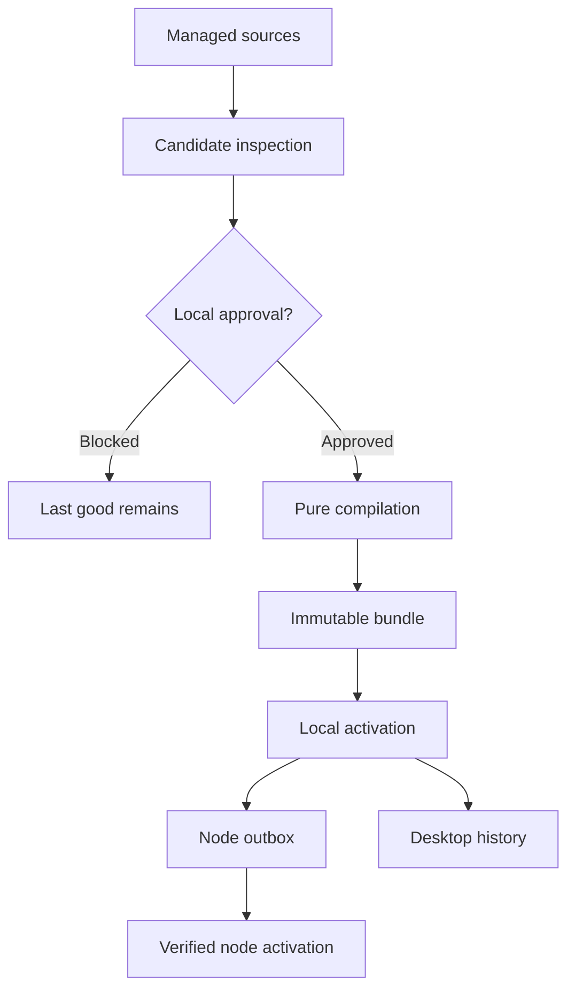
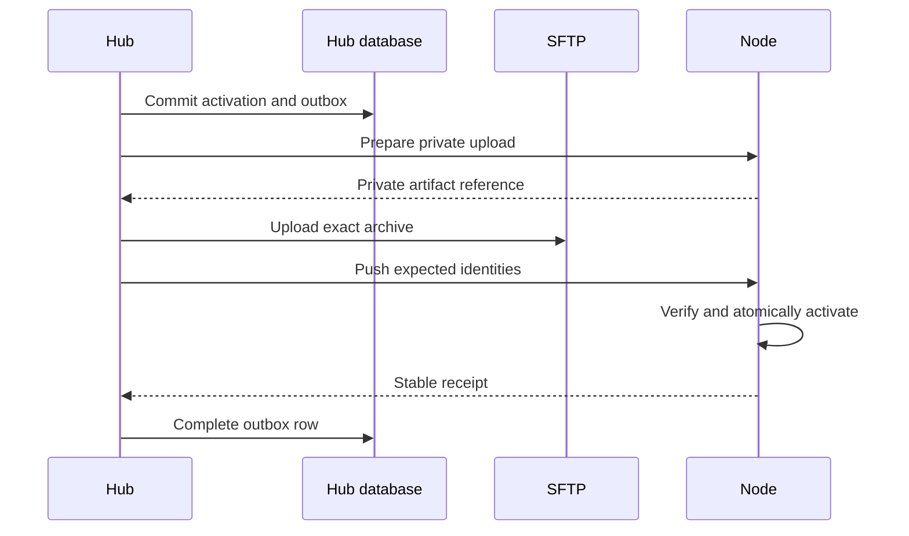

<!-- PAGE_ID: pandamux_17_trusted-configuration -->
<details>
<summary>Relevant source files</summary>

The following files were used as evidence for this page:

- [crates/pandamux-core/src/configuration.rs:1-355](../../crates/pandamux-core/src/configuration.rs#L1-L355)
- [crates/pandamux-core/src/mutation.rs:1-113](../../crates/pandamux-core/src/mutation.rs#L1-L113)
- [crates/pandamux-core/src/settings.rs:20-51](../../crates/pandamux-core/src/settings.rs#L20-L51)
- [crates/pandamux-orchestrator/src/configuration.rs:18-234](../../crates/pandamux-orchestrator/src/configuration.rs#L18-L234)
- [crates/pandamux-protocol/src/instructions_rpc.rs:1-125](../../crates/pandamux-protocol/src/instructions_rpc.rs#L1-L125)
- [crates/pandamux-protocol/src/personal_config_rpc.rs:1-59](../../crates/pandamux-protocol/src/personal_config_rpc.rs#L1-L59)
- [crates/pandamux-protocol/src/project_layer_rpc.rs:1-58](../../crates/pandamux-protocol/src/project_layer_rpc.rs#L1-L58)
- [crates/pandamux-server/src/data_paths.rs:1-328](../../crates/pandamux-server/src/data_paths.rs#L1-L328)
- [crates/pandamux-server/src/windows_security.rs:119-445](../../crates/pandamux-server/src/windows_security.rs#L119-L445)
- [crates/pandamux-server/src/managed_git.rs:285-869](../../crates/pandamux-server/src/managed_git.rs#L285-L869)
- [crates/pandamux-server/src/personal_repo.rs:98-355](../../crates/pandamux-server/src/personal_repo.rs#L98-L355)
- [crates/pandamux-server/src/instructions_service.rs:102-510](../../crates/pandamux-server/src/instructions_service.rs#L102-L510)
- [crates/pandamux-server/src/configuration_service.rs:66-520](../../crates/pandamux-server/src/configuration_service.rs#L66-L520)
- [crates/pandamux-server/src/bundle_store.rs:122-320](../../crates/pandamux-server/src/bundle_store.rs#L122-L320)
- [crates/pandamux-server/src/bundle_sync.rs:57-323](../../crates/pandamux-server/src/bundle_sync.rs#L57-L323)
- [crates/pandamux-server/src/mutation_service.rs:105-304](../../crates/pandamux-server/src/mutation_service.rs#L105-L304)
- [crates/pandamux-server/src/store/migrations.rs:1492-1705](../../crates/pandamux-server/src/store/migrations.rs#L1492-L1705)
- [crates/pandamux-server/src/store/configuration_phase5b.rs:993-1435](../../crates/pandamux-server/src/store/configuration_phase5b.rs#L993-L1435)
- [crates/pandamux-server/src/store/mutation_phase5b.rs:44-365](../../crates/pandamux-server/src/store/mutation_phase5b.rs#L44-L365)
- [crates/pandamux-server/src/mcp_server.rs:21-332](../../crates/pandamux-server/src/mcp_server.rs#L21-L332)
- [crates/pandamux-client/src/configuration_projection.rs:12-110](../../crates/pandamux-client/src/configuration_projection.rs#L12-L110)
- [crates/pandamux-desktop/src/mutation_confirmation.rs:9-440](../../crates/pandamux-desktop/src/mutation_confirmation.rs#L9-L440)
- [crates/pandamux-desktop/src/trusted_configuration_view.rs:10-235](../../crates/pandamux-desktop/src/trusted_configuration_view.rs#L10-L235)
- [tasks/2026-10-09-phase-5b-trusted-configuration.md:509-552](../../tasks/2026-10-09-phase-5b-trusted-configuration.md#L509-L552)

</details>

# Trusted Configuration

> **Related Pages**: [Architecture](../core/ARCHITECTURE.md), [GPUI Desktop](../core/UI_SHELL.md), [Application Runtime](../core/APP_RUNTIME.md), [Configuration](../core/CONFIGURATION.md), [Agent Orchestration](AGENT_ORCHESTRATION.md)

---

<!-- BEGIN:AUTOGEN pandamux_17_trusted-configuration_overview -->
## Overview

Phase 5B supplies the trusted source and activation control plane around the
pure Phase 5A compiler. It separates source commits, content digests, compiled
bundle identity, transfer archive identity, and monotonic configuration
revision so one value cannot be reused as evidence for another
([configuration.rs:98-159](../../crates/pandamux-core/src/configuration.rs#L98-L159)).

The server combines active instructions, the managed personal repository, an
exact trusted project layer, and revisioned local settings before calling the
pure compiler. It then packages the result as one verified immutable object
whose source manifest retains every contributing identity
([configuration_service.rs:192-377](../../crates/pandamux-server/src/configuration_service.rs#L192-L377),
[configuration_service.rs:380-490](../../crates/pandamux-server/src/configuration_service.rs#L380-L490)).

The user-facing surface is deliberately review-oriented. It exposes the
last-good source and bundle, candidate safety and issues, exact project trust,
pending confirmations, configuration audit history, personal Git history, and
forward-only revert actions without making raw proposal values part of the
presentation projection
([configuration_projection.rs:12-110](../../crates/pandamux-client/src/configuration_projection.rs#L12-L110),
[trusted_configuration_view.rs:112-235](../../crates/pandamux-desktop/src/trusted_configuration_view.rs#L112-L235)).

Sources: [configuration.rs:98-332](../../crates/pandamux-core/src/configuration.rs#L98-L332), [configuration_service.rs:192-490](../../crates/pandamux-server/src/configuration_service.rs#L192-L490), [configuration_projection.rs:12-110](../../crates/pandamux-client/src/configuration_projection.rs#L12-L110), [trusted_configuration_view.rs:112-235](../../crates/pandamux-desktop/src/trusted_configuration_view.rs#L112-L235)
<!-- END:AUTOGEN pandamux_17_trusted-configuration_overview -->

---

<!-- BEGIN:AUTOGEN pandamux_17_trusted-configuration_architecture -->
## Architecture and Ownership

The Hub is the composition owner. Domain crates define typed records, the pure
orchestrator inspects and compiles values, the server owns files, Git, SQLite,
activation, and transport, while clients hold only redacted presentation state.



| Component | Responsibility | Evidence |
|---|---|---|
| Core | Validated identities, revisions, source, trust, activation, proposal, resolution, and audit records | ([configuration.rs:98-332](../../crates/pandamux-core/src/configuration.rs#L98-L332), [mutation.rs:11-113](../../crates/pandamux-core/src/mutation.rs#L11-L113)) |
| Orchestrator | Deterministic candidate file and behavioral diff, issue collection, safety classification, and local-approval decision | ([configuration.rs:18-234](../../crates/pandamux-orchestrator/src/configuration.rs#L18-L234)) |
| Server | Private path ownership, managed Git, candidate acquisition, trust, compilation, persistence, activation, distribution, and mutation resolution | ([data_paths.rs:6-132](../../crates/pandamux-server/src/data_paths.rs#L6-L132), [configuration_service.rs:66-520](../../crates/pandamux-server/src/configuration_service.rs#L66-L520)) |
| Protocol | Typed local-control and node-transfer contracts with deny-unknown-field decoding | ([bundle_rpc.rs:7-56](../../crates/pandamux-protocol/src/bundle_rpc.rs#L7-L56), [mutation_rpc.rs:4-45](../../crates/pandamux-protocol/src/mutation_rpc.rs#L4-L45)) |
| Client and desktop | Redacted projections, pessimistic loading, accessible confirmation cards, and explicit intents | ([configuration_projection.rs:12-110](../../crates/pandamux-client/src/configuration_projection.rs#L12-L110), [mutation_confirmation.rs:9-277](../../crates/pandamux-desktop/src/mutation_confirmation.rs#L9-L277)) |

Only the server mutates durable configuration. Request capabilities keep MCP,
provider-child, node-proxy, local-control, and internal callers distinct, and
the authenticated environment plus connection identity are server-owned
request context fields
([request_context.rs:26-108](../../crates/pandamux-server/src/request_context.rs#L26-L108)).

Sources: [configuration.rs:18-234](../../crates/pandamux-orchestrator/src/configuration.rs#L18-L234), [configuration_service.rs:66-520](../../crates/pandamux-server/src/configuration_service.rs#L66-L520), [request_context.rs:26-108](../../crates/pandamux-server/src/request_context.rs#L26-L108)
<!-- END:AUTOGEN pandamux_17_trusted-configuration_architecture -->

---

<!-- BEGIN:AUTOGEN pandamux_17_trusted-configuration_storage -->
## Storage, Identity, and Migration

One injected `DataPaths` graph names the database, backups, runtime,
attachments, managed personal repository, instructions mirrors, candidate
snapshots, immutable bundles, upload staging, and recovery locations. Root and
child directories are validated before use, an injected database path must
remain below the owned root, and Windows reparse points are rejected
([data_paths.rs:45-82](../../crates/pandamux-server/src/data_paths.rs#L45-L82),
[data_paths.rs:164-235](../../crates/pandamux-server/src/data_paths.rs#L164-L235)).

On Windows, newly created managed directories use a protected, inheritable
DACL owned by the current user. Existing managed paths fail closed unless the
owner and every access-allow ACE belong to that user or the explicit SYSTEM or
Administrators recovery principals; broad access, unsupported ACEs, and
insufficient current-user access are rejected
([windows_security.rs:119-255](../../crates/pandamux-server/src/windows_security.rs#L119-L255)).
Native tests exercise both the descriptor rejection cases and directory
creation, while the path graph has a Windows-only junction-substitution test
([windows_security.rs:407-445](../../crates/pandamux-server/src/windows_security.rs#L407-L445),
[data_paths.rs:294-327](../../crates/pandamux-server/src/data_paths.rs#L294-L327)).

The identity boundary is explicit in code
([configuration.rs:98-107](../../crates/pandamux-core/src/configuration.rs#L98-L107)):

```rust
lowercase_hex_identity!(SourceCommitSha, "source commit SHA", [40, 64]);
lowercase_hex_identity!(ContentSha256, "content SHA-256", [64]);
lowercase_hex_identity!(BundleSha, "bundle SHA-256", [64]);
lowercase_hex_identity!(ArchiveSha256, "archive SHA-256", [64]);

pub struct ConfigurationRevision(NonZeroU64);
```

| Migration 13 record | Durable purpose |
|---|---|
| Settings revision and update time | Exact compare-and-swap against the state a reviewer saw ([migrations.rs:1492-1499](../../crates/pandamux-server/src/store/migrations.rs#L1492-L1499)) |
| Project repository and trust | Canonical organization, project, remote, root, and exact content binding ([migrations.rs:1501-1528](../../crates/pandamux-server/src/store/migrations.rs#L1501-L1528)) |
| Personal state, sources, and candidates | Managed HEAD identity, request replay, tracked refs, last-good state, inspection, and safety ([migrations.rs:1530-1600](../../crates/pandamux-server/src/store/migrations.rs#L1530-L1600)) |
| Configuration audit and bundle tables | Immutable objects, single active pointer, activation history, and bounded distribution outbox ([migrations.rs:1602-1660](../../crates/pandamux-server/src/store/migrations.rs#L1602-L1660)) |
| Mutation proposal and audit | Caller-keyed idempotency, canonical reviewed content, terminal resolution, and one immutable application receipt ([migrations.rs:1662-1699](../../crates/pandamux-server/src/store/migrations.rs#L1662-L1699)) |

Migration 13 is one SQLite transaction and records its migration number only
after every additive statement succeeds
([migrations.rs:1492-1705](../../crates/pandamux-server/src/store/migrations.rs#L1492-L1705)).

Sources: [data_paths.rs:45-235](../../crates/pandamux-server/src/data_paths.rs#L45-L235), [windows_security.rs:119-255](../../crates/pandamux-server/src/windows_security.rs#L119-L255), [configuration.rs:98-159](../../crates/pandamux-core/src/configuration.rs#L98-L159), [migrations.rs:1492-1705](../../crates/pandamux-server/src/store/migrations.rs#L1492-L1705)
<!-- END:AUTOGEN pandamux_17_trusted-configuration_storage -->

---

<!-- BEGIN:AUTOGEN pandamux_17_trusted-configuration_layers -->
## Source Layers and Trust

Each authored layer has a different ownership and trust rule. The compiler
retains origins across layers, but an upper authored layer cannot silently
widen the local access ceiling.

| Layer | Acquisition and identity | Trust behavior |
|---|---|---|
| Instructions | Private bare mirror with remote discovery, bounded fetch, immutable candidate refs, optional signature verification, and no-checkout inspection | Unchanged discovery skips fetch; invalid, rewritten, missing, offline, or unsigned candidates stay visible without replacing last good ([instructions_service.rs:135-365](../../crates/pandamux-server/src/instructions_service.rs#L135-L365)) |
| Personal | Private plumbing-only repository with one active main ref and revisioned request identity | Edits use expected-HEAD compare-and-swap; history and exact inverse commits make rollback forward-only ([personal_repo.rs:120-355](../../crates/pandamux-server/src/personal_repo.rs#L120-L355)) |
| Project | Strict `.pandamux/` snapshot discovered from the server-owned workspace | Approval binds organization, project, repository identity, canonical root, and exact content digest; changed identity invalidates trust ([configuration_service.rs:85-190](../../crates/pandamux-server/src/configuration_service.rs#L85-L190)) |
| Local settings | Revisioned trusted-configuration subset containing disabled agents and exact FullAccess opt-ins | Applied after repository policy validation; unrelated provider paths, environment overrides, and arbitrary provider settings are excluded from durable proposals ([settings.rs:20-51](../../crates/pandamux-core/src/settings.rs#L20-L51), [mutation.rs:19-35](../../crates/pandamux-core/src/mutation.rs#L19-L35)) |

Every managed Git command first validates each existing path component and any
additional artifact path against the owned app-data graph. It rejects links,
Windows reparse points, unsafe ownership or ACLs, and paths outside the root;
Windows children also use `CREATE_NO_WINDOW`
([managed_git.rs:285-323](../../crates/pandamux-server/src/managed_git.rs#L285-L323),
[managed_git.rs:754-869](../../crates/pandamux-server/src/managed_git.rs#L754-L869)).
All invocations force long-path support and durable Git writes while disabling
hooks, signing, automatic GC, and maintenance
([managed_git.rs:726-752](../../crates/pandamux-server/src/managed_git.rs#L726-L752)).

Tracking mode is typed rather than inferred from a free-form ref
([configuration.rs:162-180](../../crates/pandamux-core/src/configuration.rs#L162-L180)):

```rust
pub enum TrackingRef {
    Branch(String),
    Tag(String),
    Commit(SourceCommitSha),
}
```

Candidate inspection produces deterministic file changes, behavioral changes
for agents, access, tools, environments, capabilities, prompts, knowledge,
classes, routing, verification, schedules, identities, trust, settings, and
origins, plus a digest-bound ordered issue set
([configuration.rs:44-122](../../crates/pandamux-orchestrator/src/configuration.rs#L44-L122),
[configuration.rs:167-234](../../crates/pandamux-orchestrator/src/configuration.rs#L167-L234)).

Sources: [managed_git.rs:285-323](../../crates/pandamux-server/src/managed_git.rs#L285-L323), [managed_git.rs:726-869](../../crates/pandamux-server/src/managed_git.rs#L726-L869), [instructions_service.rs:135-365](../../crates/pandamux-server/src/instructions_service.rs#L135-L365), [personal_repo.rs:120-355](../../crates/pandamux-server/src/personal_repo.rs#L120-L355), [configuration_service.rs:85-377](../../crates/pandamux-server/src/configuration_service.rs#L85-L377), [configuration.rs:44-234](../../crates/pandamux-orchestrator/src/configuration.rs#L44-L234)
<!-- END:AUTOGEN pandamux_17_trusted-configuration_layers -->

---

<!-- BEGIN:AUTOGEN pandamux_17_trusted-configuration_activation -->
## Activation and Node Distribution

Activation begins only after compilation and immutable materialization verify
the canonical archive and source identities. The active pointer, candidate
transition, configuration audit, and pending node outbox commit in one SQLite
transaction, so restart exposes the old complete state or the new complete
state, never a mixed pointer
([bundle_store.rs:143-160](../../crates/pandamux-server/src/bundle_store.rs#L143-L160),
[bundle_sync.rs:80-156](../../crates/pandamux-server/src/bundle_sync.rs#L80-L156)).



The transfer contract binds schema version, transfer, environment, bundle,
archive hash and size, source manifest, compiler version, private artifact
reference, and expected prior bundle. A successful result returns the stored,
active, and prior bundle identities plus node receipt time
([bundle_rpc.rs:7-56](../../crates/pandamux-protocol/src/bundle_rpc.rs#L7-L56)).

Distribution marks one row uploading before transport, uses authenticated
environment routing for both RPC and SFTP, validates every returned identity,
and then stores the receipt. Transport failure resets the row to pending so a
later reconnect drains the same durable work
([bundle_sync.rs:159-317](../../crates/pandamux-server/src/bundle_sync.rs#L159-L317)).

Sources: [bundle_store.rs:122-320](../../crates/pandamux-server/src/bundle_store.rs#L122-L320), [bundle_sync.rs:80-317](../../crates/pandamux-server/src/bundle_sync.rs#L80-L317), [bundle_rpc.rs:7-56](../../crates/pandamux-protocol/src/bundle_rpc.rs#L7-L56), [configuration_phase5b.rs:993-1435](../../crates/pandamux-server/src/store/configuration_phase5b.rs#L993-L1435)
<!-- END:AUTOGEN pandamux_17_trusted-configuration_activation -->

---

<!-- BEGIN:AUTOGEN pandamux_17_trusted-configuration_mutations -->
## Mutation Proposals and Local Resolution

A proposal persists the server-stamped caller, tool, authenticated environment,
target, expected revision, canonical old and new JSON plus digests, impact,
expiry, and resolution before notification. Identity is deduplicated by caller,
tool, and request ID; the same identity with different reviewed content fails
closed
([mutation_service.rs:119-163](../../crates/pandamux-server/src/mutation_service.rs#L119-L163),
[mutation_phase5b.rs:44-103](../../crates/pandamux-server/src/store/mutation_phase5b.rs#L44-L103)).

Proposal resolution is a one-way state machine
([mutation.rs:64-79](../../crates/pandamux-core/src/mutation.rs#L64-L79)):

```rust
pub enum MutationResolution {
    Pending,
    ApprovedApplied,
    Rejected,
    Expired,
    CancelledDisconnected,
    SupersededRevision,
}
```

| Operation | Authority | Durable behavior |
|---|---|---|
| Propose | Internal, local control, or authenticated MCP adapter | Canonicalize, digest, persist, and replay an identical identity ([mutation_service.rs:119-163](../../crates/pandamux-server/src/mutation_service.rs#L119-L163)) |
| List or get | Local control only | Sweep expired proposals first and return bounded typed records ([mutation_service.rs:165-201](../../crates/pandamux-server/src/mutation_service.rs#L165-L201)) |
| Approve once | Local control only | Verify pending state, expiry, expected revision, and old digest; commit DB target, audit, and resolution together ([mutation_service.rs:203-272](../../crates/pandamux-server/src/mutation_service.rs#L203-L272), [mutation_phase5b.rs:246-365](../../crates/pandamux-server/src/store/mutation_phase5b.rs#L246-L365)) |
| Reject, expire, or disconnect | Local control, sweeper, or owned connection cleanup | Set one terminal state without applying target content ([mutation_service.rs:274-302](../../crates/pandamux-server/src/mutation_service.rs#L274-L302), [mutation_phase5b.rs:191-244](../../crates/pandamux-server/src/store/mutation_phase5b.rs#L191-L244)) |

MCP has one proposal-only `propose_agent_access` tool. Required non-null fields
are decoded into a typed request, only the trusted settings subset is persisted,
and the result explicitly states that no settings changed before local approval
([mcp_server.rs:56-74](../../crates/pandamux-server/src/mcp_server.rs#L56-L74),
[mcp_server.rs:231-332](../../crates/pandamux-server/src/mcp_server.rs#L231-L332)).

Sources: [mutation.rs:11-113](../../crates/pandamux-core/src/mutation.rs#L11-L113), [mutation_service.rs:105-304](../../crates/pandamux-server/src/mutation_service.rs#L105-L304), [mutation_phase5b.rs:44-365](../../crates/pandamux-server/src/store/mutation_phase5b.rs#L44-L365), [mcp_server.rs:56-332](../../crates/pandamux-server/src/mcp_server.rs#L56-L332)
<!-- END:AUTOGEN pandamux_17_trusted-configuration_mutations -->

---

<!-- BEGIN:AUTOGEN pandamux_17_trusted-configuration_desktop -->
## Desktop Review and Accessibility

The client projection converts a durable proposal into a presentation record
that retains caller, role, tool, environment, target, expected revision,
digests, affected scopes, access, FullAccess, budget, tracking, trust, issues,
expiry, textual status, and resolvability. Raw old and new values are replaced
with safe changed-section labels
([configuration_projection.rs:12-90](../../crates/pandamux-client/src/configuration_projection.rs#L12-L90)).

The generic confirmation card exposes a named tab group, textual status, every
review dimension, expiry, and separately named `Approve once` and `Reject`
buttons. Pending actions are keyboard-focusable and activatable; terminal cards
keep the visible controls while exposing them as disabled, non-focusable, and
non-invokable through AccessKit, so color is not the sole carrier of state
([mutation_confirmation.rs:9-143](../../crates/pandamux-desktop/src/mutation_confirmation.rs#L9-L143),
[mutation_confirmation.rs:192-277](../../crates/pandamux-desktop/src/mutation_confirmation.rs#L192-L277)).
Render-level tests cover Tab traversal plus Enter and Space activation and the
terminal disabled semantics
([mutation_confirmation.rs:369-439](../../crates/pandamux-desktop/src/mutation_confirmation.rs#L369-L439)).

The Trusted Configuration view provides explicit intents for refresh, proposal
approval and rejection, candidate approval, exact project trust and revocation,
personal revert, and retained-bundle reactivation. Candidate approval remains
disabled while loading, for invalid candidates, without a loaded project, or
outside an approval-eligible state
([trusted_configuration_view.rs:10-79](../../crates/pandamux-desktop/src/trusted_configuration_view.rs#L10-L79)).

The main panel presents source and last-good activation, candidate inspection,
project trust, pending and recent confirmations, configuration history, and
personal history as separate sections. Refresh and action controls are disabled
while a request is pending, and status messages use an accessible status role
([trusted_configuration_view.rs:112-235](../../crates/pandamux-desktop/src/trusted_configuration_view.rs#L112-L235)).

Sources: [configuration_projection.rs:12-110](../../crates/pandamux-client/src/configuration_projection.rs#L12-L110), [mutation_confirmation.rs:9-439](../../crates/pandamux-desktop/src/mutation_confirmation.rs#L9-L439), [trusted_configuration_view.rs:10-235](../../crates/pandamux-desktop/src/trusted_configuration_view.rs#L10-L235)
<!-- END:AUTOGEN pandamux_17_trusted-configuration_desktop -->

---

<!-- BEGIN:AUTOGEN pandamux_17_trusted-configuration_failure-modes -->
## Failure Modes and Evidence Boundaries

Ambiguous state remains visible and inactive. Recovery uses exact revisions,
retained commits, immutable objects, and durable outbox rows rather than
guessing that an interrupted operation completed.

| Failure | Durable result | Recovery behavior |
|---|---|---|
| Managed root, descendant, or Git path has unsafe ownership, ACLs, a link, or a Windows reparse point | Startup or command fails before using the path | Repair the exact private path boundary; never continue through an untrusted alias ([data_paths.rs:164-235](../../crates/pandamux-server/src/data_paths.rs#L164-L235), [managed_git.rs:754-869](../../crates/pandamux-server/src/managed_git.rs#L754-L869)) |
| Candidate fetch, authentication, signature, validation, or history check fails | Candidate is blocked or check records a safe reason; last-good source remains active | Repair the source or policy, then check again against its current revision ([instructions_service.rs:135-365](../../crates/pandamux-server/src/instructions_service.rs#L135-L365)) |
| Project identity or content changes | Existing exact trust no longer matches and the layer stays visible but inactive | Inspect and approve the newly displayed identity and digest ([configuration_service.rs:85-190](../../crates/pandamux-server/src/configuration_service.rs#L85-L190)) |
| Activation transaction fails | Prior active bundle remains current | Retry verified materialization and one atomic activation transaction ([bundle_sync.rs:80-156](../../crates/pandamux-server/src/bundle_sync.rs#L80-L156)) |
| Node is offline or transfer fails | Outbox remains pending and the node keeps its prior bundle | Reconnect and drain the same distribution row ([bundle_sync.rs:159-195](../../crates/pandamux-server/src/bundle_sync.rs#L159-L195)) |
| Proposal expires, disconnects, is rejected, or drifts | Terminal proposal with no target mutation | Refresh the current state and create a new reviewed proposal ([mutation_service.rs:203-302](../../crates/pandamux-server/src/mutation_service.rs#L203-L302)) |
| DB-backed proposal apply fails | Target change, audit, and resolution roll back together | Retry the same proposal while its predicates remain current ([mutation_phase5b.rs:246-319](../../crates/pandamux-server/src/store/mutation_phase5b.rs#L246-L319)) |

The Phase 5B contract requires native verification for hidden Git children,
private path ownership and reparse rejection, atomic replacement, and
confirmation accessibility, and it forbids claiming physical acceptance
without physical evidence
([2026-10-09-phase-5b-trusted-configuration.md:509-552](../../tasks/2026-10-09-phase-5b-trusted-configuration.md#L509-L552)).
Exact 0.60.88 passed those required native rows on a physical Windows host with
a limited interactive user. That run did not exercise an external Git host or
SFTP node, and Phase 5B-specific High Contrast, scaling, reduced-motion, and
Narrator checks were not run. The exact local and native evidence plus every
absent external or production claim are recorded in
[Phase 5B Trusted Configuration Acceptance](../operations/PHASE5B_ACCEPTANCE.md).

Sources: [data_paths.rs:164-235](../../crates/pandamux-server/src/data_paths.rs#L164-L235), [managed_git.rs:754-869](../../crates/pandamux-server/src/managed_git.rs#L754-L869), [instructions_service.rs:135-365](../../crates/pandamux-server/src/instructions_service.rs#L135-L365), [configuration_service.rs:85-190](../../crates/pandamux-server/src/configuration_service.rs#L85-L190), [bundle_sync.rs:80-195](../../crates/pandamux-server/src/bundle_sync.rs#L80-L195), [mutation_service.rs:203-302](../../crates/pandamux-server/src/mutation_service.rs#L203-L302), [mutation_phase5b.rs:246-319](../../crates/pandamux-server/src/store/mutation_phase5b.rs#L246-L319), [2026-10-09-phase-5b-trusted-configuration.md:509-552](../../tasks/2026-10-09-phase-5b-trusted-configuration.md#L509-L552)
<!-- END:AUTOGEN pandamux_17_trusted-configuration_failure-modes -->

---
