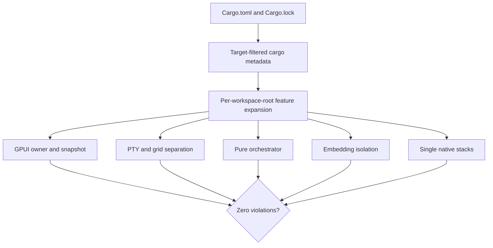

<!-- PAGE_ID: pandamux_16_dependency-policy -->

Relevant source files

The following files were used as evidence for this page:

- [Cargo.toml:1-48](../../Cargo.toml#L1-L48)
- [Cargo.lock:1-10409](../../Cargo.lock#L1-L10409)
- [rust-toolchain.toml:1-4](../../rust-toolchain.toml#L1-L4)
- [deny.toml:1-52](../../deny.toml#L1-L52)
- [rust.yml:1-171](../../.github/workflows/rust.yml#L1-L171)
- [release.yml:1-179](../../.github/workflows/release.yml#L1-L179)
- [crates/pandamux-orchestrator/Cargo.toml:1-14](../../crates/pandamux-orchestrator/Cargo.toml#L1-L14)
- [tools/pandamux-boundary-check/src/lib.rs:1-761](../../tools/pandamux-boundary-check/src/lib.rs#L1-L761)
- [tools/pandamux-boundary-check/src/main.rs:1-42](../../tools/pandamux-boundary-check/src/main.rs#L1-L42)
- [tools/pandamux-boundary-check/tests/fixture_workspaces.rs:1-80](../../tools/pandamux-boundary-check/tests/fixture_workspaces.rs#L1-L80)
- [tasks/plan-rewrite.md:2912-2936](../../tasks/plan-rewrite.md#L2912-L2936)

# Toolchain and Dependency Policy

> **Related Pages**: [Getting Started](../GETTING_STARTED.md), [Architecture](../core/ARCHITECTURE.md), [Release and Packaging](RELEASE.md)

---

<!-- BEGIN:AUTOGEN pandamux_16_dependency-policy_toolchains -->
## Toolchains and MSRV

PandaMUX separates a reproducible development/evidence toolchain from its declared minimum supported Rust version (MSRV).

| Contract | Version | Enforced scope |
|---|---:|---|
| Development and evidence | Rust `1.98.1` | The repository toolchain file includes `rustfmt` and Clippy, and the normal Windows, macOS, Linux-musl, and dormant release workflows use the same pinned version ([rust-toolchain.toml:1-4](../../rust-toolchain.toml#L1-L4), [rust.yml:56-59](../../.github/workflows/rust.yml#L56-L59), [rust.yml:104-105](../../.github/workflows/rust.yml#L104-L105), [rust.yml:128-131](../../.github/workflows/rust.yml#L128-L131), [release.yml:39-40](../../.github/workflows/release.yml#L39-L40)) |
| Declared MSRV | Rust `1.89` | The complete Windows product graph and the Linux headless graph excluding the desktop are separate compile gates ([Cargo.toml:25-30](../../Cargo.toml#L25-L30), [rust.yml:147-171](../../.github/workflows/rust.yml#L147-L171)) |

The Linux MSRV job is deliberately scoped: it does not claim that the native Linux GPUI desktop graph compiles on Rust 1.89. Likewise, target-filtered metadata validation is dependency-policy evidence, not a substitute for compiling on each native platform.

Sources: [Cargo.toml:25-30](../../Cargo.toml#L25-L30), [rust-toolchain.toml:1-4](../../rust-toolchain.toml#L1-L4), [rust.yml:56-59](../../.github/workflows/rust.yml#L56-L59), [rust.yml:97-171](../../.github/workflows/rust.yml#L97-L171), [release.yml:39-40](../../.github/workflows/release.yml#L39-L40)
<!-- END:AUTOGEN pandamux_16_dependency-policy_toolchains -->

---

<!-- BEGIN:AUTOGEN pandamux_16_dependency-policy_pins -->
## Direct Dependency Pinning

The workspace commits `Cargo.lock` and exact-pins shared dependencies selected for protocol, parsing, native integration, security-sensitive transport, and evidence stability. The Phase 5 gate directly pins `schemars` `1.2.2` and typed YAML parser `serde-saphyr` `1.3.0`; the orchestrator consumes them without importing a runtime or platform adapter ([Cargo.toml:32-48](../../Cargo.toml#L32-L48), [pandamux-orchestrator/Cargo.toml:9-14](../../crates/pandamux-orchestrator/Cargo.toml#L9-L14)).

Exact shared pins do not mean every transitive package has one acceptable version forever. The lockfile freezes the reviewed resolution for builds, while the graph checker rejects non-exact direct registry requirements and applies narrower invariants where duplicate versions or snapshot skew would violate ownership or native-linking assumptions. There are no compatible-range exceptions today; adding one requires an explicit reviewed checker exception and a concrete justification. A lockfile-only update is still a dependency change and must pass the same gates.

Sources: [Cargo.toml:32-48](../../Cargo.toml#L32-L48), [Cargo.lock:1-10409](../../Cargo.lock#L1-L10409), [pandamux-orchestrator/Cargo.toml:9-14](../../crates/pandamux-orchestrator/Cargo.toml#L9-L14), [plan-rewrite.md:2920-2925](../../tasks/plan-rewrite.md#L2920-L2925)
<!-- END:AUTOGEN pandamux_16_dependency-policy_pins -->

---

<!-- BEGIN:AUTOGEN pandamux_16_dependency-policy_boundaries -->
## Resolved Graph Boundaries

The Rust checker runs locked, target-filtered `cargo metadata` for Windows MSVC, Apple Silicon macOS, Linux GNU, and both x86_64 and aarch64 Linux musl graphs ([lib.rs:9-15](../../tools/pandamux-boundary-check/src/lib.rs#L9-L15), [lib.rs:341-366](../../tools/pandamux-boundary-check/src/lib.rs#L341-L366)). For each workspace root it reconstructs enabled optional dependencies and forwarded features instead of trusting workspace-wide feature unification ([lib.rs:140-339](../../tools/pandamux-boundary-check/src/lib.rs#L140-L339)).

The enforced contracts are:

- every direct registry dependency of a workspace member uses an exact requirement; local path dependencies are exempt ([lib.rs:418-449](../../tools/pandamux-boundary-check/src/lib.rs#L418-L449));
- only `pandamux-desktop` may reach GPUI, and every `gpui-pre`/GPUI Kit package must match the deliberate snapshot ([lib.rs:451-522](../../tools/pandamux-boundary-check/src/lib.rs#L451-L522));
- server resolves `pandamux-term` with exactly `pty`, desktop with exactly `grid`, and implementation crates stay with their owners ([lib.rs:524-612](../../tools/pandamux-boundary-check/src/lib.rs#L524-L612));
- orchestrator cannot reach runtime, filesystem/network, storage, UI, provider, keyring, PTY/grid, SSH, or embedding implementations ([lib.rs:614-647](../../tools/pandamux-boundary-check/src/lib.rs#L614-L647));
- any future embedding stack must pass through `pandamux-memory`, and selected native stacks cannot resolve multiple versions ([lib.rs:649-698](../../tools/pandamux-boundary-check/src/lib.rs#L649-L698)).

Sources: [lib.rs:9-63](../../tools/pandamux-boundary-check/src/lib.rs#L9-L63), [lib.rs:140-449](../../tools/pandamux-boundary-check/src/lib.rs#L140-L449), [lib.rs:451-698](../../tools/pandamux-boundary-check/src/lib.rs#L451-L698), [main.rs:4-41](../../tools/pandamux-boundary-check/src/main.rs#L4-L41)
<!-- END:AUTOGEN pandamux_16_dependency-policy_boundaries -->

---

<!-- BEGIN:AUTOGEN pandamux_16_dependency-policy_fixtures -->
## Negative Fixture Workspaces

The checker is tested against four deliberately invalid, self-contained workspaces before it is trusted on the real graph.

| Fixture | Required violation |
|---|---|
| `transitive-gpui-server` | Server reaches GPUI through an indirect bridge: `gpui.desktop_only` |
| `default-grid-leak` | A dependency default enables grid alongside server PTY: `term.server_features` |
| `orchestrator-native-embedding` | Orchestrator reaches an embedding implementation transitively: `orchestrator.forbidden_dependency` |
| `gpui-version-skew` | A GPUI platform package differs from the deliberate snapshot: `gpui.snapshot_skew` |

Each fixture is copied to a unique temporary directory, evaluated through real Cargo metadata, checked for its named stable code, and removed on drop ([fixture_workspaces.rs:8-37](../../tools/pandamux-boundary-check/tests/fixture_workspaces.rs#L8-L37), [fixture_workspaces.rs:39-80](../../tools/pandamux-boundary-check/tests/fixture_workspaces.rs#L39-L80)). A guard change that accidentally stops detecting one of these regressions therefore fails before the real workspace can produce a false green result.

Sources: [fixture_workspaces.rs:8-80](../../tools/pandamux-boundary-check/tests/fixture_workspaces.rs#L8-L80), [lib.rs:451-698](../../tools/pandamux-boundary-check/src/lib.rs#L451-L698)
<!-- END:AUTOGEN pandamux_16_dependency-policy_fixtures -->

---

<!-- BEGIN:AUTOGEN pandamux_16_dependency-policy_supply-chain -->
## Supply-Chain Gates

CI runs all four `cargo-deny` policy families: advisories, licenses, bans, and sources ([rust.yml:81-85](../../.github/workflows/rust.yml#L81-L85)). The repository policy denies unknown registries, warns on unknown Git sources and duplicate versions, treats unmaintained crates at workspace scope, and allows a bounded license set with package-specific exceptions rather than globally broadening the allowlist ([deny.toml:3-52](../../deny.toml#L3-L52)).

This check complements rather than replaces the resolved graph guard. `cargo-deny` answers provenance, advisory, license, and multiplicity questions; the PandaMUX checker answers product-specific ownership, target-feature, and snapshot questions. Both must pass for the dependency gate.

The checked-in release workflow remains dormant and historically stale even though its Rust setup now uses the same pinned development toolchain. A green dependency gate does not authorize signing, packaging, publication, deployment, or release ([release.yml:3-7](../../.github/workflows/release.yml#L3-L7), [release.yml:31-40](../../.github/workflows/release.yml#L31-L40)).

Sources: [deny.toml:3-52](../../deny.toml#L3-L52), [rust.yml:75-85](../../.github/workflows/rust.yml#L75-L85), [release.yml:3-40](../../.github/workflows/release.yml#L3-L40)
<!-- END:AUTOGEN pandamux_16_dependency-policy_supply-chain -->

---

<!-- BEGIN:AUTOGEN pandamux_16_dependency-policy_changes -->
## Changing Dependencies Safely

Use this order for any dependency or toolchain change:

1. Identify the owning crate and whether the dependency is runtime, native, protocol, parser, UI snapshot, packaging, scheduler, keyring, or embedding infrastructure.
2. Update the narrowest manifest and the lockfile. Keep runtime/platform dependencies out of `pandamux-orchestrator`; future native embeddings must enter through `pandamux-memory` only.
3. Add or update a negative fixture when the ownership rule or failure mode changes.
4. Run `cargo test --locked -p pandamux-boundary-check`, then `cargo run --locked -p pandamux-boundary-check --quiet` from the workspace root ([main.rs:4-21](../../tools/pandamux-boundary-check/src/main.rs#L4-L21)).
5. Run formatting, warning-denied Clippy, the workspace test suite, wiring guard, and all four cargo-deny checks. Re-run the scoped MSRV graph or native target job affected by the change ([rust.yml:69-95](../../.github/workflows/rust.yml#L69-L95), [rust.yml:147-171](../../.github/workflows/rust.yml#L147-L171)).
6. Record the dependency decision, exact verification, and any platform limitation without converting metadata analysis into a native-build or live-acceptance claim.

Do not add `fastembed`, a platform keyring, cron stack, or tree-sitter through this gate; the active plan assigns each to a later owner and acceptance gate ([plan-rewrite.md:2923-2925](../../tasks/plan-rewrite.md#L2923-L2925)).

Sources: [plan-rewrite.md:2912-2936](../../tasks/plan-rewrite.md#L2912-L2936), [main.rs:4-41](../../tools/pandamux-boundary-check/src/main.rs#L4-L41), [rust.yml:69-95](../../.github/workflows/rust.yml#L69-L95), [rust.yml:147-171](../../.github/workflows/rust.yml#L147-L171)
<!-- END:AUTOGEN pandamux_16_dependency-policy_changes -->

---
