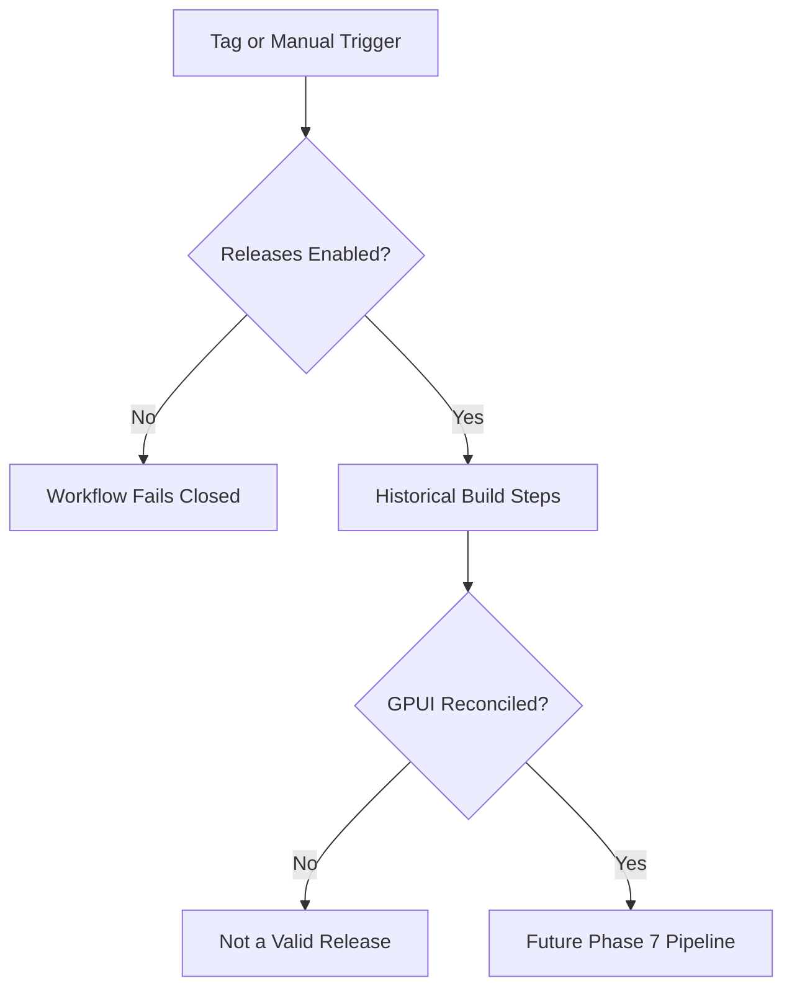

<!-- PAGE_ID: pandamux_14_release -->
<details>
<summary>Relevant source files</summary>

The following files were used as evidence for this page:

- [CLAUDE.md:121-396](../../CLAUDE.md#L121-L396)
- [Cargo.toml:1-48](../../Cargo.toml#L1-L48)
- [rust-toolchain.toml:1-4](../../rust-toolchain.toml#L1-L4)
- [CHANGELOG.md:1-46](../../CHANGELOG.md#L1-L46)
- [rust.yml:1-171](../../.github/workflows/rust.yml#L1-L171)
- [release.yml:1-179](../../.github/workflows/release.yml#L1-L179)
- [winget.yml:1-39](../../.github/workflows/winget.yml#L1-L39)
- [build-remote-musl.sh:1-38](../../scripts/build-remote-musl.sh#L1-L38)
- [smoke-built-artifacts.ps1:1-93](../../scripts/smoke-built-artifacts.ps1#L1-L93)
- [manifest.json:1-29](../../resources/remote-binaries/manifest.json#L1-L29)

</details>

# Release and Packaging

> **Related Pages**: [Getting Started](../GETTING_STARTED.md), [Toolchain and Dependency Policy](DEPENDENCIES.md), [SSH Remote Nodes](../features/SSH_REMOTE.md)

---

<!-- BEGIN:AUTOGEN pandamux_14_release_versioning -->
## Version and Changelog

The root workspace package version is the single version source inherited by all product and tooling crates. The Phase 5 dependency-gate candidate is `0.60.66`, the workspace declares Rust 1.89 and edition 2024, and development/evidence uses the separately pinned Rust 1.98.1 toolchain ([Cargo.toml:1-30](../../Cargo.toml#L1-L30), [rust-toolchain.toml:1-4](../../rust-toolchain.toml#L1-L4)).

| Artifact | Current source of identity |
|---|---|
| Rust crates and binaries | `[workspace.package] version` in root `Cargo.toml` ([Cargo.toml:25-30](../../Cargo.toml#L25-L30)) |
| Human-readable change record | `CHANGELOG.md`, with current work under `Unreleased` ([CHANGELOG.md:1-11](../../CHANGELOG.md#L1-L11)) |
| Release tag | No currently authorized tag procedure; the dormant workflow derives `v<workspace-version>` only as historical pipeline behavior ([release.yml:48-66](../../.github/workflows/release.yml#L48-L66)) |
| Remote binary manifest | Checked-in placeholder is version `0.53.36`, not the current workspace version ([manifest.json:1-3](../../resources/remote-binaries/manifest.json#L1-L3), [Cargo.toml:25-26](../../Cargo.toml#L25-L26)) |

Repository convention requires updating both `CHANGELOG.md` and the root version when preparing a commit, but a version bump or implementation commit does not grant release authorization. The current changelog identifies this work as an authorized Phase 5 sequencing exception and explicitly leaves P4-C5 and P4-C7 open ([CHANGELOG.md:8-31](../../CHANGELOG.md#L8-L31)).

Sources: [Cargo.toml:1-30](../../Cargo.toml#L1-L30), [rust-toolchain.toml:1-4](../../rust-toolchain.toml#L1-L4), [CHANGELOG.md:1-31](../../CHANGELOG.md#L1-L31), [release.yml:48-66](../../.github/workflows/release.yml#L48-L66), [manifest.json:1-3](../../resources/remote-binaries/manifest.json#L1-L3)
<!-- END:AUTOGEN pandamux_14_release_versioning -->

---

<!-- BEGIN:AUTOGEN pandamux_14_release_gates -->
## Pre-Release Gates

The maintained development guide defines the local validation gate and requires Cargo commands to run serially in one checkout ([CLAUDE.md:152-186](../../CLAUDE.md#L152-L186)). These checks establish source quality; they do not by themselves authorize packaging or prove native live acceptance.

```bash
cargo fmt --all --check
cargo clippy --workspace --all-targets -- -D warnings
cargo test --workspace
cargo test --locked -p pandamux-boundary-check
cargo run --locked -p pandamux-boundary-check --quiet
node scripts/check-claude-wiring.mjs
cargo deny check advisories licenses bans sources
```

Sources: [CLAUDE.md:152-186](../../CLAUDE.md#L152-L186)

| Gate | Required evidence |
|---|---|
| Formatting and lint | Successful `rustfmt` and warning-denied workspace Clippy run |
| Automated behavior | Successful workspace tests, plus relevant scoped crate tests when isolating failures ([CLAUDE.md:154-165](../../CLAUDE.md#L154-L165)) |
| Architecture | Negative boundary fixtures pass, then the real locked target-resolved graph passes ([rust.yml:75-79](../../.github/workflows/rust.yml#L75-L79)) |
| Dependency policy | Advisories, licenses, bans, and sources all pass ([rust.yml:81-85](../../.github/workflows/rust.yml#L81-L85)) |
| Repository wiring | Successful Claude wiring guard |
| Minimum Rust | Windows product and Linux headless graphs compile at Rust 1.89 ([rust.yml:147-171](../../.github/workflows/rust.yml#L147-L171)) |
| Built binaries | Server/CLI/desktop release builds, then the artifact smoke harness where applicable ([rust.yml:87-95](../../.github/workflows/rust.yml#L87-L95)) |
| Native acceptance | The applicable acceptance matrix on exact artifacts; R0.5 and physical P4-C6 passed, while the complete Phase 4 exit matrix remains open ([CLAUDE.md:386-396](../../CLAUDE.md#L386-L396)) |

`smoke-built-artifacts.ps1` locates built server and CLI binaries, starts the server headlessly, waits up to 15 seconds for a protocol handshake, then verifies hello, ping, and identify before force-stopping the background process ([smoke-built-artifacts.ps1:1-27](../../scripts/smoke-built-artifacts.ps1#L1-L27), [smoke-built-artifacts.ps1:29-93](../../scripts/smoke-built-artifacts.ps1#L29-L93)). That is IPC smoke evidence, not desktop packaging, deployment, or production acceptance.

Sources: [CLAUDE.md:152-186](../../CLAUDE.md#L152-L186), [rust.yml:69-95](../../.github/workflows/rust.yml#L69-L95), [rust.yml:147-171](../../.github/workflows/rust.yml#L147-L171), [CLAUDE.md:386-396](../../CLAUDE.md#L386-L396), [smoke-built-artifacts.ps1:1-93](../../scripts/smoke-built-artifacts.ps1#L1-L93)
<!-- END:AUTOGEN pandamux_14_release_gates -->

---

<!-- BEGIN:AUTOGEN pandamux_14_release_windows -->
## Windows Packaging

There is no current supported Windows packaging procedure for the GPUI workspace. The repository guide explicitly says the checked-in release workflow contains historical packaging references and must not be used as evidence that the current workspace is releasable; final packaging, signing, publication, and updates belong to a later Phase 7 ([CLAUDE.md:386-396](../../CLAUDE.md#L386-L396)).

The dormant workflow describes a prior design: build CLI and GUI binaries, sign executables with Azure Trusted Signing, package one NSIS installer with `cargo-packager`, sign the installer, and upload it ([release.yml:3-7](../../.github/workflows/release.yml#L3-L7), [release.yml:69-99](../../.github/workflows/release.yml#L69-L99), [release.yml:101-163](../../.github/workflows/release.yml#L101-L163)). It is not aligned with the active workspace because it still builds removed package `pandamux-app` with `iced-runtime`, while the workspace lists `pandamux-desktop` ([release.yml:68-73](../../.github/workflows/release.yml#L68-L73), [Cargo.toml:1-12](../../Cargo.toml#L1-L12)).

| Historical workflow control | Current meaning |
|---|---|
| `RELEASES_ENABLED` must equal `true` | The job intentionally fails while releases remain disabled ([release.yml:31-37](../../.github/workflows/release.yml#L31-L37)) |
| Azure signing inputs | Configuration retained for the historical design, not proof that current binaries were signed ([release.yml:79-99](../../.github/workflows/release.yml#L79-L99)) |
| NSIS packaging retries | Historical network-resilience logic for `cargo-packager` ([release.yml:101-128](../../.github/workflows/release.yml#L101-L128)) |
| `PandaMUX-Setup-<version>.exe` | Intended historical installer name, not a currently produced artifact ([release.yml:130-148](../../.github/workflows/release.yml#L130-L148)) |

No local packaging command should be inferred from this dormant file. Before Windows release work begins, the workflow must be replaced or reconciled with the GPUI desktop and then verified on exact native artifacts.

Sources: [CLAUDE.md:386-396](../../CLAUDE.md#L386-L396), [Cargo.toml:1-14](../../Cargo.toml#L1-L14), [release.yml:3-7](../../.github/workflows/release.yml#L3-L7), [release.yml:31-37](../../.github/workflows/release.yml#L31-L37), [release.yml:68-163](../../.github/workflows/release.yml#L68-L163)
<!-- END:AUTOGEN pandamux_14_release_windows -->

---

<!-- BEGIN:AUTOGEN pandamux_14_release_remote -->
## Remote Linux Artifacts

Remote Linux binaries are a separate artifact path from the Windows desktop installer. `build-remote-musl.sh` targets x86_64 and aarch64 musl, builds `pandamux-server` plus `pandamux-cli`, and copies any resulting server and `pandamux` CLI binaries into architecture-specific resource directories while reporting SHA-256 and size ([build-remote-musl.sh:1-38](../../scripts/build-remote-musl.sh#L1-L38)).

```text
resources/remote-binaries/
  x86_64-unknown-linux-musl/{pandamux-server,pandamux}
  aarch64-unknown-linux-musl/{pandamux-server,pandamux}
```

This helper is not a strict release gate: when a normal cargo build fails it prints guidance and continues, and it copies only binaries that exist ([build-remote-musl.sh:14-35](../../scripts/build-remote-musl.sh#L14-L35)). The maintained non-release R0 harness instead refuses a dirty tree, requires both binaries, records commit/version/size/SHA-256, re-verifies the directory, and leaves publication disabled ([CLAUDE.md:373-384](../../CLAUDE.md#L373-L384)).

The checked-in manifest currently contains zero-byte SHA-256 values for both architectures and reports version `0.53.36`; it is placeholder data and cannot verify current artifacts ([manifest.json:1-29](../../resources/remote-binaries/manifest.json#L1-L29)). Exact bootstrap requires size and SHA-256 verification before atomic placement on the node ([CLAUDE.md:373-384](../../CLAUDE.md#L373-L384)).

Sources: [CLAUDE.md:373-384](../../CLAUDE.md#L373-L384), [build-remote-musl.sh:1-38](../../scripts/build-remote-musl.sh#L1-L38), [manifest.json:1-29](../../resources/remote-binaries/manifest.json#L1-L29)
<!-- END:AUTOGEN pandamux_14_release_remote -->

---

<!-- BEGIN:AUTOGEN pandamux_14_release_pipeline -->
## Tag and Publication Pipeline

The only checked-in tag workflow is dormant and historical. A `v*` tag or manual dispatch enters the workflow, but the first substantive gate fails unless the repository variable `RELEASES_ENABLED` is explicitly set to `true` ([release.yml:9-16](../../.github/workflows/release.yml#L9-L16), [release.yml:24-37](../../.github/workflows/release.yml#L24-L37)). Current repository guidance says not to enable or rely on it for the GPUI rewrite ([CLAUDE.md:386-396](../../CLAUDE.md#L386-L396)).



For reference only, the dormant path resolves a tag, builds old package targets, signs executables, packages and signs an installer, uploads a workflow artifact, and creates a GitHub Release ([release.yml:48-179](../../.github/workflows/release.yml#L48-L179)). The winget workflow is independently disabled with `if: false`; its retained configuration would otherwise react to a published release and submit matching NSIS installers after a one-time package bootstrap ([winget.yml:1-17](../../.github/workflows/winget.yml#L1-L17), [winget.yml:20-39](../../.github/workflows/winget.yml#L20-L39)).

No deployment occurs in either workflow. GitHub Release publication and winget metadata submission would be distribution events, while host installation/activation and served-version verification would remain separate evidence.

Sources: [CLAUDE.md:386-396](../../CLAUDE.md#L386-L396), [release.yml:9-179](../../.github/workflows/release.yml#L9-L179), [winget.yml:1-39](../../.github/workflows/winget.yml#L1-L39)
<!-- END:AUTOGEN pandamux_14_release_pipeline -->

---

<!-- BEGIN:AUTOGEN pandamux_14_release_evidence -->
## Acceptance and Evidence Boundaries

Release state must be reported as distinct facts. Implementation, local verification, commit, push, CI, packaging, signing, publication, installation, activation, health, served version, and live acceptance are not interchangeable; current guidance explicitly separates the first six and live acceptance ([CLAUDE.md:386-396](../../CLAUDE.md#L386-L396)).

| Evidence statement | Minimum proof | Current repository status |
|---|---|---|
| Implemented | Source exists at a pinned commit | GPUI implementation exists |
| Locally verified | Exact commands and exit results | Must be established per change; commands are documented, not presumed ([CLAUDE.md:152-186](../../CLAUDE.md#L152-L186)) |
| CI passed | Exact commit has successful required jobs | Not established by these documentation files |
| Packaged and signed | Exact current-workspace artifacts plus signature verification | Not established; historical workflow is not valid evidence ([CLAUDE.md:386-396](../../CLAUDE.md#L386-L396)) |
| Published | Exact release/tag and assets exist | Not established; release workflow is disabled ([release.yml:31-37](../../.github/workflows/release.yml#L31-L37)) |
| Distributed through winget | Matching winget-pkgs update accepted | Not established; workflow job is disabled ([winget.yml:25-39](../../.github/workflows/winget.yml#L25-L39)) |
| Remote artifact accepted | Both binaries have exact commit/version/size/hash and pass required lifecycle checks | Placeholder manifest cannot establish this ([manifest.json:1-29](../../resources/remote-binaries/manifest.json#L1-L29)) |
| Production accepted or shipped | Entire acceptance matrix closed on exact artifacts | Not established; P4-C5 and final P4-C7 remain open even though R0.5 and P4-C6 passed ([CLAUDE.md:386-396](../../CLAUDE.md#L386-L396)) |

The recommended interpretation is therefore conservative: source and test progress may be reported on their own merits, but PandaMUX must not currently be described as released, deployed, production-accepted, or shipped.

Sources: [CLAUDE.md:152-186](../../CLAUDE.md#L152-L186), [CLAUDE.md:386-396](../../CLAUDE.md#L386-L396), [release.yml:31-37](../../.github/workflows/release.yml#L31-L37), [winget.yml:25-39](../../.github/workflows/winget.yml#L25-L39), [manifest.json:1-29](../../resources/remote-binaries/manifest.json#L1-L29)
<!-- END:AUTOGEN pandamux_14_release_evidence -->

---
