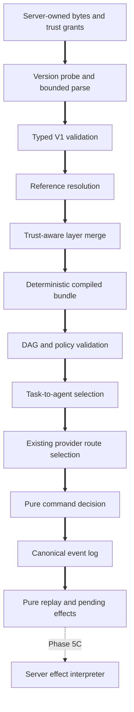

# Phase 5A: Versioned Schemas, Deterministic Policy, DAG, and Run State

Status: **Implemented and locally accepted on exact version 0.60.76 commit
`423594e3ad77497119aac09ba098a82bd499aa74`. See the
[Phase 5A acceptance record](../docs/operations/PHASE5A_ACCEPTANCE.md).**

Date: 2026-10-09

Target: Phase 5, Checkpoint 5A

Planning baseline: `7b874b0d64761306bb4efe2696726b576912e0ca`

Implement this specification in a fresh session. Phase 5A is a pure-domain
checkpoint. It does not authorize runtime dispatch, external writes, a push,
deployment, signing, packaging, or release.

## 1. Overview

Build PandaMUX's pure orchestration foundation: versioned authored
configuration, deterministic bundle compilation, validated task DAGs, two-step
routing, durable approval semantics, and a replayable run state machine.

Phase assignment:

- Foundation: freeze legacy inputs, define schemas and diagnostics, and compile
  one canonical instruction bundle.
- Core: validate plans, reconcile policy, route tasks, and reduce commands and
  events into serializable effects.

Dependencies and gates:

- Preserve the Phase 5 dependency gate at `7b874b0`.
- Keep `pandamux-orchestrator` pure under the resolved graph checker.
- Reuse Phase 4 organization, provider routing, capacity, and attempt-boundary
  primitives as the existing policy truth.
- The Phase 5 sequencing exception remains recorded. P4-C5 stays Partial and
  P4-C7 stays open.
- Do not modify the exact 0.60.64 runtime candidate, retained Galahad databases
  or evidence, original checkout, or protected `.pandamux-*.bundle` files.

Definition of done: versioned inputs compile to byte-stable configuration,
invalid plans cannot dispatch, identical route inputs produce identical
decisions and explanations, and event replay produces byte-identical state
without a duplicate effect.

## 2. Resolved design decisions

### Existing record classification

| Record | Current reality | Phase 5A treatment |
|---|---|---|
| `Run`, `RunTask`, `RunEvent` | Unversioned scaffold, unordered blackboard, no event identity | Freeze exact V0 wire DTOs, then replace live shared records with the Phase 5 model |
| `AgentDefinition` | Unversioned and missing planned policy fields | Freeze V0, then extend the canonical compiled definition |
| `MemoryEntry` | Legacy record containing derived vectors | Keep rejected until the Phase 5E markdown importer |
| `ScheduleRecord` | Active node-owned state | Leave unchanged and defer orchestrator schedules to Phase 6 |
| `RoutingDecision` | Deterministic Phase 4 provider-route truth | Reuse for route step 2 |
| `RunProjection` | Incomplete client-owned reducer | Replace transition authority with presentation mapping from canonical state |

### Ownership

```text
pandamux-core
  shared serialized IDs, runs, agents, bundles, events, effects, and routes
        ^
pandamux-orchestrator
  pure parse, compile, validate, route, decide, apply, and replay behavior
        ^
pandamux-server
  later persistence, filesystem, clocks, provider processes, and effect execution
```

Canonical shared records stay in `pandamux-core`. This avoids making protocol
or client crates depend on an implementation crate and prevents a second run
model. Authored V1 DTOs and pure behavior stay in `pandamux-orchestrator`.

### Tier names

V1 uses an open tier identifier matching `[a-z][a-z0-9_-]{0,63}`. Compilation
requires the value to exist in the trusted `TierMapping`. Seed agents use
`fast`, `smart`, or `reasoning`; the built-in orchestrator gets its model from
orchestrator settings. Historical `balanced` and `deep` examples are corrected.

### Bundle identity

Separate source and effective identities:

- `instructions_commit_sha`: approved instructions Git revision.
- `project_layer_content_sha256`: trusted project-layer content, if present.
- `personal_commit_sha`: personal repository revision, if present.
- `settings_revision`: trusted settings snapshot revision.
- `payload_sha256`: SHA-256 of compiled payload bytes without its digest field.

Runtime `bundle_sha` means composite `payload_sha256`. Running work remains
pinned to the composite bundle it started with.

### Persistence boundary

Phase 5A adds no SQLite migration and no run RPC. The pure engine returns events
and effects. Phase 5C will persist an event and outbox entry before interpreting
an effect. This preserves persist-before-dispatch ordering without claiming a
runtime that does not yet exist.

## 3. Architecture

### Modules

| File or module | Responsibility |
|---|---|
| `pandamux-core/src/ids.rs` | Typed run, task, attempt, event, effect, edge, approval, budget, and blackboard IDs |
| `pandamux-core/src/run.rs` | Canonical run state, DAG records, commands, events, effects, budgets, and approvals |
| `pandamux-core/src/agent_def.rs` | Canonical compiled provider-neutral agent |
| `pandamux-core/src/instruction_bundle.rs` | Canonical bundle and source manifest |
| `orchestrator/src/compatibility.rs` | Frozen V0 DTOs and explicit legacy boundaries |
| `orchestrator/src/diagnostics.rs` | Stable, bounded, presentation-safe issues |
| `orchestrator/src/schema/*` | Version probe, frontmatter parser, V1 DTOs, and schema generation |
| `orchestrator/src/bundle.rs` | References, trusted layer merge, canonical bytes, and digest |
| `orchestrator/src/dag.rs` | DAG normalization, validation, and stable ordering |
| `orchestrator/src/policy.rs` | Approval, access, budget, layer, and organization reconciliation |
| `orchestrator/src/routing.rs` | Task-to-agent selection and Phase 4 route composition |
| `orchestrator/src/model_output.rs` | Bounded LLM proposal parser and parse budget |
| `orchestrator/src/state.rs` | Total command decision, event apply, replay, and effect ledger |
| `pandamux-client/src/projections.rs` | Presentation mapping only |

New test files:

```text
crates/pandamux-orchestrator/tests/schema_fixtures.rs
crates/pandamux-orchestrator/tests/bundle_compilation.rs
crates/pandamux-orchestrator/tests/dag_validation.rs
crates/pandamux-orchestrator/tests/routing_determinism.rs
crates/pandamux-orchestrator/tests/state_machine_model.rs
crates/pandamux-orchestrator/tests/replay_contract.rs
crates/pandamux-orchestrator/tests/fixtures/schema/*
```

### Data flow



The engine receives trusted snapshots, IDs, timestamps, revisions, and source
bytes as values. It never reads time, generates IDs, reads files, opens a
database, invokes providers, or mutates external state.

## 4. Versioned authored schemas

### Common envelope and parser limits

Every authored document requires integer `schemaVersion: 1` and one exact kind:

- `pandamux.orchestrator`
- `pandamux.project`
- `pandamux.agent`
- `pandamux.knowledge`
- `pandamux.prompt`
- `pandamux.compiled-bundle`

Missing, zero, malformed, or future versions fail before V1 deserialization.
V1 structs use `deny_unknown_fields`; no untagged version enum is allowed.

Contract limits:

| Limit | Value |
|---|---:|
| Files in one source set | 1,024 |
| Aggregate source bytes | 16 MiB |
| Orchestrator or project YAML | 256 KiB each |
| Agent, prompt, or knowledge file | 512 KiB each |
| Markdown frontmatter | 64 KiB |
| YAML nesting | 32 levels |
| One mapping or sequence | 256 items |
| One scalar | 32 KiB |
| Relative logical path | 240 UTF-8 bytes |
| Returned diagnostics | 128 |
| One safe message or corrective action | 512 UTF-8 bytes |

Require valid UTF-8. Reject byte order marks and NULs. Normalize CRLF to LF.
Accept one YAML document only. Reject duplicate keys, non-string mapping keys,
unsupported tags, and merge or alias behavior that bypasses bounds. On issue
overflow, append one `diagnostic_limit_reached` result.

Logical paths are bundle-relative. Reject absolute paths, drive prefixes,
backslashes, `.` or `..`, empty segments, NULs, and layer-root escapes.
Diagnostics never expose an OS profile path.

### Orchestrator document

```yaml
schemaVersion: 1
kind: pandamux.orchestrator
minPandamuxVersion: "0.60.67"
defaults:
  mode: approve_first
  defaultAgent: builder
  maxParallelTasks: 4
  maxTasksPerRun: 6
  maxAttemptsPerTask: 2
prompts:
  intake: prompts/intake.md
  planner: prompts/planner.md
  handoff: prompts/handoff.md
classes: []
providerPolicy:
  minRemainingMillionths: 150000
  concurrency: {}
fallbacks:
  onRateLimit: next_provider
  onNoProvider: queue
  onFailure: ask
verification: { useProjectCommands: true }
```

V1 uses integer millionths, micro-USD, tokens, and milliseconds. It never
stores floating-point policy. `minPandamuxVersion` accepts stable numeric
`MAJOR.MINOR.PATCH` only and uses a small owned parser.

Defaults and hard bounds:

- mode `approve_first`;
- 6 tasks by default, 64 hard maximum;
- 4 parallel tasks by default;
- 2 attempts by default, 8 hard maximum;
- queue when no provider is eligible;
- ask rather than retry after a non-safe boundary.

### Project document

```yaml
schemaVersion: 1
kind: pandamux.project
classOverrides: []
verification: []
agents: []
knowledge: []
```

It cannot declare trust, organization identity, FullAccess, schedules, provider
credentials, cross-project permission, or mutation permission. The server
supplies project identity and approved content hash through `LayerGrant`.

### Agent document

The opening frontmatter delimiter begins at byte zero. The closing delimiter is
a line containing exactly three hyphens. The markdown body must be nonempty.

```markdown
---
schemaVersion: 1
kind: pandamux.agent
id: reviewer
name: Reviewer
description: Reviews diffs for correctness and maintainability.
specialties: [code-review, maintainability]
tier: reasoning
effort: high
accessMode: read_only
requiredCapabilities: [longContext]
providers: { prefer: [codex, claude], avoid: [] }
environments: [any]
knowledge: [knowledge/review-checklist.md]
tools: { allow: [read, grep, glob], deny: [write, shell] }
output: { kind: review_comments }
verification: []
concurrency: 2
budget: { maxTokens: 400000, maxCostMicroUsd: 5000000, maxRuntimeMs: 1800000 }
---
You are the Reviewer. Review the changes against the task and project rules.
```

The filename stem equals normalized `id`. Authored files cannot set scope,
author, bundle revision, FullAccess opt-in, runtime state, live concurrency, or
organization identity. The compiler attaches trusted provenance.

### Knowledge and prompt documents

Both use the same frontmatter parser and a nonempty markdown body.

```yaml
schemaVersion: 1
kind: pandamux.knowledge
id: review-checklist
title: Review Checklist
tags: [review]
```

```yaml
schemaVersion: 1
kind: pandamux.prompt
id: intake
purpose: intake
```

Prompt purposes are `intake`, `planner`, and `handoff`. Knowledge and prompt
content is untrusted data. It cannot change access, tools, routing,
organization, budgets, schedules, or agent definitions.

References compile to typed logical path, expected kind, and resolved ID.
Compilation verifies confinement, existence, kind, unique ID, filename
agreement, and layer authority. No reference reads a file or fetches a URL.

### Compiled bundle

`CompiledInstructionBundleV1` is canonical JSON containing schema and compiler
versions, source manifest, effective project and organization, ordered agents,
prompts, knowledge, reference graph, effective policy, value origins, and
`payload_sha256`.

Sort maps and vectors whose order has no behavioral meaning. Preserve and
document vectors whose order is semantic. Exclude timestamps, absolute paths,
map insertion order, and runtime availability from the digest. Compute the
digest over an unsigned payload, then construct the final envelope.

## 5. Stable diagnostic contract

```rust
pub struct ConfigurationIssue {
    pub code: ConfigurationIssueCode,
    pub file: RelativeConfigPath,
    pub field: Option<JsonPointer>,
    pub stage: ConfigurationStage,
    pub explanation: SafeText,
    pub corrective_action: SafeText,
    pub line: Option<u32>,
    pub column: Option<u32>,
}
```

Sort by file, field, code, line, then column. Never include raw YAML, markdown
bodies, secrets, provider stderr, or absolute paths in safe fields.

Stable code families:

- Bounds: `config_file_count_limit`, `config_bundle_size_limit`,
  `config_file_too_large`, `diagnostic_limit_reached`.
- Text: `config_non_utf8`, `config_bom_unsupported`,
  `config_nul_unsupported`.
- Frontmatter: `frontmatter_missing`, `frontmatter_unterminated`,
  `frontmatter_empty_body`.
- YAML: `yaml_multiple_documents`, `yaml_duplicate_key`,
  `yaml_unsupported_tag`, `yaml_depth_limit`.
- Schema: `schema_version_missing`, `schema_version_invalid`,
  `schema_version_unsupported`, `schema_kind_missing`,
  `schema_kind_mismatch`, `schema_unknown_field`, `schema_invalid_value`.
- Identity and references: `document_id_invalid`, `document_id_mismatch`,
  `document_id_duplicate`, `reference_path_escape`, `reference_not_found`,
  `reference_kind_mismatch`, `reference_duplicate_id`.
- Policy: `layer_not_trusted`, `layer_scope_violation`,
  `policy_access_widening`, `policy_full_access_from_repo`,
  `policy_cross_organization`, `tier_unmapped`.
- Compilation: `bundle_hash_mismatch`, `minimum_version_unsupported`.

Raw parser errors remain internal and map to stable codes plus bounded safe
locations.

## 6. Canonical domain model

### IDs and run state

Add `RunTaskId`, `RunAttemptId`, `RunEventId`, `OrchestrationEffectId`,
`DependencyEdgeId`, `ApprovalId`, `BlackboardEntryId`, and
`BudgetReservationId`. The engine never generates them; commands supply them.

`Run` contains identity, trigger and policy provenance, status, last sequence,
validated plan, ordered tasks, attempts, edges, approvals, blackboard,
reservations, checkpoints, routes, replay receipts, idempotency receipts,
pending effects, settled effects, and event-supplied timestamps.

Run states: `Draft`, `AwaitingApproval`, `Ready`, `Running`, `Paused`,
`Cancelling`, `Succeeded`, `Failed`, `Cancelled`. The last three are terminal
and absorb all mutations except identical replay.

### Tasks, attempts, and edges

`AgentTask` includes ID, summary, class, project, required capabilities, access
ceiling, typed inputs and outputs, selected agent and route, status, attempt
budget, approvals, and budget reservation.

Task states: `Pending`, `Blocked`, `AwaitingApproval`, `Ready`,
`DispatchRequested`, `Running`, `Succeeded`, `Failed`, `Skipped`, `Cancelled`.
One exported readiness predicate is shared by validation, transition logic, and
tests. Callers do not duplicate it by counting raw edges.

`Attempt` records ID, task, ordinal, route, optional thread and turn attempt,
status, Phase 4 `AttemptBoundary`, timestamps, failure class, and usage
reconciliation. Retry requires remaining attempts, `SafeToRetry`, no ambiguous
effect, an eligible fallback, and a nonterminal run.

`DependencyEdge` records ID, source, target, and `RequiresSuccess` or
`RequiresSettlement`. Typed output consumption requires `RequiresSuccess` and
exactly one compatible producer.

### Blackboard, budget, approvals, and checkpoints

`BlackboardEntry` records ID, version, producer, consumers, output contract,
canonical JSON content, SHA-256, and creation event. Recursively sort JSON
object keys before hashing. Blackboard content never grants permission.

Budgets use checked `u64` tokens, micro-USD, and milliseconds. Reservation
states are `Reserved`, `Reconciled`, and `Released`. Overflow or insufficient
remaining budget fails before dispatch.

An approval records ID, run and task, kind, policy revision, canonical action
digest, safe summary, reason codes, expiry, status, and decision provenance.
Decision identity is run, task, kind, policy revision, and action digest.
Equivalent observations produce one decision. A stale resolved ID is a no-op
and cannot resolve later work with a new digest.

`CheckpointRef` is an opaque server-issued value tied to task, attempt, thread,
and checkpoint kind. The engine stores it but never resolves Git.

### Routes, events, commands, and effects

`TaskRouteDecision` records agent evaluations plus existing
`pandamux_core::RoutingDecision`. Recorded decisions are immutable. Capacity
changes affect only an undecided task or permitted safe retry.

```rust
pub struct RunEvent {
    pub event_id: RunEventId,
    pub run_id: RunId,
    pub seq: u64,
    pub at_ms: u64,
    pub idempotency_key: String,
    pub kind: RunEventKind,
}
```

Kinds cover plan acceptance, approval, reservation, route selection, dispatch
request, attempt lifecycle, boundary advance, blackboard publication, task
settlement, cancellation, pause, resume, effect acknowledgement, and run
settlement.

Commands express intent against current state. Effects are server work allowed
only after the producing event is durable: `DispatchTask`, `CancelAttempt`,
`RequestApproval`, `PublishBlackboardEntry`, and `NotifyRunState`.

Effect IDs derive from run and event identity. Identical duplicate events add
no effect. Reusing an event ID, sequence, or idempotency key with different
canonical bytes is a hard replay conflict.

## 7. DAG, routing, approvals, and model proposals

Validation order is fixed: bounds; duplicate IDs; missing or self edges; cycles;
project permission; organization; agent and output references; producer
compatibility; checked budget; capability and route feasibility; approval
policy. Return either one normalized `ValidatedPlan` or sorted issues, never a
partially executable plan.

DAG rules:

- default 6 tasks, hard maximum 64, hard maximum 256 edges;
- ordered maps and ready sets provide stable topological order;
- cycles return a deterministic witness;
- duplicate edges are errors;
- missing, cyclic, cross-organization, over-budget, output-incompatible, or
  capability-impossible plans cannot become `Running`.

Partial failure default: fail the task, skip descendants requiring its success,
continue independent and settlement-only branches, then fail the run after all
runnable work settles. Never retry a permanently impossible branch.

Route step 1 hard-filters enabled state, scope, organization, access,
capabilities, environment, output contract, and concurrency before scoring.
Explicit class rules beat specialty heuristics. Stable agent ID breaks ties.
Every candidate retains eligibility, codes, score components, and explanation.

Route step 2 adapts trusted facts into existing `RoutingCandidate` values and
calls `select_route`. It does not duplicate provider policy or scoring. A
one-node universe has one environment; a one-task run has one node and zero
edges. Both still use the complete pipeline.

Auto and Approve-first are inputs to one state machine. Auto skips only an
exact action the trusted policy permits. It never widens access, crosses an
organization, approves a human-authored agent edit, grants FullAccess, enables
MCP mutation, trusts a project layer, or changes project identity. Expired,
rejected, conflicting, or stale approval creates no dispatch effect.

LLM proposals are untrusted input:

- maximum raw size 1 MiB;
- one JSON object with `schemaVersion: 1`;
- parse direct, unfenced, then one string-aware balanced object;
- reject arrays, scalars, a second object, unknown fields, and bound violations;
- allow one parse-only retry, not a timeout or transport retry;
- after exhaustion return `model_parse_budget_exhausted`, require correction or
  approval, and emit no dispatch.

Deterministic findings may tighten a proposal and cannot be lowered by model
prose. Higher model warnings may remain visible as unverified evidence but
never grant permission.

## 8. Commit-sized implementation checkpoints

Every checkpoint updates the current root version and changelog, runs its slice
tests, and commits before the next checkpoint. Preserve unrelated files.

### A. Freeze V0 compatibility

Files: `compatibility.rs`, compatibility tests, retained fixtures.

1. Copy exact old wire shapes into private V0 DTOs.
2. Stop parsing legacy fixtures through live core records.
3. Preserve existing codes and next actions.
4. Prove later canonical fields cannot reinterpret V0.
5. Keep legacy runs non-executable, memory deferred to 5E, schedules to Phase 6.

Gotchas: LL-G `clearing-legacy-field-exposes-old-readers` and
`lazy-migration-only-touches-read-records`.

### B. Canonical shared records

Files: core IDs, run, agent, new bundle module, exports, client projection.

1. Add the Section 6 IDs and records.
2. Replace replay-affecting unordered collections.
3. Extend the compiled agent and add the bundle manifest.
4. Make the client a presentation projection only.
5. Leave thread, turn, schedule, and provider route records intact.

Gotchas: LL-G `check-sibling-services-before-parallel-store` and
`consumer-parses-producer-output-string`.

### C. Schemas and diagnostics

Files: diagnostics, schema modules, schema fixtures and tests.

1. Implement logical paths, safe text, and frontmatter parsing.
2. Probe version before strict V1 decode.
3. Enforce all bounds and stable diagnostics.
4. Generate Schemars JSON schema and parse it back.
5. Add exact positive and negative fixtures for every code.

Gotchas: BP `versioned-config-migration-backup`; Phase 5A validates but never
rewrites source. LL-G `tool-arg-type-errors`; publish every enforced bound.

### D. Trust-aware bundle compiler

Files: `bundle.rs`, `policy.rs`, orchestrator manifest, compiler tests.

1. Accept bounded source documents and server-issued `LayerGrant` values.
2. Resolve references before merge and retain value origins.
3. Reject project access, tools, environment, organization, schedule, and
   FullAccess widening.
4. Validate tiers against trusted settings.
5. Canonicalize payload and add the exact-pinned workspace `sha2` dependency.
6. Prove byte and digest identity across input-order permutations.

Gotchas: LL-G `every-prompt-field-can-steer-a-classifier`; BP
`presence-check-validator-is-a-floor`.

### E. DAG normalization and validation

Files: `dag.rs`, DAG tests.

1. Normalize tasks and edges into ordered maps.
2. Implement fixed validation order and stable cycles without `petgraph`.
3. Validate server-supplied project and organization snapshots.
4. Validate typed outputs, checked budgets, and capability feasibility.
5. Export and test one readiness predicate.

Gotchas: LL-G `precondition-gate-counts-unfiltered-collection` and
`derived-signal-goes-constant`.

### F. Routing and approvals

Files: `routing.rs`, `policy.rs`, routing tests.

1. Implement task-to-agent evaluation.
2. Compose existing Phase 4 provider routing.
3. Record every candidate and stable explanation component.
4. Implement approval decision identity and one mode reconciler.
5. Prove route immutability and one-node path parity.

Gotchas: LL-G `human-review-queues-deduplicate-decision-identity` and
`persist-before-dispatch`.

### G. Model parsing and replay state

Files: `model_output.rs`, `state.rs`, state and replay tests.

1. Implement bounded JSON parsing and one parse-only retry.
2. Implement total `decide`, `apply`, and `replay`.
3. Enforce sequence, identity, idempotency, and terminal absorption.
4. Implement deterministic effects, retry, cancellation, partial failure, and
   settlement.
5. Enumerate bounded event alphabets without adding a property-test crate.
6. Replay from zero and every prefix; assert identical bytes and effects.

Gotchas: LL-G `confirmed-tool-actions-need-durable-continuation`; BP
`llm-json-parse-retry-fail-closed`.

### H. CI, docs, and acceptance

Files: Rust CI, README, CLAUDE, changelog, maintained docs, master plan, and a
new Phase 5A acceptance record.

1. Add explicit macOS orchestrator tests and musl x64 and arm64 compile checks.
2. Retain Windows workspace and Linux MSRV coverage.
3. Run every command in Section 12.
4. Correct historical tier and schema examples.
5. Separate pure implementation from absent runtime, UI, and live evidence.
6. Record exact commit, version, commands, counts, and limitations.
7. Leave P4-C5 and P4-C7 unchanged.

Gotchas: LL-G `cargo-check-skips-test-targets`; BP
`plan-with-lessons-learned`.

## 9. Pure API contract

```rust
pub fn parse_source_document(&SourceDocument)
    -> Result<ParsedDocumentV1, DiagnosticSet>;
pub fn compile_instruction_bundle(&CompileBundleInput)
    -> Result<CompiledInstructionBundleV1, DiagnosticSet>;
pub fn validate_plan(&ProposedPlanV1, &PlanValidationContext)
    -> Result<ValidatedPlan, DiagnosticSet>;
pub fn route_task(&ValidatedAgentTask, &RoutingContext)
    -> Result<TaskRouteDecision, RoutingFailure>;
pub fn decide(&Run, RunCommand)
    -> Result<Vec<RunEventKind>, OrchestrationError>;
pub fn apply(&Run, &RunEvent)
    -> Result<ApplyOutcome, OrchestrationError>;
pub fn replay<'a>(impl IntoIterator<Item = &'a RunEvent>)
    -> Result<Run, OrchestrationError>;
```

The future server assigns envelopes, persists them, and interprets pending
effects. It maps stable errors to protocol but adds no policy.

## 10. Error and recovery matrix

| Failure | Outcome | Recovery |
|---|---|---|
| Unknown schema | Reject before typed decode | Upgrade or use supported version |
| Malformed or oversized input | Reject exact logical file safely | Repair source; retain last good bundle |
| Missing or wrong reference | Reject candidate bundle | Correct referenced document |
| Untrusted project layer | Not active; visible issue | Approve exact repo and hash in 5B |
| Policy widening | Reject candidate bundle | Remove widening or use trusted local policy |
| Unmapped tier | Reject compiled agent | Add trusted mapping or change tier |
| Invalid DAG | Never enter `Running` | Edit or regenerate plan |
| No agent or provider | Queue or fail by trusted policy | Restore compatible capacity or policy |
| Model parse exhaustion | No dispatch | Correct or approve a valid plan |
| Event gap | Hard replay failure | Restore missing durable event |
| Identical duplicate event | No-op | None |
| Identity reused with changed bytes | Hard conflict | Quarantine and inspect log |
| Stale approval | No dispatch | Create new revision-bound decision |
| Retry after side effect | Refuse automatic retry | Manual recovery or continuation |
| Budget overflow | Reject before reservation | Reduce plan or raise trusted budget |
| Cancellation | Emit one cancel effect | 5C acknowledges and settles it |

## 11. Test and acceptance plan

Schema and compilation tests:

- valid fixtures for all five authored kinds;
- missing, invalid, future versions, wrong kinds, and unknown fields;
- BOM, CRLF, NUL, missing or unterminated frontmatter, duplicate keys, multiple
  YAML documents, tags, depth, item, scalar, and file bounds;
- filename mismatch, broken, duplicate, wrong-kind, and escaping references;
- hostile same-ID project overrides for access, tools, environments, FullAccess,
  schedules, and organization;
- generated schema contains all enforced bounds;
- canonical bytes and digest survive input-order permutations;
- legacy V0 cannot be silently reinterpreted.

DAG and routing tests:

- duplicate tasks and edges, missing target, self-edge, and stable cycle witness;
- allowed same-organization cross-project edge and denied permission or
  cross-organization edge;
- missing, ambiguous, or incompatible output producer;
- checked token, micro-USD, and runtime overflow;
- impossible capability, task cap, and edge cap;
- every agent and provider hard filter before score;
- stable ties and explanations under roster and candidate permutations;
- recorded route unchanged by later capacity;
- safe pre-output fallback and unsafe post-output refusal;
- one-task, one-node and multi-task, multi-node pipeline parity.

State and security tests:

- total legal and illegal transition handling;
- plan approval before dispatch, replay, expiry, and conflict;
- retry exhaustion, cancellation propagation, partial failure, independent work;
- duplicate events in adjacent and non-adjacent positions;
- identity collision with changed payload;
- full replay versus snapshot plus suffix at every prefix;
- byte-identical state, pending effects, and receipts;
- hostile prompts, knowledge, blackboard, and model output cannot grant access,
  organization, tools, schedules, agent edits, or MCP mutation;
- safe diagnostics contain no source body, secret, or absolute path;
- Auto and Approve-first have identical hard limits.

Acceptance mapping:

| Contract | Required evidence |
|---|---|
| Byte-equivalent replay and no duplicate effect | Replay prefix matrix and duplicate tests |
| Deterministic route and explanation | Permutation byte comparisons |
| Unknown or malformed input fails closed | Schema and model fixture matrices |
| Invalid DAG never runs | DAG errors plus transition refusal |
| Auto never widens authority | Mode parity and hostile layer tests |
| One-node uses same path | Pipeline parity fixture |
| Orchestrator remains pure | Boundary checker and target matrix |
| No legacy reinterpretation | Frozen V0 fixtures |

No live provider, database, filesystem, worktree, UI, or laptop acceptance is
part of 5A because those effects are absent. Record that limitation explicitly.

## 12. Verification commands

Announce purpose, estimate, and interrupt safety before these commands:

```bash
cargo fmt --all --check
cargo clippy --workspace --all-targets -- -D warnings
cargo test -p pandamux-orchestrator
cargo test --workspace
cargo run --locked -p pandamux-boundary-check --quiet
cargo deny check advisories licenses bans sources --hide-inclusion-graph
cargo +1.89.0 check --locked --workspace --all-targets --exclude pandamux-desktop
node scripts/check-claude-wiring.mjs
git diff --check
```

CI separately proves Windows, macOS, Linux GNU, Linux musl x64, and Linux musl
arm64. Local Linux results are not native Windows or macOS evidence.

## 13. Rollback

Phase 5A is pure and has no database migration. Revert its commits in reverse
order. Existing thread, turn, provider, and schedule runtime remains unchanged.

- Keep frozen V0 DTOs unless their fixtures are wrong.
- Never rewrite source files during validation or compilation.
- A bad candidate never replaces the last good bundle in later adapters.
- Existing schedule JSON remains unchanged.
- No legacy run becomes executable by import.
- Never reset or clean the worktree to roll back.

## 14. Out of scope

- SQLite run, event, effect, approval, or bundle tables.
- Server outbox and effect execution, provider dispatch, worktrees, Git, and
  runtime usage reconciliation.
- Run RPC, desktop plan cards, run tree, Agents page, Floor Plan, composer, CLI.
- Managed personal repository, instructions mirror, trust UI, agent editor.
- MCP mutation proposals, memory, embeddings, schedules, Broadside.
- Live provider, node, laptop, production, push, PR, signing, packaging,
  deployment, or release evidence.

These belong to 5B through 5F and Phase 6. Their absence is not a 5A defect.

## 15. Assumptions and delegated defaults

The user explicitly authorized recommended defaults and asked Codex to use its
judgment. These answers replace a blocking interview:

1. Shared records live in core; behavior lives in orchestrator.
2. Phase 5A has no SQLite migration or public RPC.
3. Every authored file requires version and kind.
4. Missing version is an error, not implicit V1.
5. Unknown V1 fields are errors.
6. Knowledge and prompts are versioned documents.
7. Frontmatter begins at byte zero; BOM is rejected.
8. Agent instructions are nonempty.
9. CRLF is normalized to LF.
10. Section 4 limits are contractual.
11. Unsafe YAML constructs fail closed.
12. Ratios and money use scaled integers, never floats.
13. Tier is open syntax validated against trusted settings.
14. Approve-first is the default.
15. Task default is 6 and hard cap 64.
16. Attempt default is 2 and hard cap 8.
17. Failure skips success-dependent descendants and lets independent work settle.
18. Capacity cannot rewrite a recorded route.
19. Automatic fallback stops after visible output or side effect.
20. Approval identity includes policy revision and action digest.
21. Stale approval cannot resolve replacement work.
22. Project content cannot self-assert trust, organization, or access.
23. One-task and one-node work use the full pipeline.
24. LLM parsing gets one parse-only retry and no transport retry.
25. Model output cannot grant permission or weaken hard findings.
26. Add no property-test, graph, frontmatter, or path crate.
27. Use existing exact-pinned `sha2` as the only new direct orchestrator dep.
28. Replay receipts hash canonical event bytes.
29. Stable explanation codes are contract; display prose is not policy.
30. Composite payload digest becomes runtime `bundle_sha`.
31. Client projection owns no transition policy.
32. Schedule defaults do not define orchestration defaults.
33. P4-C5 and P4-C7 remain open.

Nonblocking implementation question: if `serde-saphyr` cannot expose duplicate
keys or aliases before deserialization, add a small bounded lexical preflight or
reject the construct family. Do not weaken the contract. Record the mechanism.

## 16. Fresh-session handoff

1. Verify this worktree, branch, and committed specification baseline.
2. Confirm only protected bundles are untracked.
3. Read README, CLAUDE, this file, and the Phase 5 master-plan section.
4. Refresh LL-G and BP for newly added entries.
5. Implement Checkpoint A, verify it, and commit before Checkpoint B.
6. Preserve the original checkout, databases, evidence, and bundles.
7. Do not push, deploy, sign, package, or release.

Fresh-session request:

> Implement `tasks/2026-10-09-phase-5a-deterministic-orchestrator.md` in
> `/home/brandon/.codex/worktrees/recovery-r0/Pandamux`, starting with
> Checkpoint A and proceeding through verified commit-sized checkpoints.
> Preserve the original checkout, retained Galahad data and evidence, and all
> `.pandamux-*.bundle` files. Do not push, deploy, sign, package, or release.

## 17. Lessons Learned / Gotchas

- [ ] Route new generalizable failures to LL-G with `/add-lesson`.
- [ ] Route proven reusable conventions to BP with `/add-practice`.
- [ ] Keep only truly repo-specific notes in `.Codex/agent-memory/`.
- [ ] Record workflow gaps and failed approaches.
- [ ] Recheck YAML parser assumptions against real fixtures.
- [ ] Keep pure implementation claims separate from runtime and live evidence.
