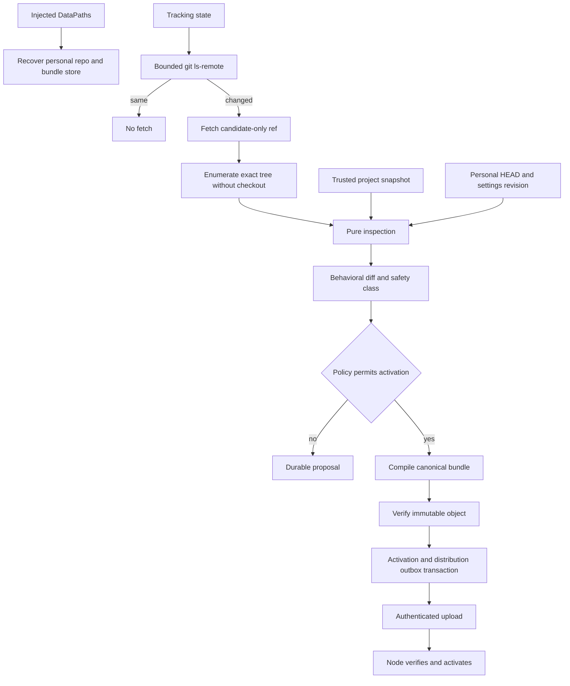

# Phase 5B: Trusted Configuration, Layers, and Durable Approvals

Status: **Implemented and accepted for the authorized local and native Windows
scope.** The exact checkpoint chain and remaining non-production boundaries are
recorded in
[`docs/operations/PHASE5B_ACCEPTANCE.md`](../docs/operations/PHASE5B_ACCEPTANCE.md).

Date: 2026-10-09

Target: Phase 5, Checkpoint 5B

Planning baseline: `9464849af9b13ed3fe864a9e55c1257fa6469d3a`

Workspace version at baseline: `0.60.77`

Implement this specification in a fresh session. It authorizes local source, test, documentation, migration, and commit work only. It does not authorize a push, deployment, signing, packaging, release, GitHub repository creation, visibility change, or pull request.

## 1. Overview

Build PandaMUX's trusted configuration control plane around the pure Phase 5A compiler. Phase 5B owns managed Git repositories, configuration candidates, project-layer trust, immutable activation, exact node distribution, durable mutation proposals, and generic confirmation surfaces.

Phase assignment:

- Foundation: canonical identities, one app-data owner, migration 13, protocol records, and revisioned settings.
- Core: managed personal Git, instructions mirroring, project trust, compilation, activation, distribution, and proposal application.
- Polish: safe diagnostics, behavioral diffs, generic history, confirmation cards, accessibility, and maintained documentation.
- Ship: local acceptance evidence only. Phase 5B does not ship a release.

Dependencies and gates:

- Phase 5A is accepted at `423594e3ad77497119aac09ba098a82bd499aa74`; the planning baseline includes its acceptance record.
- `pandamux-orchestrator` remains free of filesystem, process, network, Tokio, SQLite, remote, provider, and desktop dependencies.
- Existing Phase 4 routing, settings, authenticated IPC, environment routing, and schedule records remain authoritative inputs.
- P4-C5 and P4-C7 remain open. Phase 5B must not represent them as passed.
- The 11 protected `.pandamux-*.bundle` files are unrelated evidence and must not be modified, staged, deleted, or absorbed.
- The original checkout remains untouched.

Definition of done:

- Every active configuration is a fully validated immutable bundle identified by canonical `bundle_sha`.
- Source Git revisions remain separately identified by `source_commit_sha`.
- Invalid, offline, stale, or interrupted updates retain the last-good active bundle.
- Nodes activate only authenticated bytes from the hub and never receive Git hosting credentials.
- Personal Git writes preserve a valid `HEAD`, use ref compare-and-swap, and recover accepted edits without history rewriting.
- Mutation proposals are idempotent, revision-bound, locally resolved, and unable to apply after expiry, disconnect, rejection, or drift.

## 2. Resolved design decisions

### 2.1 Authority and ownership

```text
pandamux-core
  serialized identities, configuration records, mutation records, and DTO data
        ^
pandamux-orchestrator
  pure candidate inspection, canonical diffs, trust policy, and compilation
        ^
pandamux-server
  app-data paths, Git, files, SQLite, clocks, credentials, RPC, and activation
        ^
pandamux-client and pandamux-desktop
  read projections, intents, confirmation cards, history, and status
```

Do not create a second configuration merger. Extend the existing schemas, `LayerGrant`, `TrustedBundleSettings`, `BundleSourceManifest`, `ValueOrigin`, and `CompiledInstructionBundleV1`.

### 2.2 Exact identities

New public records never use unqualified `SHA`:

- `source_commit_sha`: exact Git commit for instructions or personal content.
- `project_content_sha256`: canonical project-layer content hash.
- `bundle_sha`: SHA-256 of the canonical compiled payload.
- `archive_sha256`: SHA-256 of optional transfer bytes.
- `settings_revision`: monotonic state revision, not schema version.

Runs and agent instances pin `bundle_sha`. Audit and UI records show every applicable identity without conflating source and compiled content.

### 2.3 Personal repository

- Store it below the injected app-data root at `personal/`.
- Initialize an empty valid canonical tree with one commit on `refs/heads/main`.
- Treat the Git ref as canonical and the worktree as a recoverable projection.
- Create one commit for each accepted logical edit.
- Stamp caller, request ID, accepted time, and originating run when present.
- Revert by a new inverse commit, never reset or rewrite.
- Return the original commit for an identical accepted request retry.
- Reject secrets and runtime artifacts before writing any Git object.
- Keep it local until a separately authorized backup feature.

### 2.4 Instructions policy

- Track a branch, tag, or exact commit; configure no remote during migration.
- Default the first configured source to `ApproveEach`.
- Make `TrustBranch` an explicit opt-in bound to one canonical remote and full branch ref.
- Require local approval under trust mode for access widening, scheduled-agent changes, history rewrites, remote identity changes, and tracking changes.
- Keep tags and commit pins fixed when branches move.
- Check on launch and every five minutes by default.
- Stop after unchanged `ls-remote`; do not fetch or activate.

### 2.5 Activation and proposals

- Candidate acquisition, validation, approval, materialization, activation, and distribution are separate durable states.
- Write and verify content-addressed objects before activation.
- Use SQLite as the hub's active-bundle truth; filesystem pointers are recoverable caches.
- Affect new work only; existing runs keep their pinned bundle.
- Identify proposals by `(caller_identity, tool_name, request_id)`.
- Return the original for byte-identical duplicates; reject conflicting reuse.
- Expire after ten minutes by default.
- Resolve caller disconnect as `CancelledDisconnected`; it can never apply later.
- Permit resolution only from authenticated local control.
- Apply one exact expected revision, old digest, and new digest once.
- Commit DB-backed target mutation, immutable audit, and resolution in one transaction.
- Give future Git-backed targets their own idempotent ref-CAS protocol; never pretend SQLite and Git are one atomic resource.

### 2.6 Product and dependency scope

Phase 5B adds generic configuration status, candidate diff, confirmation, history, trust, and revert surfaces. Phase 5D retains the full Agents editor and agent-specific create and edit workflows. UI state is pessimistic and follows durable server results.

No new third-party dependency is expected. Use `std::process::Command` behind an owned runner, `spawn_blocking`, `rusqlite`, existing serialization and hashing crates, authenticated JSON-RPC, and environment transfer. Adding `git2`, `gix`, a new archive library, or another database requires design review.

## 3. Architecture

### 3.1 Modules

| File or module | Responsibility |
|---|---|
| `pandamux-core/src/configuration.rs` | Tracking, source, candidate, trust, activation, distribution, and digest records |
| `pandamux-core/src/mutation.rs` | Proposal, caller, target, impact, resolution, and audit records |
| `pandamux-core/src/settings.rs` | Orchestration settings and schema normalization |
| `pandamux-orchestrator/src/configuration.rs` | Pure candidate inspection, behavioral diff, safety class, and canonical digests |
| `pandamux-orchestrator/src/policy.rs` | Exact trust checks and shared canonical JSON helpers |
| `pandamux-orchestrator/src/bundle.rs` | Complete diagnostics and personal-setting overlay |
| `pandamux-protocol/src/instructions_rpc.rs` | Instructions status, check, diff, approval, tracking, policy, and history DTOs |
| `pandamux-protocol/src/project_layer_rpc.rs` | Project status, diff, trust, and revoke DTOs |
| `pandamux-protocol/src/bundle_rpc.rs` | Hub-to-node manifest and receipt DTOs |
| `pandamux-protocol/src/mutation_rpc.rs` | Proposal query and local resolution DTOs |
| `pandamux-server/src/data_paths.rs` | One injected app-data graph |
| `pandamux-server/src/managed_git.rs` | Bounded Git process owner and plumbing |
| `pandamux-server/src/personal_repo.rs` | Init, commit, history, diff, revert, CAS, and recovery |
| `pandamux-server/src/instructions_service.rs` | Polling, mirror fetch, candidate state, and policy |
| `pandamux-server/src/configuration_service.rs` | Source collection, grants, compilation, diff, and activation intent |
| `pandamux-server/src/bundle_store.rs` | Immutable materialization and active lookup |
| `pandamux-server/src/bundle_sync.rs` | Distribution outbox, node receiver, and receipts |
| `pandamux-server/src/mutation_service.rs` | Proposal creation, expiry, resolution, CAS, and audit |
| `pandamux-server/src/store/configuration_phase5b.rs` | Migration-13 operations and recovery queries |
| `pandamux-client/src/configuration_projection.rs` | Shared status, history, candidate, and proposal projections |
| `pandamux-desktop/src/trusted_configuration_view.rs` | Status, diffs, trust, history, and revert UI |
| `pandamux-desktop/src/mutation_confirmation.rs` | Accessible generic confirmation card |

Integration also touches crate exports, manifests, `main.rs`, `server.rs`, `router.rs`, `request_context.rs`, `mcp_server.rs`, settings RPC and UI, sidebar, bridge, migrations, maintained docs, root version, and changelog.

### 3.2 Data flow



### 3.3 Runtime ownership and app-data layout

- Resolve `DataPaths` once at startup and inject it into Router and services.
- Serialize operations per managed repository; allow bounded concurrency across repositories.
- Run Git and filesystem work on blocking workers, never Tokio workers.
- Expose explicit shutdown that cancels children, drains output, and joins owners.
- Keep the Store as one logical writer; prove CAS with independent SQLite connections too.
- Keep desktop and client as projections, not canonical owners.

```text
<app-data>/
  data/pandamux.db
  data/backups/pandamux.db.pre-v13.<timestamp>
  personal/.git/
  instructions/<remote-identity-sha256>.git/
  configuration-candidates/<candidate-id>/
  bundles/<bundle-sha>/{manifest.json,compiled-bundle.json,source.bundle}
  bundle-staging/<uuid>/
  recovery/<owned-object-id>/
```

All roots are private to the current user. Reject symlink or reparse-point substitution and unsafe ownership. Tests inject temporary roots.

## 4. Data model

### 4.1 Core records

Add validated wrappers: `SourceCommitSha`, `ContentSha256`, `BundleSha`, `ArchiveSha256`, and nonzero `ConfigurationRevision`. Add `TrackingRef::{Branch, Tag, Commit}`, `InstructionsUpdatePolicy::{ApproveEach, TrustBranch}`, candidate state, update safety, activation, distribution receipt, and typed IDs.

`BundleActivationRecord` includes bundle SHA, complete source manifest, activation time and kind, server-stamped actor, and prior bundle SHA. Bounded display strings never become authorization keys.

### 4.2 Project identity and trust

Persist stable project ID, organization ID, credential-free canonical remote identity, canonical repository-root identity, diagnostic display path, and timestamps. Trust binds organization, project, repository identity, exact project content hash, local approver, approval time, and optional revocation.

Folder names and workspace paths are not trust keys. Remote, organization, project, content, or revocation changes make the layer untrusted.

### 4.3 Trusted personal settings

Increase `SETTINGS_SCHEMA_VERSION` only for serialized fields actually added. Derive `TrustedBundleSettings` from a revisioned row with tier mapping, disabled agent IDs, per-agent FullAccess opt-ins, and settings revision.

Repository definitions always compile with FullAccess false. A local opt-in applies only after upper-layer constraints and only to the exact compiled agent ID. Disabled agents remain visible but cannot route. Orchestrator models, fallbacks, budgets, provider settings, and backup target remain revisioned runtime inputs; repository YAML cannot author them.

### 4.4 Mutation proposal

`MutationProposal` contains proposal ID, request ID, server-stamped caller, tool, authenticated environment, target, expected revision, canonical old and new JSON plus digests, impact, creation and expiry times, resolution, and optional audit ID.

`MutationCaller` is a safe projection of `RequestContext`; request JSON cannot replace it. `MutationImpact` contains sorted affected organization, project, agent, schedule, and environment IDs plus access, FullAccess, budget, tracking, trust, and validation summaries. It contains no secret values.

Terminal resolutions are `ApprovedApplied`, `Rejected`, `Expired`, `CancelledDisconnected`, and `SupersededRevision`. Identity conflict is an error and leaves the original intact.

### 4.5 Migration 13

Before migration, create and verify a private SQLite backup. Failure stops startup before mutation. Migration 13 is additive and transactional:

1. Add `revision INTEGER NOT NULL DEFAULT 0` and `updated_at_ms INTEGER NOT NULL DEFAULT 0` to `settings`.
2. Set an existing `user_settings` row to revision 1 without changing its JSON.
3. Create `project_repositories`, `project_layer_trust`, and `personal_repo_state`.
4. Create `instruction_sources`, `instruction_candidates`, and `configuration_audit`.
5. Create `bundle_objects`, `bundle_activations`, and `bundle_distribution`.
6. Create `mutation_proposals` and append-only `mutation_audit`.
7. Record schema version 13 only after every statement succeeds.

Required constraints:

- Nonempty IDs, valid enum checks, nonnegative timestamps and revisions, and practical digest checks.
- Unique candidate source plus observed SHA; unique active trust key; unique caller, tool, and request identity.
- Unique environment plus bundle distribution; foreign keys to candidates, objects, proposals, and audits.
- Index pending expiry, active source, unresolved candidate, active trust, current activation, and incomplete distribution.

Never renumber migrations 1 through 12. Add migration rollback, reopen, idempotency, and failure tests.

### 4.6 Settings CAS

`settings.get` returns state revision. `settings.set` requires `expectedRevision` after callers update in the same checkpoint. Apply:

```sql
UPDATE settings
SET value_json = ?1, revision = revision + 1, updated_at_ms = ?2
WHERE key = 'user_settings' AND revision = ?3;
```

Exactly one row is success; zero is `revision_drift`; more is invariant failure. Normalization that changes JSON uses the same CAS and cannot overwrite a concurrent update.

## 5. Managed Git and configuration semantics

### 5.1 Hardened Git runner

`managed_git.rs` is separate from user-worktree `git.rs`. It accepts a closed command enum, confines paths to `DataPaths`, sets `GIT_TERMINAL_PROMPT=0` and stable locale, uses existing credential helpers or `gh`, captures streams separately, stores at most 16 KiB redacted stderr, and bounds tree/blob output to schema limits.

Local plumbing and `ls-remote` time out after 30 seconds; fetch and bundle verification after 120 seconds. Timeout or shutdown terminates and joins the owned child. Windows GUI parents use `CREATE_NO_WINDOW`. Personal commits disable hooks and signing. Mirror inspection never checks out, invokes filters, runs submodules or LFS, or executes repository code.

Persist no raw command line, credential-bearing URL, process environment, token, or unredacted stderr.

### 5.2 Personal repository transaction

1. Acquire the repository owner and verify expected `refs/heads/main`.
2. Materialize proposed canonical bytes in private staging.
3. Reject unexpected paths, links, special files, runtime state, and secrets.
4. Parse and validate every authored source before object creation.
5. Compute the canonical tree and change digest.
6. Use `hash-object --no-filters`, `mktree`, and `commit-tree` with explicit metadata.
7. Run `git update-ref <ref> <new> <expected>`.
8. Rebuild the worktree projection and reconcile durable state.

Initialize in a private sibling candidate, fsync, validate a real HEAD, and install atomically. Startup completes known accepted operations or moves owned ambiguous candidates to `recovery/`; it never deletes unknown paths. Revert builds the target tree as a new child of current HEAD and uses the same CAS.

### 5.3 Instructions mirror

Map each canonical remote identity to one private bare repo. Resolve full branch or tag refs, run `ls-remote`, stop if unchanged, fetch only into candidate refs, verify a commit object, enumerate via plumbing, and reject links, submodules, special modes, unexpected paths, oversized blobs, invalid encoding, and case-folded collisions.

For exact commits, check the mirror first, then verify the object is advertised or explicitly fetchable. Annotated tags retain tag and peeled commit identity. Branch rewrites become visible `history_rewritten` candidates and never auto-activate. Optional signed mode runs bounded `git verify-commit`; unknown, unsigned, or unverifiable results block activation.

### 5.4 Candidate inspection and hostile fixture

Add pure `inspect_configuration_candidate`: parse every bounded file independently, retain all per-file issues, evaluate references and policy for parseable files, order issues stably, calculate layer hashes and origins, and produce a behavioral diff. Any error makes `activatable = false`; inspection never compiles a partial candidate for activation.

Diff agents, access, tools, environments, capabilities, FullAccess, prompts, knowledge, classes, routing, verification, schedule-referenced agents, source identities, trust, settings, and origins. Mark whether local approval is mandatory.

One hostile project fixture includes exfiltration prompt, access widening, FullAccess, schedule content, invalid references, and widening same-ID override. Every independently discoverable element retains layer, path, field, code, safe reason, and origin.

## 6. API contract

### 6.1 Instructions and project RPC

| Method | Capability | Result |
|---|---|---|
| `instructions.status` | Control or bounded NodeProxy read | Active source, candidate, policy, last check, safe error |
| `instructions.check` | Local Control | One bounded check result |
| `instructions.diff` | Local Control | Stored file and behavioral diff |
| `instructions.approve` | Local Control | Exact candidate activation result |
| `instructions.setTracking` | Local Control via proposal | Revisioned source change |
| `instructions.setPolicy` | Local Control via proposal | Revisioned policy change |
| `instructions.history` | Local Control | Paginated activation audit |
| `instructions.revert` | Local Control via proposal | Reactivated retained bundle |
| `projectLayer.status` | Local Control | Current hash and trust state |
| `projectLayer.diff` | Local Control | Safe exact-hash diff |
| `projectLayer.trust` | Local Control via proposal | Exact trust grant |
| `projectLayer.revoke` | Local Control via proposal | Revocation audit |

Mutations include request ID and expected revision. Candidate approval includes candidate ID, observed source commit, and diff digest. Project trust resolves organization and repository identity from server state, never caller claims.

### 6.2 Personal history, bundles, and mutations

Add `personalConfig.history`, `personalConfig.diff`, and local-only `personalConfig.revert`; agent-specific authoring stays in Phase 5D.

`bundle.push` is NodeProxy-only after authenticated private upload. Manifest fields are schema and transfer ID, server-stamped environment, bundle SHA, archive SHA and byte length, complete source manifest, compiler version, private artifact reference, and expected prior bundle. Response includes stored, active, and prior bundle SHA, receipt time, and stable status. Identical replay returns the receipt; conflicting transfer identity fails.

The archive holds canonical compiled bundle, exact instructions Git objects needed to verify source commit, and bounded project and personal snapshots. Node verifies archive, Git object, layers, payload, environment, and schema before activation.

Add local-control `mutation.list`, `mutation.get`, `mutation.approveOnce`, and `mutation.reject`. Internal services call `MutationService::propose`. MCP stays read-only except optional proposal-only tools after immutable `RequestContext` reaches `McpServer::call_tool`. Such a tool returns a proposal ID promptly and never waits for UI.

Null and omitted optional MCP fields mean absent. Future clearing requires explicit `clearFields`; null filler cannot erase data.

### 6.3 Stable errors

Use `RpcError::with_data` with stable `reason`, safe resource ID, expected and actual revision where applicable, and retryability. Never include secret values, raw environments, raw Git stderr, nonlocal full paths, or credential-bearing URLs.

## 7. Commit-sized implementation checkpoints

Each checkpoint must be independently verified before commit. Re-read the root version, add a user-facing changelog entry, bump at least patch, stage exact paths, review the staged diff, and commit through a file with `git commit -F`. Never broadly stage.

### B-A. Contracts, paths, and migration 13

Implement core records, shared canonical JSON/digest, protocol DTOs, `DataPaths`, migration 13, phase-specific store APIs, settings revision, and desktop revision propagation.

Follow transactional migrations, `runtime.rs` ownership checks, Phase 5A IDs, and same-revision conflict patterns. Do not copy canonicalization.

Gotchas: `never-renumber-applied-migrations`, `versioned-config-migration-backup`, `stale-version-read-collides-on-push`, `null-filler-clears-fields-on-update`, `sync-sqlite-transactions-in-async-stores`.

Verify migration preservation, failure rollback to version 12, idempotent reopen, settings stale CAS, protocol round trips, and boundary checks.

### B-B. Managed personal repository

Implement bounded Git ownership, atomic initialization, pre-object validation, plumbing-only commits, ref CAS, request idempotency, history, diff, revert, and failpoints after directory, object, commit, pre-ref, post-ref, and pre-reconciliation boundaries.

Follow `checkpoint.rs` plumbing, managed-release atomic replacement, and `runtime.rs` private temporary files. Do not reuse `git_commit`.

Gotchas: `git-ls-files-blind-spot`, `content-filter-staging-sweeps-concurrent-edits`, `hook-not-executable-silently-skipped`, `case-colliding-tracked-paths`, `crlf-expansion-doubles-file`, `blocking-io-on-tokio`, `gui-subsystem-console-child-window`, `join-on-drop-sender-field-order`.

Verify one concurrent initializer, one winner for competing writers, valid HEAD at every failpoint, retry without duplicate commit, no secret objects/reflogs/audit/stderr, and exact revert with retained history.

### B-C. Instructions mirror and inspection

Implement source and candidate persistence, launch and interval polling, all tracking modes, `ls-remote` before fetch, candidate refs, no-checkout inspection, complete diagnostics, behavioral diff, signed verification, and local bare-remote fixtures.

Follow existing Git result types with stricter bounds, Phase 5A `SourceDocument`, and schedule reads for impact.

Gotchas: `clone-branch-rejects-sha`, `derived-cache-currency-misses-second-input`, `precondition-gate-counts-unfiltered-collection`, `worktree-symlinked-artifacts-fake-a-pass`, `persist-before-dispatch`.

Verify no-change means no fetch; branch advance; force-push block; fixed tag and commit; offline, auth, timeout, missing ref, invalid and unsigned candidates; safe diagnostics; last-good retention; complete issue collection.

### B-D. Layer trust and compilation

Persist canonical project repository identity and exact-hash trust, collect strict `.pandamux/` sources, extend settings for disabled and FullAccess opt-ins, extend trusted overlay, add origin-aware diff and combined hostile fixture, and prove personal settings cannot lift upper-layer denials.

Follow project remote normalization without folder-name fallback, `LayerGrant`, and `validate_agent_override`.

Gotchas: `check-sibling-services-before-parallel-store`, `derived-cache-currency-misses-second-input`, `clearing-legacy-field-exposes-old-readers`.

Verify trust across every key dimension, automatic invalidation, visible declined content, all hostile violations, four origin layers, disabled routing exclusion, and exact local FullAccess opt-in.

### B-E. Activation and node distribution

Implement private staging, payload/archive verification, immutable bundle directories, activation plus audit and outbox transaction, typed `bundle.push`, authenticated upload, exact node verification, atomic node activation, idempotent receipt, and reconnect drain.

Follow environment routing, NodeProxy authorization, SFTP private upload and fsync, extended Git bundle verification, and Phase 5A content identity.

Gotchas: `persist-before-dispatch`, `derived-cache-currency-misses-second-input`, `acceptance-must-exercise-successful-side-effect-branch`, `lazy-migration-only-touches-read-records`.

Verify pre-activation crash retains old bundle; post-transaction crash recovers new bundle and outbox; corrupt identities reject; node has no hosting credential; replay receipt is stable; offline catch-up is once; running records remain pinned.

### B-F. Mutation proposals and confirmation surfaces

Thread `RequestContext` into MCP, persist canonical proposals before notification, deduplicate, sweep expiry, cancel on owned disconnect, apply DB targets with revision and old-digest predicates, atomically audit and resolve, add local-only RPC, projections, accessible confirmation card, configuration status, trust, history, diff, and revert panels. Keep direct MCP mutation disabled.

Follow server-owned capabilities, continuation idempotency, atomic tool-result transactions, and existing keyboard approval patterns.

Gotchas: `human-review-queues-deduplicate-decision-identity`, `github-contents-sha-refresh-defeats-cas`, `persist-before-dispatch`, `mcp-tool-null-coercion`, `null-filler-clears-fields-on-update`.

Verify duplicate and conflict behavior, approve/reject race, stale revision, expiry, disconnect, rejection, response-loss replay, resolver capabilities, mandatory local widening approval, and accessible non-color-only UI.

### B-G. Documentation and acceptance record

Update README, CLAUDE, maintained docs, and `docs/operations/PHASE5B_ACCEPTANCE.md` only after B-A through B-F pass. Record exact commit, version, commands, outcomes, limitations, absent live evidence, and deliberate deviations. Re-run the full matrix on the documentation commit.

Gotchas: `cargo-check-skips-test-targets` and `acceptance-must-exercise-successful-side-effect-branch`.

Verify docs match manifests and implementation, every acceptance row maps to retained evidence, and push, deployment, packaging, signing, release, and GitHub writes remain absent.

## 8. Acceptance criteria

| ID | Criterion | Tests |
|---|---|---|
| AC-B01 | Concurrent personal initialization produces one valid repo and HEAD | REP-01, REP-02 |
| AC-B02 | Accepted edits survive every injected interruption | REP-03 to REP-08 |
| AC-B03 | Revert creates a commit and restores exact content | REP-09 |
| AC-B04 | Forbidden secrets and runtime data create no Git object | SEC-01, SEC-02 |
| AC-B05 | Unchanged remote performs no fetch | MIR-01 |
| AC-B06 | Branch, tag, and commit obey distinct policies | MIR-02 to MIR-05 |
| AC-B07 | Failed, offline, rewritten, or invalid update retains last good | MIR-06 to MIR-11 |
| AC-B08 | Project trust binds exact org, project, repo, and content | LAY-01 to LAY-05 |
| AC-B09 | Every hostile fixture element stays visible and blocked | LAY-06 |
| AC-B10 | Activation is immutable, recoverable, and new-run-only | ACT-01 to ACT-05 |
| AC-B11 | Node verifies exact bytes without Git credentials | ACT-06 to ACT-10, SEC-03 |
| AC-B12 | Proposal duplicates are idempotent and conflicts fail closed | MUT-01, MUT-02 |
| AC-B13 | Drift, expiry, disconnect, and rejection do not mutate | MUT-03 to MUT-07 |
| AC-B14 | One local approval applies one exact mutation once | MUT-08 to MUT-10 |
| AC-B15 | Access widening never auto-applies | MUT-11, SEC-04 |
| AC-B16 | UI conveys complete safe confirmation accessibly | UI-01 to UI-06 |
| AC-B17 | Migration 13 is backed up, atomic, and idempotent | DB-01 to DB-05 |
| AC-B18 | Orchestrator purity and exact pins remain enforced | ARC-01, ARC-02 |

Phase 5B fails if an active pointer references a missing or invalid object, a secret reaches Git or audit storage, or a mutation applies without exact revision and local authority.

## 9. Test plan

### 9.1 Domain, migration, and proposal tests

- ARC-01: digest and revision wrappers reject malformed values; ARC-02: graph boundary rejects runtime dependencies.
- DB-01: version-12 fixture migrates without row changes; DB-02: backup reopens independently.
- DB-03: injected migration failure leaves version 12; DB-04: reopen is idempotent; DB-05: settings CAS increments once.
- LAY-01: trust canonicalization is stable; LAY-02: every key field affects equality; LAY-03 to LAY-05: org, project, remote, and hash changes invalidate.
- LAY-06: combined hostile fixture returns the complete ordered issue set.
- MUT-01: canonical identity ignores object-key order; MUT-02: same identity with changed bytes conflicts.
- MUT-03: stale revision changes zero rows; MUT-04: approve/reject race has one terminal result.
- MUT-05: expiry, MUT-06: disconnect, and MUT-07: rejection cannot mutate.
- MUT-08: target, audit, and resolution commit together; MUT-09: injected failure rolls all back; MUT-10: lost response retry returns stored result.
- MUT-11: every widening class requires local control.

Use independent SQLite connections for races so tests do not pass only because of the store mutex.

### 9.2 Managed Git and mirror tests

- REP-01: empty bootstrap creates valid main; REP-02: concurrent init yields one identity.
- REP-03 to REP-07: fail after directory, objects, commit, before ref, and after ref; reopen always has valid HEAD and accepted work once.
- REP-08: competing expected-head writers yield one winner; REP-09: revert tree equals target and retains parents.
- SEC-01: secret sentinels are absent from objects and reflogs; SEC-02: runtime paths are absent.
- MIR-01: unchanged `ls-remote` means zero fetch; MIR-02: branch advance creates one candidate.
- MIR-03: annotated tag retains tag and peeled commit; MIR-04: commit pin survives branch move; MIR-05: lightweight tag and SHA fetch.
- MIR-06: force push is held; MIR-07: deleted ref retains active; MIR-08: offline/auth retains active.
- MIR-09: timeout terminates and joins child; MIR-10: hostile tree never checks out or activates; MIR-11: signature failure retains active.

All remote tests use temporary local bare repositories. No test contacts GitHub or another external service.

### 9.3 Bundle, authorization, and UI tests

- ACT-01: valid compile creates one immutable object; ACT-02: duplicate materialization verifies and reuses it.
- ACT-03: pre-activation crash retains prior pointer; ACT-04: post-transaction crash recovers activation and outbox.
- ACT-05: active change does not alter existing run records.
- ACT-06: authenticated node accepts exact bytes; ACT-07: bad archive rejects; ACT-08: bad source or layer hash rejects.
- ACT-09: duplicate transfer returns one receipt; ACT-10: reconnect drains one pending row.
- SEC-03: node environment has no hosting credential or remote URL; SEC-04: MCP, provider, and node cannot resolve.
- UI-01: confirmation projection redacts secrets; UI-02: it retains caller, tool, environment, diff, scopes, access, budget, expiry, and issues.
- UI-03: keyboard reaches every action; UI-04: names and status do not rely on color.
- UI-05: expired and disconnected cards disable approval; UI-06: invalid candidate stays inspectable beside last-good status.
- Caller-forgery tests prove JSON cannot replace `RequestContext`; redaction tests seed secrets in values and Git stderr.

### 9.4 Property tests

- Candidate issues and behavioral diffs are deterministic under input permutation.
- Canonical old/new JSON and digests are stable under object-key permutation.
- Proposal transitions are total; terminal states never return to pending.
- Random resolution, retry, disconnect, expiry, and drift sequences apply at most once.
- Random crash points yield old-complete or new-complete activation, never mixed state.
- Generated layer overrides never widen the instructions access ceiling.

## 10. Error handling

| Failure | Durable result | Safe reason and recovery |
|---|---|---|
| Unsafe app-data root | No service start | `managed_path_unsafe`; correct path or ownership |
| Backup or migration fails | Schema unchanged | `database_backup_failed` or `migration_failed`; correct and retry |
| Personal init interrupted | No partial active repo | `personal_repo_recovering`; complete or quarantine owned candidate |
| Personal HEAD changed | No write | `personal_head_changed`; refresh and repropose |
| Secret or runtime path | No Git object | `secret_or_runtime_data_rejected`; remove value |
| Git timeout or auth failure | Candidate unchanged | `git_command_timed_out` or `instructions_authentication_failed`; retry or repair helper |
| Ref missing or rewritten | Last good active | `tracked_ref_not_found` or `history_rewritten`; change or approve locally |
| Signature invalid | Candidate blocked | `signature_verification_failed`; configure key or policy |
| Candidate invalid | Candidate blocked | `candidate_validation_failed`; inspect complete issues |
| Project untrusted or changed | Layer ignored | `project_layer_approval_required` or `project_identity_changed`; approve exact identity |
| Bundle staging or integrity fails | Old active retained | `bundle_materialization_failed` or `bundle_integrity_failed`; retry validated source |
| Activation transaction fails | Old active retained | `bundle_activation_failed`; retry transaction |
| Node offline or rejects hash | Outbox pending, node keeps old | `node_bundle_pending` or `node_bundle_rejected`; reconnect or retransmit |
| Duplicate proposal identical | Original returned | Continue original flow |
| Duplicate proposal conflicts | Original untouched | `request_identity_conflict`; use new ID |
| Expired, disconnected, rejected | No mutation | Stable terminal reason; create fresh proposal if needed |
| Resolver unauthorized | No mutation | `capability_scope_denied`; use local control |
| Revision drift | No mutation | `revision_drift`; refresh and review new diff |
| Audit insert fails | Apply transaction rolls back | `proposal_apply_failed`; retry safely |
| Response lost after commit | Stored result retained | Retry same resolution without duplicate mutation |

Recovery loops are bounded. Ambiguous state stays visible and inactive; never guess it active.

## 11. Verification

Explain duration and interrupt safety before long commands as required by `AGENTS.md`. Run focused tests after each checkpoint and this complete matrix before acceptance:

```bash
cargo fmt --all -- --check
cargo test -p pandamux-core
cargo test -p pandamux-orchestrator
cargo test -p pandamux-protocol
cargo test -p pandamux-server
cargo test -p pandamux-client
cargo test -p pandamux-desktop
cargo test -p pandamux-remote
cargo test -p pandamux-boundary-check
cargo run -p pandamux-boundary-check
cargo test --workspace
cargo check --workspace --all-targets
cargo clippy --workspace --all-targets -- -D warnings
git diff --check
```

Use a controlled artifact path for secret scans and inspect matches manually. Native Windows verification is required for no-console Git children, private path ownership and reparse rejection, atomic replacement, and confirmation accessibility. Record these as unverified when only cross-compilation is available.

## 12. Rollback plan

Before commit, restore only current-checkpoint files from its recorded base. Never reset, clean, or touch protected evidence. Remove only validated task-owned temporary paths.

Migration 13 has no live destructive down migration. To run an older binary: stop server, verify the pre-v13 backup checksum, preserve the v13 DB, restore the complete backup, and leave personal repos, mirrors, and bundles preserved but inactive. Never drop tables live or decrement `_migrations` without restoring its matching backup.

Configuration rollback is forward-only: earlier bundle reactivation creates an activation audit, personal rollback creates a revert commit, trust revocation creates an audit, tracking rollback is a proposal, and nodes receive the selected exact bundle through the normal outbox.

## 13. Out of scope

- Creating, pushing, changing visibility, or opening a PR for `BoardPandas/pandamux-instructions`.
- Network tests against GitHub or another external host.
- Personal backup creation, push, restore, or schedule backup.
- Full Agents authoring, Team PR workflows, Phase 5D product surfaces, and Floor Plan.
- Phase 5C dispatch, worktrees, budgets, blackboard effects, and run recovery.
- Phase 5E memory authoring, journals, and vector index.
- Phase 5F broad mutating MCP registry; Phase 5B supplies its durable boundary.
- Phase 6 scheduler implementation or schedule mutation.
- New provider authentication, credential storage, or hosted team service.
- Packaging, signing, publication, deployment, release, or update channels.
- Claiming physical native acceptance without physical native evidence.

## 14. Assumptions and open questions

The user accepted all defaults on 2026-10-09. Those decisions are recorded in Sections 2 through 6. Additional implementation defaults are 16 KiB redacted stderr, five-minute polling, 30-second local and discovery commands, 120-second fetch, existing dependencies, server-supplied UTC milliseconds, and stable ordered collections.

There are no open product questions at planning time. If observed code or platform behavior conflicts with an assumption, stop that checkpoint and request a decision rather than relaxing security, trust scope, or acceptance thresholds.

## 15. Lessons Learned / Gotchas

- Never reuse `git add -A` for managed configuration.
- Validate secrets before Git object creation.
- Fetch arbitrary SHAs with init plus fetch, not clone branch syntax.
- Keep Git errors bounded and redacted; never block Tokio on Git or files.
- Persist candidates and proposals before notification or dispatch.
- Capture expected revision when the proposal is created.
- Include every source identity in bundle currency.
- Reject configuration symlinks even when they remain inside the root.
- Exercise successful side effects in acceptance, not only denials.

After implementation:

- [ ] Route general gotchas to LL-G with `/add-lesson`.
- [ ] Route proven reusable patterns to BP with `/add-practice`.
- [ ] Keep only PandaMUX-specific notes in `.claude/agent-memory/`.
- [ ] Record failed approaches and workflow improvements.

## 16. Fresh-session handoff

Worktree: `/home/brandon/.codex/worktrees/recovery-r0/Pandamux`

Opening checks:

1. Read `AGENTS.md`, `README.md`, `CLAUDE.md`, this specification, and Phase 5A acceptance.
2. Verify branch, HEAD, upstream relation, version, and status.
3. Confirm the protected bundle files are the only unrelated dirt.
4. Recheck schema version and active worktree ownership.
5. Begin B-A and stop at each checkpoint for focused tests, exact staging, changelog, version bump, and commit.
6. Do not push, deploy, sign, package, release, create or modify GitHub repositories, or open pull requests.

Fresh-session request:

> Implement `tasks/2026-10-09-phase-5b-trusted-configuration.md`, starting with Checkpoint B-A and proceeding through verified commit-sized checkpoints. Work only in `/home/brandon/.codex/worktrees/recovery-r0/Pandamux`. Do not push, deploy, sign, package, release, create or modify GitHub repositories, or open pull requests.
