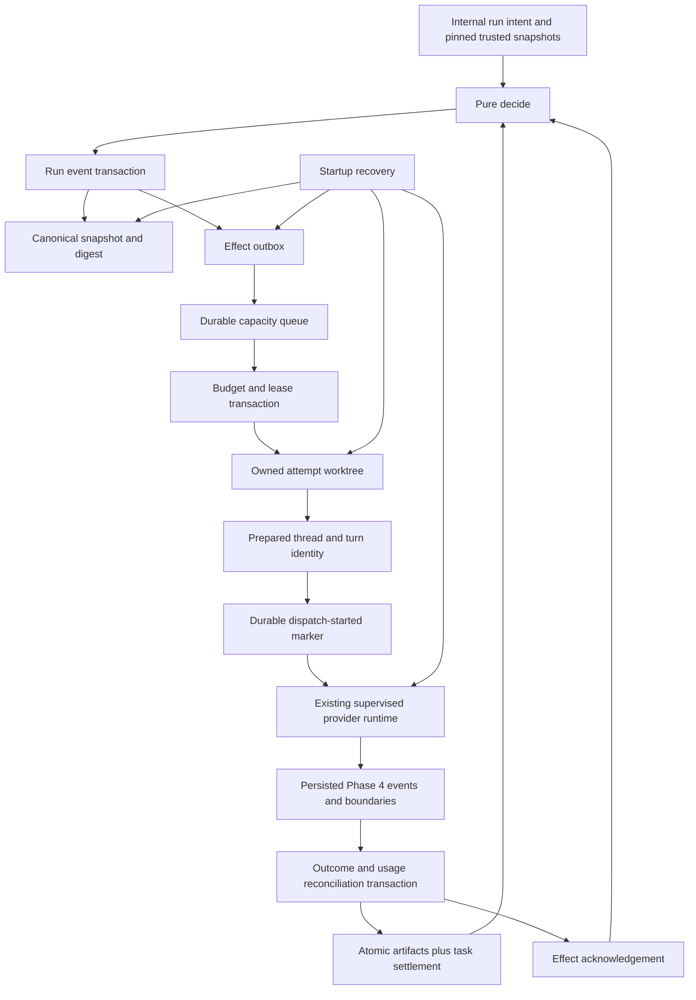

# Phase 5C: Execution Owner, Worktrees, Budgets, and Recovery

Status: **Implemented, locally verified, and target-CI verified on exact version
0.60.117 commit `e53406bbd211e701f89a25d63a8cd672033a22d9`; not accepted for
the complete local/native or production scope.** The complete portable matrix,
exact native Linux process-group and worktree rows, and all eight jobs of native
run `38040781118` pass. Windows and Apple Silicon CI execute retained native
worktree, link/reparse, lock, real-child, and release-build rows, but the
required Windows Job Object descendant and macOS process-group descendant rows
remain unverified. A physical remote Linux node, live providers, and the
controlled external-effect row remain unrun. The checkpoint chain and evidence
boundaries are recorded in
[`docs/operations/PHASE5C_ACCEPTANCE.md`](../docs/operations/PHASE5C_ACCEPTANCE.md).

Date: 2026-10-09

Target: Phase 5, Checkpoint 5C

Planning baseline: `778a164b00a1b56c8a6f63310f7d647ac49650e8`

Workspace version at baseline: `0.60.89`

The original implementation authorization covered local source, test,
documentation, migration, and commit work only. A later explicit authorization
permitted pushing the recovery branch and manually dispatching and monitoring
its native CI. Neither authorization permitted deployment, signing, packaging,
release, GitHub repository creation or administrative changes, or a pull
request.

## 1. Overview

Build the server-owned runtime that interprets the pure Phase 5A engine without
creating a second orchestration state machine. Phase 5C owns durable run events,
effect intent, queueing, per-attempt worktrees, execution leases, budget
reservation and reconciliation, provider dispatch, typed blackboard artifacts,
watchdogs, cancellation, and restart recovery.

Phase assignment:

- Foundation: extend canonical records, add migration 14, persist replayable run
  events and snapshots, and create the durable effect outbox.
- Core: allocate owned worktrees, schedule against every concurrency dimension,
  reserve budgets, and dispatch through the existing provider runtime.
- Polish: atomically publish artifacts and verification evidence, enforce
  progress watchdogs, join every runtime owner, and recover every crash state.
- Ship: local portable acceptance plus clearly separated native/live evidence.
  Phase 5C does not publish or deploy a release.

Dependencies and gates:

- Phase 5A is accepted at
  `423594e3ad77497119aac09ba098a82bd499aa74`; its pure command, event,
  replay, route, approval, budget, and side-effect-boundary records are the
  canonical policy authority.
- Phase 5B is accepted for its authorized scope at the planning baseline. New
  runs pin its immutable `bundle_sha`, settings revision, organization policy,
  project identity, and trust decisions.
- `pandamux-orchestrator` remains free of filesystem, process, network, Tokio,
  SQLite, remote, provider, protocol, and UI dependencies.
- Existing Phase 4 provider-session supervision, tool ledger, continuation,
  usage, and `AttemptBoundary` behavior remain authoritative. Phase 5C adapts
  them; it does not fork them.
- P4-C5 remains Partial and P4-C7 remains open. Phase 5C must not represent them
  as passed.
- Preserve the 11 untracked `.pandamux-*.bundle` files and the unrelated
  `tasks/security-scan-2026-10-09.md`; never stage, modify, delete, or absorb
  them. Leave the original checkout untouched.

Definition of done:

- Every effect directly dispatched by Phase 5C has durable intent before
  dispatch and a durable outcome before a dependent task can advance.
- Replaying the event log reproduces the stored run snapshot byte-for-byte and
  never creates a second effect.
- Every task attempt executes only in its own positively identified,
  PandaMUX-owned worktree; the user's checkout and index are never execution
  targets.
- Run, agent, provider-instance, environment, organization, and global
  concurrency caps are enforced by one scheduler with explicit ordering and
  interactive capacity.
- Run and daily budgets reserve before dispatch and reconcile from normalized
  usage without treating missing cost as zero.
- Blackboard artifacts are immutable, typed, bounded, append-versioned, and
  non-authoritative for access or permission.
- Cancellation and shutdown join or durably quarantine provider processes,
  event writers, watchdogs, worktree owners, and leases within declared bounds.
- Recovery resumes only provably undispatched work, reconnects only to an exact
  live attempt, and sends every ambiguous externally visible attempt to human
  review without redispatch.

## 2. Resolved design decisions

### 2.1 One engine and one effect owner

```text
pandamux-core
  serialized runs, events, effects, leases, budgets, artifacts, and receipts
        ^
pandamux-orchestrator
  pure decide, apply, replay, readiness, artifact, and budget validation
        ^
pandamux-server::RunExecutionService
  SQLite transactions, queue, worktrees, provider turns, timers, and recovery
        ^
private Hub/node protocol and later Phase 5D product surfaces
```

`RunExecutionService` is the only interpreter of `OrchestrationEffect`. It
calls the pure engine, envelopes resulting events, commits events and derived
effects, and only then lets owned workers interpret those effects. Router,
desktop, client projections, provider adapters, and background tasks never
mutate `Run` directly.

`ThreadManager` remains the owner of thread and provider-turn semantics. Add a
typed prepared-turn path for Phase 5C so the run service can persist an effect,
worktree, turn identity, attempt identity, route, and execution intent before
`ProviderResolver::acquire_execution`, `start_session`, or `send_turn` occurs.
Do not copy the large provider event loop into a second manager.

Manual threads remain valid. Shared capacity accounting and process ownership
must include both manual and orchestrated turns, but this checkpoint adds no new
public run UI or CLI.

Repair the Phase 5A pure seam before attaching runtime effects:

- add `RecordCheckpoint` and `MarkAttemptAmbiguous` commands/events so existing
  canonical fields can be populated without server-side mutation;
- bind budget reservations to an exact attempt and clear the task's active
  reservation when it is reconciled or released, allowing a valid retry;
- record checked actual usage even when it exceeds an estimate or limit, then
  pause/request approval before further work instead of discarding accounting
  truth;
- represent incomplete/unknown usage explicitly; and
- bind typed task inputs to immutable artifacts before dependency readiness.

### 2.2 Delivery is idempotent, not magically transactional

SQLite cannot atomically commit with a provider process, Git process, remote
node, or tool side effect. Phase 5C therefore promises:

- one immutable effect identity and payload digest;
- durable intent before the first external call;
- at-most-once automatic dispatch after the durable `dispatch_started` marker;
- exact outcome replay after the outcome transaction;
- no automatic rerun when a crash leaves external visibility ambiguous.

Effect states are monotonic:

```text
pending -> claimed -> prepared -> dispatch_started -> in_flight
   |          |          |                |              |
   |          |          +-> pending      +-> review_required
   |          +-> pending                 +-> outcome_recorded -> settled
   +-> cancelled                                            |
                                              review_required
```

Only `pending`, or an expired `claimed`/`prepared` effect with no dispatch
marker, may return to `pending`. Once `dispatch_started` commits, restart may
reattach to the exact attempt if the owning environment proves it is still
running. Otherwise the effect becomes `review_required`; it is never resent.

An adapter may record `dispatch_not_started` after the marker only when it
returns positive evidence that no provider process or prompt was accepted and
all partially created descendants were joined. `ProviderResolver` rejection
before process creation can satisfy this. `start_session`/`send_turn` failure
requires a typed start receipt with `prompt_accepted = false` and
`cleanup_verified = true`; an ordinary error or lost response is ambiguous.
Only this proven terminal outcome may enter the ordinary pre-output fallback
path.

Phase 4 tool-start, tool-result, approval-delivery, continuation, and
`AttemptBoundary` records remain the detailed truth inside a provider turn. A
run effect receipt summarizes those durable records; it does not replace them.

Worktree creation, checkpoint creation, Git-bundle materialization,
notification, provider start, and remote prepare/dispatch each receive a stable
child-operation identity, payload digest, intent, and receipt beneath the parent
effect. Provider-internal tool, file, command, and commit operations remain
server-owned through `ThreadManager` and the Phase 4 tool ledger/checkpoint
boundary. If an adapter cannot prove intent preceded a provider-internal side
effect, the attempt advances to an ambiguous boundary and cannot auto-retry.

For new runs, canonical artifact bytes are inserted in the run transition
transaction. Replace `PublishBlackboardEntry` with a post-commit
`NotifyBlackboardPublished` projection effect containing only entry identity and
digest. Retain the V1 shape only in compatibility fixtures; no effect
interpreter may use it as a second artifact-persistence path.

### 2.3 One app-owned worktree per attempt

Extend `DataPaths` with private `worktrees/` and `run-artifacts/` roots. An
attempt worktree lives at a deterministic path below the environment-local
app-data root:

```text
worktrees/<repository-id>/<run-id>/<attempt-id>/
```

The source repository contributes Git objects but is never an execution cwd.
Creation uses an exact commit baseline and a unique full ref:

```text
refs/heads/pandamux/run/<run-id>/<task-id>/<attempt-ordinal>
```

Record the canonical repository identity, Git common-directory identity,
baseline commit, full branch ref, path, environment, run/task/attempt owner,
lease, checkpoint refs, dirty-state policy, and cleanup eligibility. Verify all
of them before every Git or filesystem action. Reject symlinks, junctions,
reparse points, case-colliding paths, path escapes, an existing foreign path,
and a branch/ref owned by another attempt.

Disable repository hooks with a private empty `core.hooksPath`. Inspect the
exact baseline's attributes before checkout and reject external/custom content
filters; do not run LFS smudge helpers. Never recurse or initialize submodules
automatically. Reject managed-root link/reparse components and checked-out
links that escape the owned worktree; an in-root repository symlink remains
subject to the existing workspace confinement policy.

The user checkout may be dirty, but only the selected committed baseline enters
the attempt. Uncommitted user changes are neither copied nor cleaned. If a task
requires them, dispatch fails closed until a future explicit snapshot workflow
exists.

New worktrees start clean. Attempt output may be dirty and must be preserved.
Automatic cleanup is allowed only after terminal settlement, verified process
death, retained checkpoints/artifacts, no recovery review, and an ordinary
non-forced `git worktree remove` of a clean tree. Dirty, locked, mismatched, or
ambiguous worktrees remain retained with a safe recovery reason. Never run
`git clean`, broad `git add -A`, forced removal, reset, or rollback against a
path until positive attempt ownership has been revalidated; Phase 5C itself
does not automatically discard dirty output.

For a remote environment, the node is the filesystem and process owner. The
Hub keeps canonical run state and sends an authenticated, idempotent attempt
descriptor. The node persists local ownership before materializing the
worktree. It must already possess or receive the exact baseline through the
existing authenticated Git-bundle path; it never receives hosting credentials.
Canonical blackboard JSON remains transactional SQLite data. `run-artifacts/`
is only a verified content-addressed cache/export for evidence files and can be
rebuilt from durable rows; it is never a second source of truth.

### 2.4 Durable queue and capacity policy

One `ExecutionAdmissionService` arbitrates manual and orchestrated provider
starts. `ThreadManager` must obtain an admission before
`ProviderResolver::acquire_execution`; it cannot retain a bypass path. Manual
turns use a durable interactive queue/claim identity without becoming Phase 5
runs. The service checks all applicable limits before a worker claim:

1. pure run `max_parallel_tasks`;
2. compiled agent `concurrency`;
3. provider-instance `concurrency_limit`;
4. environment execution limit;
5. existing organization `max_concurrency`, when set;
6. trusted global concurrency limit.

Add an environment execution limit with default `4`, clamped to the global
limit. Retain the existing global default `8`. A cap decrease never kills
active work; it blocks new claims until counts fall below the new value.

Reserve one global and one per-environment slot for interactive work whenever
the corresponding cap is at least two. Orchestrated tasks never borrow those
reserved slots. If a cap is one, there is no impossible reservation; interactive
requests win the next shared claim, and weighted selection still admits the
oldest eligible orchestrated item after at most four consecutive interactive
claims.

Within a class, order by `(enqueued_at_ms, run_id, task_id, attempt_id)`. Scan
in that order for the oldest resource-eligible item so a provider-blocked head
does not block unrelated providers. Skipping does not change its queue age; it
wins as soon as its resource becomes available. Retries retain task age but use
a new attempt identity and explicit `not_before_ms`.

The durable row and its capacity lease use compare-and-swap. Ready run tasks
create an operational queue candidate derived from the canonical run/task/route
digest; the queue is not a second policy state machine. It holds no budget while
waiting. At a successful claim, all capacity leases, an attempt-bound budget
reservation, and the pure `BudgetReserved` plus `DispatchRequested` events
commit in one SQLite transaction before worktree or provider effects. The
existing in-memory provider permit remains the last process-level guard, but it
must not be the scheduler or the only concurrency truth.

### 2.5 Budget reservations and approvals

All enforcement uses checked integer `BudgetAmount` values. A non-mutating
feasibility check may reject an impossible queue candidate. At the successful
execution claim, reserve the attempt estimate atomically with every capacity
lease and check it against:

- the remaining task budget;
- the remaining run budget, including earlier reconciled usage;
- the compiled agent ceiling;
- the organization's UTC-day cost ledger.

With no trusted smaller estimate, reserve the task's remaining ceiling. A retry
can reserve only the unreconciled remainder. The reservation records the UTC
date at successful claim; reconciliation stays on that ledger even if the
attempt waits or runs across midnight. A queued task holds no budget. Claim
failure commits neither capacity nor budget; cancellation and pre-dispatch
failure release both atomically.

Normalize actual tokens, micro-USD, and runtime from the durable managed-turn
facts. Prefer provider-reported micro-USD when present; otherwise use the
effective-dated API-equivalent estimate. Legacy `f64` cost is display-only. If
cost remains unknown, keep the cost portion reserved and mark reconciliation
incomplete rather than treating it as zero. Conservation checks compare
reservation, usage facts, run totals, and daily totals, but never replace the
source fact.

`BudgetReservation.attempt_id` is mandatory for dispatched work. Track
completeness separately for tokens, micro-USD, and runtime. Reconciliation
always records representable actual usage, even when it exceeds the reservation
or trusted ceiling. It then releases only known reserved dimensions, records an
overage, and pauses the run before another dispatch. Checked integer overflow is
still a hard storage error; policy overage is not an excuse to lose the fact.

If a reservation would exceed a limit, do not dispatch. A local
`RunApprovalKind::Budget` may authorize one exact, bounded supplemental grant
for one run, dimension, amount, policy revision, action digest, and expiry. Add
an explicit pure command/event for that grant; approval alone never edits a
number or the organization policy. Rejection, expiry, disconnect, revision
drift, or a changed amount leaves the task paused. Actual usage above the
reservation is reconciled honestly and blocks further work until it is within
a valid grant or the run is settled over-budget.

### 2.6 Typed blackboard and verification evidence

Retain `BlackboardEntryId`, but make each entry an immutable run-scoped
artifact with:

- `artifact_key`, `version`, and optional `previous_entry_id`;
- producer task and declared consumers;
- exact `OutputContract` plus its canonical schema digest;
- canonical JSON bytes, byte length, and SHA-256;
- creation event and run identity;
- evidence provenance when derived from a checkpoint, command, tool result, or
  usage record.

Derive `artifact_key` from producer task identity plus the canonical output
contract kind and schema digest. Phase 5A already rejects ambiguous compatible
producer outputs, so consumer `TaskInput` can keep its human label while the
pure engine binds `blackboard_entry_id` to the exact compatible key. A schema
value of `None` accepts any otherwise bounded JSON value; a present schema must
use only the supported subset below.

First versions are `1`; later versions must name the immediately preceding
entry and increment by one. Enforce these limits at pure validation and the
SQLite boundary:

| Limit | Value |
|---|---:|
| Artifacts per task | 32 |
| Artifacts per run | 256 |
| Canonical bytes per artifact | 1 MiB |
| Aggregate canonical bytes per run | 16 MiB |
| JSON nesting | 32 levels |
| Items in one object or array | 1,024 |
| One string value | 256 KiB UTF-8 |

Validate content against the supported deterministic schema subset in
`OutputContract`: `type`, `required`, `properties`, `items`, `enum`, and
`additionalProperties: false`. Reject unsupported schema keywords during bundle
or plan validation; do not silently ignore them and do not add a schema crate.

Replace the two-step successful task settlement path with one atomic pure
command/event that validates and inserts all required artifacts before changing
the producer to `Succeeded` and refreshing dependent readiness. A consumer with
a typed input is not `Ready` until the exact compatible artifact exists and is
addressed by its input. Failure and cancellation publish no claimed success
artifact.

Blackboard text is untrusted data. It cannot grant access, tools, organization,
environment, routing, approvals, budget, agent edits, schedule changes, or a
different output contract.

Verification evidence is server-derived from durable facts: exact command and
arguments digest, exit status, bounded output digest, checkpoint/diff identity,
tool-ledger identity, provider/attempt identity, and recorded time. Agent prose
may summarize it but cannot create a passing evidence record. A configured
review task cannot settle successfully until every required producer artifact
and configured verification record is present.

### 2.7 Progress, watchdog, and joined ownership

Track meaningful progress as monotonic, digest-bound records. Meaningful kinds
are boundary advance, new persisted visible/reasoning bytes, tool lifecycle
transition, approval transition, checkpoint creation, usage receipt, artifact
publication, and terminal outcome. Heartbeats, duplicate events, identical
digests, queue polling, and timer ticks are not progress.

Coalesce streaming-byte progress to at most one durable record per second or
each additional 4 KiB, whichever occurs first. Retain the latest 256 progress
records per attempt plus the terminal record. Streaming progress can reset the
stall timer, but it never extends the absolute runtime budget.

Progress rows are auxiliary runtime evidence, not `RunEvent`s and not fields in
the canonical `Run` snapshot. Retention/compaction therefore cannot change pure
replay bytes. Semantic boundary, attempt, artifact, and terminal changes remain
immutable run events.

Defaults:

- progress poll: 1 second;
- stall threshold: 10 minutes without meaningful progress;
- cooperative provider interrupt: 10 seconds;
- event/process drain: 20 seconds;
- forced process-tree termination and death verification: 10 seconds;
- aggregate service shutdown: 60 seconds, with attempts drained concurrently.

Each active attempt has an explicit owner containing the provider session,
provider permit, event-writer join handle, watchdog join handle, worktree owner,
lease renewal, and terminal-result channel. Shutdown order is: close intake,
stop claims, record cancellation intent, interrupt providers, drain events,
escalate supervised process trees, verify death, settle or quarantine attempts,
release leases, stop timers, join writers, and checkpoint SQLite.

A timeout is not proof of death. If process or writer cleanup cannot be
verified, persist `cleanup_pending`, retain the worktree and capacity debt, and
surface recovery review. Never mark the attempt safely retryable merely because
a timer expired.

### 2.8 Recovery and leases

Generate a server-incarnation owner ID at startup. Effect, capacity, worktree,
and remote-attempt leases use a 60-second TTL and renew every 20 seconds. Claim
and renewal are compare-and-swap operations over owner, expiry, and revision.
Only an expired PandaMUX-owned row whose path and resource identity still match
may be reclaimed. Unknown paths, foreign refs, unexpired owners, or missing
identity evidence remain untouched.

Lease expiry is evaluated by the resource-owning server's clock. A backward
clock jump (`now < last_heartbeat`) pauses reclamation with a clock-anomaly
review. A forward jump cannot reclaim an owner still present in the live
incarnation's owner set. Hub timestamps never reclaim a node filesystem or
provider lease; the Hub queries the node's exact receipt. After restart, an
exclusive server-incarnation lock proves the old server is gone, but a local
provider attempt still defaults to review unless a provider-specific,
authenticated exact-session status channel proves reattachment. PID presence
alone is never proof.

Startup recovery completes before accepting new run work:

1. open and migrate the store, then stop dispatch;
2. replay each nonterminal run and compare canonical bytes and digest with its
   stored snapshot;
3. verify pinned bundle, policy, route, repository, worktree, branch/ref,
   baseline, checkpoints, reservations, and artifact hashes;
4. release or reclaim only expired, provably undispatched owned leases;
5. requeue `pending` effects exactly once;
6. query an exact remote/local attempt identity for an in-flight dispatch and
   reattach only when its owner and payload digest match;
7. convert every other post-dispatch uncertainty to `review_required`;
8. apply already recorded outcomes and effect acknowledgements once;
9. start queue claims only after all runs have a recovery classification.

A snapshot mismatch, event gap, missing checkpoint, changed worktree baseline,
unknown usage reconciliation, or ambiguous externally visible attempt pauses
the affected run. Recovery does not repair by guessing, resetting Git, deleting
paths, or replaying provider/tool calls.

### 2.9 Fallback and review authority

Provider fallback reuses Phase 4's exact boundary and durable continuation
rules. It is allowed only when the previous attempt is failed or interrupted,
`AttemptBoundary::SafeToRetry`, `ambiguous_effect == false`, the attempt count is
below the trusted maximum, a new route is policy-compatible, and new capacity
and budget reservations succeed. A route or continuation is persisted before
the replacement session starts.

Visible output, tool activity, approval interaction, a started external effect,
unresolved tool ledger, or uncertain dispatch forbids automatic fallback.
Review tasks consume recorded artifacts and evidence. They cannot change a
producer's outcome or self-assert that build, test, commit, push, deployment, or
cleanup succeeded.

### 2.10 Product and dependency scope

Phase 5C adds private application services and authenticated Hub/node execution
methods only. Phase 5D exposes run list/show/approve/cancel, plan cards, run
trees, agent authoring, CLI, and Floor Plan. Existing projections may gain only
the data needed by current internal tests; do not build the Phase 5D product
surface early.

No new third-party production dependency is expected. Use existing `rusqlite`,
Tokio process/time/synchronization, `serde_json`, `sha2`, UUIDs, provider
supervision, temporary-repository fixtures, and bounded Git runner patterns.
Adding `git2`, `gix`, `tokio-util`, a scheduler/lease crate, property-test crate,
or JSON Schema crate requires design review.

## 3. Architecture

### 3.1 Modules

| File or module | Responsibility |
|---|---|
| `pandamux-core/src/ids.rs` | Execution lease, worktree, progress, recovery-review, and evidence IDs |
| `pandamux-core/src/run.rs` | Canonical effect delivery, supplemental budget grants, bounded artifacts, progress, cleanup, and recovery records |
| `pandamux-core/src/settings.rs` | Environment concurrency and interactive-reserve defaults |
| `pandamux-orchestrator/src/state.rs` | Atomic task success/artifact transition, budget grants, effect receipts, and recovery-safe invariants |
| `pandamux-orchestrator/src/dag.rs` | Artifact-addressed readiness and supported output-schema validation |
| `pandamux-protocol/src/orchestration_execution.rs` | Private Hub/node prepare, status, cancel, event, and receipt DTOs |
| `pandamux-server/src/store/orchestration_phase5c.rs` | Migration-14 run, event, effect, queue, lease, budget, artifact, progress, and review transactions |
| `pandamux-server/src/run_execution_service.rs` | Sole engine adapter and effect interpreter |
| `pandamux-server/src/execution_queue.rs` | Stable queue order and multi-dimensional capacity claims |
| `pandamux-server/src/execution_budget.rs` | Run/task/agent/daily reservations, grants, reconciliation, and conservation checks |
| `pandamux-server/src/attempt_worktree.rs` | Owned local/node worktree creation, validation, checkpoints, retention, and cleanup |
| `pandamux-server/src/blackboard_store.rs` | Canonical bounded artifact persistence and evidence extraction |
| `pandamux-server/src/attempt_watchdog.rs` | Progress classification, deadlines, interrupt, drain, and escalation |
| `pandamux-server/src/run_recovery.rs` | Replay audit, lease reclamation, attempt reattachment, and review classification |
| `pandamux-server/src/thread_manager.rs` | Prepared orchestrated-turn adapter over existing provider execution |
| `pandamux-server/src/provider_resolver.rs` | Shared final process permit and active-capacity reporting |
| `pandamux-server/src/environment_router.rs` | Sole Hub-to-node transport and joined remote relay owner |
| `pandamux-server/src/bundle_store.rs` | Verified lookup of the run's exact pinned bundle, not merely the active bundle |
| `pandamux-server/src/data_paths.rs` | Private worktree and run-artifact roots |

Integration also touches crate exports, `server.rs`, `router.rs`,
`request_context.rs`, private node authorization, store migrations, mock
providers, boundary fixtures, maintained docs, root version, and changelog.

New integration tests:

```text
crates/pandamux-server/tests/run_persistence.rs
crates/pandamux-server/tests/execution_queue.rs
crates/pandamux-server/tests/attempt_worktrees.rs
crates/pandamux-server/tests/execution_budgets.rs
crates/pandamux-server/tests/orchestrated_provider_turn.rs
crates/pandamux-server/tests/blackboard_dag.rs
crates/pandamux-server/tests/run_recovery.rs
crates/pandamux-server/tests/run_shutdown.rs
```

### 3.2 Data flow



No dependent task observes a provider outcome, artifact, budget release, or
effect acknowledgement until its durable transaction commits.

### 3.3 Runtime ownership graph

```text
Server
└── RunExecutionService
    ├── recovery coordinator
    ├── scheduler
    ├── claimed attempt owner
    │   ├── capacity and budget leases
    │   ├── worktree owner
    │   ├── provider session/process tree
    │   ├── event writer
    │   └── watchdog
    └── projection broadcaster
```

Parents own and join children. Sender fields close before their receiver tasks
are joined. Dropping an object is a last-resort safety net, not the normal
shutdown protocol.

## 4. Durable data model

### 4.1 Migration 14

Add one forward-only migration without renumbering or rewriting migrations 1
through 13. It creates:

| Table | Purpose |
|---|---|
| `orchestration_runs` | Canonical snapshot bytes/digest, last sequence, status, pinned bundle/policy, and timestamps |
| `orchestration_run_events` | Immutable `(run_id, seq)` event log with unique event/idempotency identities and payload digest |
| `orchestration_effects` | Effect payload, monotonic delivery state, dispatch marker, result digest, owner, lease, and safe error |
| `orchestration_attempt_dispatch` | Deterministic thread/turn/turn-attempt IDs, exact route/bundle digest, progress, cancellation, and ambiguity state |
| `orchestration_queue` | Stable priority/order keys, task/attempt dimensions, `not_before`, and claim revision |
| `orchestration_leases` | Typed resource, owner incarnation, expiry, heartbeat, and compare-and-swap revision |
| `orchestration_worktrees` | Exact repository/baseline/ref/path/checkpoint/dirty/cleanup ownership |
| `orchestration_budget_reservations` | Task/run/agent/daily reservation components and reconciliation state |
| `orchestration_daily_budgets` | UTC organization-day limit, reserved, reconciled, grant, and revision totals |
| `orchestration_blackboard_artifacts` | Immutable bounded canonical bytes plus contract, version chain, scope, and hashes |
| `orchestration_attempt_progress` | Bounded meaningful progress records and terminal marker |
| `orchestration_recovery_reviews` | Deduplicated human-review reason, evidence digest, resolution, and audit timestamps |
| `orchestration_node_receipts` | Node-owned idempotency request/result digests for prepare, status, cancel, event, and acknowledgement |

Use foreign keys and `CHECK` constraints for nonempty IDs, nonnegative checked
integers, allowed states, digest lengths, monotonic timestamps, artifact sizes,
and terminal-field consistency. Index nonterminal runs, pending effects, queue
order, lease expiry, active worktrees, incomplete budgets, artifact key/version,
attempt progress, and unresolved recovery reviews.

No legacy Phase 1 `Run` is imported or made executable. Migration preserves all
thread, turn, usage, configuration, and failover rows exactly. The existing
verified pre-migration backup path remains mandatory.

### 4.2 Event and snapshot transaction

`commit_run_transition` accepts expected last sequence, expected snapshot
digest, one command, server-assigned IDs/time, and optional transaction-owned
artifact/budget rows. It:

1. loads and verifies the canonical run;
2. calls pure `decide` and `apply` in order;
3. inserts immutable events and any derived effects;
4. applies artifact, reservation, daily-ledger, queue, and review row changes;
5. stores canonical snapshot bytes and digest;
6. commits once;
7. broadcasts only after commit.

Identity replay with identical bytes returns the stored result. Reusing an
event, effect, sequence, or idempotency identity with different bytes is a hard
conflict. A snapshot is a cache and query accelerator; the event log remains
the recovery truth.

### 4.3 Effect claims and receipts

An effect claim records owner, lease, claim revision, and payload digest in one
transaction. Worktree creation and turn preparation each produce their own
durable receipt. `dispatch_started_at_ms` commits immediately before the first
call that can start or prompt a provider. Provider/session/remote-attempt IDs
are stored as soon as known without clearing the dispatch marker.

Outcome recording atomically stores the underlying terminal attempt identity,
normalized usage reference, checkpoint, safe failure, and effect result digest.
The subsequent pure acknowledgement is idempotent; recovery may repeat that
database-only acknowledgement but may not repeat the external dispatch.

### 4.4 Recovery review

Review identity is canonical over run, task, attempt, effect, reason code, and
evidence digest. Duplicate recovery passes return the same unresolved review.
Resolution is local-control-only and audit-bound. Phase 5C stores it and exposes
an internal service method; Phase 5D supplies the product UI and CLI.

## 5. Execution semantics

### 5.1 Start and dispatch

1. Pin bundle, policy, settings revision, organization, project repository,
   route, and baseline before accepting the run.
   Load and verify the object by the run's exact `bundle_sha`; never substitute
   the currently active bundle.
2. Persist plan acceptance, approvals, and route through pure events, then
   create the digest-bound operational queue candidate. Do not reserve budget
   or create a provider session yet.
3. Select the oldest eligible candidate.
4. In one transaction, claim every capacity dimension, reserve the exact
   attempt budget, append `BudgetReserved` and `DispatchRequested`, and insert
   the derived provider effect.
5. Create or validate the attempt worktree and before-checkpoint on a blocking
   worker using bounded, no-console Git commands.
6. Persist thread, turn, attempt, exact provider execution intent, worktree, and
   dispatch marker.
7. Acquire the existing provider process permit, start the session, and send the
   exact prompt plus addressed input-artifact manifest. The internal prepared
   request supplies deterministic thread/turn/turn-attempt IDs and server-derived
   compiled instructions, tool policy, access ceiling, agent identity, and owned
   cwd. Ordinary client JSON cannot supply or override these fields.
8. Persist provider events before broadcast, including every boundary advance.
9. On terminal provider outcome, checkpoint, reconcile usage, publish artifacts
   and evidence, settle attempt/task, acknowledge the effect, and wake the next
   eligible tasks through committed transitions.

If any pre-dispatch step fails, release only its owned claims and either requeue
with bounded backoff or pause with a stable reason. If the dispatch marker was
written, failure is never treated as pre-dispatch.

### 5.2 Cancellation

Run cancellation first commits `CancellationRequested` and its derived
`CancelAttempt` effects. A cancel worker validates ownership, interrupts the
exact session, drains events, escalates when necessary, verifies cleanup,
checkpoints retained output, reconciles known usage, and then records terminal
attempt/task state. Duplicate cancel effects return the same receipt.

Cancellation does not delete a worktree, discard output, release unknown cost,
or mark an unverified process dead.

### 5.3 Remote attempts

Private authenticated methods are:

```text
orchestration.repository.prepare
orchestration.attempt.prepare
orchestration.attempt.dispatch
orchestration.attempt.status
orchestration.attempt.cancel
orchestration.attempt.events
orchestration.attempt.ack
```

They are NodeProxy/internal only. `RequestContext` supplies the environment;
request JSON cannot choose or widen it. Every request carries schema version,
run/task/attempt/effect IDs, payload digest, exact baseline, bundle SHA, route,
lease generation, and idempotency key. A node returns its durable receipt for
an identical retry and rejects changed bytes.

Remote provider start uses a two-store handshake:

1. the Hub persists parent effect intent and sends `repository.prepare` when
   the exact object is absent; the node keys its content-addressed receipt by
   repository identity, baseline commit, bundle digest, and byte digest;
2. `attempt.prepare` makes the node persist request digest, worktree ownership,
   deterministic execution IDs, and state `prepared`, but cannot start a
   provider;
3. the Hub persists the node prepare receipt and its own `dispatch_started`
   marker;
4. `attempt.dispatch` makes the node commit its local dispatch marker before
   calling the provider;
5. the node persists accepted/not-started/ambiguous/terminal receipts, and the
   Hub reconciles them by exact status identity before settling its effect.

If the Hub marker exists but node status is still exactly `prepared`, the Hub
may send the one stable dispatch identity; this is a proved first dispatch, not
a blind retry. Once the node marker exists, response loss is reconciled only by
`status`. A crash after either marker is covered explicitly and can never cause
a second provider turn.

### 5.4 Three-task contract

The acceptance DAG is:

```text
architect --plan_contract--> builder --change_set + verification--> reviewer
       \-----------------------------------------------------------> reviewer
```

The builder cannot dispatch before the architect's task and addressed artifact
settle. The reviewer cannot dispatch before both required dependencies settle
successfully and every typed artifact validates. It receives recorded
checkpoint and command evidence, not a producer's unverified claim. A failed or
missing producer artifact blocks or skips the reviewer according to the
validated edge policy.

## 6. Internal API contract

The server service exposes typed in-process methods:

```rust
create_run(seed, validated_plan, pinned_inputs) -> Run
submit_command(run_id, expected_seq, command, idempotency_key) -> RunTransition
claim_next(owner, now_ms) -> Option<ExecutionClaim>
prepare_attempt(claim) -> PreparedAttempt
dispatch_attempt(prepared) -> DispatchReceipt
record_provider_event(attempt_id, provider_event) -> EventReceipt
complete_attempt(attempt_id, outcome, artifacts) -> RunTransition
cancel_run(run_id, idempotency_key) -> RunTransition
recover_nonterminal_runs(owner, now_ms) -> RecoveryReport
shutdown(deadline) -> ShutdownReport
```

Clocks, IDs, failpoints, provider adapters, filesystem roots, and Git runners
are injected in tests. Public RPC for users remains out of scope. Stable errors
use safe reason codes and bounded identifiers; never include prompts, artifact
bodies, raw provider output, credentials, arbitrary environment variables, or
nonlocal full paths.

## 7. Commit-sized implementation checkpoints

Each checkpoint must be independently verified before commit. Re-read the root
version, add a user-facing changelog entry, bump at least patch, stage exact
paths, inspect the staged diff, and commit through a message file. Never broadly
stage, reset, clean, or absorb unrelated files.

### C-A. Repair pure runtime contracts

Extend core IDs and run records for effect delivery, leases, owned worktrees,
supplemental budget grants, progress, artifacts, evidence, cleanup, and recovery
review. Add checkpoint and ambiguity transitions, attempt-bound reservation
lifecycle, truthful over-budget and incomplete usage state, artifact version and
consumer binding, atomic success/readiness semantics, and the post-commit-only
blackboard notification effect in the pure engine.
Preserve V1 event compatibility only where it does not weaken the new invariant;
there is no live Phase 5 run data to migrate.

Gotchas: `presence-check-validator-is-a-floor`, BP
`reconcile-llm-self-assessment-directionally`,
`confirmed-tool-actions-need-durable-continuation`.

Verify every legal and illegal transition, retry reservations, over-budget truth,
unknown usage, checkpoint/ambiguity replay, artifact-addressed readiness,
serialization bounds, and pure boundary checks.

### C-B. Migration 14 and orchestration store

Add private protocol DTOs, `DataPaths` roots, migration 14, typed store mappings,
canonical run/event/effect/attempt/queue/lease/worktree/budget/artifact/progress/
review/node-receipt transactions, and verified replay loading. No legacy run is
made executable.

Gotchas: `never-renumber-applied-migrations`,
`check-sibling-services-before-parallel-store`,
`presence-check-validator-is-a-floor`.

Verify 13-to-14 preservation, every prior-version upgrade, injected migration
rollback, backup reopen, idempotent reopen, constraints, private path ownership,
independent-connection races, and malformed-row rejection.

### C-C. Durable engine adapter and effect outbox

Implement `commit_run_transition`, canonical snapshot digests, event replay
audit, effect insertion, claims, dispatch markers, outcomes, acknowledgements,
idempotent duplicate handling, safe broadcasting, and explicit failpoints:
`AfterEventCommit`, `BeforeEffectClaim`, `AfterEffectClaim`,
`BeforeDispatchMarker`, `AfterDispatchMarker`, `BeforeOutcomeCommit`, and
`AfterOutcomeCommit`.

Gotchas: `persist-before-dispatch`,
`confirmed-tool-actions-need-durable-continuation`,
`check-sibling-services-before-parallel-store`.

Verify every crash boundary resumes a database-only step or pauses once, exact
replay matches the snapshot, changed-byte identity reuse fails, and no failpoint
can produce two dispatchable effects.

### C-D. Owned attempt worktrees and checkpoints

Implement local and node-owned worktree creation from an exact committed
baseline, full ref and path confinement, durable ownership/lease receipts,
before/after/recovery checkpoints, dirty-state classification, retention, and
non-forced clean cleanup. Route blocking filesystem/Git operations through a
bounded runner with Windows `CREATE_NO_WINDOW`.

Gotchas: `concurrent-shared-tree-worktree`,
`interrupted-rebase-detaches-head`,
`content-filter-staging-sweeps-concurrent-edits`,
`worktree-symlinked-artifacts-fake-a-pass`, `case-colliding-tracked-paths`,
`go-mode-symlink-misses-windows-reparse-points`, `blocking-io-on-tokio`,
`gui-subsystem-console-child-window`.

Verify simultaneous attempts get distinct paths, refs, indices, and
checkpoints; the user checkout status and bytes remain unchanged; foreign or
reparse paths reject; crashes retain reconstructable ownership; dirty and
ambiguous trees are never auto-removed.

### C-E. Queue, leases, and concurrency

Implement `ExecutionAdmissionService`, durable manual and orchestrated queue
identities, stable eligibility order, owner/TTL/CAS leases, atomic capacity plus
budget claim, agent/provider/environment/run/organization/global caps, the
interactive reserve, bounded retry delay, and capacity-change reconciliation.

Gotchas: BP `owner-ttl-cap-drain`, BP
`stress-harness-for-load-dependent-flakes`, `join-on-drop-sender-field-order`.

Verify each cap independently and in combination, no overclaim across separate
SQLite connections, manual `ThreadManager` admission against orchestrated
claims, FIFO tie-breaking, blocked-head bypass, one protected interactive lane,
four-to-one bounded arbitration at cap one, no starvation, lease renewal,
expired owned reclaim, and refusal to reclaim foreign/unexpired resources.

### C-F. Budget reservation, grants, and reconciliation

Implement checked task/run/agent/daily reservations, UTC ledgers, one-time
budget grants, normalized usage reconciliation, unknown-cost retention,
over-budget pause, conservation diagnostics, and exact crash recovery.

Gotchas: `presence-check-validator-is-a-floor`, BP
`reconcile-llm-self-assessment-directionally`, `persist-before-dispatch`.

Verify overflow/underflow, concurrent reservations, task/run/daily ceilings,
retry remainder, midnight crossing, grant identity/expiry/drift, rejection and
disconnect, provider-reported versus estimated cost, unknown cost, actual
overage, rollback at every transaction boundary, and no dispatch without an
active complete reservation.

### C-G. Local provider effect execution and Phase 4 fallback

Add the prepared-turn adapter, persist all execution identities before process
or prompt dispatch, reuse the existing provider event loop and side-effect
boundaries, record exact effect outcomes, share final process permits, implement
exact pinned-bundle lookup and server-derived instruction/tool-policy injection,
and connect safe fallback through durable continuations. Keep `ThreadManager`
as the only provider-session owner and `ProviderResolver` as the final exact
instance permit.

Gotchas: `persist-before-dispatch`,
`confirmed-tool-actions-need-durable-continuation`,
`blocking-io-on-tokio`, `gui-subsystem-console-child-window`,
`conpty-inherits-parent-stdio`, `join-on-drop-sender-field-order`.

Verify local turns, provider/session start failure, duplicate events,
tool-start ambiguity, unresolved-tool false success, pre-output fallback once,
post-output refusal, route immutability, capacity release, exact compiled
instructions/tool policy, and no provider start before the dispatch intent
transaction.

### C-H. Authenticated node execution

Implement private NodeProxy/internal repository prepare and attempt prepare,
dispatch, status, cancel, event, and acknowledgement methods, including the
two-phase prepare/dispatch handshake; environment-bound authorization; durable
node receipts; exact bundle/baseline/worktree verification; deterministic
execution IDs; and `EnvironmentRouter` integration. Response loss queries the
same receipt and never blindly starts a replacement.

Gotchas: `persist-before-dispatch`, BP `owner-ttl-cap-drain`,
`confirmed-tool-actions-need-durable-continuation`,
`thread-power-request-must-not-depend-on-session-window`.

Verify caller-forged environment rejection, identical replay, conflicting
payload reuse, content-addressed baseline preparation, missing bundle/baseline,
every Hub/node prepare/dispatch crash boundary, response loss, proxy disconnect,
exact status reattachment, remote cancel idempotency, event ordering, and joined
relay cleanup.

### C-I. Blackboard, evidence, and three-task DAG

Implement bounded canonical artifacts, schema-subset validation, version chains,
atomic successful task completion, addressed consumer readiness, server-derived
verification evidence, and the architect/builder/reviewer integration fixture.

Gotchas: `presence-check-validator-is-a-floor`, BP
`reconcile-llm-self-assessment-directionally`,
`worktree-symlinked-artifacts-fake-a-pass`.

Verify every byte/depth/count bound, schema mismatch, hash mismatch, version
gap, wrong producer/consumer/run, duplicate identity, aggregate limit,
transaction rollback, permission-injection fixture, dependency blocking,
failure propagation, and reviewer refusal without recorded evidence.

### C-J. Watchdog, cancellation, shutdown, and recovery

Implement meaningful-progress records, absolute runtime and stall watchdogs,
cooperative interrupt, bounded drain, supervised escalation, death verification,
explicit join handles, service shutdown, startup replay, worktree/checkpoint
audit, lease reclaim, exact-attempt reattachment, and deduplicated human review.

Gotchas: BP `owner-ttl-cap-drain`, BP `provable-graceful-shutdown`, BP
`stress-harness-for-load-dependent-flakes`, `join-on-drop-sender-field-order`,
`thread-power-request-must-not-depend-on-session-window`.

Verify injected-clock progress classification, repeated-token hard-runtime cap,
all cancellation phases, hung writer/process quarantine, concurrent shutdown,
every crash boundary, missing and changed resources, safe pending reclaim,
in-flight reattachment, ambiguous pause, duplicate recovery, and zero live
owned tasks after a successful shutdown report.

### C-K. Documentation and acceptance record

Update README, CLAUDE, maintained architecture/orchestration/operations docs,
and `docs/operations/PHASE5C_ACCEPTANCE.md` only after C-A through C-J pass.
Record exact commits, versions, commands, results, failpoint matrix, native/live
rows, retained-worktree/recovery-review debt, limitations, and deliberate
deviations. Re-run the complete local matrix on the documentation commit.

Gotchas: `cargo-check-skips-test-targets` and
`acceptance-must-exercise-successful-side-effect-branch`.

Verify every claim maps to retained evidence and keep implementation, local
verification, native/live acceptance, commit, push, CI, deployment, activation,
and release status separate.

## 8. Acceptance criteria

| ID | Criterion | Required evidence |
|---|---|---|
| AC-C01 | Event replay is byte-equivalent to the stored snapshot | RUN-01 to RUN-04 |
| AC-C02 | Every enumerated parent/child persist-dispatch boundary resumes or pauses once without duplicate provider/tool effects | CRASH-01 to CRASH-12 |
| AC-C03 | Concurrent attempts never share a path, ref, index, checkpoint, or owner | WT-01 to WT-06 |
| AC-C04 | The user checkout is byte/status unchanged by orchestrated execution | WT-07, WT-08 |
| AC-C05 | Dirty, foreign, or ambiguous worktrees are retained, never force-cleaned | WT-09 to WT-14 |
| AC-C06 | Run, agent, provider, environment, organization, and global caps hold under races | QUE-01 to QUE-08 |
| AC-C07 | Interactive capacity is reserved and eligible queued work cannot starve | QUE-09 to QUE-14 |
| AC-C08 | Run/task/agent/daily budget reservations are checked and conserved | BUD-01 to BUD-10 |
| AC-C09 | Unknown or excess actual usage cannot silently release or exceed budget | BUD-11 to BUD-15 |
| AC-C10 | Typed artifacts are bounded, immutable, versioned, and non-authoritative | ART-01 to ART-12, SEC-01 |
| AC-C11 | The reviewer waits for dependencies and durable evidence | DAG-01 to DAG-06 |
| AC-C12 | Safe pre-output fallback occurs once and unsafe fallback never auto-runs | EFX-01 to EFX-08 |
| AC-C13 | Cancellation joins or quarantines every owned resource within declared budgets | LIFE-01 to LIFE-09 |
| AC-C14 | Recovery reclaims only expired matching ownership and fails closed on clock anomalies | REC-01 to REC-08, CLK-01 to CLK-03 |
| AC-C15 | Ambiguous external attempts deduplicate into human review | REC-09 to REC-13 |
| AC-C16 | Authenticated remote attempts are idempotent and environment-bound | REM-01 to REM-07 |
| AC-C17 | Migration 14 is backed up, atomic, preserving, and repeatable | DB-01 to DB-06 |
| AC-C18 | The pure boundary, exact pins, MSRV, and platform graphs remain enforced | ARC-01 to ARC-05 |

Phase 5C fails if any effect directly dispatched by Phase 5C lacks durable
intent, provider-internal tool activity lacks its Phase 4 durable boundary and
is treated as safely retryable, an attempt can execute in the user's checkout,
a lease can be reclaimed without exact ownership, a missing usage fact becomes
zero, an artifact changes authority, or shutdown reports success with an
unjoined owner.

AC-C13's portable tests prove owner/join/quarantine logic; native process-death
claims additionally require the mandatory native rows in Section 9.6. AC-C16 is
satisfied functionally by the authenticated loopback-node matrix; it does not
claim a physical remote host or live commercial provider was exercised.

## 9. Test plan

### 9.1 Migration, event, and crash tests

- DB-01: migrate a populated schema-13 fixture without changing prior rows;
  DB-02: independently reopen the verified backup.
- DB-03: inject migration failure and retain version 13; DB-04: retry and repeat
  migration safely; DB-05: validate every constraint/index; DB-06: reject
  malformed serialized state.
- RUN-01: event log and snapshot bytes match; RUN-02: every prefix replay plus
  suffix matches full replay; RUN-03: identical duplicate is a no-op; RUN-04:
  changed duplicate is a hard conflict.
- CRASH-01 covers event/snapshot/effect commit; CRASH-02 effect claim/lease;
  CRASH-03 capacity plus budget claim; CRASH-04 worktree intent before Git;
  CRASH-05 Git completion before worktree receipt; CRASH-06 local dispatch
  marker before provider call; CRASH-07 provider acceptance before outcome;
  CRASH-08 outcome before effect acknowledgement; CRASH-09 atomic artifact plus
  task settlement; CRASH-10 cancellation intent before interrupt; CRASH-11 node
  prepare before Hub receipt; and CRASH-12 Hub/node dispatch-marker ordering.
  Each child operation adds a failpoint immediately before and after its
  external call under the same numbered scenario.

Use independent SQLite connections and barriers. Do not use timing sleeps as
the correctness oracle.

### 9.2 Worktree and queue tests

- WT-01 to WT-04 race creation for the same and different repositories and
  prove unique path/ref/index/lease identity; WT-05 verifies exact baseline;
  WT-06 verifies checkpoint ownership.
- WT-07 byte-compares tracked/untracked user-working-tree content, user index,
  and user HEAD/ref before and after; expected Git common-directory worktree
  administration metadata is explicitly excluded. WT-08 compares user
  porcelain status and index entries. WT-09 covers dirty retention; WT-10
  locked retention; WT-11 foreign ownership; WT-12 unsafe reparse/symlink;
  WT-13 case collision; and WT-14 interrupted creation.
- QUE-01 to QUE-06 isolate run, agent, provider, environment, organization, and
  global caps; QUE-07 and QUE-08 race combined claims and dynamic cap decreases.
- QUE-09 proves the reserved lane; QUE-10 cap-one arbitration; QUE-11 stable
  ties; QUE-12 blocked-head bypass; QUE-13 bounded-load starvation resistance;
  QUE-14 races durable manual admission with orchestrated claims across every
  shared cap.

Run queue stress tests under the same controlled load for comparison and always
join their workers and remove only test-owned temporary repositories.

### 9.3 Budget, effect, and artifact tests

- BUD-01 to BUD-05 cover checked arithmetic, run/task/agent/daily limits, and
  concurrent reservation; BUD-06 retry remainder; BUD-07 midnight; BUD-08 to
  BUD-10 grant identity, expiry, and drift.
- BUD-11 provider-reported cost; BUD-12 effective-dated estimate; BUD-13 unknown
  cost retention; BUD-14 overage pause; BUD-15 conservation mismatch.
- EFX-01 persist-before-process; EFX-02 start failure; EFX-03 response loss;
  EFX-04 duplicate provider events; EFX-05 unresolved tool; EFX-06 safe fallback;
  EFX-07 visible-output refusal; EFX-08 external-commit refusal.
- ART-01 to ART-07 cover contract, schema subset, every size/depth/count bound,
  hash, and aggregate limit; ART-08 to ART-10 cover version and scope; ART-11
  atomic task completion; ART-12 rollback without readiness.
- SEC-01 injects access, tools, organization, route, budget, approval, schedule,
  and agent-edit instructions into artifact text and proves no authority change.

### 9.4 Lifecycle, recovery, and DAG tests

- LIFE-01 meaningful progress; LIFE-02 duplicate nonprogress; LIFE-03 absolute
  runtime; LIFE-04 cooperative interrupt; LIFE-05 drain; LIFE-06 escalation;
  LIFE-07 unverified death quarantine; LIFE-08 concurrent service shutdown;
  LIFE-09 sender-close and join ordering.
- REC-01 to REC-04 cover expired/unexpired, matching/foreign leases; REC-05
  missing worktree; REC-06 changed baseline; REC-07 missing checkpoint; REC-08
  snapshot mismatch. CLK-01 covers backward wall-clock movement, CLK-02 forward
  movement with a live owner, and CLK-03 remote clock skew without Hub-side
  reclamation.
- REC-09 through REC-13 cover dispatch-marker ambiguity, exact live reattach,
  response loss, deduplicated review, and resolution audit.
- REM-01 through REM-07 cover context-bound environment, exact payload replay,
  conflicting retry, absent baseline, disconnect, status reconciliation, and
  cancel receipt.
- DAG-01 executes architect/builder/reviewer successfully; DAG-02 blocks builder
  before plan; DAG-03 blocks reviewer before change/evidence; DAG-04 wrong type;
  DAG-05 producer failure; DAG-06 reviewer self-assertion refusal.

### 9.5 Architecture and toolchain tests

- ARC-01 runs the resolved pure-orchestrator dependency boundary and its failing
  fixtures; ARC-02 proves protocol does not depend on implementation crates.
- ARC-03 checks exact dependency pins and the complete cargo-deny policy;
  ARC-04 runs the locked workspace all-target graph; ARC-05 checks the Rust 1.89
  non-desktop product graph.

### 9.6 Native and live acceptance

Portable mocks do not prove process death or native Git behavior. Record these
separately:

- Windows: no-console Git, private app-data ownership, NTFS index isolation,
  junction/reparse rejection, case collisions, locked-file retention, Job
  Object descendant cleanup, and native restart at dispatch boundaries.
- Linux/macOS: process-group descendant cleanup, ownership/symlink checks, and
  real concurrent Git worktrees.
- Remote Linux: exact baseline materialization, node lease ownership, proxy
  disconnect/reconnect, cancellation, and no duplicate provider turn.
- Live Codex, Claude, and Antigravity: provider-specific interrupt, drain,
  forced cleanup, usage reconciliation, and exact-session status behavior.
- Controlled external effect: crash around one disposable HTTP/file/command
  effect and prove one effect, durable ambiguity, and no redispatch.

Local Linux results are not native Windows, macOS, remote-node, live-provider,
CI, deployment, or release evidence.

Acceptance classification:

- Required to call the checkpoint **implemented and locally verified**: all
  portable automated rows, including controlled real local child processes and
  an authenticated loopback node.
- Required to call it **accepted for the local/native scope**: the portable
  rows plus native Windows no-console/path/reparse/worktree/Job Object cleanup
  and the Unix process-group/worktree rows on an exact committed build.
- Physical remote Linux, live Codex/Claude/Antigravity, and controlled external
  service interruption are separate production-readiness evidence. They may
  remain explicitly unverified under the current authorization, but no claim
  may imply they passed.
- macOS and target-specific CI graphs remain separate CI evidence and cannot be
  inferred from local checks.

## 10. Error handling

| Failure | Durable result | Safe recovery |
|---|---|---|
| Event gap or snapshot mismatch | Run paused, no effect claim | Restore/inspect event log; never synthesize state |
| Effect identity conflict | Original effect retained | Use a new identity after correcting caller logic |
| Claim lease lost | Worker stops before next effect boundary | Current owner or recovery classifies the row |
| Worktree path/ref collision | No Git mutation or dispatch | Allocate only after verifying ownership; review foreign state |
| Baseline object missing | Queue blocked | Materialize the exact object through the authenticated path |
| Dirty user checkout | Ignored, never cleaned | Use committed baseline or future explicit snapshot flow |
| Dirty attempt cleanup | Worktree retained | Commit/checkpoint/review output; never force-remove automatically |
| Capacity unavailable | Stable queued row | Wait in explicit order without losing age |
| Budget unavailable | Task paused or approval requested | Approve exact grant or reduce work |
| Usage cost unknown | Cost reservation retained | Reconcile a trusted fact; do not assume zero |
| Provider start fails with typed not-started and cleanup-verified receipt | Attempt fails pre-output | Apply bounded safe fallback when eligible |
| Provider start/send fails without that receipt | Dispatch remains ambiguous | Query exact status or require review; never infer pre-output |
| Crash after dispatch marker | Exact reattach or review required | Never blindly resend |
| Tool result unresolved | Attempt fails ambiguous | Preserve ledger and require review/continuation |
| Artifact invalid or oversized | Task not successful, consumers blocked | Correct output within the same trusted contract |
| Watchdog interrupt times out | Escalation recorded | Verify process-tree cleanup before settlement |
| Cleanup cannot be verified | `cleanup_pending`, leases/worktree retained | Human or later exact recovery check |
| Remote response lost | Hub keeps in-flight identity | Query exact attempt status; no duplicate prepare |
| Shutdown budget exceeded | Failure report plus recovery debt | Do not claim graceful shutdown or safe retry |

Recovery loops use bounded backoff and safe reason codes. Raw prompts, secrets,
provider output, artifact bodies, environment variables, and credential-bearing
paths never appear in errors or logs.

## 11. Verification

Explain purpose, duration, and interrupt safety before long commands as required
by `AGENTS.md`. Run focused tests at each checkpoint and the complete matrix
before acceptance:

```bash
cargo fmt --all -- --check
cargo test --locked -p pandamux-core
cargo test --locked -p pandamux-orchestrator
cargo test --locked -p pandamux-protocol
cargo test --locked -p pandamux-providers
cargo test --locked -p pandamux-server
cargo test --locked -p pandamux-remote
cargo test --locked -p pandamux-client
cargo test --locked -p pandamux-desktop
cargo test --locked -p pandamux-boundary-check
cargo run --locked -p pandamux-boundary-check --quiet
cargo test --locked --workspace
cargo check --locked --workspace --all-targets
cargo clippy --locked --workspace --all-targets -- -D warnings
cargo deny check advisories licenses bans sources --hide-inclusion-graph
cargo +1.89.0 check --locked --workspace --all-targets --exclude pandamux-desktop
node scripts/check-claude-wiring.mjs
git diff --check
```

Use controlled temporary directories for crash harnesses and secret scans. Do
not treat a cross-build as native acceptance. Record every skipped native/live
row explicitly.

## 12. Rollback plan

Before commit, restore only files owned by the current checkpoint from its
recorded base. Never reset, clean, or touch protected evidence or unrelated
files.

Migration 14 has no destructive live down migration. To run an older binary:
stop the server, verify the pre-v14 backup checksum, preserve the v14 database,
restore the complete schema-13 backup, and retain all owned worktrees and
artifacts for inspection. Never drop orchestration tables or decrement
`_migrations` in place.

Runtime rollback is forward-only: cancel through the durable effect path, retain
dirty/ambiguous worktrees, preserve event and tool ledgers, and resolve recovery
reviews through an audited decision. Never make a rollback appear safe by
deleting the evidence that it was ambiguous.

## 13. Out of scope

- Public orchestrate/run/agent/instructions CLI commands and user-facing run
  RPC; those belong to Phase 5D.
- Composer Orchestrator target, plan card, run tree, Agents editor/page, agent
  history/revert, and Floor Plan.
- Replacing every existing manual-thread lifecycle with the Phase 5 run model.
- Importing legacy Phase 1 runs or schedules as executable Phase 5 state.
- Automatic inclusion of uncommitted user-checkout changes.
- Forced deletion of dirty worktrees or automatic push/PR/merge behavior.
- Phase 5E memory, embeddings, vector index, and node memory journal.
- Phase 5F broad mutating MCP registry and Phase 6 scheduler execution.
- A user-facing recovery-review resolver. Phase 5C provides an internal audited
  method and test harness; real human resolution remains intentionally
  unavailable until Phase 5D exposes it.
- Closing P4-C5/P4-C7 or claiming provider exhaustion acceptance from mocks.
- Except for the later narrow authorization to push this recovery branch and
  manually dispatch and monitor native CI: deployment, activation, signing,
  packaging, publication, release, GitHub repository administration, or pull
  requests.
- Claiming Windows, macOS, remote-node, or live-provider evidence when it was
  not executed on that exact platform/provider.

## 14. Assumptions and delegated defaults

The user asked Codex to continue with whatever is next and explicitly accepted
recommended judgment. These defaults replace a blocking interview:

1. Phase 5C is the next roadmap checkpoint.
2. This session produces and commits the plan only; implementation starts in a
   fresh session under the specification workflow.
3. `RunExecutionService` is the single effect interpreter.
4. The pure event log is truth; snapshots are verified caches.
5. Migration 14 is additive and imports no legacy run.
6. No new third-party dependency is planned.
7. Phase 5C adds private/internal execution APIs, not Phase 5D product surfaces.
8. Every orchestration attempt gets a new worktree, including retries.
9. Worktrees live under private environment-local app data.
10. Only a committed baseline enters a worktree.
11. A unique full branch ref retains each attempt's commits.
12. User-checkout dirt is ignored and never cleaned or copied.
13. Dirty or ambiguous attempt worktrees are retained.
14. Automatic worktree removal is clean and non-forced only.
15. Existing checkpoint plumbing is reused only after positive ownership checks.
16. Git/filesystem work never blocks a Tokio worker.
17. Global concurrency remains 8 by default.
18. Per-environment concurrency defaults to 4.
19. Ready tasks queue without holding budget; budget and every capacity lease
    commit atomically at successful claim.
20. One interactive slot is reserved when a cap is at least two.
21. Cap-one arbitration admits background work after at most four interactive
    claims.
22. Queue ties use stable IDs; a blocked item keeps its age.
23. Manual provider starts use the same durable admission service.
24. Leases expire after 60 seconds and renew every 20 seconds.
25. Only expired, exact, PandaMUX-owned resources are reclaimable.
26. Resource-owning clocks decide expiry; cross-machine timestamps never
    reclaim remote resources.
27. Run/task/agent/daily budgets use integer tokens, micro-USD, and milliseconds.
28. Daily ledgers use the UTC date fixed at reservation time.
29. Missing actual cost retains its reservation; it is not zero.
30. A budget approval creates one exact supplemental grant and does not mutate
    organization policy.
31. Artifact limits are the exact values in Section 2.6.
32. Output schemas use the bounded supported subset; unsupported keywords fail.
33. Successful task settlement and required artifact publication are atomic.
34. Artifact content never grants authority.
35. Verification success derives from durable server facts, not agent prose.
36. Streaming progress can reset stall but not absolute runtime.
37. The default stall threshold is ten minutes.
38. Cancellation uses 10-second interrupt, 20-second drain, and 10-second
    escalation/verification stages.
39. Service shutdown has a 60-second aggregate budget and drains attempts
    concurrently.
40. A timeout never proves process death.
41. Post-dispatch uncertainty pauses for review unless the exact attempt owner
    proves it is still running.
42. A typed not-started, cleanup-verified receipt is the only post-marker path
    back to ordinary fallback.
43. Remote execution uses separate prepare and dispatch receipts on both stores.
44. Phase 4 `AttemptBoundary` remains the retry/fallback authority.
45. No test contacts GitHub or mutates an external repository.
46. The original checkout, protected bundles, and unrelated security report
    remain untouched.
47. P4-C5 and P4-C7 remain open throughout Phase 5C.

There are no open product questions at planning time. If implementation proves
an assumption impossible, stop that checkpoint and request a decision rather
than weakening ownership, persistence, budget, cleanup, or acceptance rules.

## 15. Lessons Learned / Gotchas

- Persist effect intent before any provider process, prompt, Git mutation,
  notification, or remote attempt dispatch.
- Do not call post-marker ambiguity retryable merely because the external call
  may not have happened.
- Do not create a second run store or provider event loop beside the existing
  owners.
- Worktree path, Git common directory, baseline, ref, and lease must all match
  before destructive Git operations.
- Never use force-remove, `git clean`, reset, rebase, or broad staging as
  automatic recovery.
- Keep queue truth durable and process permits as the final guard.
- Reserve budget atomically with a successful queue claim and retain unknown
  usage debt.
- Make successful task settlement and artifact visibility one transition.
- Treat blackboard and reviewer prose as untrusted claims, not evidence or
  permission.
- Close senders before joining receivers; retain every spawned owner handle.
- A timeout starts escalation; it does not certify cleanup.
- Crash tests must cover the successful external-effect branch, not only
  validation failures.

Knowledge-base checks applied while planning:

- LL-G: `blocking-io-on-tokio`, `gui-subsystem-console-child-window`,
  `join-on-drop-sender-field-order`, `concurrent-shared-tree-worktree`,
  `interrupted-rebase-detaches-head`,
  `content-filter-staging-sweeps-concurrent-edits`,
  `worktree-symlinked-artifacts-fake-a-pass`, `case-colliding-tracked-paths`,
  `check-sibling-services-before-parallel-store`,
  `confirmed-tool-actions-need-durable-continuation`,
  `go-mode-symlink-misses-windows-reparse-points`,
  `thread-power-request-must-not-depend-on-session-window`, and
  `conpty-inherits-parent-stdio`.
- BP: `read-only-first-rule`, `owner-ttl-cap-drain`,
  `provable-graceful-shutdown`, `presence-check-validator-is-a-floor`,
  `never-renumber-applied-migrations`, `plan-with-lessons-learned`,
  `reconcile-llm-self-assessment-directionally`, and
  `stress-harness-for-load-dependent-flakes`.

After implementation:

- [ ] Route general gotchas to LL-G with `/add-lesson`.
- [ ] Route proven reusable patterns to BP with `/add-practice`.
- [ ] Keep only PandaMUX-specific notes in `.claude/agent-memory/`.
- [ ] Record failed approaches, exact crash boundaries, and cleanup debt.

## 16. Fresh-session handoff

Worktree: `/home/brandon/.codex/worktrees/recovery-r0/Pandamux`

Opening checks:

1. Read `AGENTS.md`, `README.md`, `CLAUDE.md`, this specification, Phase 5A and
   Phase 5B acceptance, and the Phase 5 master-plan section.
2. Verify branch, HEAD, upstream relation, version, schema version, and status.
3. Confirm all protected bundles and the security report remain unrelated and
   untracked.
4. Refresh LL-G and BP for newly added entries.
5. Start C-A, run its focused checks, stage only owned paths, bump version and
   changelog, and commit before C-B.
6. Continue only through independently verified commit-sized checkpoints.
7. Do not push, deploy, sign, package, release, create or modify GitHub
   repositories, or open pull requests.

Fresh-session request:

> Implement `tasks/2026-10-09-phase-5c-execution-owner.md`, starting with
> Checkpoint C-A and proceeding through verified commit-sized checkpoints. Work
> only in `/home/brandon/.codex/worktrees/recovery-r0/Pandamux`. Preserve all
> `.pandamux-*.bundle` files and `tasks/security-scan-2026-10-09.md`. Do not
> push, deploy, sign, package, release, create or modify GitHub repositories, or
> open pull requests.
