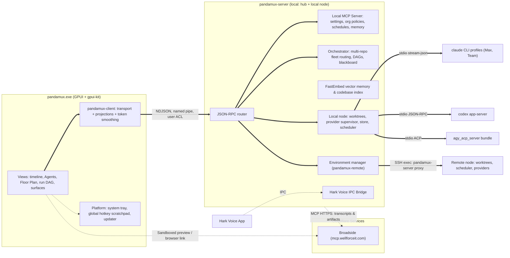
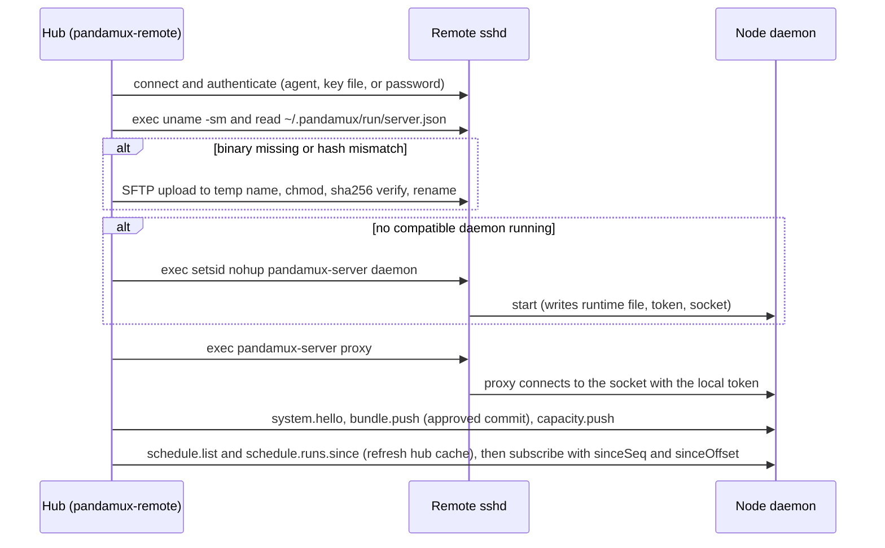
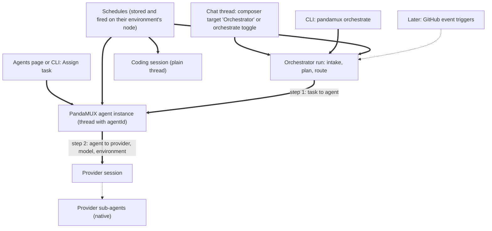

# PandaMUX Rewrite: Chat-First Agent Client with Remote Environments, Multi-Repo Fleet Orchestration, Agents, Schedules, Full MCP Settings Control, and Broadside Sharing

Date: 2026-09-25 (Approved 2026-09-26; recovery rewrite 2026-09-28; Phase 4 closure rewrite 2026-10-06; accounting and native acceptance 2026-10-07; continuation restart acceptance 2026-10-08)
Status: **Phases 0 to 3 and Phase 4A through 4F implementation are recorded; P4-C1, P4-C2, and P4-C4 passed on exact 0.60.15; the terminal, Narrator, visual, scaling, and IPC rows passed on exact 0.60.41; the provider/model routing row passed local, live, and native Windows acceptance on exact 0.60.43; exact 0.60.43 passed supporting post-side-effect proxy-loss and Hyper-V recovery rehearsals; exact 0.60.47 repaired unresolved-tool false success and passed supporting approval plus loopback-network recovery; exact 0.60.49 made tool-result projection atomic and passed the live pending-approval plus exact tool-result process-crash restart rows; exact 0.60.52 repaired continuation route persistence and passed the pending-continuation restart row; and P4-C5 remains Partial, so real capacity, external-service, final documentation, and physical acceptance gates keep Phase 4 open**
Baseline: The preserved original checkout remains PandaMUX v0.53.44 at `9511d0e22d44`; active recovery work is isolated on `codex/recovery-r0`, with exact 0.60.15 accounting evidence at `3a77382`, exact 0.60.41 native Windows evidence at `c6a20ff4f768747d0dadd59b88b40d3e20f7674d`, exact 0.60.43 local, live, and native provider-routing plus supporting recovery evidence at `372f2ae83e67a62cd3b382e5db52af96d00a85ce`, exact 0.60.47 fail-closed plus supporting approval/network evidence at `1822486b4f7d98ba6026bbfd7224e97f09e447c9`, exact 0.60.49 atomic tool-result, pending-approval restart, and exact process-crash evidence at `d09641e86cd06d72d7312ceb1fa3b20e5931ff5f`, and exact 0.60.52 continuation-route plus restart evidence at `5d8b77d7086a7a266251cd3106e5f124d6cd2aec`

Relationship to `tasks/plan-repo.md`: that file is the **historical** record of the Electron to native Rust rewrite (Phases 1 to 7, complete). This plan supersedes its product direction (terminal multiplexer) but keeps its engineering posture: backend-owned state, single writer, intent-in/delta-out, deliberate dependency pins, crate isolation, and tag-driven signed releases. Its Section 12 design tokens carry over where they still apply (Section 8). UI history: Iced is removed. An earlier draft of this plan chose Tauri 2 + React; the user replaced that with **GPUI + gpui-kit** (all Rust) on 2026-09-25, and Tauri 2 remains only as the documented fallback if the Phase 0 GPUI spike fails. `plan-repo.md` rejected GPUI for three reasons, each now handled explicitly: GPL contamination (zed#55470, still open; tracked as a license gate in S6 and Risks), "not built for external consumption" (gpui-kit publishes exact-pinned `gpui-pre` snapshots and ships in production in Longbridge Pro on Windows, macOS, and Linux), and weak accessibility. Phase 0 treated accessibility as exploratory; the rewritten Phase 4 and Phase 7 criteria make the defined v1 accessibility matrix release-gating.

Reference products: T3 Code (github.com/pingdotgg/t3code, MIT; Electron + React + Effect-TS), Pixel Agents (C:\Github\pixel-agents-future, 2D virtual office agent visualization), and Hark (C:\Github\Hark, Rust-based voice pipeline and code spellbook). We study them and borrow ideas, contracts, and lessons. We do **not** fork them. Where driver logic is **ported** to Rust (Antigravity for certain, possibly other providers), the port keeps T3's MIT copyright and license notice in a root `THIRD_PARTY_NOTICES.md`, and each ported module's doc comment cites the T3 source files it came from. Paths cited from it were checked against its `main` branch on 2026-09-25. Zed's own agent and terminal UI crates are GPL-3.0-or-later: study them for patterns, never copy code (Section 13).

Style note: this repo forbids em dashes and double dashes in prose. CLI flags keep their real leading dashes inside code spans so commands stay copyable (the same convention `CLAUDE.md` uses for `cargo` commands). Markdown tables use single-dash separators, and mermaid edges use `==>` and `-.->`.

Terminology used throughout:
- **Provider**: an agent CLI PandaMUX drives (Codex, Claude, Cursor, Grok, OpenCode, Antigravity).
- **Provider instance**: a named profile configuration for a provider (for example `claude:max`, `claude:team`, `antigravity:personal`) with its own config directory, credentials, and capacity ledger.
- **Organization / Group**: a collection of repositories (for example Wellforce, Organization X, Personal Websites) with shared access boundaries, subscription checklists, and routing defaults.
- **PandaMUX agent**: a provider-agnostic specialist role (reviewer, tester, ...) defined in the instructions repo. Its **definition** is a template; each assignment creates an **agent instance**, which is a normal thread tagged with the agent id.
- **Provider sub-agent**: a native sub-agent a provider spawns inside a turn (for example a Claude Task sub-agent).
- **Run**: one execution of the orchestrator or of a schedule. Hierarchy: run, then agent tasks (instances), then provider sub-agents.
- **Schedule**: a timed trigger, stored on and fired by one environment's server, that assigns work to the orchestrator, a PandaMUX agent, or a coding session.

## 1. Decision Summary

| Decision | Choice | Rationale |
|-|-|-|
| Product direction (fixed) | Chat-first client that drives coding-agent CLIs as structured **providers**, locally and over SSH, plus an **orchestrator**, a **specialized agent layer**, **scheduled tasks**, **multi-repo fleet management**, **full MCP settings control**, and **Broadside artifact sharing** | User decisions. T3 Code proves the chat-first model; orchestrator, multi-repo fleet routing, agents, schedules, ambient 2D office visualization, instructions repo, and Broadside sharing are PandaMUX's differentiators |
| Language (fixed) | Rust everywhere, including the view layer; no T3 fork | User decision. Keeps the russh/SFTP/persistence/updater/signing investment; one language and one toolchain |
| UI (fixed) | **GPUI** (Zed's framework, via the `gpui-pre` snapshot crates) + **gpui-kit** (github.com/longbridge/gpui-kit, formerly gpui-component). Iced removed; Tauri 2 is the fallback only | User decision. macOS is GPUI's home platform (Metal); Windows uses a DirectX 11 + DirectWrite renderer (Zed ships stable on Windows); Linux uses Vulkan. A future Mac port gets one renderer everywhere and no WebView engine divergence. Also: no Node/pnpm in the build, no WebView script-injection class, and the desktop uses the Rust protocol types directly |
| UI pins | `gpui-kit` / `gpui-component` `=0.6.6` and every `gpui-pre*` crate (`gpui-pre =0.3.6`, `gpui-pre-platform`, `gpui-pre-macros`, `gpui-pre-sum-tree`, and the rest) pinned exactly; bumped **together, deliberately** | gpui-kit's manifest warns that any snapshot may change GPUI's API. crates.io `gpui` 0.2.2 (2025-10-22) is stale. Matches the repo's exact-pin rule |
| Licenses | PandaMUX MIT; GPUI and gpui-kit Apache-2.0; logic ported from T3 Code (MIT) is credited in `THIRD_PARTY_NOTICES.md` and in module docs. **No code from GPL Zed crates** (`agent_ui`, `markdown`, `terminal`, `terminal_view`, and so on). `cargo deny` license allowlist denies GPL/AGPL/LGPL anywhere in the graph | zed#55470 (GPL via `sum_tree` to `ztracing`) is open upstream; the manifests on Zed main and in `gpui-pre-ztracing` 0.3.6 now declare Apache-2.0, and S6 confirms the shipped license files |
| Terminal multiplexer (fixed, refined) | **Multiplexer dropped**: no split tree, pane/tab layouts, saved layouts, `layout.grid`, workspace/pane V2 methods, tmux-wrapped sessions, or `session.json` layout restore. **Kept**: an optional, on-demand **Terminal surface** (shortcut T) opened in the thread's working directory on the thread's environment | User decision. Providers are driven over stdio or local HTTP, so agents never need a PTY; the terminal is a user tool reusing the tested `pandamux-term` engine |
| Terminal placement | PTY on the thread's **node** (portable-pty; ConPTY on Windows); raw bytes over the hub/node protocol; the **desktop parses** with `pandamux-term`'s alacritty grid and paints a custom GPUI element; node keeps a bounded ring buffer for replay | Remote terminals survive disconnects without tmux. Desktop-side parsing (the VS Code remote model) keeps alacritty out of the node binary and rendering local. Node-side grid snapshots are the fallback (Phase 3 exit) |
| Process topology (refined) | One headless binary, `pandamux-server`, in two roles. **Hub**: the local process the desktop, CLI, and full orchestrator talk to. **Node**: owns providers, terminals, threads, the store, git, attachments, **and the scheduler and a local agent executor** for its own environment. The local hub embeds the local node; remote hosts run a node only | The orchestrator needs one place that sees every environment; schedules stored on an always-on host must fire while the laptop is off, so a minimal agent-execution path (definitions + routing among that node's providers) runs on every node |
| Local server lifetime | `pandamux-server.exe` is a **separate process** that the desktop spawns or discovers | Agents, schedules, and terminals keep running when the window closes; same binary as remote nodes; the CLI works without the GUI. Cost: the updater must drain it (Phase 7) |
| Wire protocol | **JSON-RPC 2.0** messages, NDJSON framing on two transports in v1: the local **named pipe / Unix socket** (desktop and CLI) and an **SSH exec channel** (hub to node). WebSocket deferred until a browser/phone client exists | One schema everywhere; OS ACLs establish the local user boundary, scoped capabilities establish client role and method authority, and there is no network listener on the laptop (4.5) |
| Shared types | The desktop and CLI use `pandamux-protocol` Rust types through a shared **`pandamux-client`** crate. No TS generation. `schemars` generates the instructions-repo JSON Schema | No second language, no drift check; `pandamux-client` has zero GPUI deps and is unit-testable |
| Persistence | **SQLite via rusqlite** (bundled, WAL) on each node, event-sourced: append-only `events` plus projections written in **one transaction** by a single writer thread | Matches T3's events-plus-projections model and our single-writer rule. sqlx rejected (no gain with one writer; friction for musl) |
| Git & checkpoints | git CLI for per-thread worktrees, hidden-ref checkpoints (`refs/pandamux/checkpoints/<thread>/<turn>`), diffs, commit, push; `gh` for PRs. **Instant time-travel rewind and thread branching** from any checkpoint | Honors user git config, credential helpers, and hooks; checkpoint refs allow instant 0ms restoration of worktree state without manual git reset |
| Provider layer | `ProviderDriver` trait in `pandamux-providers`. Drivers: Codex (app-server JSON-RPC), Claude (stream-json control protocol in Rust), one shared **ACP** driver (Cursor, Grok, Antigravity, optionally OpenCode), OpenCode HTTP as a fallback | One normalized event model; T3 drives Cursor, Grok, and Antigravity over ACP |
| First-release providers (decided 2026-09-25) | **Must-have: Codex, Claude, and Antigravity.** Best effort: Cursor, Grok, OpenCode. Antigravity lands in Phase 1 right after Codex and Claude, together with the shared ACP driver | The first release is gated on all three; pulling Antigravity (the least familiar must-have) forward surfaces integration problems before the UI is built on top |
| Antigravity integration (decided 2026-09-25: replicate T3) | Port T3 Code's approach (fully supported in T3 nightlies): run Google's **ACP server bundle** (`agy_acp_server` + `localharness_external`), not the `agy` CLI, as a **managed install** (pinned zip from `dl.google.com`, size + SHA-256 verified, hardened extraction, `initialize` validation), spawned with a **replaced** environment and a private per-instance `GEMINI_HOME`, driven over standard **ACP v1** by the shared ACP driver plus an Antigravity profile layer; Google OAuth loopback sign-in with strict URL validation and callback forwarding (5.4). S5a becomes "confirm the ported approach on Windows and Linux" and stays gating | T3 has solved and shipped this; porting its proven logic (with its MIT notice) removes the protocol-discovery risk. The `agy` CLI's headless issues (LL-G `headless-hangs-no-output`) do not apply to the ACP server bundle |
| Provider-agnostic execution (new) | Drivers declare how they take **instructions** (native system/developer instructions, else a first-message preamble) and how they **restrict tools** (per-tool lists where supported, else coarse AccessMode). Agent instructions are never written into the user's repo or worktree | Lets any PandaMUX agent or schedule run on any provider, with documented, visible degradation per provider (5.3) |
| Claude integration | Implement the Claude CLI's stream-json + control-request protocol in Rust; no Node sidecar | Keeps nodes Node-free; the control protocol is SDK-internal, mitigated by a tested CLI range and transcript contract tests |
| Multi-instance provider profiles (refined 2026-09-28) | Named provider instances (for example "Claude (Max)" and "Claude (Team)") use isolated config dirs and credentials. Each instance is explicitly mapped to a generated opaque `SubscriptionKey`; matching email addresses are display hints only and never merge subscriptions or authorize pooling. Failover requires an explicit `FailoverPoolId` and organization policy approval | One email can represent multiple billing and security boundaries. Explicit identity prevents accidental usage aggregation and cross-organization failover |
| Full MCP settings control (decided 2026-09-25) | Built-in local **MCP server** and tool bridge exposing PandaMUX management APIs to AI agents (reading and updating settings, organization boundaries, provider allowlists, schedules, project tags, and memory) with interactive approval cards for write actions | Users can instruct PandaMUX in natural language to adjust settings (for example: "allow my Claude Max subscription to be used for Wellforce repos" or "set up a nightly review schedule") instead of hunting through preference menus |
| Multi-repo fleet management (decided 2026-09-25) | Global Orchestrator threads (`projectId: None`) capable of decomposing requests across multiple repositories (`targetProjectId`), managing cross-repo dependencies in a unified plan DAG, and batch-coordinating PRs | Enables "one chat to rule them all" where a single instruction (such as updating schemas, backend API, frontend UI, and docs) executes coherently across independent repos |
| Repo grouping & subscription boundaries (decided 2026-09-25) | `ProjectRecord` carries `organization`, `tags`, and `collection`; Settings provides an Organization × Provider Instance checklist matrix enforcing hard boundaries on which subscriptions touch which projects | Guarantees company code (for example Wellforce) never touches unapproved personal subscriptions (such as personal Antigravity), prevents accidental cross-org token burn, and powers fleet queries ("run doc-sync on all personal websites") |
| Remote bootstrap | Linux musl `pandamux-server` **and `pandamux-cli`** (x64, arm64; the CLI is needed on nodes so agents can call `pandamux memory ...`) **bundled in the signed installer**, uploaded over SFTP, SHA-256 verified against a manifest compiled into the signed desktop exe, started as a detached daemon, reached via `pandamux-server proxy` on an SSH exec channel | Works on air-gapped hosts, needs no sshd forwarding config, integrity rooted in Authenticode, one Release asset. Zed and T3 use the same model |
| Usage and capacity (refined 2026-09-28) | Nodes persist idempotent raw `UsageObservation` facts and durable scanner cursors. Hubs pull observations over authenticated tunnels and derive `UsageBucket` projections. Subscription quota and per-instance availability are separate; every capacity value carries source, freshness, and confidence | Facts can be re-priced and re-aggregated safely, retries do not double count, and routing never mistakes a healthy process for available subscription quota |
| Orchestrator (fixed modes) | Entry points: (a) a **normal chat thread** (the composer's target picker offers "Orchestrator" next to single providers, or a per-message orchestrate toggle), (b) **schedules**, (c) the CLI (`pandamux orchestrate`), (d) later, GitHub event triggers. Modes **Auto** and **Approve first**; **two-step routing**: task to PandaMUX agent, then agent to provider/model/environment; deterministic rules from the instructions repo, fed by an LLM classifier that fails closed. Full cross-environment orchestration runs in the hub; the same pure crate runs node-scoped on nodes. The orchestrator is also a **built-in PandaMUX agent** (`orchestrator`) with its own editable instructions (intake and planning prompts) and memory (routing outcomes), while routing **rules** stay in `orchestrator.yaml` | Explainable ("why reviewer on Codex?"), testable without a model, safe on classification failure, and usable offline on a node. Treating the orchestrator as an agent reuses the editor, versioning, memory, and run log with no special case |
| Orchestrator model (decided 2026-09-25) | **Settings > Orchestrator**: provider + model + effort the orchestrator runs on (for example Codex GPT-6-Astra at extra-high effort, or Claude Opus 5.5), chosen only from configured, authenticated providers using each driver's live model list, plus an ordered **fallback list** for when the primary is unavailable or out of capacity. Advanced: a separate fast model for intake classification. Per-environment override for node-side runs, defaulting to the same provider/model if that environment has it, else the first available fallback there; Settings warns when an environment with schedules has no usable orchestrator model | The orchestrator's quality and cost depend on its model; users pick what they trust and have paid for |
| PandaMUX agents (new, user requirement) | Provider-agnostic roles defined as `agents/<id>.md` (YAML frontmatter + markdown, mirroring Claude Code agent files). Definition = template; each assignment = an **instance thread** tagged with the agent id; per-agent concurrency. Default repo seeded from this repo's `.claude/agents/` roster | Reuses thread infrastructure, so every agent's work is visible and steerable; one familiar file format; users see what each agent is doing on the Agents page |
| Agent authoring (decided 2026-09-25; replaces "repo only") | Agents are **created and edited in the app** by the user and by the orchestrator. Agent editor on the Agents page (create, edit, duplicate, delete, history with diffs, revert, per-provider compile preview). **Save scope** per agent: Personal (default; a **PandaMUX-managed local git repo**), Project (`.pandamux/agents/`), or Team repo (branch + PR via `gh`; direct push only in trust-branch mode on a repo the user owns); "Promote to team" opens a PR. The **orchestrator writes only to the Personal layer** (it may propose PRs elsewhere); every orchestrator change is a commit tagged with its run, labeled, revertable, rate-capped. **Decided**: in Auto mode the orchestrator may freely edit only agents it created; editing human-authored agents needs user approval; access widening always needs approval in every mode | Users and the orchestrator can grow specialists as work demands, while git gives history, diff, and revert, and the shared layers keep their review gates |
| Agent memory (decided 2026-09-25: in v1; refined 2026-09-28) | Persistent canonical markdown per agent and project plus an agent-wide section, versioned in the personal git repo and merged from node journals. Lexical retrieval is the correctness baseline. Optional local vector retrieval lands in isolated `pandamux-memory` only after its target, license, model-distribution, and size gate passes | Memory remains usable offline and without a native embedding runtime. The vector index is derived data and memory is untrusted data, never permission |
| Backups (decided 2026-09-25) | One private backup repo holds **schedules, personal agents, and agent memory**: one-way export pushed by the hub (after changes, debounced, and daily), private repos only (visibility checked before every push), secrets excluded, explicit restore that never auto-applies FullAccess | One place to recover or move a developer's automation, with no path for the backup to fire schedules or overwrite agents on its own |
| Scheduled tasks (decided 2026-09-25; formerly open questions 8 and 9) | Schedules are **machine-specific server state**, not configuration in any repo. Each schedule is stored in the SQLite store of the **environment that runs it** (under that host's OS user) and fired by that node's scheduler whether or not the hub or desktop is connected. The developer creates, edits, enables, disables, deletes, and runs them from **Settings > Schedules**, where **Environment** (local or any SSH environment) is a required field. Cron + IANA timezone; targets: orchestrator, a PandaMUX agent, or a coding session. Schedules are one of several orchestrator entry points, not the only one | User decision: an SSH Linux coding machine that stays online fires its schedules while the developer's own computer is off. Machine-local storage also means a schedule can only fire where it is stored, so shared config can never double-fire across teammates |
| Configuration layers (new; project layer in v1 decided 2026-09-25) | Three layers, all in v1, broadest to most specific: (i) the **instructions repo** (org or default: agents, routing, prompts, knowledge); (ii) an optional **project layer** `.pandamux/` inside each code repo (project agents, knowledge, routing overrides that travel with the code); (iii) the **personal layer**: a PandaMUX-managed local git repo (personal agents, agent memory, the built-in orchestrator agent's edits) plus personal settings (orchestrator model, tier-to-model mapping, plan budgets, disabled agents, FullAccess opt-ins); pushed nowhere except, optionally, to the user's private backup repo. Schedules are in none of these layers: they are server state on their environment. Specific overrides broad; the project layer is **untrusted until approved per repo** | Mirrors Claude Code's user/project/local settings, which our users already understand. A cloned third-party repo could ship hostile agent instructions, hence the per-repo, per-hash trust prompt (like Claude Code's). The user chose to ship the project layer in v1 |
| Instructions repo (fixed, extended) | Default BoardPandas repo, forkable (URL + branch or tag). **Git is the source of truth, but PandaMUX manages a mirror clone** under app data, never a user working copy. Checked every 5 minutes (configurable) with a cheap `git ls-remote` before fetching; private repos use the user's git credentials or `gh` auth. Tracking: follow a branch, or pin a tag/commit. Update policy: **approve each update** or **trust this branch** (team mode: PR review and branch protection are the gate; optional signed-commit requirement). **Defaults (decided 2026-09-25)**: repos the user or their team controls follow `main` with "trust this branch"; everyone else's repos, including the BoardPandas default, use "approve each update". The hub distributes the exact approved commit to nodes as a git bundle or tarball, so nodes never need GitHub credentials | Instructions drive agents with full access and run unattended, so they are trusted code with a single approval point. Git gives versioning, PR review, audit history, forking, and offline use at zero hosting cost |
| Ambient 2D Virtual Office (decided 2026-09-25: Pixel Agents surface) | Optional 2D tilemap and character sprite view porting mechanics from `C:\Github\pixel-agents-future` into a native GPUI custom element on the Agents page. Characters animate typing at desks when working, gather at whiteboards when planning, and display interactive speech bubbles when awaiting approvals | Provides immediate, low-fatigue spatial situational awareness across dozens of concurrent agents and remote nodes without staring at scrolling text logs |
| Voice Integration (decided 2026-09-25: Hark native bridge) | Integration with `C:\Github\Hark` (pure Rust audio pipeline, STT, and hotkey injection) via a local IPC pipe, with dynamic synchronization of active codebase symbols into Hark's `spellbook` | Replaces generic speech tools with an ultra-accurate, developer-tuned voice interface that never misrecognizes code types or function identifiers |
| Team sync (new) | Teams share one instructions repo for agents, routing, prompts, and knowledge. Schedules are not shared: each developer's schedules live on the environments they chose. Team-relevant results land where everyone sees them (PRs, issue comments, reports). No central team view in v1; each hub shows its active commit | Git covers the shared parts; keeping schedules machine-local removes the need for schedule ownership rules |
| Hosted team hub (decided 2026-09-25: not in v1) | **Not in v1**; revisit later only if wanted. A hosted BoardPandas team service (real-time config sync, UI editing, RBAC, central schedule runner, shared dashboards) is a possible later "team hub", likely a `pandamux-server` in hub mode that teammates connect to | It is a product in itself (hosting, auth, availability, security review). Git plus machine-local schedules covers the v1 team need with zero hosting |
| Right-side surfaces panel | T3-style toggleable right panel: **Agents**, **Diff**, **Files**, **Pull request**, **Linked pull requests**, optional **Terminal**, and optional **Office / Floor Plan**. **Browser and Device surfaces: not in v1 (decided 2026-09-25); revisit later** | Live visibility into provider sub-agents, PandaMUX agent instances, and interactive surfaces |
| Version at cut-over (decided 2026-09-25) | The cut-over release is a **Major bump to 1.0.0**, an explicit user decision recorded per `.claude/rules/commit-changelog.md` (agents never bump Major on their own) | New product, breaking protocol, no 0.x users to preserve |
| Default instructions repo (decided 2026-09-25) | `BoardPandas/pandamux-instructions`, public, MIT | Forkable starting point; public so anyone can fork it |
| Browser/phone client (decided 2026-09-25) | **Not in v1**; revisit later. Approvals stay protocol calls so a future client can use them | Would be a separate web client plus a WebSocket transport with pairing and TLS; not needed for v1 |
| Schedule session target (decided 2026-09-25) | Both modes, chosen per schedule in the form: **new thread per run** (form default) or **continue an existing thread** (picked in the form) | Fresh threads suit independent jobs; continuing suits iterative work that benefits from the thread's context |
| Backup repo (decided 2026-09-25) | A **user-created private repo** (PandaMUX offers `gh repo create --private`). Backups are **disabled until the user configures them**; no backup activity happens before that | Explicit opt-in keeps prompts, paths, and host names from going anywhere by default |
| Memory scope (decided 2026-09-25) | Per agent **per project** plus an **agent-wide** section | Project facts stay with the project; general learnings travel |
| Agent visualization (new) | Global **Agents page** (roster board), **Settings > Schedules** (list across environments plus per-schedule history), a **run view** tree (run, agent tasks, provider sub-agents), and the per-thread Agents surface with "Provider sub-agents" and "PandaMUX agents" groups | The user must see which agents exist, what each is working on, and what ran overnight |
| Packaging | Rebuild the production cargo-packager NSIS path from the passing Phase 0 fixture while releases remain disabled. Package exactly the desktop, server, and CLI Windows binaries plus verified Linux node artifacts | The current workflow still targets the deleted Iced-era crate and has no production packager metadata, so historical success is evidence for the layout, not evidence that the current workflow works |
| Release | Rebuild and rehearse tag validation, target builds, explicit-path signing, packaging, updater verification, install, upgrade, uninstall, and Winget generation before public publication. `RELEASES_ENABLED` and Winget stay disabled until a signed release candidate passes the clean-machine matrix | Current release and Winget files are stale scaffolding. Publication must be the last switch, after the exact built artifacts have passed CI and installation tests |
| Mac readiness (decided 2026-09-25: macOS ships later) | macOS CI job from Phase 1 (build + test server, CLI, client, desktop on `macos-latest`) stays, keeping the code Mac-clean; shipping on macOS comes after v1 | Keeps Windows-only code from creeping in so the later port stays cheap |
| CLI | `pandamux-cli` on `pandamux-client`, protocol **v3** over the local pipe/socket; new `agents`, `memory`, `schedule`, and `run` verbs. Also built for Linux musl and installed on every node next to `pandamux-server`, talking to the node's Unix socket, so agents on remote hosts can read and write memory | Interactive CLI uses the restricted control capability; agent-spawned CLI receives only a thread-scoped capability. The local MCP adapter has its own method allowlist |
| Broadside bridge (decided 2026-09-25) | Native bridge to Broadside (github.com/BoardPandas/Broadside): 1-click transcript sharing (`pages.wellforceit.com`), sandboxed HTML/web artifact hosting (`broadside-content.bp-dev.workers.dev`), schedule auto-publishing with mobile notification links, and direct MCP tool integration (`mcp.wellforceit.com/mcp`) | Solves public and team sharing of agent transcripts and provides an isolated, browser-grade iframe preview of HTML/JS artifacts without bundling Chromium/CEF into the GPUI desktop client; zero additional server infra needed since Broadside runs serverless on Cloudflare Workers |
| Repo strategy (decided 2026-09-25; formerly open question 5) | **Rewrite in place on master.** The old app never entered production and has no users, so there is no parallel shipping, no feature freeze, no side-by-side binary or CI split, and **no migration of 0.x data**. At the start of Phase 1, the reusable parts are moved into the new crates and everything else is deleted; git history keeps the old code for reference. Existing 0.x GitHub releases are left as they are | Nothing to protect, so the simplest path wins. No Node/pnpm added (Node stays only for the `.claude` wiring guard) |
| Crate isolation (updated 2026-09-28) | Only `pandamux-desktop` imports GPUI. `pandamux-orchestrator` is a pure domain crate. `pandamux-memory` isolates embedding and vector-index dependencies. `pandamux-server` owns SQLite, lifecycle, platform IO, and composes `pandamux-remote`; it imports `pandamux-term` with only the `pty` feature. Enforce the resolved dependency and feature graph from `cargo metadata` | The current boundary script only scans direct manifest text and the server currently enables both terminal features. A resolved-graph gate catches transitive UI, native-library, and default-feature leakage |

## 2. Current repo review (refreshed 2026-09-28)

> This section preserves the review snapshot that justified Recovery Gate R0.
> The implementation and acceptance delta through 2026-10-06 is recorded in
> Section 2.1 and in the checkpoint completion records. Where they conflict,
> the newer evidence controls.

- Verified baseline: workspace `0.53.44`, edition 2024, `rust-version = "1.88"`; `master` and `origin/master` both point to `9511d0e22d44`.
- Phases 0 to 3 and Phase 4 Step 1 have implementation commits, but checked boxes are not production acceptance. The Phase 3 live matrix in its exit criteria has not been archived.
- Remote routing is incomplete in the production composition. `ProxyTunnel` exists, but there is no registered production `EnvironmentTransport`, and `pandamux-server proxy` is not implemented end to end. Thread execution also constructs a placeholder provider configuration instead of resolving the stored provider instance and its profile, binary, settings, environment, enabled state, and concurrency policy.
- The default new-thread provider id resolves to the Custom mock path. Until exact instance resolution is fixed, live provider and remote acceptance would not exercise the configuration the user selected.
- Phase 4 Step 1, Cursor, Grok, and OpenCode profiles, is committed at `52656f5`. The uncommitted Phase 4 Step 2 prototype touches core, protocol, providers, router, store, and migration code. It contains useful token types, fixtures, RPC scaffolding, and a migration draft, but it is not an accepted implementation and must be selectively salvaged.
- The prototype has known static compile errors and correctness gaps: no durable source identity, retry-safe event identity, transactional cursor advancement, rotation handling, authenticated provenance, subscription identity, schedule attribution, persistent pricing source, or production scanner owner. It can double count managed turns and can lose a partial trailing JSON record.
- Local IPC does not yet enforce the approved security contract. Runtime tokens are written but not validated; Unix permissions are not explicitly restricted; the Windows pipe lacks the planned user-SID name, DACL, remote-client rejection, and peer-image checks. This blocks mutating MCP and unattended scheduling.
- Existing MCP is read-only, but `read_settings` exposes the full settings object, including arbitrary provider settings and environment overrides. It needs a redacted projection before being treated as a safe read API.
- Organization and schedule domain records exist, but organization restrictions are not enforced in routing and the schedule default is currently `Auto`, contrary to the approved Approve-first posture. The continue-existing-thread target lacks a thread id.
- Provider health UI and environment UI contain incomplete and misleading states. Unknown authentication can appear healthy, request failures disappear, plausible fallback version/platform values are fabricated, and several visible controls have no handlers.
- The workspace has nine crates. `pandamux-orchestrator` and `pandamux-memory` do not exist yet. `pandamux-server` currently enables both `pandamux-term` features, and no production crate composes `pandamux-remote`.
- The dependency boundary checker is text-based, not resolved-graph-based. CI installs drifting `stable`; the stated exact-pin policy is not consistently enforced. Phase 4 needs no new runtime dependency, while embedding, keyring, YAML/schema, and scheduling libraries each need an isolated target-matrix spike before adoption.
- Release automation is stale scaffolding. `release.yml` builds deleted `pandamux-app`, expects removed packager metadata, omits the server and remote ARM64 artifacts, and does not gate signing on the current CI suite. The updater was not ported. The checked-in remote manifest and Winget metadata are placeholders or internally inconsistent.
- Root `README.md`, `CLAUDE.md`, and the maintained `docs/` wiki still describe the removed Iced multiplexer and contradict the implemented GPUI chat-first architecture. Minimal developer-truth corrections belong in the recovery gate; a complete user and release documentation pass remains in Phase 7.
- The worktree contains user-owned uncommitted Phase 4 files. Recovery work must preserve them, take an explicit snapshot, use narrow staging, and never reset or clean them.

### 2.1 Current recovery delta (2026-10-06)

- R0.1 preserved and restore-tested the dirty Phase 4 prototype. The original
  checkout remains untouched at `9511d0e22d44`; implementation continues only
  in the managed `codex/recovery-r0` worktree.
- R0.2 through R0.4 and Phase 4A through 4F are implemented. The exact 0.60.0
  acceptance commit proved native Windows startup, live Codex, Claude, and
  Antigravity turns on Galahad, production SSH proxy composition, policy denial,
  and bounded Hub usage synchronization. Those results are partial Phase 4
  acceptance, not a production release claim.
- Exact 0.60.3 commit `2be212f9a290637add9a4f5c662ca3155da98a0c`
  repaired the Usage editor accessibility bridge. Later 0.60.5 and 0.60.6
  commits added native table, row, header, cell, count, and complete labeled row
  summaries. Exact 0.60.6 UI Automation evidence passed the semantic table
  contract. A real screen-reader walkthrough remains separate and open.
- Exact 0.60.7 commit `5d1a8d77581b687dd802a385f18d09e9b2bc3a15`
  repaired queued and in-flight desktop bridge requests that otherwise left a
  serverless Usage page in Loading forever. Native limited-user evidence passed
  the persistent Offline alert, Status role, keyboard-focusable Retry, Loading
  transition, repeated failure, and zero-server-process conditions.
- Exact 0.60.8 commit `054bd3e941e394cd8ffcff62a8dc60faa9b7e1fe`
  synchronizes gpui-kit component theme state with the PandaMUX shell. Local
  formatting, strict Clippy, 415 workspace tests, repository guards,
  `cargo deny`, and headless checks passed. Clean Windows MSVC artifacts were
  built for desktop, server, and CLI. The limited-user headless check and the
  actionable Offline and Retry probe passed. The exact screenshot was visually
  inspected and confirmed that component buttons and actions are legible on the
  dark shell. This is current native evidence, not a final Phase 4 candidate.
- Exact 0.60.15 commit `3a77382` closes the Claude component correctness
  blocker. Final `message_delta.usage` events update the matching assistant
  message ID, including separate root and subagent lanes, so simple and
  tool-using turns retain terminal model, token, and cache values instead of
  preliminary stream values.
- P4-C4 passed against a clone of the retained Galahad evidence. Three fresh
  Claude message components matched sanitized transcript facts exactly, no new
  mismatch appeared, 48 accepted observations remained stable across repeated
  scans and restart, and `usage.query` matched direct SQL. Old result UUID and
  message-ID ambiguity remains preserved as visible legacy debt. The fixed
  historical seven-day window has no independent provider statement, so all
  external provider comparisons are Unknown and the two percent threshold is
  not applicable.
- Exact 0.60.17 commit `2f56a27` partially passes P4-C5. Live scanner and Hub
  durability, conservative capacity and route explanations, the diagnostic
  failover fixtures, and all four rollback controls passed in isolated roots.
  Real external quota exhaustion and post-side-effect capacity interruption
  remain open.
- Exact 0.60.47 commit
  `1822486b4f7d98ba6026bbfd7224e97f09e447c9` fails closed when a provider
  reports success while a side-effecting tool still lacks a durable result. Its
  complete local gate and clean live rehearsal passed one approval plus one
  loopback HTTP POST across exact remote-proxy loss with unique replay, one
  protected attempt, one terminal tool result, one settled turn, and one
  matching managed usage observation. This supports P4-C5 but does not replace
  real provider capacity exhaustion, external-service interruption, or the
  pending-delivery restart rows that were still open at that point.
- Exact 0.60.49 commit
  `d09641e86cd06d72d7312ceb1fa3b20e5931ff5f` commits each completed tool
  result's immutable ledger transition, timeline projection, and Delivered
  marker in one transaction. Its 444-test source gate proves rollback,
  database reopen, exact duplicate suppression, and conflict rejection. The
  exact Galahad server then passed a real pending-approval restart under a
  controlled post-dispatch persistence fault: one approval produced one
  loopback POST, two identical submissions after daemon restart both returned
  `approval_delivery_pending`, and no resolution or second dispatch appeared.
  A second isolated run held a real terminal tool-result transaction open under
  a confirmed SQLite writer lock and killed the exact daemon process group.
  Reopen exposed only the pre-result state, and restart preserved one external
  request without inventing or replaying a result.
- Exact 0.60.52 commit
  `5d8b77d7086a7a266251cd3106e5f124d6cd2aec` persists a continuation's
  selected provider instance and model on the thread. Its complete source gate
  passed 445 tests, and its hash-pinned Galahad server passed restart with one
  real Codex continuation Running at a side-effecting tool boundary. The exact
  five-process descendant tree was killed after one loopback request; restart
  failed the continuation and attempt without replay, and two duplicate
  continuation calls refused redispatch. The controlled source fixture does
  not replace real provider capacity exhaustion or a real external-service
  interruption.
- Exact 0.60.22 commit `fee9e02` passed every P4-C3 row that was
  executed. The limited-user build and smoke, actionable Offline path,
  recorded 100 and 200 percent keyboard and scroll
  matrices, dark and light visual review, High Contrast, disabled animations,
  genuine Narrator walkthrough, and current normal-user named-pipe security
  matrix all passed on the same hashes. The VM was restored to its named
  checkpoint with network, guest services, and video settings returned to the
  recorded baseline. P4-C3 was reopened on 2026-10-07 after manual use of the
  successful provider-login launch path exposed an undiscoverable,
  noninteractive Terminal surface that preview and cancel did not cover. The
  Exact 0.60.24 commit `581113e` proved the repaired panel, terminal binding,
  and automatic focus on native Windows, but the injected PowerShell command
  remained at a continuation prompt because ConPTY received a line feed instead
  of carriage return. Exact 0.60.25 commit `8f0ec20` proved native command
  execution visually, then failed because painted Terminal output was absent
  from UI Automation. Exact 0.60.26 commit `b696aad` exposed a bounded semantic
  output Log and passed the interaction, High Contrast, and disabled-animation
  rows, but Narrator Speech Recap did not announce READY or ECHO. Exact 0.60.27
  passed successful-login interaction, 200 percent scaling, High Contrast, and
  disabled-animation rows, but direct UI Automation focus did not reach the
  Log and the advertised Tab path remained PTY input. Exact 0.60.28 commit
  `c0200a9` added an explicit F6 input/output focus toggle and passed the
  successful-login interaction, 200 percent scaling, High Contrast, and
  disabled-animation rows. Narrator displaced focus to the PandaMUX window,
  where the terminal-scoped shortcut could not run, so 0.60.28 is rejected.
  Exact 0.60.29 commit `2b3b806` passed native build, smoke, remote lifecycle,
  successful-login, 200 percent, High Contrast, and disabled-animation rows,
  but its root visual handler still had no GPUI focus path under Narrator and
  did not receive F6. Exact 0.60.30 commit `9dae237` passed native build, smoke,
  remote lifecycle, and standard successful-login interaction, but Narrator
  still consumed or withheld F6 before PandaMUX received it. Exact 0.60.31
  commit `0394eb3` passed native build, smoke, remote lifecycle, and standard
  successful-login interaction. Its explicit controls were visible and
  invokable, but accessibility activation restored window-level focus after
  the output-focus request, so Narrator still could not read the terminal Log.
  Exact 0.60.32 commit `952b280` passed native build, smoke, remote lifecycle,
  and standard successful-login interaction, but direct UI Automation Invoke
  still left focus on the PandaMUX window because the styled control fell back
  to synthesized pointer input under Narrator. Exact 0.60.33 commit `58452e7`
  passed native build, smoke, remote lifecycle, and standard successful-login
  interaction, but its direct AccessKit handler deferred the focus update and
  UI Automation Invoke still left focus on the PandaMUX window. Exact 0.60.34
  commit `1f1df21` passed native build, smoke, remote lifecycle, and standard
  successful-login interaction, but Windows UI Automation still restored
  window-level focus after the synchronous accessibility callback. Exact
  0.60.35 commit `b54f8e3` passed native build, smoke, remote lifecycle, and
  standard successful-login interaction, but its delayed same-handle retry was
  elided by GPUI while UI Automation focus remained on the PandaMUX window.
  Exact 0.60.36 commit `6fd5d02` made that move a distinct GPUI focus
  transition and passed native build, smoke, remote lifecycle, and standard
  interaction, but UI Automation still reported the PandaMUX window. Exact
  0.60.37 commit `f21bc2d` activated PandaMUX and passed the same gates, but its
  Narrator result was unchanged. Diagnostics proved PandaMUX already owned the
  foreground window and had visibly entered output-reading mode. Exact 0.60.38
  commit `d328ad8` then passed the complete local gate, native build, host
  smoke, remote lifecycle, and standard successful-login interaction. Ordinary
  UI Automation honored its active-descendant output focus, but Narrator did
  not speak READY. Diagnostics proved that native foreground, active, and
  keyboard focus remained correct while synchronized Narrator navigation
  reached the terminal header controls and skipped the semantic Log group.
  Exact 0.60.39 commit `8b7b880` instead used AccessKit's dedicated Terminal
  role and passed the complete local gate, native build, host gates, and
  standard successful-login interaction. Windows reported the output as a
  focusable UI Automation Document, but genuine Narrator visited that Document
  without speaking its parent-only accessible name and then left PandaMUX.
  Exact 0.60.40 commit `d4c9dd8` retained the Document, passed the local gate,
  native build, and host gates, but its label-only semantic child was absent
  from the exact Windows UI Automation tree. Exact 0.60.41 commit
  `c6a20ff4f768747d0dadd59b88b40d3e20f7674d` supplied that child value with a
  synthetic text run and passed the complete local gate, clean native build,
  host smoke and remote lifecycle, controlled successful-login interaction at
  100 and 200 percent, High Contrast, disabled animations, genuine Narrator
  traversal with exact READY, ECHO, and reopened-output phrases, visual review,
  and the complete local plus independent-peer named-pipe security matrix.
  Those P4-C3 rows remain Pass. Exact 0.60.43 later passed local live
  provider/model routing and its exact native Windows configured-route and
  no-route picker rows, so P4-C3 is Pass again. Version 0.60.42 was the
  documentation-only accounting follow-up and has no executable or native
  claim.
- Phase 4 remains open on real capacity exhaustion, external-service
  interruption, and the final documentation archive after those P4-C5 rows
  stabilize. The re-scoped physical laptop
  disconnect and sleep rows remain production-acceptance and release blockers.
- Phase 5 implementation has not started. The next development work is the
  ordered Phase 4 closure sequence in its verification record. Phase 5 begins
  only with its dependency, legacy-domain, and boundary gate. Phase 6 depends
  on accepted Phase 5 run-state and agent contracts. Phase 7 remains the only
  packaging, signing, publication, deployment, and shipping phase.

## 3. Kept, deleted, new

### 3.1 Crates

| Crate | Fate | Detail |
|-|-|-|
| `pandamux-core` | **Kept, trimmed and extended** | Keep `ids`, `project`, `project_registry`, `ssh`, `notification`, `i18n`, `home`. Add `organization`, `thread` (with `projectId: Option<ProjectId>` for global threads), `event`, `provider_config` (multi-instance profiles), `environment`, `usage`, `terminal`, `agent_def`, `schedule`, `run`, `settings` v2 (including organization subscription access matrix). Delete `split_tree`, `state`, `surface_content`, `keymap`, `sidebar`, the old `agent`, `config` at the start of Phase 1 |
| `pandamux-protocol` | **New** | Versioned wire contract, JSON-RPC 2.0 types, protocol version constants, and MCP tool schemas |
| `pandamux-client` | **New** | Transport client, hello, reconnect with `sinceSeq`, subscriptions, per-thread and per-run **projections**, token frame queue (smoothing). Zero GPUI deps; used by desktop and CLI |
| `pandamux-providers` | **New** | `ProviderDriver` trait, event model, drivers, multi-instance profile management, side-effect-free probes, provider parsers, instruction injection and tool-restriction mapping, supervision (Job Objects / process groups). Filesystem scanning and cursor ownership stay in the server |
| `pandamux-remote` | **New** (SSH parts of `pandamux-term/src/ssh.rs`) | Pool, auth, known-hosts, SFTP, **new** exec-without-PTY, bootstrap, proxy, reconnect, and cross-host worktree delta sync |
| `pandamux-term` | **Kept, reshaped** | Features `pty` (server side: portable-pty, `shell.rs`, grid-free byte session with ring buffer) and `grid` (desktop side: `grid.rs`, `search.rs`, `links.rs`, `cwd.rs`, `clipboard.rs`) |
| `pandamux-orchestrator` | **New** (pure, no IO) | Multi-repo DAG planner, fleet routing and organization-policy evaluation, in-memory run blackboard, circuit-breaker and run state machines, instructions bundle schema and validation, agent-change policy, memory entry and merge rules, and pure schedule evaluation. No Tokio, SQLite, GPUI, network, filesystem, provider-process, or embedding dependencies |
| `pandamux-memory` | **New** (isolated adapter) | Embedding model lifecycle, vector persistence, and lexical fallback. Contains `fastembed` or its selected replacement only after the target-matrix and distribution spike passes. The index is derived and rebuildable; domain consumers receive query results through narrow types |
| `pandamux-server` | **New** (evolves `pandamux-app::backend` + `persistence`) | Binary + lib; Windows, Linux musl, macOS (CI). Hub and node roles, authenticated router, local and SSH transports, `pandamux-remote` composition, store (SQLite WAL), threads, PTYs, git worktrees, attachments, usage ingestion, instructions sync, personal git repo, memory adapter lifecycle, local MCP endpoint, Hark voice IPC, schedule storage and runtime, and budget ledger |
| `pandamux-desktop` | **New** (GPUI + gpui-kit) | `[[bin]] name = "pandamux"` from the start. Views (threads, multi-repo fleet sidebar, Agents page, 2D Floor Plan virtual office, run DAG, surfaces, settings matrix), terminal element, system tray and global hotkey quick-summon scratchpad (`tray-icon`), platform services, server spawn/discovery, and the updater restored in Phase 7. The **only** crate importing GPUI |
| `pandamux-cli` | **Kept, rewritten** | Protocol v3 via `pandamux-client`; verbs in 4.6; Windows exe plus Linux musl builds installed on nodes |
| `pandamux-ui`, `pandamux-app` | **Deleted** at the start of Phase 1 | Iced removed. Backend and persistence patterns were reused; the 2026-09-28 audit found that updater behavior and production packaging were not ported and assigns their recovery to Phase 7 |

Dependencies removed at the start of Phase 1: `iced` and its text/GPU stack, `arboard`. Kept: `alacritty_terminal`, `portable-pty` (inside `pandamux-term`), `russh`, `russh-sftp`, `tokio`, `serde`, `reqwest`, `winresource`. Already added: `rusqlite` and `tray-icon`. Phase 4 adds no runtime dependency. Phase 5 selects and directly pins `schemars` plus one YAML parser; keyring stays in a hub-only platform adapter and must not pull desktop secret-service dependencies into musl nodes; `fastembed` stays isolated in `pandamux-memory` and lands only after its model-distribution and target-matrix spike. Phase 6 selects one exact-pinned cron and IANA-timezone stack after deterministic DST, fake-clock, and musl proof. Tree-sitter remains an optional compression adapter, not an orchestration prerequisite.

### 3.2 Repository directories

| Path | Fate |
|-|-|
| `resources/pandamux-orchestrator/` | **Deleted**: replaced by the native orchestrator, agents, and schedules |
| `resources/shell-integration/` | **Deleted**: terminal cwd comes from the thread |
| `resources/themes/` | **Kept**: terminal color schemes |
| `resources/claude-instructions/` | **Deleted**: guidance moves to the instructions repo and provider instruction injection |
| `resources/opencode-plugin/` | **Deleted**: OpenCode becomes a provider |
| `resources/icons/` | **Kept** |
| `resources/sounds/` | **Kept only if used** (turn-complete notification sound); otherwise deleted |
| `resources/server/linux-{x64,arm64}/` | **New** (CI-populated): `pandamux-server` and `pandamux-cli` node binaries + `manifest.json` |
| `spikes/phase2-native-terminal/` | **Deleted** at the start of Phase 1 (its lessons are already recorded in `plan-repo.md` Section 10); new `spikes/phase0-*` are excluded from the workspace |
| `site/`, `docs/` | **Rewritten** / **regenerated** in Phase 7; multiplexer-era docs are deleted (git history keeps them) |
| `winget/`, `.github/workflows/winget.yml` | **Kept but disabled** until the new app ships (Phase 7) |
| All deletions | Happen at the start of Phase 1 after the reusable parts are moved; nothing is kept around "in case" |

## 4. Target architecture

### 4.1 Layout

```
Cargo.toml                    workspace (rust-version bumped deliberately; see Gotchas)
crates/
  pandamux-core/              domain types, project registry, organization policies (no IO, no UI)
  pandamux-protocol/          wire contract (JSON-RPC 2.0 types, MCP tool schemas, versions)
  pandamux-client/            transport client + projections + token frame smoothing queue (no GPUI)
  pandamux-providers/         ProviderDriver + multi-instance profiles + usage scanners
  pandamux-remote/            russh pool/auth/SFTP/exec/bootstrap/proxy/worktree-sync
  pandamux-term/              features: pty (server side), grid (desktop side)
  pandamux-orchestrator/      multi-repo DAG planner, routing engine, blackboard, circuit breakers (pure)
  pandamux-memory/            isolated embedding/index adapter with lexical fallback
  pandamux-server/            hub + node binary, SQLite WAL, MCP server, remote composition, Hark IPC
  pandamux-desktop/           GPUI + gpui-kit app (pandamux.exe)
    src/views/{sidebar,timeline,composer,surfaces,agents,floorplan,schedules,runs,settings,usage}/
    src/terminal/             GPUI terminal element over pandamux-term grid
    src/platform/             tray icon, global hotkey scratchpad, dialogs, notifications, updater
  pandamux-cli/               pandamux-cli.exe
resources/                    icons, sounds, themes, server/<target>/ (CI-populated)
```

### 4.2 Component diagram



### 4.3 Data flow for turns and multi-repo orchestration

1. **Standard Turn**:
   - The composer calls `thread.sendTurn {threadId, text, attachmentIds, model, effort}` through `pandamux-client` over the pipe to the hub.
   - Hub resolves the thread's `environmentId` and forwards the request over the node channel (in-process for local; SSH proxy for remote).
   - Node appends `TurnRequested` and writes checkpoint-before (hidden ref `refs/pandamux/checkpoints/<thread>/<turn>`) in one store transaction, then hands the turn to the thread's `ProviderSession`.
   - The driver translates provider-native messages into `ProviderEvent`s; the node maps them to `ThreadEvent`s with a monotonic `seq`, persists them (deltas coalesced), updates the budget ledger, and publishes them.
   - Token smoothing in `pandamux-client` coalesces streaming text into 16ms frame-aligned updates, keeping UI scrolling at 120 FPS.
   - Approval requests surface as `ApprovalRequested`; the answer (`thread.respondApproval`) resumes the provider with an idempotency key.
   - On `TurnCompleted` the node writes checkpoint-after, computes changed files, records usage, and emits `TurnSettled`.

2. **Multi-Repo Fleet Turn**:
   - User sends a cross-cutting goal in a Global Orchestrator thread (`projectId: None`): *"Update billing tiers across our stack: update schemas, implement API webhook, update pricing UI, and refresh docs."*
   - Hub resolves available projects and organization boundaries from `ProjectRegistry`.
   - Orchestrator intake decomposes the goal into a multi-repo DAG with dependencies.
   - Tasks dispatch to agent instance threads in target project worktrees across local and remote nodes:
     - Task 1: `shared-schemas` worktree -> Claude Max.
     - Task 2: `api-backend` worktree -> Codex.
     - Task 3: `web-frontend` worktree -> Antigravity.
   - In-memory blackboard shares intermediate types/contracts as Task 1 settles.
   - The single Orchestrator chat shows live progress across all repositories; upon completion, it prepares coordinated branch commits and PR drafts via `gh`.

### 4.4 Event model and persistence

Core types (`pandamux-core`):

- `ProjectRecord { id: ProjectId, name: String, organization: Option<String>, tags: Vec<String>, collection: Option<String>, matchers: Vec<ProjectMatcher>, known_locations: Vec<ProjectLocation>, created_at_ms: u64, manual: bool }`.
- `OrganizationPolicy { id: String, display_name: String, allowed_provider_instances: Vec<ProviderInstanceId>, default_tier_mapping: Option<TierMapping> }`.
- `Environment { id, kind: Local | Ssh { profileId }, displayName }`.
- `Thread { id, projectId: Option<ProjectId>, environmentId, parentThreadId: Option, title, providerInstanceId, model, effort, accessMode, workspace: { cwd, worktree: Option<{ path, branch, baseRef }> }, status: Idle | Working | AwaitingApproval | Paused | Errored | Archived, agent: Option<{ agentId, bundleSha }>, origin: Manual | Orchestrator { runId, taskId } | Schedule { scheduleId, runId } }`. Global Orchestrator threads have `projectId: None`. An **agent instance** is a thread with `agent` set.
- `Turn { id, threadId, seq, input, status, startedAt, endedAt, usage, checkpointBefore, checkpointAfter }`. Checkpoint refs enable 1-click instant time-travel and thread branching.
- `ThreadEvent { threadId, seq, at, kind }` where `kind` is one of: `TurnRequested`, `TurnStarted`, `AssistantText { itemId, text }` (coalesced), `Reasoning { itemId, text }`, `ToolCall { itemId, name, input, status, output }`, `CommandRun { itemId, command, cwd, exitCode, outputTail }`, `FileChange { itemId, path, kind }`, `ApprovalRequested { requestId, kind, detail }`, `ApprovalResolved { requestId, decision, by }`, `PlanUpdated { steps }`, `TokenUsage`, `RateLimitObserved`, `BudgetExceeded { limit }`, `Notice`, `Error { class, recoverable }`, `TurnCompleted { outcome }`, `TurnSettled { changedFiles }`.
- `AgentDefinition { id, scope: Team | Project | Personal | BuiltIn, author: User | Orchestrator { runId }, version (git commit), ... }` (parsed from the effective layers, 7.4), `AgentChange { agentId, scope, diff, author, widensAccess, status: Proposed | Approved | Applied | Rejected | Reverted }`, `MemoryEntry { id, agentId, scope: Project { projectId } | AgentWide, text, embedding: Option<Vec<f32>>, createdAt, updatedAt, sourceRunId, tombstone }` (7.13), `Schedule` (7.6; a server record owned by one environment), `Run { id, kind: Orchestrator | Schedule { scheduleId }, status, trigger, startedAt, endedAt, tasks: Vec<RunTask>, blackboard: HashMap<String, Value>, usage, outcome }` with `RunEvent`s (`Planned`, `ApprovalRequested`, `TaskDispatched { taskId, targetProjectId, agentId, threadId, route }`, `TaskRerouted`, `TaskFinished`, `Paused`, `Resumed`, `Finished`).

Provider sub-agent events (same `ThreadEvent` stream, named `SubAgent*` to avoid confusion with PandaMUX agents):

- `SubAgentSpawned { subAgentId, parentSubAgentId: Option, parentItemId: Option, title, agentType, model, effort }`. Parents come only from the provider's linkage (for example Claude's `parent_tool_use_id` on Task tool messages), so nesting is preserved.
- `SubAgentActivity { subAgentId, latest: Message { preview } | Tool { name } | Thinking }`: throttled to one per sub-agent per 500ms, not persisted per tick.
- `SubAgentUsage { subAgentId, tokens, toolCalls }`: cumulative.
- `SubAgentFinished { subAgentId, outcome, elapsedMs, summary: Option }`.

Items inside a sub-agent carry `subAgentId`, so the timeline folds them under the spawning tool call. Node projections: `threads`, `turns`, `items`, `sub_agents`, `approvals`, `attachments`, `terminals` (metadata only; output lives in the ring buffer, 4.11), `schedules` (canonical, event-sourced through `schedule_events`), `schedule_runs`, `budget_ledger`, `bundle` (active approved bundle SHA), `memory_journal`. Hub projections: `organizations`, `projects`, `environments`, `runs`, `run_events`, `instructions_state`, `capacity`, `agent_stats`, `agent_changes`, `memory_index` (vector + markdown), `memory_conflicts`, a **cache** of each node's schedules and `schedule_runs` for display, and `schedule_backup_state`.

Store rules: `events(thread_id, seq, at, kind, payload_json)` is append-only; each event batch and its projection updates commit in one transaction on the single writer thread (mirroring `handle_line`); reads use a small pool via `spawn_blocking`; streaming deltas persist as coalesced segments at item boundaries, turn end, or every 1s. Migrations are versioned SQL applied in a transaction after a DB backup (BP `versioned-config-migration-backup`).

### 4.5 Protocol and transports

- JSON-RPC 2.0, NDJSON framing. A protected handshake proves an out-of-band scoped capability, then `system.hello { protocolVersion, clientKind, clientVersion }` returns the server-assigned `{ serverVersion, protocolVersion, role, capabilities }`. `clientKind` is diagnostic and never grants authority. Capability secrets are redacted from logs. Major mismatch: refuse with an upgrade hint; minor: capability gating.
- Server-to-client notifications: `event { subscriptionId, environmentId, threadId?, runId?, seq, kind, payload }`, plus `terminal.output`.
- **Transport decision (v1)**: desktop and CLI use local IPC. Windows: named pipe `\\.\pipe\pandamux-hub-<user SID>` (the user SID suffix means it never collides across users on one machine), created with a DACL granting only the current user, `PIPE_REJECT_REMOTE_CLIENTS`, and `FILE_FLAG_FIRST_PIPE_INSTANCE`; clients verify the server via `GetNamedPipeServerProcessId` and its image path (anti-squatting). Unix: socket `0600` in a `0700` directory. The OS boundary authenticates the user; a server-issued capability authenticates the client role and method scope. Remote nodes use an SSH exec channel running `pandamux-server proxy`; the server tags that accepted proxy path rather than trusting a caller-supplied role.
- Why not WebSocket in v1: no browser origin to serve, and a listener adds a network surface, token handling, and origin checks for zero v1 benefit. The router is transport-agnostic; a future browser/phone client (decided: not in v1) would add WS with TLS, pairing, and an origin allowlist, accepting Text and Binary frames (LL-G `websocket-binary-frames-not-text`).
- Attachments: `attachment.importPath {threadId, path}` for local files; chunked `attachment.put` (base64, 256 KiB) for clipboard images and hub to node transfer. Stored names are server-generated.
- Hub to node sync on connect: `bundle.push {layers: [{kind, source, sha}], payload}` (the exact approved instructions commit as a git bundle or tarball, plus any approved project layers, the personal git repo snapshot (personal agents and memory for trusted projects), and the effective personal overrides the node needs, such as tier mapping, the orchestrator model for that environment, and FullAccess opt-ins), `capacity.push` (latest estimates), then `memory.journal.pull` (memory writes the node recorded while disconnected, merged on the hub by entry id), `schedule.list` and `schedule.runs.since {cursor}` refresh the hub's cache of that node's schedules and the run history recorded while disconnected. Schedules are never pushed from hub to node except as explicit user edits.

### 4.6 Protocol v3 method groups and V2 breakage

| V2 (removed) | Replacement |
|-|-|
| `workspace.*`, `pane.*`, `layout.grid` | none (multiplexer dropped); threads replace workspaces |
| `surface.*` | `thread.*` (create, list with filters `agentId`/`origin`/`parentThreadId`/`status`, get, subscribe, sendTurn, interrupt, respondApproval, rename, archive, setModel) for agents; `terminal.*` for user terminals |
| `agent.*` (spawn, spawn-batch, status, list, kill) | `agentdef.*` + `thread.*` + `orchestrator.*` + `run.*` |
| `markdown.*`, `diff.*` | `checkpoint.diff`, `thread.changedFiles` |
| `sidebar.*` | thread status + `run.*` |
| `ssh.*` | `environment.*` (list, add, update, remove, connect, disconnect, status, bootstrap) |
| `clipboard.*`, `window.*` | desktop-local |
| `config.*`, `theme.*` | `settings.*`; UI themes are desktop-local |
| V1 text protocol | removed |
| kept | `system.ping`, `system.identify`, `system.capabilities`, `notification.*` |
| new (core) | `system.hello`, `provider.*` (list, probe, models, settings, capabilities, profiles), `usage.*` (summary, capacity), `instructions.*` (status, check, diff, approve, setTracking {branch or tag or commit}, setPolicy {approveEach or trustBranch, requireSigned}), `projectLayer.*` (status, diff, trust, revoke), `git.*`, `attachment.*`, `project.*` (list, create, update, delete, tag, setGroup, setOrganization), `orgPolicy.*` (list, get, set), `checkpoint.*` (list, get, diff, rollback, branch) |
| new (orchestration) | `orchestrator.submit {threadId?, text, source: chat or cli or schedule or event}` (the chat composer's "Orchestrator" target calls this), `orchestrator.mode.set`; `run.*` (list, get, tree, cancel, approvePlan, rejectPlan, resume) covering orchestrator and schedule runs |
| new (agents) | `agentdef.*` read: list, get, stats, history {agentId}, diff {agentId, from, to}, preview {agentId, provider} (per-provider compile preview); write, each with an explicit `scope` (personal, project, team): create, update, duplicate, delete, revert {agentId, version}, promote {agentId, toScope: team or project} (opens a PR or branch), plus change control: changes.list, changes.approve, changes.reject; assign {agentId, projectId, prompt, environment?}. Agent **instances** are listed through `thread.list {agentId}` rather than a separate `agentinstance.*` group, because instances are threads |
| new (memory) | `memory.*`: list {agentId, scope?}, get, search {agentId, query}, add, update, delete, forgetProject {agentId, projectId}, history, pending.list/approve/reject (when review is on), conflicts.list/resolve; hub to node: `memory.journal.pull` |
| new (orchestrator config) | `orchestrator.config.get` / `orchestrator.config.set {provider, model, effort, fallbacks: [...], intakeModel?, environmentOverrides: {envId: {...}}}`; `orchestrator.config.validate` returns per-environment availability and warnings |
| new (schedules) | `schedule.*`, **environment-scoped**: every call carries `environmentId` and the hub routes it to that node (list, get, create, update, delete, enable, disable, runNow, nextRuns, history, setFullAccessOptIn, move {toEnvironmentId}); the hub-level `schedule.listAll` merges cached node lists with reachability; `scheduleBackup.*` (configure, status, backupNow, listSnapshots, previewRestore, restore {file, commit, targetEnvironmentId}) |
| new (surfaces) | `subagent.tree {threadId}`; `fs.list` / `fs.read` (confined, read-only, size-capped); `pr.get` and `pr.linked` via `gh` |
| new (broadside) | `broadside.shareTranscript {threadId, visibility}`, `broadside.publishArtifact {threadId, artifactId, visibility}`, `broadside.status` |
| new (terminal) | `terminal.open/list/attach/input/resize/close`; events `terminal.output {terminalId, offset, data, truncated?}`, `terminal.exited` |
| new (mcp) | Local MCP server in `pandamux-server`: redacted read tools after R0 IPC hardening; revisioned proposal and approval tools for settings, organization, project, agent, and memory after Phase 5B; schedule writes only after the Phase 6 scheduler is real |
| new (hub to node) | `bundle.push`, `capacity.push`, `schedule.runs.since` |

CLI verbs: `pandamux thread list/send`, `pandamux orchestrate "<task>"`, `pandamux run list/show/approve/cancel`, `pandamux agents` (roster with status), `pandamux agents assign <agent> "<task>"`, `pandamux agents create/edit/history/revert`, `pandamux memory add|update|list|search` (scoped automatically by `PANDAMUX_AGENT_ID` and the thread's project; usable by agents on any node), `pandamux schedule list/show/run/enable/disable/next` (with `--env <environment>`), `pandamux schedule backup`, `pandamux broadside share <threadId>`, `pandamux broadside publish <path>`, `pandamux instructions status/check/approve`, `pandamux project trust <path>`, `pandamux project tag/group/org`, `pandamux checkpoint list/rollback/branch`, `pandamux notify`.

Provider processes and terminal shells get `PANDAMUX=1`, `PANDAMUX_THREAD_ID`, `PANDAMUX_PIPE`, and an expiring `PANDAMUX_CAPABILITY` limited to that thread's allowed `notify` and memory operations (plus `PANDAMUX_AGENT_ID`, `PANDAMUX_PROJECT_ID`, and `PANDAMUX_RUN_ID` for agent instances). On a remote node the pipe points to that node's Unix socket and the node-installed CLI is on `PATH`; the general control capability is never injected into a provider environment.

### 4.7 Desktop app (`pandamux-desktop`)

The desktop is a view plus platform services. It holds a **read projection** (from `pandamux-client`) and submits intents; it never owns canonical state (the `plan-repo.md` 6.2 rule).

| Concern | Mechanism |
|-|-|
| Runtime bridge | GPUI runs its own executor, not tokio. `pandamux-client` runs on a dedicated tokio runtime thread; channels bridge events into `cx.spawn` tasks that update entities and call `cx.notify()` at most once per frame. Declare channel senders before joined handles (LL-G `join-on-drop-sender-field-order`). Verify in S1 |
| Server lifecycle | Read `%LOCALAPPDATA%/pandamux/run/server.json`; if absent or dead, spawn `pandamux-server.exe` detached with `CREATE_NO_WINDOW`; `system.hello` health check; restart with backoff; menu item "Restart server" |
| Platform services | System tray icon and global hotkey summon (`CmdOrCtrl+Shift+Panda` or `Win+Alt+P` via `tray-icon` crate) toggles floating quick-summon scratchpad window; file pick via GPUI path prompts; clipboard via GPUI (image read verified in S1); external links via GPUI's URL opener behind a scheme allowlist; reveal and open-in-editor for local environments only; OS notifications through a platform module (crate chosen in Phase 2); single instance via a per-user named mutex; window geometry persisted |
| Updates | Restore the deleted app's useful updater behavior in the current platform boundary during Phase 7B; verify hash, Authenticode, exact asset name, drain, install, recovery, and N-to-N+1 behavior |
| Window chrome | gpui-kit `title_bar` (custom 40px titlebar with surfaces panel buttons), `status_bar` |
| Agent-assisted UI work | Reference or vendor gpui-kit's `skills/gpui-kit` and `skills/gpui-kit-design-guides` into `.claude/skills/` (Phase 1, respecting the claude-wiring guard); read gpui-kit's `CLAUDE.md` and examples first |

### 4.8 Security model

1. **Local hub**: no network listener in v1; user-only pipe or socket; anti-squatting checks. The ACL is the user boundary, while server-issued scoped capabilities and method allowlists distinguish desktop, interactive CLI, MCP, node proxy, and provider children.
2. **Remote node**: never listens on TCP; socket and token file `0600`; reached only through authenticated SSH (known-hosts verified; changed host key blocks with a warning).
3. **Rendering agent output**: inert (GPUI has no script engine); gpui-kit TextView in **markdown mode only** (raw HTML renders as text); links only via the scheme allowlist (http, https, mailto) with a visible URL; remote images **never auto-fetched** (tracking beacons); S1 verifies TextView does not fetch on its own.
4. **Terminal**: OSC 52 writes allowed with a size cap, queries denied; hyperlinks open via the allowlist on click only.
5. **Agent authority**: access modes default to Ask. An agent definition declares an **access ceiling**; the effective mode is the minimum of the ceiling, the schedule or run setting, and any user override. **FullAccess never comes from any repo**: it requires a local opt-in, per agent (hub settings, pushed to the node that executes) or per schedule (set in Settings > Schedules, stored with the schedule on its node). Every approval decision is persisted with who (user, policy, or schedule), when, and what.
6. **Unattended runs** (schedules, Auto mode): budget caps enforced per run and per day where the run executes; max runtime; an approval that cannot be auto-resolved within the access ceiling **pauses** the run and notifies (queued for the next client connection when the laptop is off). Overlap caps prevent storms (7.5). A schedule runs with the **credentials of the OS user that owns the node on that host** (git, provider logins, SSH keys available there), so creating or changing one requires an authenticated hub connection to that node (SSH auth for remote nodes, the user-only pipe for the local one), and every change is recorded in the node's `schedule_events` (who, when, what).
7. **Instructions repo**: fetched only by the hub into a managed mirror; approval-gated (or "trust this branch" by explicit user choice, optionally requiring signed commits), validated, audited (7.9); nodes accept bundles only from the hub over the authenticated channel, verify the commit SHA of the payload, and refuse a schema newer than they support. Nodes never hold GitHub credentials.
8. **Project layer** (`.pandamux/` in a code repo): **untrusted by default**. Nothing from it (agents, knowledge, routing overrides) loads until the user approves that repo's layer, per repo and per content hash; any change to the layer after approval requires re-approval (like Claude Code's project trust prompt). A project layer can never raise an access ceiling above the instructions repo's or grant FullAccess, and it cannot define schedules.
9. **Agent instructions placement**: injected through the provider session (5.3), **never written into the user's repo, worktree, or provider config files**.
10. **Secrets**: provider secrets are write-only in the UI and redacted from logs. A hub-only OS keyring adapter lands only after the platform spike; it never becomes a musl-node dependency. Secrets are pushed to nodes in memory, with opt-in `0600` persistence only when a node must run unattended across restarts.
11. **Backups** (schedules, personal agents, memory): one-way export to a **private** git repo only (visibility checked via `gh` or the GitHub API; unknown visibility warns; public refused); secrets and env var values excluded (names only); FullAccess exported as a flag but never honored on restore without re-confirmation; restores arrive disabled (7.5).
12. **Files and attachments**: `fs.*` confined to the thread root with canonicalized paths; server-generated attachment names; size caps.
13. **Agent authoring**: the orchestrator writes agents **only to the Personal layer** (Team and Project changes are proposed as PRs or branches for a human to merge). Any change that widens access (accessMode ceiling, tool policy, FullAccess, allowed environments) **always** requires user approval, in every mode. In Approve-first mode every orchestrator agent change waits for approval; in Auto mode, the orchestrator may freely edit only agents it created, and edits to **human-authored** agents require approval (decided). The orchestrator may not edit its own built-in definition without approval. Creation is capped per run and per day; orchestrator-created agents are labeled; every change is a git commit tagged with its run id and revertable.
14. **Agent memory**: memory is a prompt-injection persistence vector (a hostile file could lead an agent to store "always push to X"). Memory is injected as clearly labeled **untrusted notes, data not instructions**; it can never change access, tools, routing rules, or agent definitions; the reflection step and the CLI refuse entries that look like secrets or instructions to widen access; every memory write appears in the run log with a diff; per-project memory loads only for trusted projects; an optional "review new memories before they apply" setting holds writes for approval (decided: default off). Memory is scrubbed for secrets before commit and before any backup push.
15. **Supply chain**: committed lockfile; exact pins for critical, native, protocol, parser, GPUI, packaging, and scheduler dependencies; documented exceptions elsewhere; `cargo deny advisories licenses bans sources` with GPL/AGPL/LGPL denied; remote binaries hash-verified.
16. **Broadside artifact and transcript sharing**: Shared transcripts default to unlisted or private grants; sensitive organizations can disable Broadside sharing entirely via Organization policy; HTML artifacts are hosted with strict content isolation on `broadside-content.bp-dev.workers.dev` (`never allow-same-origin`, opaque origin, Public Suffix List separation) preventing cross-origin access to local resources. Broadside API bearer tokens are stored in the OS keyring, never in git or plain config.

### 4.9 Testing strategy

- **Pure logic** (`pandamux-core`, `pandamux-orchestrator`): two-step routing over synthetic agent rosters and capacity/availability tables; bundle validation with good and bad fixtures (agent frontmatter, orchestrator.yaml, project layers); schedule record validation and backup serialization (stable key order, secrets excluded); schedule engine with a fake clock (cron in several IANA zones, DST gaps and repeats, overlap policies, catch-up after simulated sleep, budget caps); capacity monotonicity.
- **Client projections** (`pandamux-client`): reducer tests over recorded event streams (sub-agent trees, run trees, replayed `seq`), no GPUI involved.
- **Drivers**: replay recorded transcripts from `tests/fixtures/<provider>/<cli-version>/`, including instruction injection and tool restriction; a scriptable `pandamux-fake-provider` binary (text, tool, approval, sub-agent spawn, rate limit, stall, crash, token burn) drives higher-level tests without real CLIs or quota.
- **Server**: protocol tests over an in-memory transport; migrations; crash consistency; reconnect replay; terminal ring buffer; hub/node bundle distribution; a disconnected node that fires its own schedules and reports history later; schedule move between two reachable nodes (and refusal when one is unreachable); backup and restore round trip against a local bare repo.
- **Terminal**: the existing headless grid harness in `pandamux-term`, extended for replay-after-truncation.
- **Desktop views**: GPUI's test harness (`TestAppContext`/`VisualTestContext` style; S1 confirms the `gpui-pre` export) following gpui-kit's patterns; unique pipe and mutex names per test (LL-G `test-claims-production-os-singleton`).
- **Remote**: Linux CI job with an `openssh-server` container (bootstrap, hash mismatch, proxy, disconnect mid-turn, idle exit, remote PTY replay, node-side schedule firing while the hub is absent); opt-in live smokes against Galahad.
- **Live provider smokes**: opt-in, before releases and in a non-blocking weekly job.

### 4.10 On-disk layout

| Host | Path | Contents |
|-|-|-|
| Windows (hub + local node) | `%LOCALAPPDATA%/pandamux/` | Authoritative non-roaming v1 base: `config/settings.json`, `data/hub.db`, `data/node.db`, optional derived `data/vectors.db` only when Phase 5E vector search is enabled, `profiles/<provider>/<instance>/`, `personal/`, `attachments/`, `schedule-backup/` when configured, `instructions/<url-hash>.git`, `bundles/<sha>/`, `trust/project-layers.json`, `run/`, `logs/`, `worktrees/`, `cache/`, and `backups/`. The rewrite has no production users, so historical `%APPDATA%` state is not auto-migrated; any future location change requires a versioned migration and backup |
| Any host running Antigravity | app data base (`%LOCALAPPDATA%/pandamux` or `~/.pandamux`) | `tools/antigravity-acp/<platform>-<arch>/versions/<sha256>/` plus `active.json` (managed bundle), per-instance `profiles/antigravity/<instance>/` (`GEMINI_HOME`) and a **sibling** `scratch/antigravity/<instance>/` temp dir |
| Linux node | `~/.pandamux/` | `server/<version>/pandamux-server`, `run/server.json`, `run/token` (0600), `run/server.sock` (0600), `data/node.db` (including this host's schedules), `data/attachments/`, `bundles/<sha>/`, `worktrees/<project>/<thread>/`, `cache/`, `logs/` |

Worktrees live outside the user's repo so they never appear as untracked files; configurable per project.

### 4.11 Terminal surface design

1. `terminal.open` routes to the thread's node, which spawns the user's shell with portable-pty (ConPTY on Windows) in the thread's worktree or cwd, with the thread env vars, under Job Object / process-group supervision. Shell resolution and tree-kill reuse `pandamux-term::shell`.
2. The node reads output into a per-terminal **ring buffer** (default 4 MiB) addressed by a monotonic byte offset and broadcasts `terminal.output` coalesced to 16ms or 64 KiB. With no client attached, the node answers ConPTY's startup cursor-position query itself (DA1/CPR logic in `shell.rs`), otherwise the shell blocks (`plan-repo.md` Section 10).
3. The desktop feeds bytes into a `pandamux-term` grid and paints a custom GPUI element (cells, colors, wide glyphs, cursor, selection, scrollback, find, link underline), ported from the Iced renderer, not from Zed's GPL `terminal_view`. Grid replies (DA1, CPR) go back as `terminal.input`.
4. Reattach: `terminal.attach {sinceOffset}`; if evicted, the node replays the whole buffer with `truncated: true`, the desktop resets the grid, replays, then nudges a resize so full-screen programs repaint.
5. Lifecycle: up to 4 terminals per thread, plus a per-node cap; terminals end on close, thread archive, or node shutdown and are not restored after a node restart. Same-size resizes are dropped.
6. Terminal settings keep scrollback lines, confirm-close, and the color scheme from `resources/themes/`.
7. Library check (2026-09-25): gpui-kit has no terminal component; `gpui-libghostty` (MIT) is one month old and depends on Wayland/EGL crates, so it is unsuitable for Windows (re-check in Phase 2); Zed's `terminal_view` is GPL-3.0-or-later (verified), study only.

### 4.12 Acceleration and performance architecture

1. **Instant time-travel and branch creation via checkpoints**: Turn-level checkpoint refs (`refs/pandamux/checkpoints/<thread>/<turn>`). PandaMUX generates tree hashes without copying working trees. Instant rollback rewinds the worktree index and HEAD pointers in milliseconds, enabling branching from any prior turn with zero file copying overhead.
2. **Optional local vector search**: canonical memory works with lexical retrieval first. After Phase 5E proves the model distribution and native target matrix, `pandamux-memory` may add a derived SQLite vector index. Missing or stale embeddings degrade visibly to lexical search and never block an agent.
3. **Pre-warmed worktree pools**: The hub and nodes may maintain bounded clean worktrees for active repositories. Dispatch uses one only after verifying its baseline, ownership, and cleanliness; otherwise it creates a worktree normally. Measure the benefit instead of promising zero-millisecond allocation.
4. **Shared build and package cache mounts**: Worktree environments configure shared target and dependency directories (`CARGO_TARGET_DIR`, pnpm store, uv cache) through persistent symlinks or environment overrides. Sub-agents avoid redundant dependency downloads and full compilations across separate worktrees.
5. **Compiler and linter autonomous feedback loops**: Sub-agents run verification commands (`cargo check`, `tsc`, `eslint`) directly in their worktree and inspect diagnostic output to self-correct compilation or lint errors before signaling turn completion.
6. **Anti-oscillation circuit breakers**: The orchestrator monitors file change histories across turns. If two sub-agents or successive turns repeatedly toggle the same code blocks or oscillate between conflicting states, the circuit breaker halts the loop, rolls back to a stable checkpoint, and pauses for user guidance.
7. **Shared in-memory blackboard**: Multi-repo and multi-agent runs expose a shared blackboard (`Run.blackboard`) in `pandamux-server`. Concurrent sub-agents publish and consume API schemas, contracts, and type definitions with zero latency, without needing to poll or read git commits across worktrees.
8. **Structural diff compression**: the current implementation uses an owned line-oriented structural heuristic, not tree-sitter. Raw diffs remain the correctness source. Tree-sitter may be evaluated later behind an optional adapter only if measured quality and token savings justify the grammar and native dependency cost.
9. **120 FPS token velocity smoothing render queue**: Streaming tokens from high-speed providers are buffered through a velocity-smoothing queue in `pandamux-client`. Tokens are dispatched to GPUI in frame-budgeted chunks (targeting 120 FPS), eliminating UI micro-stutters during massive token bursts.

## 5. Provider driver contract

### 5.1 Trait (sketch)

```rust
#[async_trait]
pub trait ProviderDriver: Send + Sync {
    fn metadata(&self) -> ProviderMetadata;            // id, display name, capabilities
    fn settings_schema(&self) -> SettingsSchema;       // drives the Providers settings page
    /// Side-effect free: MUST NOT create sessions, start logins, or refresh tokens.
    async fn probe(&self, cfg: &ProviderConfig, host: &HostContext) -> ProviderSnapshot;
    async fn list_models(&self, cfg: &ProviderConfig, host: &HostContext) -> Result<Vec<ModelInfo>>;
    async fn usage_limits(&self, cfg: &ProviderConfig, host: &HostContext) -> Option<UsageLimits>;
    async fn start_session(&self, cfg: &ProviderConfig, spec: SessionSpec) -> Result<Box<dyn ProviderSession>>;
}

pub struct SessionSpec {
    pub cwd: PathBuf,
    pub model: ModelId,
    pub effort: Option<Effort>,
    pub access: AccessMode,
    pub instructions: Option<InjectedInstructions>, // agent role text + knowledge files
    pub tool_policy: Option<ToolPolicy>,             // allow/deny lists, best effort
    pub resume: Option<String>,
}

#[async_trait]
pub trait ProviderSession: Send {
    async fn send_turn(&mut self, input: TurnInput) -> Result<()>;   // text + attachment refs
    fn events(&mut self) -> &mut mpsc::Receiver<ProviderEvent>;
    async fn respond_approval(&mut self, id: ApprovalId, decision: ApprovalDecision) -> Result<()>;
    async fn interrupt(&mut self) -> Result<()>;
    fn resume_token(&self) -> Option<String>;
    async fn shutdown(self: Box<Self>);
}
```

- `ProviderSnapshot { installed, version, auth: Authenticated { accountLabel } | Unauthenticated | Unknown, health, checkedAt }` feeds labels like "Authenticated · Claude Max Subscription".
- Capabilities: `images`, `reasoning`, `planMode`, `approvals`, `resume`, `rateLimits`, `accessModes`, `subAgents` (None | Flat | Nested), `longContext`, `instructionInjection` (Native | Preamble), `toolFiltering` (PerTool | Coarse). Agent `requiredCapabilities` are matched against these.
- Sub-agent contract: drivers translate native sub-agent signals into `SubAgent*` events with parent linkage and per-sub-agent model, effort, tokens, tool count when exposed; missing fields stay `None`. **Claude**: `parent_tool_use_id`, Task input `subagent_type` and `description` (S2 verifies). **Codex**: unverified (S2). **Antigravity**: ACP 1.1.1 carries no child ids or models; following T3, sub-agents are classified **heuristically** from tool titles ("Running start_subagent", "Run start_subagent?") and `_meta.is_mcp_tool_call`, so `subAgents: Flat` (heuristic, no per-sub-agent model or usage). **Other ACP providers**: no standard concept (S5b); default `subAgents: None`.
- `AccessMode` (ReadOnly, Ask, AutoEdit, FullAccess) maps onto native settings (Codex sandbox/approval policy, Claude `--permission-mode`, ACP permission responses).
- Supervision: Windows **Job Object** with kill-on-close (Unix: process group); every spawn sets `CREATE_NO_WINDOW` (LL-G `gui-subsystem-console-child-window`); all IO is tokio (LL-G `blocking-io-on-tokio`).
- Watchdogs: reasoning without content or tool calls for N minutes emits a `Notice` (LL-G `reasoning-model-spiral`); no events for M minutes marks the turn stalled; budget ledger breaches interrupt the turn and emit `BudgetExceeded`.
- Settings per provider instance: enabled, display name, binary path, config dir (`CLAUDE_CONFIG_DIR`, `CODEX_HOME`), launch args, env vars (secrets in the hub keyring), model list overrides, **tier mapping** (fast, balanced, deep to concrete models), auto-compact threshold (Claude), health-check interval (default 300s). Scope: thread, then project, then environment, then "All environments".

### 5.2 Per-provider integration

| Provider | Launch / transport | Auth detection | Models | Usage and limits source | Verification |
|-|-|-|-|-|-|
| Codex | `codex app-server`, JSON-RPC 2.0 over stdio; schema via `codex app-server generate-json-schema` | `account/read` (null for API-key-only) | `model/list` | Scan `$CODEX_HOME/sessions` JSONL; `account/rateLimits/read` + rate-limit notifications (usedPercent, windowDurationMins, resetsAt) | **Partially verified**: `account/read` and `model/list` in the upstream README; rateLimits corroborated only by third-party tools. S2 confirms. T3: `packages/effect-codex-app-server`, `Drivers/CodexDriver.ts` |
| Claude | `claude -p` with `--input-format stream-json`, `--output-format stream-json`, `--verbose`, `--permission-prompt-tool stdio`, `--permission-mode <mode>`; NDJSON plus `control_request`/`control_response` | **Unverified** (T3 `probeClaudeCapabilities`; S2 finds a probe that starts no session) | Bundled manifest + refresh (T3 `ClaudeModelCatalog`) | Scan `CLAUDE_CONFIG_DIR` `projects/**/*.jsonl`; remaining = plan budget estimate unless the stream exposes rate-limit events (S2) | **Flags verified** (LL-G `permission-prompt-tool-needs-initialize`, CLI 2.1.248). T3 uses `@anthropic-ai/claude-agent-sdk`, which wraps this protocol |
| Antigravity (**must-have**) | Google's ACP server bundle, not the `agy` CLI: Windows `agy_acp_server.exe` + sidecar `localharness_external.exe`; macOS/Linux `agy_acp_server.par` + `localharness_external`. Managed install, replaced environment, private `GEMINI_HOME`; standard **ACP v1**, NDJSON JSON-RPC over stdio (16 MiB line cap): `initialize`, `authenticate` (`oauth-personal`), `session/new`, `session/load`, `session/resume`, `session/prompt`, `session/cancel`, `session/set_config_option`, `session/set_model` (unstable). Details in 5.4 | Install record plus the per-instance `GEMINI_HOME/settings.json` `auth.type` (no process spawn); ACP `-32000` = sign-in required; `-32603` on `session/new` = authenticated but session or models failed. Labels: `oauth-personal` "Google account", `oauth-business` "Gemini Enterprise" | `model` select in `configOptions` from `session/new` or `session/resume`, refreshed through a disposable session (90 s timeout, TTL cache); selection via `session/set_config_option` (`configId: "model"`). No reasoning-effort control found (unverified) | Not found (unverified); capacity confidence Estimated or Unknown | **Ported from T3** (`AntigravityInstallation.ts`, `antigravityRelease.ts`, `antigravityAuthSupport.ts`, `antigravityCallback.ts`, `AntigravityAuth.ts`, `Drivers/AntigravityDriver.ts`); fully supported in T3 nightlies. **S5a** confirms the port on Windows and Linux (gating) |
| Cursor (best effort) | `cursor-agent acp`, ACP (JSON-RPC 2.0 NDJSON, protocolVersion 1) | ACP auth methods (`cursor_login`) | ACP session modes/config (S5b) | Unverified | **Verified** (Cursor ACP docs). T3: `Drivers/CursorDriver.ts` |
| Grok (best effort) | xAI Grok Build CLI via ACP | T3 reads the account in `Layers/grokUsageLimits.ts` | S5b | T3 has a usage-limits reader (source unverified) | **Unverified** binary name and ACP entry point; T3 `Layers/GrokAdapter.ts` uses ACP. S5b |
| OpenCode (best effort) | `opencode acp` first; `opencode serve` (OpenAPI + SSE `/event`, 127.0.0.1, `OPENCODE_SERVER_PASSWORD`) if ACP lacks features | OpenCode provider config | serve API or ACP config (S5b) | Unverified | **Verified** both entry points exist. T3 uses `serve` (`OpenCodeServerOwner.ts`) |

ACP library: the Rust `agent-client-protocol` crate (Apache-2.0, originated at Zed; about 2.x, **re-verify** before pinning), only in `pandamux-providers`; a hand-rolled ACP client is the fallback. The shared ACP driver serves Antigravity (with its profile layer, 5.4) and the best-effort ACP providers.

Completion is never inferred from exit codes or agent self-reports (LL-G `exit-0-not-complete`); the orchestrator verifies (7.3).

### 5.3 Provider-agnostic agent execution

An agent instance's instructions are: the agent file body, then the listed `knowledge/` files, then the run's task prompt and output contract. Delivery per provider:

| Provider | Instruction injection | Tool restriction | Status |
|-|-|-|-|
| Claude | Native: `--append-system-prompt` (append, so Claude Code's own system prompt and the project's `CLAUDE.md` still apply) | Per tool: `--allowedTools` / `--disallowedTools`, plus `--permission-mode` | **Unverified** flag behavior in stream-json mode (S2) |
| Codex | Native: developer instructions on thread start (T3 has `CodexDeveloperInstructions.ts`; exact app-server param from the generated schema) | Coarse: sandbox and approval policy | **Partially verified** (S2) |
| Antigravity | Preamble: no system or developer instruction field exists, so the role block goes in the first prompt (re-sent after compaction if signalled) | Coarse: access modes map to Antigravity modes (FullAccess `yolo`, AutoEdit `auto_edit`, Ask and ReadOnly `default`) plus per-request ACP `request_permission` answers; file writes route through the app's permission UI via client `fs` capabilities (5.4) | **Ported from T3**; S5a confirms |
| Cursor, Grok, OpenCode (ACP) | Preamble: first user message carries a clearly delimited role block; re-sent after context compaction if the provider signals it | Coarse: ACP permission responses per request (deny outside the ceiling) | **Unverified**; S5b checks for ACP session instruction extensions |
| OpenCode (`serve`) | Possibly native via its agent/system prompt config (S5b) | Coarse or per tool via its config (S5b) | **Unverified** |

### 5.4 Antigravity profile (ported from T3 Code)

Ported to Rust from T3 Code's `main` (files under `apps/server/src/provider/`), with T3's MIT notice in `THIRD_PARTY_NOTICES.md` and the source files cited in module docs. Lives in `pandamux-providers` as a profile layer on the shared ACP driver.

- **Managed install** (`AntigravityInstallation.ts`, `antigravityRelease.ts`): download a **pinned** zip from `dl.google.com`; verify size and SHA-256; extract **exactly two** entries (`agy_acp_server[.exe|.par]` and `localharness_external[.exe]`) with zip-bomb, path-traversal, and symlink checks; validate by spawning once and calling `initialize`, requiring `agentInfo.name == "antigravity-acp"`, `protocolVersion == 1`, `loadSession`, session resume, auth logout, and `authMethods` containing `oauth-personal`. Layout `<base>/tools/antigravity-acp/<platform>-<arch>/versions/<sha256>/` plus `active.json`. Resolution order: explicit binary path setting, then the managed active release, then `PATH`. Settings shows the version from the install record as `antigravity-acp <version>`.
- **Spawn** (`antigravityAuthSupport.ts` `buildAntigravityAcpSpawnInput`): args `--uid=` on Linux, none elsewhere; the environment is **replaced, not merged**: set `ANTIGRAVITY_HARNESS_PATH`, `GEMINI_HOME` (a private per-instance profile dir, never the user's `~/.gemini`), `AGY_ACP_FORCE_FILE_STORAGE=1`, `PYTHONUNBUFFERED=1`, `BROWSER=<helper that echoes the URL to stderr>` (suppresses an OS browser launch), and `TEMP`/`TMP` or `TMPDIR` to an app-owned scratch dir; strip `GEMINI_API_KEY`, `GOOGLE_API_KEY`, `GOOGLE_APPLICATION_CREDENTIALS`, `GOOGLE_CLOUD_*`, `AGY_ACP_*`, and similar from anything inherited. cwd is the thread cwd (temp dirs for probes and model refresh). Job Object / process-group supervision and `CREATE_NO_WINDOW` as for every provider.
- **Session**: client capabilities `terminal: false` and `fs.readTextFile` / `fs.writeTextFile` **on** for chat sessions, so file edits route through PandaMUX's permission UI and access ceiling. Native user-input questions arrive as tool calls whose id starts with `interaction_` and render as prompts.
- **Permissions**: access mode to Antigravity mode (FullAccess `yolo`, AutoEdit `auto_edit`, Ask and ReadOnly `default`); ACP `request_permission` options map to approvals: `allow_once` accept, `allow_always` accept for session, `reject_once` decline, plus cancel. An `allow_always` option may carry a prompt-injection warning in `_meta["agy.security.warning"]`; the approval card must show it.
- **Auth** (`AntigravityAuth.ts`, `antigravityCallback.ts`): Google OAuth with a loopback redirect. The sign-in URL is taken from stdout (prefix "Open the following link to authenticate the ACP server: ") **or** from the BROWSER helper's stderr marker, and validated strictly (`accounts.google.com` origin, `redirect_uri` = `http://127.0.0.1:<port>/`, `state` present). The desktop shows the URL and opens it on request; the callback is validated (path, `state`) and forwarded as a **one-shot GET** to Antigravity's own loopback server. Credentials stay in the per-instance `GEMINI_HOME`.
- **Remote sign-in** (Antigravity on a node): the loopback listener is on the remote host, so the user's browser cannot reach it directly. The desktop opens a **one-shot, loopback-only listener on the same port** on the laptop (short TTL) to catch the redirect; if the port is busy, the user pastes the final URL from the browser's address bar. The hub validates it against the pending sign-in (`state`, port) and relays it through the tunnel; the node performs the GET to its own `127.0.0.1:<port>`.
- **Remote install** (decided): the **node downloads** the pinned zip from `dl.google.com` itself, using the URL, size, and SHA-256 pushed by the hub, because hosts usually have better bandwidth than a laptop and the bundle is large. If the node cannot reach `dl.google.com`, the hub downloads and verifies once, caches it, and **pushes the verified zip over SFTP** through the tunnel; the node re-verifies the hash either way.
- **Reliability rules copied from T3**: (1) **never spawn the process for routine health checks**: the PyInstaller bundle unpacks about **1 GB per launch**, so health is on-disk resolution plus the cached version from the install record; (2) sweep orphaned per-process unpack temp dirs at driver start (Windows keeps handles after a force-kill); (3) keep the runtime temp dir a **sibling** of the profile dir, not a child, to stay under Windows `MAX_PATH` (members unpack up to 120 characters deep); (4) cancel = `session/cancel`, wait for the prompt to finish, kill the process after 15 s; (5) sanitize and truncate tool payloads (8 to 64 KB text caps, strip image data, node budget) and coalesce alternate field casings (`CommandLine`/`command_line`/`commandLine`/`command`; `Cwd`/`WorkingDirectory`/`working_dir`/`cwd`); (6) preflight-test the BROWSER helper once; (7) accept the auth URL on stdout or stderr.
- **Capacity**: a per-environment **concurrency cap for Antigravity** (default 2 processes) and a free-disk preflight (at least 2 GB in the scratch volume), because each process unpacks about 1 GB and is disk and CPU heavy. Usage and limits: none found, so capacity confidence is Estimated (plan budget) or Unknown.

Rules: instructions never touch repo or worktree files; the injection method used is recorded on the thread and shown in the UI ("instructions: native" or "instructions: preamble"); when an agent requires `toolFiltering: PerTool` and no available provider has it, routing treats that as unsatisfiable (queue or fail with a reason) rather than silently widening access. Degradations are documented per provider in `crates/pandamux-providers/CLAUDE.md`.

### 5.5 Multi-instance provider profiles and subscription pooling

PandaMUX allows multiple accounts, subscriptions, and profiles to run concurrently for the same provider, but it does not infer billing identity or permission from an email address.

1. **Three explicit identities**:
   - `ProviderInstanceId` identifies one provider configuration on one environment, including its isolated profile directory, binary, settings, and concurrency limit.
   - `SubscriptionKey` is a generated opaque identifier for one billing or quota boundary. The user or policy explicitly maps instances on different hosts to it. A provider-reported account fingerprint can suggest a match but cannot merge records automatically.
   - `FailoverPoolId` is an explicit policy group. Membership means an instance may be considered as a fallback only after organization, capability, access, health, and capacity filters pass.
   - Email and account names are optional masked display labels. They are never primary keys, never written to routine logs, and never sufficient to pool credentials.
2. **Isolation and observation**:
   - Each instance has a dedicated `profiles/<provider>/<instance>/` directory and its own `CLAUDE_CONFIG_DIR`, `CODEX_HOME`, or `GEMINI_HOME` as applicable.
   - Health, installation, authentication, process concurrency, and disk availability are instance facts. Subscription usage and quota are subscription facts. The router evaluates both and explains every exclusion.
3. **Failover safety**:
   - Organization policy is a hard filter before scoring. Ambiguous or missing organization assignment fails closed.
   - Automatic retry is allowed only before visible assistant output, tool execution, file mutation, network mutation, or any other externally observable side effect.
   - After output or side effects, a rate limit produces a durable interrupted state with the original attempt, checkpoint, provider, and reason. PandaMUX may propose a continuation on another eligible instance, but it never silently replays the turn.
   - Provider-native cross-account session resume is used only when a fixture and live acceptance prove it for that provider and version. Otherwise a new attempt receives a bounded handoff summary and the existing worktree checkpoint.
   - Every route attempt, rejection, transition, and handoff is audited. If no allowed fallback remains, the run pauses with an actionable reason and never crosses an organization boundary.

### 5.6 Full MCP settings control and tool bridge

`pandamux-server` embeds a local MCP endpoint. Provider sessions continue to use their native CLI protocols by default; the MCP endpoint is an optional management surface with the same authenticated application service and policy validators as the desktop and CLI.

1. **Read boundary first**:
   - `settings_get`, health, and list tools return purpose-built safe projections. They never serialize the full `UserSettings`, raw provider settings JSON, environment-variable overrides, profile paths, credentials, tokens, or secret-bearing error strings.
   - All tool results and errors use versioned schemas and stable error codes. Missing MCP tooling is distinct from a missing underlying PandaMUX capability.
2. **Durable proposal workflow for writes**:
   - `settings_update`, `org_policy_set`, `project_tag`, `agent_manage`, and `memory_manage` create an idempotent proposal containing caller identity, request id, expected revision, exact old/new diff, affected environments/projects/schedules, policy impact, expiry, and audit metadata.
   - The desktop renders Approve once and Reject. Disconnect, expiry, duplicate completion, revision mismatch, or unavailable desktop produces no mutation. Access widening always requires local approval and cannot be covered by a blanket rule.
   - Approval applies the proposal with compare-and-swap semantics through the same validator used by native settings UI, then records one audit event. Full-object replacement is an internal revisioned desktop operation and is never an MCP tool.
3. **Phase availability**:
   - Phase 4 permits only the redacted read surface after local IPC authentication is complete.
   - Phase 5 adds the durable proposal system and settings, organization, project, agent, and memory mutations.
   - `schedule_manage` remains read-only or returns `CapabilityNotReady` until Phase 6 has a real scheduler, schedule validator, event audit, and executor. A tool can never create a nominally enabled schedule that no runtime safely owns.

## 6. Remote environments

1. **Connect.** Reuse the `SshConnectionPool`, auth matrix (agent pipe including 1Password, key file, password), and known-hosts learning in `pandamux-remote`. Add exec without PTY and ProxyJump.
2. **Detect.** `uname -sm` and `printf %s "$HOME"`. Supported in v1: Linux x86_64 and aarch64.
3. **Install.** `~/.pandamux/server/<version>/pandamux-server` and `~/.pandamux/server/<version>/pandamux` (the CLI): if missing or hash differs, SFTP upload to a temp name, `chmod 755`, verify SHA-256 remotely against the manifest in the signed desktop exe, rename atomically; keep the previous version until unused.
4. **Start or discover.** Read `~/.pandamux/run/server.json`. Same version and alive: attach (**discovered**). Absent: `setsid nohup ~/.pandamux/server/<v>/pandamux-server daemon` (**launcher-owned**). Different version: replace if launcher-owned and idle; otherwise attach under minor-compat rules and offer "upgrade when idle".
5. **Tunnel.** Exec channel running `pandamux-server proxy` to the daemon socket (no sshd forwarding config needed). Alternative: russh `direct-streamlocal` (S3 compares). No remote TCP port is opened.
6. **Lifecycle.** Redial with backoff; on reattach the hub re-subscribes (`sinceSeq`, `sinceOffset`), pushes the bundle and capacity, and pulls the node's schedules and run history into its cache. Daemon policy is owner + TTL + cap + drain (BP `owner-ttl-cap-drain`): a launcher-owned daemon exits after no clients, no active turns, no live terminals, and **no enabled schedules stored on it** for the idle period (default 60 min). A node with enabled schedules stays up; to survive host reboots, the user can opt in to installing a systemd user service (Phase 6, with `loginctl enable-linger` guidance; LL-G linux `daemon-stays-dead` informs the unit's restart policy). Caps on concurrent sessions and terminals per node.
7. **Attachments.** Desktop to hub, hub to node (`attachment.put`), stored at `~/.pandamux/data/attachments/<thread>/<id>`; SFTP is for bootstrap only.
8. **Per-environment settings.** Hub is the source of truth; effective provider config pushed on connect and cached on the node. Environments page: local toggle, versions, hosts with state (Connecting, Bootstrapping, Ready, Degraded, Offline), last error, and the number of schedules stored on each (linking to Settings > Schedules filtered to it).
9. **Prerequisites** per host: git, provider CLIs installed and logged in on that host (the Terminal surface is a convenient place to log in), writable `$HOME`. tmux is no longer required.
10. **Cross-host worktree delta sync.** When a multi-repo orchestrated run coordinates tasks between the local machine and remote nodes, unpushed worktree commits are synchronized directly across the SSH exec tunnel via `git bundle` or delta streaming. Remote tasks can build and test changes that depend on local worktree state without publishing unfinished work to shared upstream git remotes.



## 7. Orchestrator, PandaMUX agents, scheduled tasks, fleet management, and integrations

### 7.1 Layers and entry points



The orchestrator has four entry points, and schedules are only one of them: (a) **chat**: in any thread, the composer's target picker offers "Orchestrator" alongside single providers, and a per-message toggle ("orchestrate this") sends one message through the orchestrator while the thread otherwise stays single-provider; the run's plan card and agent instances then appear in that thread and its Agents surface; (b) **schedules** with an `orchestrator` target; (c) the **CLI** (`pandamux orchestrate "<task>"`); (d) **later, GitHub event triggers** (issue labeled, PR opened, CI failed). Agents can also be assigned directly (Agents page, CLI, schedules), and schedules can start plain coding sessions. Every path ends in ordinary threads, so everything is visible, steerable, and uses one event model.

### 7.2 Modes

- **Auto**: intake, plan, and dispatch immediately. Any rule marked `requireApproval`, any task above the effective access ceiling, and any failed classification still stop at an approval card.
- **Approve first**: the plan card (tasks, chosen agent and route per task with "why", estimated capacity use, environments) waits for approve, edit, or reject in the desktop or via `pandamux-cli run approve`. Approval is a protocol call, so a future phone client (not in v1) could use it.

### 7.3 Pipeline and two-step routing

1. **Intake.** A classifier (the optional fast intake model from Settings > Orchestrator, else the orchestrator model, 7.13; prompt from the built-in orchestrator agent's instructions) returns `{ taskClass, size, risk, needsDecomposition, touchedAreas, targetProjects: Vec<ProjectId> }`; parse-only retry, then **fail closed** to the default class with Approve first (BP `llm-json-parse-retry-fail-closed`). Deterministic rule matches override the model.
2. **Plan.** Optional decomposition into a multi-task DAG (default cap 6 tasks) with explicit dependency edges (`dependsOn: Vec<TaskId>`) and project targets (`targetProjectId: Option<ProjectId>`), allowing tasks to span multiple repositories simultaneously.
3. **Route, step 1: task to agent.** Rules in `orchestrator.yaml` map task classes to candidate agents; otherwise the planner picks by agent `description` and `specialties`. If no agent fits and the planner judges a recurring need, it may **propose a new Personal agent** (7.4, subject to the authoring guardrails); otherwise the fallback agent is the repo's default (seeded as `builder`). An agent at its concurrency limit queues the task.
4. **Route, step 2: agent to provider, model, environment** (deterministic). Filter providers by: the agent's `requiredCapabilities`, allowed `environments`, enabled and authenticated on the environment, capacity above the provider policy threshold, concurrency caps, and the repository's organization subscription checklist matrix (7.15). Score by: agent `providers.prefer` (hints only), remaining capacity weighted by confidence, reset proximity, `providers.avoid` as a penalty. The agent's `tier` and `effort` resolve to a concrete model through the provider's tier mapping. No candidate: queue with a readable reason ("no provider on galahad supports perTool filtering") or fail per policy.
5. **Dispatch.** Each task becomes an **agent instance** thread bound to its target repository and worktree (`pandamux/run-<id>/<repo>/<n>`), pulled from pre-warmed worktree pools (4.12) with instructions injected per 5.3, and budget from the agent file and run. The user can open and steer it. Intermediate contracts, schemas, and types are published to `Run.blackboard` for dependent tasks.
6. **Monitor.** On a rate-limit or quota error, mark the provider exhausted until reset and re-run step 2 for that agent (failing over to an alternate instance within the allowed organization subscription matrix), continuing in the **same worktree** with a handoff prompt. Stall watchdog. Review tasks go to the agent named in the review policy (for example `reviewer`), read-only.
7. **Verify.** Run the agent's and project's verification commands in the worktree; reconcile claims directionally (BP `reconcile-llm-self-assessment-directionally`). Autonomous compiler and linter feedback loops repair minor issues before completion.
8. **Report.** Run summary with per-task outputs per the agent's output contract (PR, report, review comments). For multi-repo tasks, presents a unified coordinated review card offering "Commit, push & PR" across all modified repositories via `gh`. No auto-merge in v1.

Run state is event-sourced; approval and dispatch commit in one transaction with an idempotency key; runs resume after restart.

### 7.4 PandaMUX agents

- **Definition** (`agents/<id>.md`): YAML frontmatter + markdown instructions, deliberately mirroring Claude Code agent files so the seed conversion is mechanical. A definition is a template; it holds no state.
- **Instance**: one thread per assignment, tagged `agent: { agentId, bundleSha }` and an `origin` (Manual from the Agents page or CLI, Orchestrator, Schedule). Per-agent `concurrency` limits live instances across all environments (enforced by the hub; scheduled runs on a node enforce it per node while the hub is unreachable).
- **Default roster** seeded from this repo's `.claude/agents/`: architect, builder, explorer, reviewer, tester, security, performance, ux-reviewer. Conversion maps Claude-specific fields (`tools`, `model`) to provider-agnostic ones (`accessMode`, `tier`, `requiredCapabilities`, best-effort `tools` hints).
- **Memory** (decided, v1): agents remember past runs per project and agent-wide (7.12), in addition to `knowledge/` files and the task.
- **Built-in `orchestrator` agent**: its instructions hold the intake and planning prompts (seeded from the instructions repo's `prompts/`), its memory holds routing outcomes per provider and task type, and it is editable like any agent; its model comes from Settings (7.13), not from `tier`.

**Authoring in the app (decided 2026-09-25).**
- **Agent editor** on the Agents page: create, edit, duplicate, delete, version history with diffs, revert. Fields match the file format (frontmatter form plus a markdown editor for instructions), validated live, with a **per-provider compile preview** (instruction injection mode, how the tool policy and access ceiling degrade on that provider, 5.3).
- **Save scope** per agent, mapped onto the layers (7.8): **Personal** (default): committed to the PandaMUX-managed personal git repo, so history, diff, and revert come from git. **Project**: written to `.pandamux/agents/` in the code repo; the user commits it with their normal git flow, or PandaMUX commits it on a branch on request; the project layer's trust hash updates to the user's own change without a re-prompt. **Team repo**: commit to a new branch and open a PR via `gh`; direct push only when the repo is in trust-branch mode and the user owns it. **Promote to team** opens a PR that copies a Personal agent into the team repo.
- **Orchestrator-authored agents**: the orchestrator may create and edit agents **only in the Personal layer**; for Team or Project it may only propose a PR or branch. Each change is a commit tagged with the run id, shown in the run log and on the Agents page, labeled "created by orchestrator" where applicable, and revertable in one click. Guardrails: access-widening changes (ceiling, tool policy, FullAccess, environments) always need approval in every mode; in Auto mode the orchestrator may freely edit **only agents it created**, and edits to human-authored agents need approval (decided); in Approve-first mode every orchestrator agent change waits for approval; per-run and per-day creation caps (defaults 2 per run, 5 per day) prevent sprawl; the orchestrator never edits its own definition without approval.

```markdown
---
id: reviewer
name: Reviewer
description: Reviews diffs for correctness, maintainability, naming, and project standards. Use after code changes.
specialties: [code-review, maintainability]
tier: deep                      # fast | balanced | deep, mapped per provider in settings
effort: high
accessMode: read_only           # ceiling: read_only | ask | auto_edit | full_access (full_access needs local opt-in)
requiredCapabilities: [longContext]
providers: { prefer: [codex, claude], avoid: [] }   # hints only
environments: [any]             # or [local] / [remote] to restrict where instances run
knowledge: [knowledge/review-checklist.md]
tools: { allow: [read, grep, glob], deny: [write, shell] }   # best effort per provider
output: { kind: review_comments }
verification: []
concurrency: 2
budget: { maxTokens: 400000, maxCostUsd: 5, maxRuntimeMinutes: 30 }
---
You are the Reviewer. Review the changes in this worktree against the task...
```

### 7.5 Scheduled tasks

Decided 2026-09-25: schedules are **machine-specific server state**, not shared configuration. They never live in the instructions repo or a project layer.

- **Storage and ownership**: each schedule is a record in the SQLite store of the **environment that runs it**, under that host's OS user (`~/.pandamux/data/node.db` on Linux, `%LOCALAPPDATA%/pandamux/data/node.db` on Windows). That node's scheduler fires it whether or not the hub or desktop is connected. The hub aggregates schedules from all connected environments. When an environment is unreachable, its last-known node projection is read-only and marked stale; any user-requested edit is a separate cancellable **pending control intent** on the hub and does not change the displayed node state until acknowledged.
- **Management**: created, edited, enabled, disabled, deleted, and run now from **Settings > Schedules**, with a required **Environment** field (local or any SSH environment). Reachable changes are environment-scoped calls recorded in the node's `schedule_events`. An offline pending intent shows proposed action, target revision, age, and Cancel; on reconnect the node revalidates policy and revision before applying and acknowledging it.
- **Moving** a schedule to another environment: the hub creates it on the target node, then deletes it from the source node, only when **both** are reachable (otherwise the move is refused with a reason). Run history stays with the source and is labeled "moved".
- **Trigger**: cron expression with an IANA timezone. Event triggers (GitHub issue/PR/CI polling or webhooks) are a later extension point; the trigger field is a tagged union so they drop in.
- **Target**: `orchestrator` (plan and dispatch), `agent` (one PandaMUX agent instance; the definition comes from the last approved instructions commit the hub distributed to that node), or `session` (a plain coding thread with a prompt, provider, and model or tier). The project is a path on that environment (resolved through the project registry).
- **Session target modes** (decided; chosen per schedule in the form): **new thread per run** (form default) or **continue an existing thread** (the form's thread picker lists threads on the schedule's environment only). Continue-thread rules: the run sends the prompt as a new turn in that thread; if the thread is **archived or deleted**, the run is **skipped** and the user notified, and the schedule shows "target thread unavailable" until edited; if the thread is **busy** (a turn running or awaiting approval), the schedule's **overlap policy** applies (`skip` notifies, `queue` waits for the turn to settle, `parallel` is not allowed for continue-thread and falls back to `queue`); if the thread has been **moved to or lives on another environment**, the run is skipped with a notification (a schedule only acts on its own environment). A scheduled turn in an existing thread is marked with a clock chip in the timeline.
- **Policies**: approval (`auto`, or `approve_first`, which queues and notifies); overlap (`skip`, `queue`, `parallel` with a cap); catch-up for missed runs (`skip` or `run_once`); budget (per run and per day: tokens, cost, runtime); max runtime; notifications (completion, failure, needs approval). FullAccess is a **per-schedule local opt-in** set in Settings, never from any repo.
- **States**: Scheduled, Due, AwaitingApproval, Running, Paused (needs approval), Succeeded, Failed, Skipped, BudgetExceeded. Every run is an ordinary thread (visible in the sidebar and on the Agents page); run history per schedule links each run's thread and run view; Run now; enable/disable; next-run preview (next 5 fire times in the schedule's timezone and in local time).

Schedule record (as stored on the node and shown in Settings; also the backup format):

```json
{
  "id": "sch_01J9...",
  "name": "Nightly review of main",
  "environment": { "id": "env_galahad", "displayName": "galahad" },
  "trigger": { "cron": "0 2 * * *", "timezone": "America/Chicago" },
  "target": { "kind": "agent", "agent": "reviewer", "projectPath": "/home/chaz/src/Pandamux",
              "prompt": "Review commits merged to main in the last 24 hours and report risks." },
  "approval": "approve_first", "overlap": "skip", "catchUp": "run_once",
  "budget": { "perRun": { "maxTokens": 500000, "maxRuntimeMinutes": 45 }, "perDay": { "maxCostUsd": 10 } },
  "notify": ["failure", "needs_approval"],
  "fullAccessOptIn": false, "enabled": true
}
```

**Backup to git (one-way; covers schedules, personal agents, and agent memory, decided 2026-09-25).** The node (for schedules) and the hub's personal repo (for agents and memory) stay the source of truth; the backup is export only and nothing is ever auto-imported from it, so it cannot resurrect or duplicate schedules or overwrite agents.
- **Where** (decided): a **user-created private repo** configured in Settings > Schedules > Backup (for example a personal `pandamux-backups` repo); PandaMUX offers to create it with `gh repo create --private`. PandaMUX checks visibility via `gh` or the GitHub API and **refuses a public repo** (the default instructions repo is public, and schedules contain prompts, repo paths, and host names); unknown visibility shows a warning that must be acknowledged. **Backups are disabled until the user configures and sets them up; no backup activity (no clone, no push, no visibility checks) happens before that.**
- **What**: schedule definitions only (the record above: target, cron and timezone, prompt, project path, environment id and display name, policies, enabled flag), one file per environment (`schedules/<environment>.json`, stable key order for clean diffs). Excluded: secret and env var values (names or references only), run history, tokens. `fullAccessOptIn` is exported as a flag but **never honored on restore** without re-confirmation.
- **Who pushes**: the hub, using the user's git credentials (credential helper or `gh`), after every acknowledged schedule change (debounced) and once a day; the commit message names the environment and the change. Nodes never need GitHub credentials. Pending offline intents are not exported as if they were node state.
- **Agents and memory**: the hub also pushes the personal repo's `agents/` and `memory/` (secret-scrubbed) into the same backup repo after each change (debounced) and daily; per-agent FullAccess opt-ins are exported only as flags.
- **Restore**: Settings > Schedules > Restore: pick a backup file and commit, preview, choose the **target environment** (it may differ from the original, which doubles as "copy schedules to a new machine"). Restored schedules arrive **disabled** until the user enables each one; FullAccess must be re-confirmed. Settings > Agents > Restore: pick a commit, preview agents and memory with diffs against the current personal repo, and import selected items as a new commit in the personal repo (revertable); FullAccess opt-ins are never restored without re-confirmation.

### 7.6 Where agents and schedules execute

- The **hub** runs the full orchestrator across all connected environments, the Agents page, Settings > Schedules (aggregated view and edits), schedule backups, and instructions sync.
- **Every node** (including the local one) stores and runs the scheduler for **its own** schedules, plus a **node-scoped executor**: the same `pandamux-orchestrator` crate restricted to that node's environment and providers, routing with the last capacity snapshot pushed by the hub plus the node's own observed usage (confidence downgraded as the snapshot ages).
- Consequences (decided 2026-09-25): an always-on SSH Linux coding machine fires its schedules while the developer's computer is off or asleep; their threads and results appear after reconnect via `schedule.runs.since`. Schedules stored on the local environment fire only while the local server runs; missed fires follow the catch-up policy. A scheduled run routes only among the providers of its own environment; hub-mediated cross-environment routing (for example an orchestrator run that dispatches a task to another host) happens only while the hub is reachable, otherwise such tasks queue with a reason.
- Wake and clock handling: the scheduler ticks every 30s and compares expected with actual wall-clock time; a jump (sleep, hibernate, clock change) triggers catch-up evaluation instead of relying on OS power events, which works identically on Windows, Linux, and macOS. Cron times are evaluated in the schedule's timezone; a nonexistent local time (DST gap) fires once at the next valid instant and a repeated local time fires once.

### 7.7 Routing inputs

Task class and risk; agent roster and definitions (effective layered config, 7.8); rules and provider policy; capacity with confidence (7.10); reset windows; live concurrency (per provider, per environment, per agent); per-environment provider availability and capabilities; effective access ceiling; budgets remaining; user overrides (pin agent, pin or forbid provider, force environment).

### 7.8 Configuration layers and instructions repo format (schemaVersion 1)

**Layers** (broadest to most specific; later layers override earlier ones key by key):

| Layer | Where | Holds | Trust |
|-|-|-|-|
| (i) Instructions repo | Managed mirror of the org or default repo (7.9) | `orchestrator.yaml`, `agents/`, `knowledge/`, `prompts/` | Approve each update, or "trust this branch" |
| (ii) Project layer (optional) | `.pandamux/` inside a code repo: `agents/`, `knowledge/`, `project.yaml` (class-to-agent overrides, verification commands) | Project-specific agents that travel with the code | **Untrusted until approved per repo and per content hash** (4.8 item 8) |
| (iii) Personal layer | A PandaMUX-managed local git repo under app data (`personal/`) plus PandaMUX settings; pushed nowhere except, optionally, the user's private backup repo | Personal and orchestrator-authored agents, edits to the built-in orchestrator agent, agent memory; settings: orchestrator model and fallbacks, tier-to-model mapping, plan budgets, disabled agents, per-agent FullAccess opt-ins, per-provider settings, backup target | The user's own; orchestrator writes follow the authoring guardrails (7.4) |

Schedules belong to none of these layers; they are server state on their environment (7.5).

Merge rules: agents merge by `id` (a project agent with the same id overrides the repo agent for that project only; a project agent can never widen the access ceiling set by the instructions repo); `orchestrator.yaml` keys are overridden by `project.yaml` keys for that project; personal settings override both for routing preferences and may **disable** agents but cannot enable anything the upper layers forbid, except FullAccess opt-ins, which exist only locally. The UI shows, for every agent, which layer it comes from and what overrides it (like Claude Code's settings precedence display).

Instructions repo layout:

```
orchestrator.yaml          classes, class-to-agent rules, provider policy, concurrency, review, verification
agents/<id>.md             PandaMUX agent definitions (7.4)
knowledge/*.md             shared docs agents can include
prompts/intake.md          classifier prompt (must request the JSON shape in 7.3)
prompts/planner.md         decomposition and agent-selection prompt
prompts/handoff.md         cross-provider handoff template
README.md                  how to fork and customize
```

```yaml
schemaVersion: 1
minPandamuxVersion: "1.0.0"
defaults:
  mode: approve_first
  defaultAgent: builder
  maxParallelTasks: 4
  maxTasksPerRun: 6
classes:
  - id: small-fix
    match: { keywords: [fix, bug, typo], maxFilesHint: 5 }
    agents: [builder]
  - id: feature
    decompose: true
    requireApproval: true
    agents: [architect, builder]
    review: { agent: reviewer, when: always }
  - id: security-review
    agents: [security]
  - id: docs
    agents: [builder]
providerPolicy:
  minRemaining: 0.15
  concurrency: { perProvider: { claude: 3, codex: 4 }, perEnvironment: 6 }
fallbacks: { onRateLimit: next_provider, onNoProvider: queue, onFailure: ask }
verification: { useProjectCommands: true }
```

Tiers (`fast`, `balanced`, `deep`) map to concrete models in PandaMUX settings, so the repo never hard-codes churning model names. Plan budgets for capacity estimation live in settings, not the repo. PandaMUX publishes `instructions.schema.json` (schemars) covering all files for editor validation.

### 7.9 Sync and approval flow

Git is the source of truth, but the copy PandaMUX reads is **managed by PandaMUX**: a bare mirror under app data (`instructions/<url-hash>.git`), never a user working copy, so a user's local edits or checkouts can never silently change agent behavior. Edits happen through PRs on the repo; an in-app editor that opens a branch and PR via `gh` is a later option.

1. **Source and tracking.** Settings hold the repo URL and a tracking mode: **follow a branch** (for example `main`) or **pin a tag or commit**. First run offers the default BoardPandas repo. Defaults (decided): repos the user or their team controls follow `main` with "trust this branch"; everyone else's repos, including the BoardPandas default, use "approve each update" (step 4).
2. **Checking.** On launch and every 5 minutes (configurable), the hub runs `git ls-remote` for the tracked ref (cheap: one round trip, no objects); only if the remote SHA differs from the mirror does it fetch (`git fetch` of that ref into the mirror; for SHAs use fetch plus `FETCH_HEAD`, per LL-G `clone-branch-rejects-sha`; stderr always captured and shown). Private repos use the user's existing git credential helper or `gh auth` token; PandaMUX stores no GitHub credentials of its own. Offline or auth failures show a banner and keep the active commit.
3. **Validation.** Each candidate commit is validated as a whole (schema for every file, `minPandamuxVersion`, referenced agents/knowledge/prompts exist, size limits) and summarized: commit list, per-file diff, and **behavioral changes** (agents added, removed, or with widened access ceilings; agents referenced by the user's existing schedules that changed or disappeared, since those schedules would behave differently on their next run). A failing commit is shown as blocked; the last good commit stays active.
4. **Update policy.** **Approve each update** (default for repos the user does not control, including the BoardPandas default): nothing applies until the user approves; the UI shows the active commit and "N updates available". **Trust this branch** (team mode, chosen explicitly per repo): validated commits on the tracked branch apply automatically because the team's PR review and GitHub branch protection are the gate; optional "require signed commits" rejects unsigned or unverifiable commits (verified with `git verify-commit` against keys the user configures). Even in trust mode, a commit whose behavioral summary **widens an access ceiling or changes an agent used by one of the user's schedules** is held for explicit approval. Every applied commit (who approved or which policy applied it, when, SHA) goes to an audit table.
5. **Distribution to nodes.** On apply, the hub parses the commit into a bundle (`bundles/<sha>/`) and ships the exact commit to every connected node (`bundle.push` carrying a git bundle or tarball plus the SHA); the node verifies the SHA and stores it. Nodes never contact GitHub and never need credentials; they always run exactly the hub's applied commit. Offline nodes, including those firing their own schedules, keep using the last distributed commit until they reconnect. Running instances finish on the commit they started with (`bundleSha` on the thread).
6. **Project layers.** When a thread's project contains `.pandamux/`, the hub reads it from the project's checkout (not the mirror), computes a content hash, and prompts once per repo: "This repository defines N agents. Trust them?" with a diff view. Approval is stored per repo and hash; any change prompts again; a declined layer is ignored with a subtle indicator. Approved project layers ship to nodes with the bundle.
7. Switching URL, branch, tracking mode, or update policy is itself an audited change that requires confirmation.

### 7.10 Usage and capacity model

- **Ingestion truth is an idempotent fact**: `UsageObservation { observationId, sourceKind, sourceVersion, sourceNativeId?, occurredAt, provider, providerInstanceId, subscriptionKey, model?, tokens, providerReportedCostMicrousd?, threadId?, agentId?, scheduleId? }`. Token counts and money are non-negative checked integers. Environment provenance is stamped by the authenticated receiver, not accepted from a caller body.
- **Projection is separate**: `UsageBucket` is produced at query time by SQL aggregation over observations and accepts date, environment, provider, subscription, agent, and schedule filters. It is never the write model. Unknown price remains unknown.
- **Source precedence**: PandaMUX-managed turn events are authoritative for managed turns. Transcript scanners cover external or historical use. A provider-native turn/session id or a deterministic source fingerprint prevents the same managed turn from being counted twice.
- **Durable scanning**: cursor identity includes provider instance, source kind, platform file identity, committed byte offset, size, modification time, parser version, and last error. Canonical path is diagnostic only. A cursor never advances past an incomplete trailing record. Replacement, truncation, and rotation are explicit state transitions. Symlinks and junctions are not followed by default.
- **Hub pull protocol**: the hub calls `usage.export { afterSeq, limit }`; the node returns normalized observations only, never raw transcripts or paths. The hub upserts by `(environmentId, observationId)` and advances its high-water mark in one transaction. `nodeStoreId` detects a reset; optional acknowledgement permits bounded node outbox compaction.
- **Pricing**: API-equivalent estimates are source-dated, effective-dated, versioned, provider-scoped, and stored as integer micro-USD. They are not labeled actual spend. Provider-reported cost is kept separately. There is no generic fallback price and no substring-first model match. Query-time pricing preserves safe revaluation.
- **Capacity separates two concerns**: `CapacitySnapshot` describes subscription quota windows with `source`, `confidence`, `asOf`, `resetsAt`, and optional hard-block evidence. `InstanceAvailability` describes health, authentication, concurrency, and local resources for one instance on one environment.
- **Confidence**: **Reported** means provider-reported and fixture-verified; **Estimated** means budget-derived; **Unknown** means PandaMUX has no defensible value. Codex rate-limit data can be Reported. Grok becomes Reported only after fixtures and live verification. Claude and Antigravity remain Estimated or Unknown until their provider supplies a verified source.
- **Monotonic safety**: a locally observed hard limit forces zero until reset and cannot be raised by a stale hub snapshot. Age decays snapshot confidence. Routing discounts Estimated and Unknown and always reports why an instance was selected or excluded.

### 7.11 Team use

- **Shared repo, personal hubs.** Each teammate runs their own PandaMUX hub pointed at the same instructions repo. Agents, routing, prompts, and knowledge are shared through git; personal settings (tier mapping, budgets, opt-ins) stay personal.
- **Schedules are not shared.** Each developer's schedules live on the environments they chose (7.5), so a shared repo can never cause teammates to fire the same schedule. A team that wants one nightly job designates one person's always-on environment to hold it; a private schedule backup (7.5) can be restored onto another machine when ownership changes.
- **Results.** Output that matters to the team lands where everyone already looks (PRs, issue comments, reports committed to a branch) via each agent's output contract, so no central dashboard is needed in v1.
- **Drift visibility.** Each hub shows its active commit and "N updates available"; there is no central team view in v1. In "approve each update" mode teammates can legitimately run different commits; the decided team default ("trust this branch" on `main` for team-controlled repos) keeps teammates converged.
- **Not in v1 (decided): hosted team hub.** Revisit later only if wanted. Real-time config sync, UI editing, RBAC, a central schedule runner, and shared dashboards would need a hosted service (possibly a `pandamux-server` in hub mode that teammates connect to). Deferred: it is a product in itself (hosting, auth, availability, security review), while git already provides versioning, PR review, audit history, forking, and offline use at zero hosting cost.

### 7.12 Agent memory (decided 2026-09-25: in v1)

- **Scope**: per agent **per project** by default, plus an **agent-wide** section for general learnings (decided). The built-in orchestrator agent's memory records routing outcomes (provider, task type, success, rework) that the planner can consult; routing **rules** still come only from `orchestrator.yaml`.
- **Format**: markdown files in the personal git repo, `memory/<agent>/<project-id>.md` and `memory/<agent>/_agent.md`, one fact per entry with a small header (`id`, `created`, `updated`, `sourceRun`, `scope`), plus `memory/index.json` for fast lexical lookup. If the Phase 5E native-target spike passes, `pandamux-memory` adds a derived `data/vectors.db` pinned to an explicit model, tokenizer, dimensions, and SHA. Human-readable canonical memory remains editable in the app.
- **Canonical store**: the hub; every change is a commit in the personal repo (history, diff, revert). The hub ships memory for trusted projects to nodes inside the bundle so remote and scheduled runs see it. Node-side runs (for example a schedule firing while the laptop is off) append writes to the node's `memory_journal`; on reconnect the hub pulls the journal and merges by entry id (append, update, tombstone); two different updates to the same entry become a **conflict** surfaced in the Memory tab.
- **Writing**: (a) during a run, agents normally call the **`pandamux` CLI** (`pandamux memory add|update|list|search`), scoped automatically by `PANDAMUX_AGENT_ID` and the thread's project; the CLI ships to every node and does not require an MCP bridge; (b) after Phase 5's guarded proposal system lands, trusted clients may use the equivalent local MCP tools; (c) at run end, a short reflection step on a cheap model proposes memory updates under fixed rules (one fact per entry; no secrets; nothing derivable from the code or git history; no instructions that change access, tools, routing, or targets).
- **Reading**: at run start, hybrid retrieval combines structured facts and semantic vector search hits (`data/vectors.db`) within a token budget (default 2,000 tokens), labeled as **untrusted notes from earlier runs**; agents fetch more with `pandamux memory search`.
- **Review setting (decided)**: "Review new memories before they apply" is optional and **off by default**; every write is still visible in the run log with a diff and revertable.
- **Maintenance**: size caps per agent and project (default 200 entries), periodic consolidation by a cheap model (itself a reviewable commit), secret scrubbing before commit and before backup, tombstones compacted after the backup has captured them.
- **Backup (decided)**: agents from the personal layer and all memory are exported to the **same private backup repo as schedules** (7.5), with the same rules: private repos only, secrets excluded, one-way export, explicit restore. Layout in the backup repo: `schedules/<environment>.json`, `agents/<id>.md`, `memory/<agent>/...`.

### 7.13 Orchestrator configuration (decided 2026-09-25)

- **Settings > Orchestrator > Model**: provider, model, and effort the orchestrator runs on (for example Codex GPT-6-Astra at extra-high effort, or Claude Opus 5.5), offered only from providers that are configured and authenticated, using each driver's live `list_models`. An ordered **fallback list** is tried when the primary is unavailable, unauthenticated, or below its capacity threshold. The run log records which model actually ran.
- **Advanced**: an optional separate fast model for intake classification (7.3 step 1).
- **Per-environment override** for node-side runs (schedules while the hub is offline): defaults to the same provider/model if that environment has it authenticated, else the first fallback available there. Settings validates every environment (`orchestrator.config.validate`) and **warns** when an environment that holds schedules has no usable orchestrator model.
- The built-in `orchestrator` agent (7.4) supplies the instructions; this setting supplies the model. `orchestrator.yaml` keeps the deterministic routing rules.

### 7.14 Multi-repo fleet orchestration and DAG execution

PandaMUX provides a unified global orchestration model ("one chat to rule them all") allowing developers to manage, inspect, and execute tasks across their entire fleet of repositories from a single thread.

1. **Global orchestrator threads**:
   - A thread created with `projectId: None` operates as a Fleet Orchestrator thread.
   - The global composer can reference any registered repository, organization, or tag.
   - The user can issue cross-repo prompts such as: "Add user profile avatars to shared-proto, update the gRPC handlers in backend-api, and render the avatar in web-frontend".
2. **DAG task decomposition and dependencies**:
   - The planner decomposes fleet prompts into a Directed Acyclic Graph (`tasks: Vec<RunTask>`). Each task records its `targetProjectId`, `assignedAgentId`, and prerequisite task IDs (`dependsOn`).
   - Tasks execute concurrently as soon as their dependencies resolve.
   - Intermediate outputs (such as exported Protobuf/OpenAPI schemas, TypeScript interfaces, or API contracts) are written to the shared in-memory `Run.blackboard`, allowing downstream tasks in separate repositories to consume updated contracts before git commits are merged.
3. **Worktree isolation**:
   - Each task in a multi-repo run executes within an isolated, dedicated git worktree in its respective repository (`worktrees/<project>/run-<id>/<task_idx>`), pre-warmed from the idle pool (4.12).
   - Tasks cannot overwrite each other's uncommitted files, even if two tasks target different branches or modules of the same repository.
4. **Batch coordination and PR drafting**:
   - The global chat thread displays a live interactive progress view across all repositories involved in the run.
   - Upon completion, PandaMUX generates a coordinated multi-repo summary card displaying diffs per repository, verification test outcomes, and a single "Draft Pull Requests" button that invokes `gh` to push branches and open linked PRs across all touched repositories.

### 7.15 Repo grouping and organization subscription checklist matrix

Repositories can be tagged, grouped by organization, and restricted to specific provider subscriptions to guarantee strict data and billing boundaries.

1. **Hierarchy and grouping**:
   - `ProjectRecord` carries `organization: Option<String>` (e.g. "BoardPandas", "Wellforce", "Personal"), `collection: Option<String>` (e.g. "Websites", "Applications", "Libraries"), and `tags: Vec<String>` (e.g. "frontend", "rust", "production").
   - Git remote URLs automatically seed initial organization names from GitHub or GitLab namespace paths.
   - Sidebar navigation provides views grouped by Organization, Collection, or Tags, alongside a flat recent view.
2. **Fleet-wide natural language queries**:
   - Fleet commands target groups using plain language: "Run doc-sync on all personal website repos", "Run security audit against all Wellforce repos", or "Update dependencies across all libraries".
   - The orchestrator expands group selectors into matching repository sets, generating batch runs with individual per-repo tasks.
3. **Organization subscription checklist matrix**:
   - Configured in **Settings > Organizations & Subscriptions**.
   - Renders a two-dimensional checklist matrix: Organizations (rows) x Provider Instances (columns, e.g. `claude:max`, `claude:team`, `antigravity:personal`, `codex:work`).
   - Each cell contains a toggle determining whether that provider subscription is permitted for that organization.
   - **Enforcement**:
     - Hard boundary at routing: The orchestrator router (7.3 Step 4) prunes candidate providers that are unchecked for the repository's organization.
     - Rate-limit failover protection: Automatic failover (5.5) will never switch to a provider instance that is not checked for that organization, even during quota exhaustion.
     - Interactive composer gating: When working in a thread with a specific project, the provider dropdown highlights and filters instances based on the organization's allowed subscriptions.
     - Schedule validation: A schedule targeting a repository fails validation if its configured provider violates the organization policy.

### 7.16 Ambient 2D Virtual Office (Pixel Agents)

PandaMUX incorporates an ambient, gamified 2D visualization of active agents and sub-agents ("The Floor Plan"), porting core concepts and mechanics from `C:\Github\pixel-agents-future` into a native GPUI surface.

1. **Virtual office environment**:
   - Displayed as a tab in the right-side surfaces panel or as a standalone floating canvas window.
   - Rendered natively in GPUI as a hardware-accelerated 2D sprite canvas (quad meshes with texture atlases), operating at 60/120 FPS with minimal CPU and memory overhead.
2. **Agent avatar states and interactions**:
   - Each active PandaMUX agent and native provider sub-agent is represented by a customizable pixel-art panda or engineer avatar.
   - Avatars occupy desks corresponding to their current repository or environment.
   - Live animations reflect real-time agent telemetry from `ThreadEvent`:
     - **Typing / coding**: Agent is actively executing tool calls or writing code.
     - **Pacing / thinking**: Agent is engaged in deep reasoning or model thinking.
     - **Whiteboard collaboration**: The orchestrator is decomposing tasks and planning DAGs.
     - **Coffee break / idle**: Agent has completed its turn and is waiting for input or queued.
     - **Alert / approval**: Avatar waves or displays an exclamation bubble when an approval or prompt is required.
   - Speech bubbles: Ambient previews of tool actions ("running cargo check", "fetching docs") appear over avatars with subtle, optional 8-bit audio chimes. Clicking an avatar immediately navigates to its active thread and timeline.

### 7.17 Hark native voice bridge

PandaMUX integrates with the Hark voice assistant (`C:\Github\Hark`) to provide low-latency, hands-free voice control and code-aware speech-to-text dictation.

1. **Architecture and connection**:
   - Native Rust-to-Rust bridge: `pandamux-server` connects to the running Hark daemon via a local IPC named pipe (`\\.\pipe\hark-pandamux`) or Unix domain socket.
   - Reuses Hark's audio pipeline (`hark-pipeline`, `hark-stt`, `hark-inject`).
2. **Dynamic spellbook synchronization**:
   - Code-aware transcription requires domain vocabulary. PandaMUX extracts symbols from active repositories (types, functions, files, branch names) and active agent names through the existing owned lexical/structural extractor. An optional tree-sitter adapter may improve extraction later if its dependency gate and measurements pass.
   - PandaMUX pushes these symbols into Hark's `spellbook` service (`hark-spellbook`) over IPC.
   - Result: Technical terms, project-specific identifier names, and agent handles are transcribed with near-perfect accuracy without phonetic misinterpretations.
3. **Voice control workflow**:
   - Voice trigger or push-to-talk invokes Hark's STT pipeline, streaming transcribed prompts directly into the active PandaMUX composer or global orchestrator.
   - PandaMUX can stream synthetic speech responses through Hark's audio output for ambient turn completion notifications or approval prompts.

### 7.18 Broadside artifact and transcript bridge

PandaMUX integrates with Broadside (`BoardPandas/Broadside`), a serverless platform built on Cloudflare Workers, D1, and R2, to provide secure, 1-click sharing of chat transcripts and sandboxed hosting of interactive agent artifacts.

1. **Architecture and deployed services**:
   - Broadside operates across dedicated domains:
     - `https://pages.wellforceit.com`: Responsive viewer shell for rendering transcripts, markdown documents, and artifact galleries.
     - `https://broadside-content.bp-dev.workers.dev`: Sandboxed content domain enforcing strict security policies (no `allow-same-origin`, opaque sandbox, Public Suffix List boundary) to safely render agent-generated HTML, SVG, and JavaScript widgets without endangering local resources.
     - `https://mcp.wellforceit.com/mcp`: Streamable HTTP Model Context Protocol (MCP) server authenticated with Bearer tokens verified against `control.wellforce.ai`.
   - `pandamux-server` interfaces with Broadside via HTTPS and the MCP tool bridge, requiring no local server infrastructure or database hosting.

2. **1-click transcript sharing**:
   - Every chat thread header features a "Share to Broadside" button.
   - The hub maps the thread's event stream (`ThreadEvent`) into Broadside's canonical `MessageShape` format, calling `create_transcript(title, messages, visibility, grants)`.
   - Shared transcripts default to `unlisted` (viewable only by those with the direct link), with options for `public` or organization-restricted grants.
   - The returned URL (`https://pages.wellforceit.com/t/<id>`) is copied to the user's clipboard and surfaced in a desktop notification.
   - Ongoing threads can synchronize new turns to existing transcripts via `append_messages`.

3. **Sandboxed HTML artifact hosting and in-app previews**:
   - Coding agents regularly generate interactive HTML prototypes, dashboards, and visual diagrams. Rendering untrusted HTML locally within a desktop webview risks credential theft or local file access.
   - PandaMUX streams HTML artifacts directly to Broadside via `publish_artifact(title, content, type: "html", visibility)`.
   - The desktop displays live previews inside a sandboxed iframe pointing to `https://broadside-content.bp-dev.workers.dev/raw/<id>`, or opens the preview in the user's default browser.
   - Artifact revisions are tracked via `update_artifact`, keeping the preview synchronized across iterative agent turns.

4. **Nightly schedule auto-publishing**:
   - Scheduled tasks (such as nightly code reviews, test suites, or dependency audits) can enable `publishToBroadside: true` in their schedule policy.
   - When a scheduled run finishes on an always-on host (for example Galahad), the node or hub publishes the run summary, test diffs, and transcript to Broadside.
   - Desktop and mobile notifications include direct links to `pages.wellforceit.com`, allowing developers to inspect overnight results from their phones without opening the desktop app.

5. **Agent tool integration**:
   - Broadside's MCP tools (`publish_artifact`, `update_artifact`, `create_transcript`, `attach_text_file`) are exposed to PandaMUX agents.
   - Specialist agents (such as `architect` or `builder`) can share rendered architectural diagrams or visual prototypes directly during task execution.
   - API tokens are securely managed in the OS keyring via the `keyring` crate under `broadside_api_token` and injected into agent tool requests without leaking into transcripts or logs.

## 8. UI design notes

**Navigation and screens.** A narrow top section of the left sidebar holds entries for **Threads**, **Agents**, and **Usage**, with Settings at the bottom; the rest of the sidebar is the thread and repository hierarchy. Users can switch sidebar grouping between **Organizations** (e.g. Wellforce, BoardPandas, Personal), **Collections** (e.g. Websites, Applications, Libraries), or **Tags**, with search and active status filters. Scheduled runs appear in the thread list like any other thread, with a clock chip.
1. **Thread view**: threads grouped by organization, collection, or repository; each row shows live status (spinner plus "Working 7m", approval marker, paused, errored) and an agent chip for agent instances; project headers show a settled count; runs as collapsible groups. Center timeline with "Share to Broadside" quick action; composer; footer with environment chip, worktree/branch, git actions; right-side surfaces panel.
2. **Agents page** (roster board): one card or row per agent from the effective layers: name, description, specialties, scope badge (Team, Project, Personal, Built-in) and a "created by orchestrator" label where applicable, tier and access ceiling, status (idle, working, queued, error), active instances (task title, thread link, provider/model/environment, elapsed, tokens), queue length, recent runs with outcomes, usage totals (day and week), memory entry count, and the instruction delivery method per provider in use. Actions: **New agent**, Assign task, Edit, Duplicate, Delete, Promote to team, filter by status, scope, or environment. A **pending changes** banner lists orchestrator agent changes awaiting approval (with diffs). Offline environments show last-known state with "offline since".
   - **Agent editor** (per agent, tabs): **Definition** (frontmatter form, markdown instructions, save scope picker, live validation), **Preview** (compiled instructions and degraded permissions per provider), **History** (git log with author: user or orchestrator run link; diff; Revert), **Memory** (entries grouped by project and agent-wide; edit, delete, forget all for a project; conflicts to resolve; pending memories when review is on).
3. **Run view**: tree of run, then agent tasks, then provider sub-agents, with per-node status, route reasons ("reviewer on Codex: Claude at 9% remaining, below threshold"), budgets used, and links into threads. Used for orchestrator runs and schedule runs.
4. **Settings > Schedules**: one list across all environments (environment, name, target, cron + timezone, next run, last result, enabled switch), filterable by environment; rows from unreachable environments are greyed and marked "unreachable (last seen ...)" and are read-only. Create/edit form with a required **Environment** picker (local or any SSH environment), target, cron with timezone and live next-run preview, prompt and project path, policies, and a per-schedule FullAccess opt-in with a warning. Detail view: run history (each entry links its thread and run view), Run now, Move to environment, delete. Sub-pages **Backup** (private repo URL, visibility status, last backup commit, Back up now) and **Restore** (pick file and commit, preview, target environment, restore as disabled).
5. **Settings**: Providers (scope selector; tier mapping; multi-instance profiles), Organizations & Subscriptions (two-dimensional checklist matrix of organizations x provider instances enforcing strict allowed subscriptions per repo group), Environments (schedules stored per environment), Schedules (above), Usage, Orchestrator (**model**: provider, model, and effort from live lists of authenticated providers, ordered fallbacks, optional fast intake model, per-environment overrides with warnings for environments that hold schedules but have no usable model; mode; repo URL; tracking mode branch or tag/commit; update policy approve-each or trust-branch with signed-commit option; active commit; "N updates available" with behavioral-change summary and Approve; check interval), Project trust (trusted `.pandamux/` layers with hash, revoke), Agents (layer of origin per agent, disable, per-agent FullAccess opt-ins, orchestrator authoring caps, "review new memories" toggle, memory token budget and size caps, Restore from backup), Integrations (Broadside: API token with `control.wellforce.ai` verification, default visibility unlisted or public, schedule auto-publishing defaults), Terminal, General, Advanced.

**Composer target.** The composer's provider picker gains an **Orchestrator** entry (with the current mode shown, Auto or Approve first); choosing it makes the thread an orchestrator thread. A per-message toggle ("orchestrate this message") sends a single message through the orchestrator from a normal single-provider thread. Either way the plan card, run view link, and agent instances appear inline in that thread.

**Right-side surfaces panel** (T3 Code pattern).
- Titlebar buttons: right panel (badge counts running sub-agents and agent instances for the thread), bottom placement, maximize. Resizable width persisted. `Esc` returns focus to the composer.
- Empty state "Open a surface" with single-key shortcuts active only while the panel has focus: Agents (A), Diff (D), Files (F), Pull request (P), Linked pull requests (L), Terminal (T), Floor Plan (O), Artifacts (R). Open tabs are per thread and restored on reopen.
- **Agents** surface, two groups: **Provider sub-agents** (native sub-agents of this thread; nested spawns indented) and **PandaMUX agents** (agent instances dispatched from this thread by the orchestrator, by "Assign task", or by a schedule targeting this thread). The earlier "Orchestrator tasks" group is **replaced** by "PandaMUX agents" because every orchestrator task now runs as an agent instance (the default agent when no specialist matches), so one group covers orchestrator, manual, and scheduled dispatches without duplication. In Approve-first mode a "Plan awaiting approval" row heads that group. Row: status dot plus shape (never color alone), title, agent chip (reviewer) or sub-agent type chip (explorer), provider/model/environment for PandaMUX agents, elapsed with done checkmark, latest message or tool preview (`WebFetch`), metadata (effort, tokens, tool calls). Clicking a provider sub-agent scrolls to its spawning tool call; clicking a PandaMUX agent opens its thread.
- **Floor Plan** (O): Ambient 2D Virtual Office ("Pixel Agents") showing desks, avatars, typing/thinking animations, and speech bubbles for live agents and sub-agents, rendered natively in GPUI.
- **Diff**, **Files**, **Pull request**, **Linked pull requests**, **Artifacts**: as before (per-turn or full diff; read-only confined file tree; PR state via `gh` with graceful degradation; Artifacts tab lists agent-generated HTML/SVG assets with 1-click "Preview on Broadside" in a sandboxed iframe).
- **Terminal** (optional, on demand): 4.11.
- Not in v1 (decided 2026-09-25; revisit later): **Browser** (B) and **Device** (M).

**Quick-summon scratchpad window.** A lightweight floating window summonable from anywhere via the system tray or global hotkey (`CmdOrCtrl+Shift+Panda` or `Win+Alt+P` via `tray-icon`). Allows quick prompts to the Global Orchestrator, scratch notes, or voice input through Hark without bringing the main window forward.

**gpui-kit component mapping** (modules under `crates/component/src`, checked 2026-09-25):

| UI area | gpui-kit components | Custom work |
|-|-|-|
| App shell | `root`, `title_bar`, `dock` / `resizable`, `status_bar`, `theme` | Section 12 tokens as a gpui-kit theme |
| Thread sidebar and nav | `sidebar`, `list` or `tree`, `spinner`, `badge`, `tag`, `menu` | Row element with live elapsed timer; Organization/Collection/Tag grouping |
| Timeline | `message_scroller`, `message`, `bubble`, `virtual_list`, `text` (TextView markdown), `highlighter`, `shimmer` | Incremental markdown blocks; selection model |
| Work log and tool calls | `collapsible`, `accordion`, `label`, `kbd` | "Worked for 11m 20s" header |
| Approvals | `alert`, `group_box`, `button`, `dialog` | Command and diff preview |
| Composer | `input` (multi-line), `attachment`, `select` / `combobox` / `popover`, `button` | Image paste and ExternalPaths drops (S1) |
| Surfaces panel | `tab`, `empty`, `kbd`, `badge` | Focus-scoped shortcuts |
| Agents surface | `list`, `spinner`, `tag`, `label`, `progress` | Two groups, tree indentation |
| Floor Plan surface | custom quad renderer / canvas | 2D pixel-art sprite animation engine, desk layout, speech bubbles |
| Agents page | `group_box` or `table`, `badge`, `tag`, `progress`, `chart`, `searchable_list`, `hover_card` | Roster card with live instances |
| Agent editor | `form`, `input` (markdown editor mode), `select`, `switch`, `tab` (Definition, Preview, History, Memory), `dialog` | Per-provider compile preview; history list with diffs (reusing the diff viewer); scope picker; pending-change approval banner |
| Memory tab | `list`, `input`, `badge`, `alert`, `dialog` | Entry editor, conflict resolution, "forget all for this project" |
| Settings > Orchestrator | `setting`, `select` (provider, model, effort from live model lists), `list` (reorderable fallbacks), `alert` | Per-environment override table with availability warnings |
| Organization matrix | `table`, `checkbox`, `switch`, `badge` | 2D subscription policy checklist grid |
| Run view | `tree`, `stepper`, `progress`, `description_list`, `alert` | Route-reason rendering |
| Settings > Schedules | `setting`, `table`, `switch`, `form`, `input`, `select` (Environment picker), `time` (date/time pickers), `sheet` (detail), `badge` | Cron input with live next-run preview; unreachable-environment rows; backup and restore sub-pages |
| Files | `tree`, `highlighter`, `input` (read-only editor mode) | Lazy loading |
| Diff viewer | `highlighter`, `input` (read-only), `scroll` | **Custom** hunks, line numbers, unified/split, word emphasis |
| Pull request | `description_list`, `table`, `badge`, `link` | |
| Terminal | none | **Custom** GPUI element (4.11) |
| Settings | `setting`, `form`, `switch`, `select`, `input`, `slider`, `tab` | Scope selector, tier mapping grid, multi-instance configuration |
| Usage | `chart`, `plot`, `table`, `progress` | Capacity cards with confidence badge; per-agent and per-schedule breakdowns |
| Quick-summon scratchpad | `root`, `input`, `message_scroller` | Floating frameless window, global hotkey listener |
| Broadside share modal | `dialog`, `button`, `input`, `badge`, `link` | Export transcript or artifact to Broadside, copy link |
| Global | `command`, `notification`, `tooltip` | |

Examples to study first: `stream-markdown`, `markdown`, `markdown_table`, `text_selection`, `ai_recipes`, `sidebar`, `dock`, `editor`, `large-text`. (`webview` / `gpui-wry` only matters if a Browser surface is added.)

**T3 lessons translated to GPUI.**
- *Selection across virtualized messages*: selection is owned at the **timeline** level (anchor and head as item + offset); spanned items stay laid out while a selection is active; copy text comes from the projection. gpui-kit TextView's `window_selection.rs` may already provide window-level selection; S1 decides.
- *Streaming cost*: incremental markdown (closed blocks cached; only the open tail re-parses); highlight fences once closed, caching syntax-highlight results by `(language, hash, highlighter version)`; one entity notify per frame.
- *Variable heights*: S1 verifies `virtual_list` with growing items and stick-to-bottom; fallback is turn-level virtualization with the latest N turns unvirtualized.

**Carried from `plan-repo.md` Section 12:** dark default and light tokens, typography (Segoe UI; JetBrains Mono for code and the terminal), radii, shadows, transitions, 40px titlebar, 26px status bar (environment, usage, orchestrator and scheduler state), 264px sidebar, one overlay at a time, the fixed-dark terminal scheme. Window blur on Windows is unverified; translucent fills are the baseline. **Dropped:** drag-split interaction, 52px icon rail, shell badges (the SSH gold `#d8b45e` is reused for remote environment chips).

**Accessibility.** S1 assesses Narrator exposure honestly. The v1 bar: full keyboard operability, visible focus, states never carried by color alone (LL-G accessibility `forced-colors-drops-background-state` as a principle). UI changes get a `ux-reviewer` pass (BP `laws-of-ux-code-review`).

## 9. Phases

Repo strategy (decided): **rewrite in place on master**. The old app has no users, so there is no parallel shipping, no side-by-side CI, and no data migration. Phase 1 starts by moving the reusable parts and deleting the rest (step 1). `rust.yml` is rewritten for the new workspace and is required from Phase 1. `release.yml` is **guarded until Phase 7**: no `v*` tags are pushed before cut-over, and the workflow's first job fails unless the repository variable `RELEASES_ENABLED` is `true` (set only in Phase 7), so an accidental tag cannot publish a half-built app. `winget.yml` is disabled until the new app ships. Preview builds for internal testing come from CI artifacts, not GitHub Releases.

Historical checkboxes below mean a commit recorded the step as complete. They do not certify current production wiring, live acceptance, documentation accuracy, or release readiness. The 2026-09-28 audit found concrete gaps in several checked claims; Recovery Gate R0 and the rewritten Phase 4 to 7 checkpoints are the current contract.

### Phase 0: Spikes (go/no-go; code in `spikes/phase0-*`, excluded from the workspace)

1. **S1 GPUI chat spike** (gpui-kit 0.6.6 + `gpui-pre` 0.3.6). Pass/fail:
   a. Stream markdown with tables and code blocks at about 50 tokens/s into a 2,000-item thread with smooth scrolling (record frame times and CPU).
   b. Select and copy text across two messages, including near the viewport edge.
   c. Composer: multi-line input; pasting an image creates an attachment chip; dragging a file in works; basic IME check on Windows.
   d. A collapsible tool-call block and an inline diff view render.
   e. Builds and runs on `windows-latest` **and** `macos-latest` CI (record build times and prerequisites such as shader compilers).
   Recorded, not gating: Narrator exposure, the GPUI test harness under `gpui-pre`, the tokio bridge, TextView remote-image behavior, and (if cheap) a `pandamux-term` grid painted in a GPUI element.
   **Fallback if S1 fails**: design review with the user; Tauri 2 + React remains the documented fallback, with server, protocol, providers, orchestrator, and `pandamux-client` unchanged.
2. **S2 Codex + Claude drivers.** Codex: schema dump fixture; a turn with command, approval, interrupt, resume, usage, `account/read`, `model/list`, `account/rateLimits/read`; **developer instructions on thread start** and which sandbox/approval knobs exist. Claude: stream-json with `initialize` and `--permission-prompt-tool stdio`; approve and deny (with `message`) a blocked command such as `curl`; resume; `CLAUDE_CONFIG_DIR`; a no-session auth probe; **`--append-system-prompt` and `--allowedTools` / `--disallowedTools` in stream-json mode** (confirm a denied tool is actually refused). Resolve `.cmd` shims. Sub-agents: nested Task spawns, `parent_tool_use_id`, `subagent_type`, per-sub-agent model and usage; grep Codex for sub-agent items. Record fixtures.
3. **S3 Remote bootstrap.** Against Galahad: exec without PTY; SFTP upload of a musl build; remote SHA-256; `setsid` daemon; proxy vs `direct-streamlocal`; kill SSH mid-turn, reconnect, replay; daemon survives, idles out, cleans up. Cheap extras: remote PTY bytes through the proxy; a daemon-side timer that fires while the hub is disconnected and is reported after reconnect.
4. **S4 Packaging.** cargo-packager NSIS with three exes plus Linux binaries as resources: build, sign each exe, package, sign installer; signatures survive.
5. **S5a Antigravity: confirm the ported T3 approach (gating; Antigravity is a must-have).** The protocol is known (5.4); this spike confirms a minimal Rust port works on **Windows and on Galahad (Linux)**: managed install (pinned zip, size and SHA-256, two-entry hardened extraction, `initialize` validation with the required capabilities), replaced environment with private `GEMINI_HOME`, OAuth sign-in (URL scraped from stdout or the BROWSER helper, strict validation, callback forwarded as a one-shot GET), including the **remote sign-in relay** through the tunnel on Galahad; `session/new`, `session/prompt` with streamed text and tool events, a `request_permission` decision honored (a rejected write is actually refused), `fs` capability writes routed through our handler, `session/cancel` with the 15 s kill, `session/load`/`session/resume`, model list from `configOptions` and selection via `session/set_config_option`, error mapping (`-32000`, `-32603`), orphan temp-dir sweep, sibling temp dir under `MAX_PATH`, and the measured unpack size and startup time per process. Record fixtures. **A failed S5a triggers a design review** (like S1 and S2), because Antigravity gates the first release.
6. **S5b Best-effort ACP providers** (not gating). `agent-client-protocol` client against `cursor-agent acp`; Grok CLI binary and ACP entry point; OpenCode `acp` vs `serve`; for each: session-level instruction mechanism (else preamble) and permission granularity. Record fixtures.
7. **S6 Pins and licenses.** Verify exact GPUI snapshot alignment and review candidate versions/licenses for rusqlite/libsqlite3-sys, ACP, russh, schema/YAML, optional structural parsers, embeddings, and scheduling. Candidate review is not adoption: later native and scheduler dependencies still pass their phase-specific target gates. Run license checks on the resolved desktop graph and inspect the shipped GPUI license files; any GPL finding blocks Phase 1.

Exit criteria: `spikes/PHASE0_REPORT.md` records pass/fail per spike with numbers, the proxy-vs-streamlocal decision, verified or rejected status per row in 5.2 and 5.3, a11y findings, pins, and the license verdict. Any failed S1, S2, S5a, or S6 criterion triggers a design review. Ships: nothing.

### Phase 1: Foundation (local only, Codex + Claude + Antigravity)

1. [x] **Clear the ground.** (Recorded in commit `7a22b68`, v0.53.11) SSH, terminal, core, backend, and persistence pieces were moved or rewritten and the old Iced crates were deleted. The intended updater and release-pipeline carryover did not survive as a working current implementation; Phase 7 restores them from verified behavior and the Phase 0 packaging contract.
2. [x] **Add `pandamux-protocol` and `pandamux-client` with reducer tests; add new `pandamux-core` modules.** (Completed in commit `e839833`, v0.53.12)
3. [x] **Add `pandamux-server`.** (Recorded in commit `7a38a40`, v0.53.13) Hub + local node, single-writer SQLite store, migrations, runtime file, drain scaffolding, and initial read-only MCP endpoint. Later audit found the user-only IPC and anti-squatting contract incomplete; R0.4 is the acceptance gate.
4. [x] **Add `pandamux-providers`.** (Completed in commit `40b9bb1`, v0.53.14) Trait, event model, capabilities, Job Object supervision, multi-instance profile isolation in `profiles/<provider>/<instance>/` setting `CLAUDE_CONFIG_DIR`, `CODEX_HOME`, `GEMINI_HOME` with the Codex and Claude drivers and fixture contract tests.
5. [x] **Shared ACP driver + Antigravity profile** (Completed in commit `4979e53`, v0.53.15) (5.4), ported from T3 with `THIRD_PARTY_NOTICES.md` and module-doc citations: managed install and resolution order, spawn environment, OAuth sign-in with callback forwarding (local), permission and mode mapping, `interaction_` prompts, heuristic sub-agent classification, payload sanitizing, all seven reliability rules, per-environment concurrency cap and disk preflight, health checks that never spawn. Phase 4 then only adds Cursor, Grok, and OpenCode profiles. Fixture contract tests plus a live smoke on Windows.
6. [x] **Threads**: create, send turn, stream, approvals, interrupt, resume after restart; optional per-thread worktree. (Completed in commit `25004a9`, v0.53.16)
7. [x] **`pandamux-desktop`**: GPUI app, Section 12 theme, custom titlebar, spawn-or-discover server, tokio bridge, read projection. (Completed in commit `532c41b`, v0.53.17)
8. [x] **Views**: sidebar with nav stubs, timeline, composer (text), provider/model picker, reconnect with `sinceSeq`. (Completed in commit `6484398`, v0.53.18)
9. [x] **`pandamux-cli` v3 skeleton** (`ping`, `identify`, `thread list`, `thread send`, `notify`, `mcp`). (Completed in commit `384bfcd`, v0.53.19)
10. [x] **Reference or vendor gpui-kit's agent skills and design guides.** (Completed in commit `cd9800d`, v0.53.20)
11. [x] **CI `rust.yml` (rewritten, required)** (Recorded in commit `7e97368`, v0.53.21): Windows and macOS jobs, format, clippy, selected dependency checks, tests, caching, and built-artifact smoke. Later audit found the boundary script scans manifest text rather than the resolved feature graph and `cargo deny` coverage is incomplete; Phase 5's dependency gate replaces those claims with tested enforcement.

Exit criteria: the old crates and resources are gone and the workspace builds; on Windows, chat with Codex, Claude, and Antigravity in one project, approve and deny, interrupt, close and reopen with full history; killing the desktop leaves turns running; killing the server leaves no orphaned providers; an accidental `v*` tag does not publish (the `RELEASES_ENABLED` guard fails the run); both CI jobs green. Ships: internal CI artifacts only.

### Phase 2: Chat UI completeness

1. [x] **Work log grouping and timing; approval variants; plan updates; error and notice cards.** (Completed in commit `741badd`, v0.53.22)
2. [x] **Checkpoints (hidden refs via temporary index, `write-tree`, `commit-tree`, `update-ref`); changed-files card; ref GC; non-git fallback.** (Completed in commit `2a8b0df`, v0.53.23)
3. [x] **Custom diff viewer on gpui-kit `highlighter` and read-only editor pieces.** (Completed in commit `cdb0023`, v0.53.24)
4. [x] **Attachments (local): paste, drag, pick; size caps; provider mapping.** (Completed in commit `ccc2b5e`, v0.53.25)
5. [x] **Settings: Providers (scoped, tier mapping), Terminal, General, Advanced; health checks that never trigger auth.** (Completed in commit `2bb4f28`, v0.53.26)
6. [x] **Git actions: status, commit (drafted message), push, PR via `gh` or compare URL.** (Completed in commit `e141449`, v0.53.27)
7. [x] **OS notifications; command palette; shortcuts; light/dark theme.** (Completed in commit `a75f9ea`, v0.53.28)
8. [x] **Timeline virtualization with the S1 selection model; incremental markdown and highlight cache; 2,000-item performance budget.** (Completed in commit `84b8ebc`, v0.53.29)
9. [x] **Provider sub-agent tree: `SubAgent*` events (Claude; Codex if S2 found a source), `sub_agents` projection, `subagent.tree`, timeline folding.** (Completed in commit `b93ea72`, v0.53.30)
10. [x] **Surfaces panel with Agents ("Provider sub-agents" group), Diff, Files (root-confinement tests), Pull request, Linked pull requests.** (Completed in commit `41238e8`, v0.53.31)
11. [x] **Sidebar live status: "Working Nm", approval and paused markers, settled counts.** (Completed in commit `143a39d`, v0.53.32)
12. [x] **Local Terminal surface: `pandamux-term` feature split, node PTY sessions with ring buffer, `terminal.*`, GPUI terminal element.** (Completed in commit `470ef64`, v0.53.33)
13. [x] **Structural diff compression, token smoothing, tray, and quick summon.** (Recorded in commit `523f9a5`, v0.53.34.) The structural implementation is an owned line-oriented heuristic, not tree-sitter; Phase 5 treats tree-sitter as an optional measured adapter rather than an existing dependency.

Exit criteria: single-machine T3-style feature set; nested Claude sub-agents appear live with type, model, elapsed, latest activity, tokens, tool count, then settle; `fs.read` refuses paths outside the root (including symlinks); `vim` and `htop` (or Windows TUIs) run in a local terminal and reattach with scrollback after closing the window; `cat` of a 20 MB file stalls the UI no more than 100ms; the keyboard a11y bar passes and S1 screen-reader findings are documented; global hotkey summons the scratchpad. Ships: internal CI artifacts only.

### Phase 3: Remote environments

1. [x] **Extend `pandamux-remote` (moved in Phase 1): exec-without-PTY, proxy, ProxyJump.** (Completed in commit `96f20bf`, v0.53.35)
2. [x] **Linux musl builds (x64, arm64) of `pandamux-server` and `pandamux-cli`; manifest; hashes embedded in the desktop build; the node's CLI is installed next to the server and put on `PATH` for agent processes.** (Completed in commit `2d693c3`, v0.53.36)
3. [x] **Bootstrap, start/discover, versioning, teardown; Environments page.** (Completed in commit `ce9b10b`, v0.53.37)
4. [x] **Hub routing of environment-scoped calls and event relay; per-environment provider settings; secrets policy.** (Completed in commit `1f1c938`, v0.53.38)
5. [x] **Attachments through the tunnel.** (Completed in commit `714f5b7`, v0.53.39)
6. [x] **Remote Terminal surface with `sinceOffset` reattach.** (Completed in commit `f71e102`, v0.53.40)
7. [x] **Antigravity on nodes** (5.4): node-side managed download of the pinned Linux `.par` bundle with the hub-pushed URL, size, and SHA-256; fallback hub download, verify, cache, and SFTP push when the node has no internet; remote OAuth sign-in relay (desktop one-shot loopback listener or pasted URL, hub validation, node-side GET); per-node Antigravity concurrency cap and disk preflight. (Completed in commit `a9ceb32`, v0.53.41)
8. [x] **Optional one-time import of hosts from `~/.ssh/config` into environments (user-initiated; this is the user's SSH config, not old-app data).** (Completed in commit `db6ea8d`, v0.53.42)
9. [x] **Cross-host worktree delta sync (6.10): sync unpushed worktree commits across the SSH exec tunnel via `git bundle` or delta streaming; Hark native voice bridge (7.17): `pandamux-server` named pipe connection to Hark daemon with dynamic symbol spellbook synchronization.** (Completed in commit `f0a7137`, v0.53.43)

Exit criteria: Antigravity's managed bundle is installed on Galahad by node-side download (and, with outbound access blocked, by the hub-pushed zip), with hashes verified; remote Antigravity sign-in completes from the desktop through the relay; run a Claude, a Codex, and an Antigravity thread on Galahad; sleep the laptop 30 minutes mid-turn and see the completed turn after wake; a remote `htop` terminal survives the same sleep (decide here whether desktop-side replay suffices or the node-side grid fallback is needed); the node upgrades when idle; pasted images reach the remote provider; unpushed worktree deltas sync to Galahad. Ships: internal CI artifacts only.

### Recovery Gate R0: prove the Phase 3 foundation before extending it

**Why this gate exists:** When R0 opened, Phase 3 had implementation commits, but the production hub did not compose a remote transport, the server did not complete the proxy command, thread execution did not resolve the selected provider instance, and the documented live matrix had not been archived. Phase 4 usage, capacity, and failover would otherwise have observed and routed a placeholder system. R0.2 through R0.4 now correct those foundations. On 2026-09-29, the user explicitly approved moving past the two remaining physical R0.5 rows. That rescope closes R0 as a Phase 4 development gate only. The disconnect and sleep rows remain required production-acceptance and release evidence.

#### R0.1 Preserve and classify the unfinished Phase 4 attempt

1. Record the exact baseline SHA, branch/upstream, version, tracked diff, untracked files, and ownership before editing.
2. Create a recoverable named snapshot of the user-owned Phase 4 prototype without resetting or cleaning the worktree. Preferred mechanism: copy a binary-safe patch plus an archive of untracked files into an app-owned recovery directory, record SHA-256 values and the exact baseline, and verify a dry-run restore into a temporary worktree. If a recovery commit is used instead, create it on a temporary recovery branch from the exact baseline with path-specific staging, then restore the user's working state without stash, reset, or checkout-overwrite. Keep unrelated changes out of every commit.
3. Classify each prototype unit as **keep**, **rewrite**, or **discard**. Expected keeps are token category types, parser fixtures, protocol scaffolding, and migration-test ideas. Expected rewrites are scanner ownership, cursor identity, persistence, provenance, pricing, and aggregation.
4. Add a short recovery note to the completion record listing every salvaged file and every deliberately replaced design.

Acceptance:

- The pre-recovery prototype is recoverable by an exact ref/commit or a verified patch-plus-untracked archive whose baseline and hashes are recorded.
- `git status` before and after the snapshot accounts for every path.
- No user-owned file is lost, broadly staged, or silently absorbed.

#### R0.2 Complete production environment routing

1. Add the hub-owned adapter that implements `EnvironmentTransport` over `pandamux-remote::ProxyTunnel`; register and unregister it with `EnvironmentRouter` for the environment lifecycle.
2. Implement `pandamux-server proxy` as the node-side NDJSON bridge over an SSH exec channel, including hello/version negotiation, bounded request and event queues, cancellation, EOF semantics, and joined cleanup.
3. Define reconnect behavior: reject new routed calls while disconnected, preserve node-owned work, resume event delivery from sequence, and surface an explicit stale or unreachable state instead of silently falling back local.
4. Make `pandamux-server` the production composition owner of `pandamux-remote`. Restrict its terminal dependency to `default-features = false, features = ["pty"]`.
5. Add fixture integration tests for connect, request/response, event relay, cancellation, abrupt SSH loss, protocol mismatch, reconnect, and cleanup with no leaked child or task.
6. Add a narrow non-release node-artifact harness for the live R0 matrix: build the current Galahad target's server and CLI, fail on either missing binary, generate a fresh commit/version/size/SHA-256 manifest, verify it before and after transfer, and keep publication disabled. Multi-target artifact flow, signing, packaging, and public manifests remain Phase 7 work.

Acceptance:

- A routed environment-scoped RPC demonstrably traverses the production SSH proxy and returns from the remote node.
- Dropping the tunnel leaves no proxy child or forwarding task and does not relabel the node as local.
- The resolved dependency graph contains `pandamux-remote` only in its intended composition path and excludes the terminal grid from the server.

#### R0.3 Resolve the exact provider instance for every turn

1. Replace provider-kind inference from an instance-id string with a typed lookup of the stored `ProviderInstanceConfig` on the thread's environment.
2. Carry its provider kind, binary override, profile directory, settings, environment overrides, enabled state, concurrency limit, and capability map into driver construction. R0 does not require `SubscriptionKey`; the normalized subscription mapping lands transactionally in 4A after typed execution is proven.
3. Remove the `prov-default` to Custom-mock production fallback. A missing, disabled, incompatible, or unauthenticated instance returns a structured actionable error.
4. Share one resolver between thread start, health, login, orchestrator routing, schedule validation, and usage attribution so those paths cannot disagree.
5. Enforce per-instance concurrency with permits owned for the complete provider-process lifetime and released during every cancellation and crash path.

Acceptance:

- Tests prove two instances of one provider receive different profile directories and settings without credential or process leakage.
- The selected thread, health row, login target, spawned process, existing turn record, and audit record all carry the same typed instance id. Checkpoint 4A extends that invariant to normalized usage observations and subscription mapping.
- No production path constructs a placeholder provider config or selects the Custom mock implicitly.

#### R0.4 Secure the local control boundary and correct developer truth

1. Introduce `RequestContext { peerRole, authenticatedEnvironmentId, clientIdentity, capabilityScope }` at the router boundary. The accepting endpoint and server-side handshake assign role and scope; request JSON cannot claim them. Node proxy connections are tagged by the SSH proxy listener. Every local control call requires a capability in addition to the per-user OS boundary: the desktop and interactive CLI load a restricted control capability, MCP runs behind a distinct server-owned adapter, and provider children receive only a per-process expiring capability limited to their thread and the exact `notify` or memory methods they need. Provider environments never receive the general control capability.
2. Windows: include the user SID in the pipe name, create the pipe with a user-only DACL and remote-client rejection, validate the connecting client PID and image where supported, and test anti-squatting behavior.
3. Unix: create the runtime directory as `0700`, the socket as `0600`, reject symlink or ownership surprises, and validate peer credentials where supported.
4. Either validate the existing runtime token as a scoped capability on every applicable connection or replace it with explicit endpoint and per-child capabilities once the new model is proven. Never retain security theater. Keep the general control capability outside provider-readable working/profile directories and inherited environments. Document that a malicious process already running as the same OS user is outside the v1 isolation boundary; a FullAccess provider intentionally has host-user authority and may defeat file-held capability separation, so the UI must not describe that mode as process-isolated. Scoped capabilities protect normal sandboxed and accidental call paths, not a hostile same-user process.
5. Audit every existing MCP read tool. Replace full-settings and full-schedule serialization with purpose-built redacted projections, or disable the tool until its projection exists. Schedule prompts, repo paths, notification targets, FullAccess state, provider overrides, arbitrary provider JSON, profile paths, and secrets are never returned by a general read tool.
6. Correct `README.md`, `CLAUDE.md`, and the maintained docs index enough to state the GPUI chat-first architecture, current commands, crate map, version authority, remote composition, and known Phase 4 status. Preserve historical rewrite material under its clearly marked archive.

Acceptance:

- Same-user desktop and CLI connections work; unauthorized local clients and cross-user or remote pipe clients are rejected before routing.
- Safe-projection snapshot tests prove provider env overrides, arbitrary provider JSON, profile paths, secrets, schedule prompts, repo paths, notification targets, and FullAccess state cannot appear in general MCP reads.
- Method-allowlist tests prove a provider-child capability cannot invoke settings, organization, schedule, environment, or hub-ingestion methods, and request fields cannot upgrade its role.
- A new contributor following root docs reaches the current crates and current validation commands without encountering the removed Iced app.

##### R0.2 through R0.4 implementation record, 2026-09-28

- **R0.2 production routing:** `pandamux-server` now owns `pandamux-remote` composition and consumes only the `pty` half of `pandamux-term`. The versioned proxy bridge provides bounded request and event queues, cancellation, protocol and environment negotiation, durable replay cursors, explicit stale state, reconnect, and joined cleanup. Six proxy transport integration fixtures pass. `scripts/r0-node-artifacts.sh` requires an exact clean commit, both Galahad binaries, a fresh size and SHA-256 manifest, verification before and after transfer, and disabled publication.
- **R0.3 exact provider execution:** one shared resolver loads the typed stored instance for its environment, applies exact profile, binary, settings, environment overrides, enabled state, compatibility, health, and concurrency, and returns structured failures. Threads, turns, health, login, provider launch, and process audit retain the same typed instance ID. Permits remain owned for the full provider-process lifetime and are released on every tested cancellation and shutdown path. No production Custom fallback remains. Orchestrator and scheduler execution do not yet exist; Phase 5 and Phase 6 must use this resolver when those paths become real.
- **R0.4 local boundary:** accepting transports assign immutable request contexts. Control, MCP, provider-child, node-proxy, and internal roles have distinct server-owned scopes. Provider tokens expire, require the exact thread on every allowed call, and cannot upgrade through request fields. Unix runtime, record, and socket modes, symlink and ownership checks, and peer credentials are enforced and tested. Windows code uses a SID-scoped pipe, protected user-only DACL, remote-client rejection, connecting PID and executable validation, and first-instance anti-squatting. The exact security module type-checks for MSVC, and the full Windows server plus all targets cross-check for the GNU ABI without warnings. Exact native Windows behavior later passed under R0.5 from commit `b314ae7` and version `0.54.12`.
- **MCP and developer truth:** general MCP reads now use explicit redacted projections with sentinel tests for provider paths, environment overrides, arbitrary JSON, secret-like values, schedule prompts, repository paths, notification targets, and FullAccess state. `README.md`, `CLAUDE.md`, and `docs/README.md` route contributors to the GPUI desktop, current crates and commands, authenticated server composition, and open recovery gate. The removed Iced wiki is labeled historical.
- **Verification:** `cargo test --workspace` passed 291 tests with zero failures and two intentionally ignored real-shell terminal tests at `e562ae4`. Strict workspace Clippy, formatting, whitespace, crate-boundary, wiring, and focused compile checks passed. A production Unix socket smoke authenticated the real CLI for `ping` and `identify` and observed `0700`, `0600`, and `0600` modes for the runtime directory, record, and socket. These are implementation checks, not R0.5 production acceptance.

#### R0.5 Archive the Phase 3 production acceptance matrix

Live results and required evidence are tracked in [`docs/operations/PHASE3_ACCEPTANCE.md`](../docs/operations/PHASE3_ACCEPTANCE.md). The record is open for the physical laptop rows; every accepted native Windows and Galahad result is backed by direct live evidence rather than inferred from fixture coverage.

R0.5 preflight found that the recovered Antigravity path used placeholder release metadata, shell-script stand-ins for the Google bundle, a fabricated OAuth flow, and success responses without a live ACP process. The recovery implementation now uses the pinned Google ACP 1.1.1 bundles, streaming size and SHA-256 verification, two-entry hardened extraction, real initialize and session traffic, strict OAuth relay validation, workspace-confined file capabilities, opaque permission option IDs, cancellation and process cleanup, node download plus verified hub-to-node SFTP fallback, and private profile and scratch directories. Exact-commit Galahad runs prove both managed-install paths, idle and busy lifecycle behavior, the remote transfer layer, stored best-effort-provider disabled states, the full Codex row on `0.54.7`, and the authenticated Claude and Antigravity rows on `0.54.11`. Exact `0.54.12` Windows binaries prove the native IPC boundary. Only the required physical laptop disconnect and sleep checks remain gating.

Run the matrix against local Windows and Galahad with exact binary SHAs and captured artifacts:

1. Codex, Claude, and Antigravity: login where needed, start a configured-instance thread, stream output, request and resolve an approval, cancel, reconnect, and enforce an access ceiling.
2. Antigravity: node-side managed download; separately block outbound node access and prove verified hub download plus SFTP push; complete remote OAuth relay.
3. Disconnect and sleep the laptop for 30 minutes during a remote turn and a remote full-screen terminal; reconnect and recover final turn events plus terminal replay.
4. Upgrade the idle node using the R0-generated non-release artifacts and fresh manifest; refuse or defer an upgrade while owned work is active. This proves Phase 3 node lifecycle and hashes, not the later multi-target release pipeline.
5. Transfer a pasted image to a remote provider and synchronize an unpushed worktree delta to Galahad.
6. Cursor, Grok, and OpenCode each pass the common fixture and live smoke or remain disabled with a stored structured reason exposed through the protocol. Phase 4E owns the final disabled/error UI acceptance.

Gate exit:

- Store exact commands, results, logs, screenshots where useful, environment details, artifact hashes, limitations, and the deciding commit SHAs in a Phase 3 acceptance record.
- R0 closes only when every required row passes or the plan explicitly re-scopes that row with user approval. A checked implementation step is not a substitute.
- Ships: internal CI artifacts only.

##### R0.5 live progress record, 2026-09-28 through 2026-09-29

- **Exact node lifecycle:** clean commit
  `28614286b6ce2e9b14f1c4279bee4cd69709eb34` produced publication-disabled `0.54.11`
  musl server and CLI artifacts with fresh size and SHA-256 evidence. Galahad serves the
  exact launcher-owned artifact, and authenticated ping, identity, protocol, executable
  path, hash, and child cleanup checks pass. The earlier busy-PTY request still proves
  `ssh_daemon_upgrade_deferred`, while later idle transitions reached `0.54.11`.
- **Acceptance-driven provider fixes:** exact live runs found and corrected Codex Ask
  mode using an approval policy that could execute mutations without surfacing PandaMUX,
  duplicate durable event sequences when a provider resumed immediately after approval,
  explicit cancellation being overwritten by expected stream closure, Claude permission
  modes, current structured stream and control envelopes, full-access opt-in, error
  termination, and its ReadOnly `ExitPlanMode` escape. The deciding fixes are `495b6e6`,
  `10904b9`, `f9aa2b2`, `9c196e8`, `8b5d104`, and `2861428`.
- **Codex provider row:** exact `0.54.7` proves configured instance and model identity,
  basic streaming, one approval with contiguous persisted events, a read-only ceiling,
  explicit cancellation and settlement, image receipt, and replay after a short Hub
  disconnect. The 20-second reconnect is supporting evidence only and does not replace
  the required 30-minute physical laptop check.
- **Claude provider row:** exact `0.54.11` proves isolated authenticated instance
  `claude-default`, current structured input and nested output, basic streaming, one Ask
  approval with exact pending tool input, a fail-closed ReadOnly ceiling, cancellation
  and durable interrupted state, and replay after a 20-second Hub disconnect. The final
  cleanup daemon has no provider children.
- **Antigravity provider row:** the production OAuth relay completed for isolated
  `antigravity-default`, whose private token then authenticated Google ACP 1.1.1 health
  and live turns. Exact `0.54.11` proves multi-delta output, opaque permission option
  responses, pre-tool ReadOnly denial, cancellation with no surviving sleep process,
  and contiguous replay after a 20-second Hub disconnect.
- **Managed Antigravity install:** fresh isolated exact-commit nodes passed both the
  direct Google ACP 1.1.1 download and the blocked-node Hub-cache plus SFTP path. The
  pinned 681,969,407-byte archive hash, both extracted sizes, executable modes, private
  active record, capacity status, and staging cleanup were verified. The egress-blocked
  node independently failed a curl through its closed proxy before fallback passed.
- **Remote transfer:** the production SSH proxy applied one unpushed local commit to a
  named Galahad branch with matching commit and blob hashes. A 970,142-byte PNG crossed
  the attachment chunk path with matching local and remote SHA-256; Codex then described
  the attached image correctly on exact `0.54.7`.
- **Best-effort providers:** settings schema v3 now persists Cursor, Grok, and OpenCode
  disabled by default with typed code, message, and remediation fields, and provider
  health exposes each structured reason on the exact deployed artifact.
- **Native Windows IPC:** exact `0.54.12` server and CLI binaries from clean commit
  `b314ae79f1f16d1eac3a5360eba340dda70884e8` ran on the isolated `SF-C4AD-VM`
  Windows 11 guest. SID-scoped naming, authenticated same-user CLI access, the
  protected user-only DACL, connecting-process image rejection, cross-user denial,
  first-instance anti-squatting, controlled remote-client rejection, and post-probe
  server health all passed. Exact sizes, hashes, guest identity, cleanup, and the
  Hyper-V restore ordering are archived in the acceptance record.
- **Verification:** exact `0.54.11` passed 302 workspace tests with zero failures and two
  intentional real-shell ignores, strict Clippy, formatting, whitespace, crate-boundary,
  and wiring guards. `cargo-deny` is unavailable on this host, so no advisory result is
  claimed.
- **Development-gate rescope, 2026-09-29:** the user explicitly approved continuing
  Phase 4 without waiting for the 30-minute physical laptop disconnect and
  full-screen-terminal sleep checks. Browser authentication, native Windows IPC, and all
  three Galahad provider rows are complete. The two deferred rows still require
  interactive evidence before any production-accepted, released, or shipped claim.

### Phase 4: Provider observability, usage, capacity, policy, and safe failover

#### Previous Phase 4 attempt and recovery decision

- [x] **Cursor, Grok, and OpenCode profiles on the shared ACP driver.** Completed in `52656f5`, v0.53.44. Keep this committed Step 1 subject to R0 live acceptance.
- [x] **Usage prototype recovery (R0.1 completed 2026-09-28).** The 2026-09-28 uncommitted attempt is evidence and salvage material, not the implementation contract. Do not incrementally patch its append-only buckets, caller-supplied provenance, path-only cursors, floating-point pricing, or memory-only scanner state into production.
- **Explicit move:** vector memory and `fastembed` leave Phase 4 and move to isolated Phase 5 memory work. Phase 4 adds no runtime dependency.

##### R0.1 recovery completion record

- Baseline `9511d0e22d44192f106e2f84a7c96b96d76734b6`, branch `master`, upstream `origin/master`, and workspace version `0.53.44` were recorded with the exact nine tracked and three untracked paths. Every path was owned by the user before recovery work began.
- The named snapshot is `/home/brandon/.codex/recovery/Pandamux/2026-09-28-r0.1-phase4-prototype-9511d0e`. Its full-index binary patch has SHA-256 `96117c5a4fe97b0448036a6154f2b9c0cf70b31a9417c33aea698b7aa0f9668a`; its untracked archive has SHA-256 `27cb07ad0ef5497e6b764d562bbc0828ffeb09e1c597cc08b49f54bc2f6754bd`. A detached worktree restore at the exact baseline passed `git apply --check --binary`, applied the patch, extracted the archive, and matched all 12 paths byte for byte. Source status was identical before and after the snapshot.
- **Keep:** `tasks/plan-rewrite.md` as the current contract; the token-category vocabulary and serialization-test intent from `crates/pandamux-core/src/usage.rs`; module seams in `crates/pandamux-core/src/lib.rs`, `crates/pandamux-protocol/src/lib.rs`, `crates/pandamux-providers/src/lib.rs`, and `crates/pandamux-server/src/lib.rs`; pure Claude and Codex parser fixtures from `crates/pandamux-providers/src/usage_scanner.rs`; query and versioned-wire fixture ideas from `crates/pandamux-protocol/src/usage_rpc.rs`; migration and store failure-test ideas from `crates/pandamux-server/src/store/migrations.rs` and `crates/pandamux-server/src/store/mod.rs`; and router fixture intent from `crates/pandamux-server/src/router.rs`. Migration 4 remains immutable as a legacy input to normalized usage migration 6.
- **Rewrite:** `crates/pandamux-core/src/usage.rs` around checked `UsageObservation`, `SubscriptionKey`, integer money, explicit unknowns, and projection-only buckets; `crates/pandamux-protocol/src/usage_rpc.rs` around authenticated export and bounded query contracts; `crates/pandamux-providers/src/usage_scanner.rs` as pure parsers below a server-owned scanner with durable file-identity cursors; `crates/pandamux-server/src/usage_aggregator.rs` as indexed SQL projection and effective-dated pricing; the usage portions of `crates/pandamux-server/src/store/mod.rs` as transactional observation, cursor, and outbox persistence; and the usage portions of `crates/pandamux-server/src/router.rs` behind trusted request context.
- **Discard:** caller-submitted `UsageBucket` writes and environment identity, path-only in-memory cursors, scanner-owned filesystem traversal, append-only duplicate-prone buckets, floating-point prices and fallback prices, fabricated dates and models, silent read and parse failures, clamping corrupt database values, unknown-provider fallback to Claude, in-memory pricing mutation, and loading all rows for aggregation.
- Pre-edit verification was intentionally recorded rather than repaired in place: `cargo fmt --all --check` failed on formatting in `usage.rs` and `router.rs`; `cargo test -p pandamux-core usage` failed to compile because the prototype used `ProviderKind` as a `BTreeMap` key without `Ord`. These failures confirm that the snapshot is salvage material, not an accepted implementation.

#### Phase 4 domain contract

1. `UsageObservation` is the only ingestion truth. It has a stable observation id, source kind and parser version, optional provider-native session, message, turn, or result id with an explicit identity kind, occurrence time, provider, provider instance, subscription key, model, checked token categories, optional provider-reported micro-USD, fact role, and optional thread, agent, and schedule attribution. Token components and terminal cost facts remain distinct when the provider reports them at different scopes.
2. `UsageBucket` is a query projection, never a write DTO. The server derives environment identity from authenticated context and derives managed-run attribution from thread metadata.
3. `SubscriptionKey` identifies one quota boundary; `ProviderInstanceId` identifies one configured runtime on one environment; `FailoverPoolId` expresses explicit routing policy. Email is only a masked label.
4. `CapacitySnapshot` represents subscription quota windows. `InstanceAvailability` represents installation, executable compatibility, authentication, process health, concurrency, and local resources. Neither substitutes for the other.
5. Token counts, byte offsets, sequence values, and money use checked integer conversions. Overflow, negative database values, unknown enum values, and malformed timestamps are quarantined or rejected, never clamped into plausible data.

#### Checkpoint 4A: normalized schema, migration, and authenticated protocol

1. Finish or replace core token types with total checked addition, all provider variants, forward-compatible unknown handling, and stable serialization tests.
2. Consolidate overlapping organization types into one canonical policy/domain model before schema design. Define invariants for project organization, allowed provider instances/subscriptions, failover pools, budgets, Broadside policy, and fail-closed missing or ambiguous assignment.
3. Keep applied migrations 4 and 5 immutable. Add migration 6 for normalized observations, durable scanner cursors, node outbox sequence, hub high-water marks, subscriptions, instance-to-subscription mapping, failover pools, canonical organization policy, pricing versions, capacity snapshots, and quarantine records. Migration 5 was added during R0.3 for provider execution audit after this checkpoint was drafted, so renumbering or rewriting it would violate the migration contract.
4. Give observations a unique stable id and use conflict-safe inserts. Cursor advancement, observation inserts, and outbox enqueue happen in one SQLite transaction.
5. Deterministically backfill valid migration-4 rows into observations; quarantine invalid providers, negative integers, impossible dates, and ambiguous identity. Preserve the legacy table until a verified release has completed migration and reconciliation.
6. Test upgrades from schema versions 1, 2, 3, 4, and 5, repeated migration, interrupted rollback, corrupt legacy rows, and database reopen. Never renumber an applied migration.
7. Define internal `usage.export { afterSeq, limit }` and optional `usage.ack`. Require an authenticated hub peer. The response contains normalized observations and `nodeStoreId`, never transcript text, profile paths, or source filenames.
8. Define desktop-facing `usage.query`, `capacity.query`, and `provider.health` with bounded pagination, explicit filters, stable error codes, and versioned wire fixtures.
9. Remove or permanently internalize unrestricted `usage.record_buckets`; no client can submit environment id, subscription identity, or cost as trusted provenance.

Checkpoint acceptance:

- Replaying any accepted batch produces no duplicate fact or projection change.
- Cursor and fact insertion either commit together or both roll back.
- An authenticated node cannot forge another environment, and a desktop client cannot call hub-only ingestion methods.
- Migration tests preserve all valid legacy totals and enumerate every quarantined row.

##### Checkpoint 4A completion record, 2026-09-29

- Core usage truth is now `UsageObservation` with opaque ids, checked token totals,
  integer micro-USD, explicit unknown provider and source variants, stable serialization,
  provider-instance and subscription identity, and optional managed attribution.
- One canonical revisioned organization policy now owns project assignment, allowed
  instances and subscriptions, failover pools, budget, concurrency, tier mapping, and
  Broadside policy. Missing or conflicting project assignment fails closed. Failover
  pools reject empty or duplicate candidates, and the SQLite policy store rejects stale
  or same-revision mutations.
- Additive migration 6 creates normalized facts, subscription mapping, transactional
  cursors and outbox, node store identity, hub high-water state, organization and
  failover policy, pricing, capacity, and quarantine tables. The expression-backed
  capacity identity remains idempotent even when optional window values are unknown.
- Migration-4 buckets are preserved, deterministically backfilled when valid, and
  quarantined with safe hashes and bounded reasons when invalid. Upgrade tests cover
  every earlier schema through 5, repeat application, rollback and retry, database
  reopen, totals, and every corrupt fixture row.
- `usage.export` and `usage.ack` require the authenticated hub peer. Local-control
  `usage.query` and `capacity.query`, plus `provider.health`, have explicit filters,
  bounded keyset pages, stable validation reasons, and serialization fixtures. The old
  unrestricted `usage.record_buckets` method is absent.
- **Deliberate deviation:** normalized usage is migration 6 rather than the originally
  drafted migration 5 because R0.3 had already applied migration 5 for provider execution
  audit. Preserving applied migration numbers takes precedence over the stale draft
  number and changes no 4A domain or acceptance requirement.
- **Local verification:** at workspace version `0.55.0`, formatting and strict workspace
  Clippy passed, and `cargo test --workspace` passed 325 tests with zero failures and two
  intentionally ignored real-shell terminal tests. The Rust crate-boundary and Claude
  wiring guards passed. `cargo-deny` is unavailable on this host, so no advisory or
  license result is claimed.
- This completion record is source and local verification evidence only. It does not
  satisfy the deferred physical R0.5 rows, Phase 4B scanner acceptance, production
  acceptance, push, deployment, or release.

#### Checkpoint 4B: node-owned scanners and source reconciliation

1. Keep provider-specific transcript parsing as pure fixture-tested code. Put filesystem enumeration, cursor state, cadence, blocking IO, and lifecycle in a server-owned scanner service.
2. Run filesystem work on a dedicated bounded blocking worker. Trigger a startup scan, a turn-completion scan, and a jittered periodic fallback. Apply owner, TTL, cap, drain, and joined-shutdown rules.
3. Cursor by platform file identity, not path: device and inode on Unix; volume serial and file index on Windows. Record canonical path only for diagnostics. Detect replace, truncate, rotation, parser-version change, and node-store reset.
4. Do not follow symlinks or junctions by default. Bound directories, files, bytes, line length, record size, total scan time, and diagnostic retention.
5. Never advance past an incomplete trailing JSON record. A malformed complete record is quarantined with a safe reason and bounded excerpt hash; subsequent valid records remain discoverable according to a provider-specific resynchronization rule.
6. Managed PandaMUX message components are primary when they share the exact provider message identity with a transcript fact. Transcript scans cover external use and backfill. A versioned fingerprint may deduplicate repeat reads within one source, but it must not cross-reconcile managed and transcript facts or merge unrelated turns. Missing exact cross-source identity remains visible Partial coverage.
7. Eliminate fabricated dates and stale hard-coded fallback model ids. Unknown time, model, identity, or token fields remain explicitly unknown and affect coverage reporting.
8. Expose source coverage, last successful scan, lag, quarantined count, last safe error, and parser version through diagnostics.

Checkpoint acceptance:

- Fixtures cover first scan, restart, append, partial line, rotation, truncation, path rename, file replacement, duplicate record, malformed record, symlink cycle, oversized record, permission denial, and source disappearance on Windows and Unix abstractions.
- Restarting after any injected transaction failure neither loses nor duplicates an accepted observation.
- A managed turn present in both the event store and provider transcript contributes exactly once.
- Scanner shutdown completes within the owned drain budget with no detached blocking task.

##### Checkpoint 4B completion record, 2026-09-29

- Provider transcript parsing is pure and fixture-tested for Claude and Codex. The
  server owns profile-root discovery, bounded filesystem enumeration, durable cursors,
  startup and turn-completion triggers, deterministic periodic jitter, and a joined
  scanner thread with bounded trigger lifetime, queueing, drain, and shutdown.
- Additive migration 7 preserves every earlier migration and adds platform-identity
  cursors, parser state, reconciliation keys, typed unknown fields, bounded scanner
  diagnostics, and scanner quarantine identity. Cursor advancement, observations,
  quarantine, and diagnostics commit atomically, including after an injected failure,
  close, reopen, and retry.
- Unix cursors use device and inode. Windows cursors use volume serial and file index.
  Paths remain local diagnostics only. Tests cover append, restart, rename, rotation,
  truncation, replacement, parser-version and node-store reset, partial records,
  malformed and oversized records, permission denial, disappearance, and link rejection.
- Completed managed turns are normalized before transcript backfill and remain
  authoritative. Native provider ids are preferred, with a versioned strong fingerprint
  fallback. Both managed-first and transcript-first fixtures reconcile to one fact, and
  an authoritative managed revision produces a new ordered outbox revision without
  changing the observation identity.
- Missing time, model, identity, and token fields are stored as typed unknowns rather
  than fabricated values. Coverage reports scanner success, lag, quarantine count,
  parser version, and bounded safe diagnostics without exposing paths or transcript
  content. Scanner quarantine retains at most 4,096 rows per environment, provider,
  and source.
- **Local verification:** at workspace version `0.56.0`, formatting and strict workspace
  Clippy passed, and `cargo test --workspace` passed 344 tests with zero failures and two
  intentionally ignored real-shell terminal tests. The Rust crate-boundary and Claude
  wiring guards passed. The full `pandamux-server` target set type-checks for the Windows
  GNU ABI. `cargo-deny` is unavailable on this host, so no advisory or license result is
  claimed.
- **Acceptance boundary:** the Windows MSVC target was not built on this Linux host
  because its native `lib.exe` toolchain is unavailable. The earlier R0.5 native Windows
  run covers commit `b314ae7`, not this scanner implementation. This completion record
  is source and local verification evidence only; it does not satisfy the deferred
  physical R0.5 rows, native Phase 4B runtime acceptance, Phase 4C, production
  acceptance, push, deployment, or release.

#### Checkpoint 4C: hub synchronization, aggregation, and pricing

1. The hub pulls bounded pages from every connected node, upserts `(environmentId, observationId)`, and advances that node's high-water mark transactionally. Reconnect resumes from the committed mark; a changed `nodeStoreId` enters an explicit reconciliation state.
2. Bound outbox retention by count, age, and bytes. Compact only after acknowledgement. If the hub falls behind past retention, report an explicit coverage gap and request a bounded backfill rather than pretending totals are complete.
3. Implement `usage.query` as indexed SQL aggregation with date, environment, provider, subscription, agent, schedule, model, and source filters. It must not load all observations into memory.
4. Store source-dated, effective-dated, versioned, provider-scoped pricing rules. Match exact canonical model ids plus explicit aliases. Keep provider-reported spend separate from API-equivalent estimates; unknown price yields `None`, not a generic price.
5. Calculate estimates from integer token counts into integer micro-USD with checked arithmetic and documented rounding. Query-time pricing permits safe revaluation and identifies the pricing version used.
6. Publish coverage metadata with every result: observation sources, included environments, stale or unreachable nodes, unknown-price token share, quarantined count, and latest source time.

Checkpoint acceptance:

- Duplicate pages, reordered pages, reconnects, and process restarts produce identical aggregates.
- Query totals equal fixture truth across timezone boundaries and all filters; property tests cover aggregation conservation and checked overflow.
- A pricing update changes only the estimate projection, never raw usage facts.
- Raw transcripts, filesystem paths, and unmasked account labels never leave their node.

##### Checkpoint 4C completion record, 2026-09-29

- The Hub now owns a bounded asynchronous synchronization service and persists its
  default database at `data/hub.db`. Connection and periodic triggers pull authenticated
  node pages. Observation upserts and per-environment high-water advances share one
  transaction, reconnect resumes the committed sequence, and stale or unreachable
  environments remain explicit in coverage.
- Changed node-store identity and acknowledged retention loss enter durable bounded
  backfill. Snapshot sequence, run identity, and observation cursor persist after every
  page. Final cleanup and high-water advancement commit together, then newer revisions
  resume incrementally. Duplicate items are idempotent, reordered items are sorted, and
  an early page cannot advance past a missing sequence.
- Node outboxes compact only acknowledged rows and apply count, age, and serialized-byte
  limits. A request older than the retained sequence window returns an explicit coverage
  gap plus a path-free node coverage snapshot rather than silently omitting facts.
- Additive migration 8 preserves migrations 4 through 7 and adds remote revision
  identity, outbox size accounting, durable synchronization and backfill status, query
  indexes, source-dated pricing metadata, normalized exact-model rules, and explicit
  aliases.
- `usage.query` keeps its bounded fact page and computes complete totals in indexed
  SQLite queries for time, environment, provider, provider instance, subscription,
  agent, schedule, model, and source filters. Results include observation sources,
  included environments, stale or unreachable nodes, latest source time, quarantine,
  and unknown-price token share.
- Provider-reported spend remains separate from API-equivalent estimates. Effective
  provider pricing matches exact canonical model ids or declared aliases. Integer token
  and micro-USD arithmetic is checked; each effective rule group rounds once to the
  nearest micro-USD with exact halves upward. Any nonzero unpriced category makes the
  aggregate estimate absent, and pricing updates revalue only the query projection.
- Acceptance fixtures cover duplicate and reordered pages, reconnect, Hub restart,
  node-store reset, persisted backfill restart, count, age, and byte retention, every
  usage filter, a UTC day boundary, aggregation conservation, checked overflow,
  effective pricing replacement, unknown-price share, and path and account-label
  privacy.
- **Local verification:** at workspace version `0.57.0`, formatting and strict workspace
  Clippy passed, and `cargo test --workspace` passed 361 tests with zero failures and two
  intentionally ignored real-shell terminal tests. The Rust crate-boundary and Claude
  wiring guards passed. The full `pandamux-server` target set type-checks for the Windows
  GNU ABI. `cargo-deny` is unavailable on this host, so no advisory or license result is
  claimed.
- **Acceptance boundary:** no current Phase 4C executable was run natively on Windows or
  against a live multi-node production topology. This completion record is source and
  local verification evidence only; it does not satisfy the deferred physical R0.5
  rows, native Phase 4C runtime acceptance, Phase 4D, production acceptance, push,
  deployment, or release.

#### Checkpoint 4D: capacity, provider health, and actionable login

1. Implement provider adapters for quota reports only where fixtures prove the semantics. Codex rate-limit events may be Reported. Grok remains unverified until fixtures and a live smoke pass. Claude and Antigravity use Estimated or Unknown unless a defensible provider source appears.
2. Persist capacity revisions with subscription key, windows, used and remaining fraction, reset time, source, confidence, provider version, and `asOf`. Push signed-by-context snapshots to nodes with schema version and age-decay policy.
3. Local hard-limit evidence forces remaining capacity to zero until its verified reset and cannot be raised by stale hub data. Conflicting evidence is visible and fails toward the safer value.
4. Run provider health probes concurrently with per-instance deadlines and a global cap. Probes never spawn a provider session, trigger login, or burn quota.
5. Report installation, resolved executable/version, authentication state and confidence, masked account/subscription label, runtime health, last success, check time, expiry, and structured login guidance separately. Unknown authentication is not Healthy.
6. Login is an explicit action. Preview environment, instance, profile, and exact safe command or flow before launching it in the Terminal surface. Remote-unreachable and terminal-launch errors remain visible and retryable.

Checkpoint acceptance:

- Capacity fixtures cover fresh Reported, stale Reported, Estimated, Unknown, reset, hard limit, conflicting snapshots, offline node, and clock skew.
- Health fixtures cover missing binary, unsupported version, unknown auth, logged out, logged in, timeout, malformed output, remote unreachable, and login launch failure.
- No health test starts a provider session or modifies provider state.

##### Checkpoint 4D completion record, 2026-09-29

- Additive migration 9 preserves migrations 4 through 8 and stores immutable capacity
  revisions by subscription, environment, provider instance, evidence window, scope,
  source, and observation time. Legacy unnamed windows remain distinct by start and end
  time during migration and projection. Durable provider-health rows retain current and
  last-success evidence without storing raw account labels.
- Capacity revisions use exact millionths, schema and age-policy versions, verified
  reset times, provider versions, and explicit Reported, Estimated, or Unknown
  confidence. Projection decays stale evidence, exposes clock skew, reset, offline, and
  conflict state, chooses the safer conflicting value, and keeps an active local hard
  limit at zero until its verified reset.
- Codex account rate-limit events have fixture-backed Reported semantics and can persist
  verified hard-limit evidence. Grok live quota collection remains disabled because its
  semantics lack a live smoke result. Claude and Antigravity remain Unknown rather than
  receiving inferred capacity.
- Authenticated Hub synchronization now exchanges bounded capacity snapshots after usage
  synchronization. A node supplies only the subscription metadata referenced by the
  snapshot so a fresh Hub can commit parent records before child revisions. Transport
  context replaces claimed environment identity, and node-bound Hub evidence is stamped
  with the supported schema and age policy.
- Provider health runs concurrently under a global cap and per-instance deadline.
  Results separate installation, executable and version, authentication and confidence,
  masked labels, runtime state, check and expiry times, last success, retryability, and
  structured guidance. Unknown authentication never becomes Healthy, cancelled probes
  terminate their child process, and acceptance fixtures prove that health starts no
  provider session.
- Claude and Codex login actions require a one-time preview of the exact environment,
  provider instance, isolated profile, flow, and safely quoted command. Launch opens the
  Terminal surface with private environment values. Mismatch, remote reachability,
  terminal-open, and input failures remain visible and retryable, and failed input closes
  the newly opened terminal. Antigravity retains its dedicated browser OAuth flow;
  unverified generic launchers remain unavailable.
- Acceptance fixtures cover fresh, stale, estimated, unknown, reset, hard-limit,
  conflicting, offline, and clock-skewed capacity; missing binary, unsupported version,
  unknown auth, logged out, logged in, timeout, malformed output, remote unreachable,
  and real terminal-launch failure health and login states; health concurrency and
  expiry; login preview consumption; bootstrap synchronization; and legacy unnamed
  capacity-window preservation.
- **Local verification:** at workspace version `0.58.0`, formatting and strict workspace
  Clippy passed, and `cargo test --workspace` passed 369 tests with zero failures and two
  intentionally ignored real-shell terminal tests. The Rust crate-boundary and Claude
  wiring guards passed. The full `pandamux-server` target set type-checks for the Windows
  GNU ABI. `cargo-deny` is unavailable on this host, so no advisory or license result is
  claimed.
- **Acceptance boundary:** no current Phase 4D executable was run natively on Windows,
  against live provider quota sources, or against a live multi-node production topology.
  All 11 prototype source files in the original checkout remain byte-identical to the
  archived R0.1 snapshot; its plan also retains the later R0.1 recovery record. This
  completion record is source and local verification evidence only; it does not satisfy
  the deferred physical R0.5 rows, native Phase 4D runtime acceptance, Phase 4E,
  production acceptance, push, deployment, or release.

#### Checkpoint 4E: Usage, provider identity, policy, and accessibility UI

1. Add Usage as a top-level rail destination, following the existing projection-plus-intents architecture. Put pure reducers and formatting in `pandamux-client`; GPUI owns presentation only.
2. Filters: date, environment, provider, named subscription, agent, schedule, model, and source. Token totals are primary. Dollar values are labeled **API-equivalent estimate** unless provider-reported; Unknown remains visible.
3. Show source coverage and freshness with every aggregate. Provide loading, empty, partial, stale, offline, malformed-source, migration-quarantine, and server-error states.
4. Capacity cards always show confidence, source, `as of`, reset time, hard-limit state, and why a profile was discounted or excluded. Charts have equivalent table or text summaries.
5. Add a subscription/instance editor that uses user-defined names plus provider and optional masked account label. Opaque keys never appear in the UI.
6. Render and edit the canonical 4A organization policy model. Enforce it in direct routing, failover, schedule validation and execution, MCP proposal validation, and Broadside sharing. Missing or ambiguous project organization fails closed when a policy-sensitive action is requested.
7. Organization matrix cells identify provider instance and subscription, not email. Removing the last valid provider or one used by enabled schedules requires a blocking impact review.
8. Fix provider health presentation: version, reason, freshness, last successful snapshot, explicit retry, and separate login action. Render Unknown or Not reported instead of fabricated operational values; disable unfinished actions with a reason.
9. Accessibility gate: every icon has an accessible name; keyboard reachability, visible focus, focus return, persistent announced errors, non-color status, minimum hit targets, 200 percent scaling/scroll, reduced motion, and forced-colors behavior are tested. Run a screen-reader smoke on the supported Windows path where the GPUI accessibility bridge exposes controls, and record any framework-limited gap explicitly. Usage charts expose their data table.

Checkpoint acceptance:

- Reducer tests cover every data, error, stale, and filter state without GPUI.
- Keyboard-only walkthrough reaches and operates Usage, health/login, filters, organization policy, retry, and details without focus loss.
- Cross-organization fixtures prove a disallowed personal subscription is filtered before scoring and cannot be approved implicitly by failover.
- No plausible fake version, platform, account, price, capacity, or health value is rendered.

##### Checkpoint 4E implementation record (2026-09-29)

- Usage is a top-level rail destination. `pandamux-client` owns pure reducer, filter,
  formatter, and capacity-card logic; GPUI renders the projection and dispatches intents.
  Date, environment, provider, named subscription, agent, schedule, model, and source
  filters map to the bounded query contract. Token totals remain primary, reported spend
  and API-equivalent estimates stay separate, and all required data, freshness, source,
  quarantine, offline, malformed, and server-error states remain explicit.
- The Usage surface renders full source diagnostics, an equivalent data table, evidence-
  qualified capacity cards, and a named subscription editor with optional masked account
  labels. Opaque provider-instance and subscription keys remain transport join values and
  are not presentation text. Editor focus moves to the first field and returns to the
  prior control after save or cancel.
- Organization settings render and edit named provider and subscription boundaries,
  exact budget, concurrency, tier defaults, and Broadside sharing. Atomic settings
  persistence validates revisioned canonical policies, requires at least one valid named
  route, and performs blocking enabled-schedule impact review. Project-assignment editing
  is disabled because no canonical project catalog exists, and failover-pool editing is
  explicitly deferred to 4F.
- Local and authenticated remote project threads revalidate policy before creation and
  every turn. Schedule validate, save, and run paths apply the same policy. Read-only MCP
  proposal validation returns names without granting approval. Core failover and
  Broadside authorization primitives reject disallowed policy values before candidate
  use. Missing or ambiguous organization assignment fails closed for each implemented
  policy-sensitive path.
- Provider health cards show version, authentication evidence, freshness, last success,
  reason, targeted retry, and a separate preview-before-launch login action. Unknown and
  unavailable values remain explicit. Icon-only controls added or touched by the
  checkpoint have accessible names; status uses non-color text and symbols; the Usage
  surface wraps and scrolls; and the full data table remains visible alongside summaries.
- **Local verification:** at workspace version `0.59.0`, `cargo fmt --all -- --check`,
  strict workspace Clippy, and `cargo test --workspace --quiet` passed. The workspace ran
  387 tests with zero failures and two intentionally ignored real-shell terminal tests.
  The Rust crate-boundary and Claude wiring guards passed, and every `pandamux-server`
  target type-checks for the Windows GNU ABI. `cargo-deny` is unavailable on this host,
  so no advisory, license, ban, or source result is claimed.
- **Acceptance boundary:** no current desktop executable was exercised natively on
  Windows. The required keyboard-only, 200 percent scaling, reduced-motion,
  forced-colors, live-region, semantic-table, and screen-reader walkthroughs remain open.
  GPUI primitives used by this surface do not expose live-region or semantic-table roles,
  so persistent visible errors and the data table are source-verified but not claimed as
  announced or screen-reader navigable. There is no runtime Broadside share action or
  failover executor to integrate before 4F. Remote, orchestrator, and continue-existing-
  thread schedules remain explicitly unavailable. The desktop's quick-create actions
  are unscoped and do not invent a project assignment; project-bound callers supply a
  canonical project id and receive fail-closed enforcement. No built-artifact smoke,
  live provider matrix, push, deployment, or release is claimed for this checkpoint.
- **Recovery preservation:** the original dirty checkout remains at its recovered base.
  Its 11 unfinished prototype source files remain byte-identical to the archived R0.1
  snapshot, and its later R0.1 plan record remains present. The Phase 4E work is isolated
  on the managed recovery branch.

##### Checkpoint 4E native accessibility follow-up (2026-10-06)

- Exact Windows MSVC artifacts from clean commit
  `2be212f9a290637add9a4f5c662ca3155da98a0c`, version `0.60.3`, passed native
  build and headless startup on COLT-SHINE. The accepted desktop SHA-256 is
  `2f9fb97a6bc6a9c9633fe5987ce75931f58556ca6439e5a563344dfd2f51cb9e`.
- Opening the subscription editor now defers focus until the field is mounted.
  Its semantic TextInput node tracks the real editing handle. Save and Cancel
  expose direct UIA Click actions without losing keyboard, pointer, theme, or
  visible focus behavior.
- One initial strict run still published the window as focused even though
  keyboard editing and direct Cancel worked. A fresh diagnostic run and two
  subsequent unmodified strict runs all passed without a corrective input-focus
  call. Each reported `Subscription name`, `ControlType.Edit`, AutomationId
  `usage.subscription.name`, and `HasKeyboardFocus=true`; one UIA Invoke on
  Cancel closed the editor and restored focus to the originating Edit button.
- This follow-up closes the functional editor focus and UIA Cancel rows with
  repeat evidence. Screen-reader announcement, 200 percent scale, reduced
  motion, forced colors, and complete non-color-state review remain open. The
  transient miss remains an explicit observation target in those runs.
- Local verification at 0.60.3 passed formatting, strict workspace Clippy, 412
  workspace tests with zero failures and two intentional real-shell ignores,
  crate-boundary and Claude wiring guards, `cargo deny check`, and desktop
  headless startup. No push, deployment, activation, or release occurred.

#### Checkpoint 4F: explicit pools and side-effect-aware failover

1. Add explicit failover-pool editing and validation. A pool can span compatible providers only when every member declares the required instruction, tool, model, and access capabilities.
2. Route new turns by hard filters first: project and organization policy, required capabilities, access ceiling, authentication, compatibility, and local hard blocks. Then score capacity confidence, health, concurrency, locality, and user preference.
3. Classify every attempt as **safe to retry**, **visible output begun**, **tool side effect begun**, or **externally committed**. Drivers emit the transition before forwarding the corresponding output or action.
4. Automatically retry only in the safe state. Otherwise persist `InterruptedForCapacity` with checkpoint, partial output, tool ledger, and exact provider evidence; offer an audited continuation on an eligible instance.
5. Do not claim transparent cross-account resume unless that provider and tested version prove native portability. The portable fallback is a new provider session plus bounded handoff and the same worktree checkpoint.
6. Add durable continuation records so approval or tool results survive provider handoff and restart without duplicate execution.

Checkpoint acceptance:

- Deterministic routing fixtures explain every selected and rejected instance.
- Injected rate limits before output retry once on an allowed instance. Injected limits after text, file edit, command, network action, or approval never silently replay.
- A disallowed cross-organization candidate remains excluded even when it is the only healthy instance.
- Duplicate continuation, approval, and tool-result delivery is idempotent across restart.

##### Checkpoint 4F implementation record (2026-09-29)

- Explicit compatible failover pools now persist in settings schema 6. Pool validation
  requires each member to name its provider instance, model, instruction, tool, access,
  and provider capabilities. The settings editor exposes member preference and required
  capabilities while preserving a repair path for legacy pre-4F pool JSON that omitted
  the new fields. Invalid legacy pools load but fail closed until repaired.
- The deterministic router applies project and organization policy, capabilities, access
  ceiling, authentication, compatibility, and local hard blocks before scoring capacity
  confidence, health, concurrency, locality, and user preference. Every candidate has a
  stable selected or rejected explanation. Remote node execution uses the Hub's canonical
  policy and pool snapshot and revalidates it on the node; a missing Hub snapshot fails
  closed, and only an authenticated node-proxy caller may carry remote routing context.
- Providers emit visible-output, tool-side-effect, and external-commit transitions before
  forwarding the associated event. A capacity failure can automatically retry once only
  while the attempt remains safe. Once any boundary is crossed, the turn persists as
  `InterruptedForCapacity` with its checkpoint, partial output, tool ledger, capacity
  report, and exact provider execution evidence. Terminal attempt states are monotonic,
  including across restart reconciliation.
- Safe retry retargets the running turn to the selected provider and model. Every attempt
  persists the exact provider kind, profile, binary, capabilities, and version used under
  additive migration 11; migration 10 owns attempts, tool ledgers, continuations, and
  delivery records. Usage backfill attributes a completed retry to that attempt rather
  than to the turn's original route.
- Cross-account continuation starts a fresh provider session with a bounded handoff and
  the same verified worktree checkpoint; no transparent native resume is claimed.
  Continuation, approval, and tool-result delivery records use stable payload identities.
  Restart tests prove duplicate delivery does not execute twice, including two historical
  approvals that reuse one provider request id on different turns.
- Usage scanners, Hub sync, capacity-aware routing, and automatic failover have independent
  rollback switches. Scanner and sync switches apply at process start; capacity routing
  applies to the next turn; automatic failover applies at the next capacity decision.
  Disabling them preserves observations, attempt evidence, and legacy tables.
- **Local verification:** at workspace version `0.60.0`, focused migration, store, router,
  lifecycle, safe-retry, approval, and restart tests passed. `cargo fmt --all -- --check`,
  strict workspace Clippy, and `cargo test --workspace --quiet` passed. The workspace ran
  412 tests with zero failures and two intentionally ignored real-shell terminal tests.
  All `pandamux-server` targets type-check for `x86_64-pc-windows-gnu`; the Rust boundary
  and Claude wiring guards passed. Fresh debug server and CLI artifacts completed
  authenticated `system.hello`, `system.ping`, and `system.identify` calls against an
  isolated runtime, and the desktop headless startup check passed. `cargo-deny` is not
  installed on this host, so no advisory, license, ban, or source result is claimed.
- **Acceptance boundary at commit `96aad1d`:** deterministic local fixtures and injected
  provider failures satisfy the source-level 4F rows. Subsequent exact-artifact
  acceptance on 2026-09-29 proved native Windows build and window smoke, a partial
  Windows UI Automation Usage-control probe, real Codex, Claude, and Antigravity
  turns on an isolated Galahad node, and a real Hub-to-node SSH turn with policy
  denial and bounded usage sync. The full native interaction and accessibility
  matrix, live restart and side-effect-aware failover matrix, and weekly
  reconciliation remain open. The deferred R0.5 physical laptop-disconnect and
  sleep rows also remain open. See `docs/operations/PHASE4_ACCEPTANCE.md` for
  exact hashes, commands, result IDs, limitations, and cleanup. No push,
  deployment, production activation, or release is claimed.
- **Recovery preservation:** the original dirty checkout remains at recovered base
  `9511d0e22d44`. Its 11 unfinished Phase 4 prototype source files were restored from the
  R0.1 archive in a detached temporary worktree and compared byte-for-byte with the
  original checkout before source editing; all matched. The archive patch SHA-256 is
  `96117c5a4fe97b0448036a6154f2b9c0cf70b31a9417c33aea698b7aa0f9668a` and the archive
  tar SHA-256 is `27cb07ad0ef5497e6b764d562bbc0828ffeb09e1c597cc08b49f54bc2f6754bd`.
  Phase 4F remains isolated on the managed recovery branch.

#### Phase 4 verification and completion record

This section is the authoritative forward plan for Phase 4 closure. The 4A through
4F records above remain implementation history. A checked implementation record
does not upgrade native, live, production, release, deployment, or served-version
status.

Evidence vocabulary:

| State | Meaning |
|-|-|
| Implemented | Source and migrations exist at a named commit |
| Locally verified | Named commands passed in the recovery worktree |
| Native accepted | Exact hash-pinned Windows artifacts passed the named native matrix |
| Live accepted | Exact artifacts passed the named local and Galahad data and failure matrix |
| Production accepted | Every mandatory physical and production-topology row passed without a waiver |
| Released | Authorized artifacts were signed and published |
| Deployed | An external delivery surface was updated |
| Served | The artifact or version retrieved from the public surface was independently verified |

Current exact 0.60.8 evidence at `054bd3e941e394cd8ffcff62a8dc60faa9b7e1fe`:

| Artifact or probe | Result |
|-|-|
| Desktop | 27,378,688 bytes, SHA-256 `e336b1268aae65f2e3566fe44320c990c67537d5b803490ef908cfea6623a018` |
| Server | 13,804,544 bytes, SHA-256 `5561f1e33b88ee10dd2fd7d2e09a7a782ad488a42a592745e07b709b18540901` |
| CLI | 1,323,520 bytes, SHA-256 `73768521459ad71fac25014f7e1959583f02e8e7638679f2c510def612358cde` |
| Limited-user headless | Passed with task result 0 and `ALL CHECKS PASSED` |
| Desktop-only Offline and Retry | Passed Alert, Status, focusable Invoke, persistence, Loading transition, repeated Offline, and zero-server checks |
| Dark-shell visual | Exact 1216 by 808 screenshot visually confirmed legible component actions; SHA-256 `5ff23308e808a32bbd8427487bdabcd1592d2acba82f37179d8cd5b82aef61e6` |

This evidence proves the 0.60.8 regressions it exercised. It is not inherited by
a later candidate without rerunning the affected rows, and it does not repair the
known Claude accounting defect.

##### P4-C0: freeze the closure baseline and preserve evidence

1. Keep the original checkout and R0.1 archives untouched. All implementation
   remains in the managed recovery worktree with narrow staging.
2. Record the 0.60.5 through 0.60.8 implementation and native evidence in the
   plan now, but defer the maintained acceptance-page rewrite until the final
   accounting candidate stabilizes.
3. Treat retained Galahad databases as read-only evidence. Clone a database
   before any migration, rescan, repair, or query that can write.
4. Keep current accepted evidence, failed evidence, unrun rows, and external
   gates distinct. A source check or UI Automation probe is a floor, not a
   screen-reader, visual, live-provider, or physical acceptance ceiling.

Acceptance:

- `git status`, branch, exact source commit, version, artifact hashes, host,
  runtime user, and cleanup state are archived for every candidate.
- No retained database, original checkout, Hyper-V checkpoint, or unrelated
  process is mutated by baseline inspection.

##### P4-C1: correct Claude component identity and usage reconciliation

The observed duplicate is structural, not a one-off deduplication miss. Claude's
terminal result UUID and assistant message ID name different protocol objects.
One CLI turn can contain several assistant messages, and one assistant message
can appear in several transcript chunks. The implementation must preserve those
facts instead of guessing from time.

1. Add a backward-compatible optional component list to `TurnUsage`. Each
   component carries provider-native assistant message ID, actual model, input,
   output, cache-read, cache-write, and optional provider occurrence time. Keep
   the existing aggregate fields for older serialized turns and providers that
   expose only turn-level totals.
2. Replace stateless Claude NDJSON usage handling with a per-CLI-turn accumulator.
   Deduplicate assistant chunks by exact `message.id`, retain every distinct
   assistant message, and finalize only when the terminal result arrives or the
   bounded stream ends with an explicit partial result.
3. Normalize one managed token observation per unique assistant message. Store
   terminal `total_cost_usd` as a separate managed cost fact keyed to the
   PandaMUX turn and result identity. Do not assign the whole turn cost to the
   latest assistant message.
4. Preserve actual assistant model and all cache categories. The configured or
   selected model remains routing evidence only and is not a substitute for the
   model reported by the assistant message.
5. Reconcile managed and transcript token components only by exact provider
   message identity. For the same exact key, timestamp skew and one missing
   optional cost may be enrichment. Conflicting provider, instance,
   subscription, model, or token measurements remain separate and mark coverage
   Partial with a diagnostic.
6. Add migration 12, or the next unused number if another migration lands first.
   Preserve migrations 1 through 11 unchanged. Replace the one-managed-row-per-
   turn assumption with a component identity that permits several token facts
   plus one cost fact per PandaMUX turn.
7. Make backfill completion component-aware. The presence of one managed fact
   must not suppress missing components or the separate cost fact.
8. Bump the Claude transcript parser version so cloned acceptance stores can be
   rescanned under the corrected exact-ID rules.
9. Do not automatically merge existing result-UUID and message-ID history. No
   shared exact identifier exists. Surface it as legacy reconciliation debt, or
   apply only an explicit reviewed repair map against a clone.

Required tests:

- The exact live shape reproduces result UUID versus assistant message ID,
  selected versus actual model, and missing versus present cache categories.
- Repeated thinking and text chunks with one message ID contribute once even
  when their timestamps differ.
- A tool turn with two assistant message IDs yields two token components and
  one terminal cost fact.
- Two different message IDs with identical measurements and nearby timestamps
  never merge.
- Managed-first and transcript-first ingestion converge to the same queryable
  token components.
- Missing cost enriches; conflicting non-null cost, model, or tokens remain a
  visible mismatch.
- Component facts survive restart, replay, outbox export, Hub ingest, backfill,
  and repeated scanner passes without duplication.
- Existing ambiguous historical pairs remain unchanged unless an explicit
  reviewed repair map is supplied.

Rollback:

- The component fields are additive and old serialized turns remain readable.
- Disabling Claude managed usage ingestion leaves transcript facts and source
  coverage visible. Disabling the scanner leaves managed facts visible.
- Raw observations, legacy rows, and quarantine records are preserved.

Result recorded 2026-10-07: **Pass** on exact commit `3a77382`, version
`0.60.15`. Migration 12, component-aware storage, parser version 2, exact-ID
reconciliation, component-aware backfill, and durable debt behavior passed their
focused tests. A direct Claude partial-message probe demonstrated that
`message_start` can report 8 output tokens before `message_delta.usage` finalizes
the same message at 12. The production parser now applies that final delta to the
same exact message ID. No retained historical pair was repaired or merged.

##### P4-C2: cut one locally verified accounting candidate

1. Run focused provider parser, migration, store, query, outbox, Hub ingest, and
   restart tests first.
2. Run, serially, `cargo fmt --all -- --check`, strict workspace Clippy with all
   targets and features, the full workspace test suite, Rust boundary guard,
   Claude wiring guard, and `cargo deny advisories licenses bans sources`.
3. Build desktop, server, and CLI from the exact clean commit. Exercise the
   built desktop headless entry and server and CLI handshake, not only test
   binaries.
4. Record dependency warnings separately from pass or fail. A presence-only
   guard can prove a forbidden edge exists, but absence does not certify the
   entire resolved graph. Phase 5 replaces the text guard.

Acceptance:

- Every focused and full command has exact output and exit status.
- The source tree is clean before and after the build.
- One commit, version, changelog entry, artifact set, and acceptance root agree.

Result recorded 2026-10-07: **Pass** for the accounting candidate at exact
commit `3a77382`, version `0.60.15`. The provider suite passed 57 tests before
the commit. Formatting, strict all-target and all-feature Clippy, 423 workspace
tests with zero failures and two intentional ignores, the Rust boundary guard,
the Claude wiring guard, and dependency policy all passed after the commit.
Release desktop, server, and CLI binaries built from the clean commit. The
desktop headless entry reported `ALL CHECKS PASSED`, and an isolated authenticated
node completed CLI `hello`, `ping`, and `identify`. Dependency policy retained
its non-failing unmatched allowance, duplicate-version, and two yanked transitive
crate warnings.

##### P4-C3: complete exact-candidate Windows native acceptance

1. Build MSVC desktop, server, and CLI as the normal limited user from the exact
   clean candidate. Record Rust toolchain, host, sizes, and SHA-256 hashes.
2. Run limited-user headless and authenticated server and CLI smoke tests.
3. Run the desktop-only Offline matrix: persistent announced error, Status,
   keyboard-focusable Retry, Loading transition, repeated failure, and no
   accidental server spawn.
4. Run the complete keyboard path across Usage, every filter, source coverage,
   capacity, subscriptions, policy, health and login, details, editor actions,
   errors, retries, and focus return. For provider login, preview and cancel are
   insufficient: use a controlled login fixture to confirm launch, prove that
   Settings keeps the Surfaces panel visible, verify the Terminal surface opens
   and receives focus automatically, observe retained output, send keyboard
   input, close the session, and reopen the Surfaces panel without losing the
   terminal. Repeat the terminal ownership and interaction assertions for a
   remotely forwarded login with a mock or isolated node.
5. Inspect UI Automation names, roles, actions, focus, table counts, headers,
   rows, cells, and complete row summaries. Then run Narrator separately for
   status changes, error announcement, table or row reading, field labels, and
   focus return. UI Automation exposure alone is not Narrator acceptance.
6. Capture dark and light theme screenshots at 100 percent and perform a visual
   contrast and hierarchy review.
7. Repeat at Windows 200 percent display scale with keyboard traversal, editor
   use, vertical scrolling, horizontal table scrolling, and no clipped action.
8. Repeat with Windows High Contrast. Every selected, focused, active, error,
   warning, and status state must survive without relying on background tint.
   Add native high-contrast handling if framework defaults do not preserve it.
9. Repeat with Windows animations disabled. Decorative motion may stop, but
   state changes, focus, loading, and progress remain understandable.
10. Rerun the full normal-user named-pipe security matrix on the same server and
    CLI hashes: SID-scoped name, user-only DACL, remote rejection, peer PID and
    image enforcement, cross-user denial, anti-squatting, and post-probe health.

Acceptance:

- Every row names exact hashes and records Pass, Fail, Partial, Unrun, or
  Framework-limited. Partial and Framework-limited never count as Pass.
- Visual screenshots are inspected, not merely created.
- The supported Windows screen-reader path passes, or the framework limitation
  remains an explicit Phase 7 release blocker with a user-approved scope change.

Historical result recorded 2026-10-07: **Pass for the rows that ran** on exact
commit `fee9e02275dceafd87c25a36af0732cd38c47076`, version `0.60.22`.
The clean limited-user MSVC build produced desktop, server, and CLI artifacts
with SHA-256 values
`d3ff7f61aa665f8caa46e09a68f157791ef6d43d7445d4f926b0a6747e1f4440`,
`3679477bd511722555a365348ac10ed315cdf3c77e3e65db37c49e2934bc66ab`,
and `850211de884bc917feed8da24617d52574364c57a22eb55f914c110cf0fbbabe`.
The source was clean before and after the build. Limited-user headless startup,
authenticated `hello`, `ping`, and `identify`, server shutdown, and runtime
credential removal all passed.

The desktop-only Offline matrix passed with no server process. It retained the
full actionable error, exposed `Usage status: Offline`, kept Retry keyboard
focusable, showed the Loading transition after Retry, returned to the same
explicit failure, and left no desktop process. The complete 96 DPI keyboard
matrix reached Retry, all eight filters, the focusable Usage data table, every
subscription editor control, provider health, login preview and cancel,
organization policy, and focus return. Its table name was `Usage observations
table. 0 observations. Columns: Provider instance; Subscription; Model; Tokens;
Source; Observed.` Dark and light captures, the editor, provider evidence, and
policy bottom were visually inspected and passed.

A later contract audit correctly rejected the empty table as proof of the
required populated row and cell semantics. A fresh limited-user follow-up used
the unchanged 0.60.22 binaries and a controlled one-row copy of the isolated
acceptance profile. The zero-row source database stayed byte-identical at
SHA-256
`429fda04c1eb95fe11920116e8807f61ace2e43f09f2c5c08f613bd258d824d2`.
Windows UI Automation then exposed a keyboard-focusable one-observation table,
the named header row and all six headers, one named data row, six ordered child
DataItems for its cells, and the complete row summary for Claude Code,
Acceptance Claude, `claude-sonnet-4-5`, 1,234 tokens, managed turn, and the
observed age. The focused populated table was visually inspected and passed.
The controlled fixture proves native table semantics only, not live ingestion.

The 192 DPI matrix verified an actual 200 percent application scale at
2560 by 1440. Keyboard traversal, editor use, six vertical wheel steps,
horizontal table movement of 156 pixels, two additional vertical wheel steps,
provider actions, policy controls, and Save visibility passed without a clipped
required action. All seven final screenshots were visually inspected. Genuine
Windows Narrator at 200 percent placed the full Usage status and table name in
Speech Recap, read the table shape and columns, announced both editor labels,
returned focus to the Claude Edit button after Cancel, announced Settings
completion, and exposed complete named provider-failure reasons. The final
Narrator matrix recorded `mechanicalPassed=true` with no framework limitation.

Windows High Contrast Black preserved selected, focused, active, warning,
error, and status meaning without tint alone, then restored the original flags.
With Windows UI effects disabled, focus, Retry, Loading, persistent failure,
and status meaning remained understandable, then the original flags were
restored. The standard, High Contrast, and disabled-animation screenshots were
visually inspected.

The current normal-user named-pipe matrix passed its SID-scoped name,
user-only DACL, unapproved client-image rejection, SYSTEM cross-user denial,
runtime PID and image checks, first-instance anti-squatting, and post-probe
health rows. An independent `SF-C4AD-VM` peer reached TCP 445 but received
Access Denied when opening the host pipe, while the legitimate client still
pinged afterward. The local matrix intentionally records its embedded remote
field as Unrun; the separate independent-peer result closes that row, and the
original combined P4-C3 summary recorded Pass.

Reopened 2026-10-07: manual execution of the successful login-launch path on
the retained exact 0.60.22 candidate returned a terminal ID and displayed a
success banner, but Settings did not render the Surfaces panel. The title-bar
Surfaces control only toggled hidden state, the desktop discarded the returned
terminal ID, and the Terminal surface did not attach output or forward input.
The previous matrix covered login preview and cancel, so its executed evidence
remains valid but cannot support an overall P4-C3 Pass. Version 0.60.24 was the
first source repair candidate. It moves confirmation near the top of Provider
settings, keeps Surfaces available from Settings, automatically opens and
focuses the returned login terminal, wires bounded output polling plus keyboard
input and explicit close, preserves visible errors, and registers remotely
created login terminal IDs with Hub routing. Native Windows use proved those
panel, binding, and focus changes, then exposed that line feed did not submit
the reviewed command in PowerShell over ConPTY. Version 0.60.25 changes the
Windows submit delimiter to carriage return. Its exact native build, smoke,
mock-remote ownership, panel, focus, command execution, and visible READY
output passed, but the painted output was absent from Windows UI Automation.
Exact 0.60.26 exposed a bounded visible grid as a semantic Log and passed the
successful-login interaction, High Contrast, and disabled-animation rows.
Genuine Narrator Speech Recap did not announce READY or ECHO, so the attempt is
rejected. Exact 0.60.27 passed successful-login interaction, 200 percent
scaling, High Contrast, and disabled-animation rows, but direct UI Automation
focus did not move to the Log and its advertised Tab path remained PTY input.
Exact 0.60.28 added an explicit F6 input/output focus toggle while preserving
ordinary Tab as PTY input. Its exact native build, headless and limited-user
smoke, remote login lifecycle, successful-login interaction, 200 percent
scaling, High Contrast, and disabled-animation rows passed. Two direct UI
Automation Invoke attempts on the close button did not close the terminal, but
real keyboard focus plus Enter closed it and stopped the fixture in every
accepted row. Narrator then displaced focus to the PandaMUX window. The
terminal-scoped F6 handler could not run, and neither UI Automation focus nor
real pointer recovery restored the child focus, so 0.60.28 is rejected.
Exact 0.60.29 commit `2b3b806` gave the output Log an application-owned focus
handle and moved F6 to the root visual element. Its native build, smoke, remote
lifecycle, successful-login, 200 percent, High Contrast, and
disabled-animation rows passed. Narrator reproduced window-only focus, and the
root visual handler still did not receive F6 because no GPUI child focus path
existed, so 0.60.29 is rejected. Exact 0.60.30 commit `9dae237` moved F6 to an
application-level interceptor. Its native build, smoke, remote lifecycle, and
standard successful-login interaction passed, but Narrator still consumed or
withheld F6 before PandaMUX received it, so 0.60.30 is rejected. Exact 0.60.31
commit `0394eb3` added explicit accessible `Type here` and `Read output`
controls and passed native build, smoke, remote lifecycle, and standard
successful-login interaction, but Narrator invoking `Read output` left UI
Automation focus on the PandaMUX window. Exact 0.60.32 commit `952b280`
deferred that focus request and passed native build, smoke, remote lifecycle,
and standard successful-login interaction, but direct UI Automation Invoke
still left focus on the PandaMUX window. Exact 0.60.33 commit `58452e7` gave
both focus controls direct AccessKit Click handlers and passed native build,
smoke, remote lifecycle, and standard successful-login interaction. Its direct
accessibility handler still deferred the focus update, and UI Automation Invoke
left focus on the PandaMUX window. Exact 0.60.34 commit `1f1df21` focused the
requested target synchronously and passed native build, smoke, remote lifecycle,
and standard successful-login interaction. Windows UI Automation still restored
window-level focus after that callback under Narrator. Exact 0.60.35 commit
`b54f8e3` repeated the requested focus after platform Invoke dispatch and again
passed the standard row, but GPUI elided the delayed same-handle request while
UI Automation focus remained on the PandaMUX window. Version 0.60.36 first
focused the invoked control so its delayed move to the output Log was a
distinct focus transition. Exact 0.60.36 commit `6fd5d02` passed the standard
row, but UI Automation still reported the PandaMUX window. Exact 0.60.37 commit
`f21bc2d` activated the native window and passed the same gates, but its
Narrator result was unchanged. Diagnostics proved PandaMUX already owned the
foreground window and had visibly entered output-reading mode, isolating the
defect to accessibility focus publication. Exact 0.60.38 commit `d328ad8`
used GPUI's active-descendant pattern and passed the complete local gate,
native build, host smoke, remote lifecycle, and standard successful-login row.
Ordinary UI Automation honored the active descendant, but Narrator still did
not speak READY. Instrumentation proved PandaMUX retained native foreground,
active, and keyboard focus. Narrator navigation synchronized to that focus,
reached all three terminal header controls, and skipped the semantic Log group.
Exact 0.60.39 commit `8b7b880` changed that output node to AccessKit's
dedicated Terminal role and passed the complete local gate, native build, host
gates, and standard successful-login interaction. Windows reported a focusable
UI Automation Document, but Narrator reached it without speaking the
parent-only accessible name and then left PandaMUX. Exact 0.60.40 retained that
Document but failed because its label-only semantic child was absent from the
Windows UI Automation tree.

Final result recorded 2026-10-07: **Pass** on exact commit
`c6a20ff4f768747d0dadd59b88b40d3e20f7674d`, version `0.60.41`. The Label
child now exposes the bounded terminal output as a value backed by a synthetic
text run. One exact desktop, server, and CLI artifact set passed the complete
local gate, clean limited-user MSVC build, host smoke, remote login lifecycle,
controlled successful-login interaction at 100 and 200 percent scaling, High
Contrast, disabled animations, visual inspection, genuine Windows Narrator,
and the complete local plus independent-peer named-pipe security matrix.
Narrator directly copied the exact READY, ECHO, and reopened-output phrases;
three synchronized Speech Recap screenshot pairs remain as audit evidence.
Direct UI Automation extraction of the XAML Speech Recap surface was not used
as a gate because it exposed only a container and its viewport paged older
lines nondeterministically. This corrects the observer without replacing the
genuine screen-reader criterion.

The accepted host build root is
`C:\ProgramData\PandaMUX\acceptance\phase4-c6a20ff-0.60.41-p4-c3-text-ranges-build`;
its build record has SHA-256
`5ed4bf60e2da7d5bd07a222d7b4828997ba3194ff6088f2079dcda82c6a85c16`.
The retained guest root is
`C:\ProgramData\PandaMUX\acceptance\phase4-c6a20ff-0.60.41-p4-c3-text-ranges-lab`.
The standard, Narrator, 200 percent, High Contrast, and animations-disabled
result records have respective SHA-256 values
`2da6a65114514b16056f0812ef7566fb584f3ba66130340edb98f0685a19797e`,
`26cfd7011ecdd5d2a7b9f989e21ad39cd5d5cbe587df96fe84f28380e24c48f0`,
`f3795f53746d72727e77c452d3cb6e665d025b2ae013c8ce44b8be2c564cce25`,
`8fcc422012de9b380d8263bc94ae1be0d90ef302109b72bfeaa8eb68dcbb1d66`,
and `aab4270a497fbf4bd3cb077e86bb779f5784b143b74bac19af298e596fc559bd`.
The local pipe matrix, strict anti-squat repeat, and independent remote
rejection have respective SHA-256 values
`cd261f04758fafb2df97731846e02b98525621f25f499a9fee38e08226622424`,
`c170b957f7e4b5f0cc086fe186e324771c526931386a50aa9ac9ebe4097beb43`,
and `9c264e9c9ca6cc3586bd4bd7aa40f0cc7d4b255924c2bec2cec07cda8b3ed2af`.
The full artifact hashes, row details, screenshots, and observer rationale are
recorded in `docs/operations/PHASE4_ACCEPTANCE.md`.

The full guest evidence root was archived on the host before lab restoration.
Its 65,224,704-byte TAR has SHA-256
`964291b96b306191f92439dada0f0c21a5389a6d32bdc028aa368c48c06f69e2`;
its file and size manifest has SHA-256
`49dcad9f291ee553cebf38922179c09d02e78142f0f45fd00492a18b3e1ef259`.
All 86 host and 89 guest P4-C3 scheduled tasks were exported and unregistered.
The temporary transfer account, share, mapped credential, and ingress folder
were removed. The temporary checkpoint was restored and then deleted by exact
ID. Final evidence at SHA-256
`c141deaf69ed3ceff472864c276ba4794b55be4ed3c465f088faace795e12b66`
records the VM Off and disconnected, Guest Service Interface disabled, default
1920 by 1200 video, all eight original checkpoint IDs unchanged, and zero host
acceptance tasks or PandaMUX processes.

The historical 0.60.22 host evidence root is
`C:\ProgramData\PandaMUX\acceptance\phase4-fee9e02-0.60.22-p4-c3`.
Its original `p4-c3-acceptance-summary.json` has SHA-256
`88cb877059ba08bc2cba1e2cc9903ab1e87bf20897b3cd7d34b11ae0a29c9ed2`.
The 8,252-byte populated-row addendum has SHA-256
`ed36c4221827d5377035dab393bd6ff4923dbef183b77087e1b9799a8933ebb6`.
Together they support the rows recorded by the original matrix, but the omitted
successful-login row means only the exact 0.60.41 result closes that historical
matrix. The later 0.60.43 routing change adds a separate native picker row.
Rejected harness attempts remain preserved. They include a guest runtime-DLL
staging miss, a deterministic-login-stub omission that reproduced on old and
new binaries, a focus helper that restored rather than showed a maximized
window, and the first populated-row classifier expecting localized type `cell`
instead of the native DataItem `item` mapping under its row. None was promoted
to product evidence.

All temporary host and guest scheduled tasks were exported and unregistered.
PandaMUX and Narrator processes were zero, guest autologon credentials were
cleared, and `SF-C4ad-c4f68c3c` was restored to checkpoint
`pre-rvr-3.271.0.1-4d42541b-20260929`. Final verification recorded the VM Off,
its network adapter disconnected with no switch, Guest Service Interface
disabled, default 1920 by 1200 video, all eight checkpoints intact, and the
host High Contrast and UI-effects settings restored. The later populated-row
follow-up did not start or edit the VM; both of its tasks were exported and
removed, exact processes were zero, its runtime credential was absent, and the
zero-row source profile remained unchanged. The documentation-only follow-up
uses version `0.60.23`; it makes no 0.60.23 native result, push, deployment,
activation, or release claim. Version `0.60.42` is the documentation-only
accounting follow-up for the exact 0.60.41 Pass; it makes no 0.60.42 executable,
native, live, production, push, deployment, activation, or release claim.

Narrowly reopened 2026-10-07 for the later provider/model selection path:
exact commit `372f2ae83e67a62cd3b382e5db52af96d00a85ce`, version `0.60.43`,
replaced the desktop's hard-coded provider kinds and stale model names with
enabled, authenticated configured instance IDs intersected with bounded
driver-backed `provider.models` results. Its complete local gate passed, its
schema-6 clone migrated only the exact shipped Codex `o3-mini` defaults, and an
isolated live Codex 0.157.0 run discovered six current models before completing
a real turn through `codex-default` and `gpt-6-luna` with exact output
`P4-MODEL-ROUTE-OK`. The same exact source then produced clean limited-user
Windows artifacts. Native UI Automation proved that an unavailable route
visibly redirects to Provider Settings without creating a thread and that
authenticated Codex 0.159.2 renders `Codex CLI` plus live `GPT-6.1-Sol` before
creating a thread whose persisted `codex-default` and `gpt-6.1-sol` values
match the shipped CLI. These results close the later native picker row, so
P4-C3 is Pass again. The unchanged 0.60.41 login-terminal, Narrator, scaling,
High Contrast, disabled-animation, visual, and named-pipe rows remain Pass.

##### P4-C4: rerun defensible seven-day reconciliation

1. Clone the retained Galahad database and run migration and rescan only against
   the clone. Keep before and after hashes and row counts.
2. Compare scanner input, managed components, normalized observations,
   quarantine, and query projections. Prove source fitness independently of
   total conservation so a consistently misread source cannot appear green.
3. Compare each provider with an independent reporting source only where one
   exists. A managed-turn cost on the same event is not an independent provider
   report. Providers without a defensible independent report show Unknown.
4. Reconcile within 2 percent only for comparable measures and windows. Explain
   cache categories, provider-reported cost, API-equivalent estimates, timezone,
   late records, and excluded ambiguous legacy pairs.
5. Run at least one fresh simple Claude turn and one fresh tool-using Claude turn
   through managed and transcript ingestion. Both must reconcile by exact
   message IDs with no double count.

Acceptance:

- No old ambiguous UUID and message-ID pair is silently merged.
- Every Unknown is visible and does not become zero, healthy, complete, or
  reconciled.
- Query totals equal the accepted normalized component set and remain stable
  after restart and repeated scan.

Result recorded 2026-10-07: **Pass with explicit historical Partial and external
Unknown states** on exact commit `3a77382`, version `0.60.15`. The cloned store
migrated from 11 to 12 and stabilized at 43 historical observations before live
turns. A fresh simple turn produced one 16-output-token component. A fresh
tool-using turn produced 74-output-token and 14-output-token components plus one
successful Bash ledger entry. All three managed components matched sanitized
transcript message ID, session, actual model, input, output, cache-read,
cache-write, and reasoning fields exactly. Zero new mismatch rows appeared.
After live ingestion, 48 observations, 48 outbox rows, 6 quarantines, 4 retained
Codex mismatches, and 1 retained Claude legacy-debt row remained stable across
restart and repeated scan.

The fixed historical window is inclusive from `2026-09-22T22:22:42.754Z` to
`2026-09-29T22:22:42.754Z`. `usage.query` returned 43 facts totaling 304,517
input, 594,663 cache-read, 264,912 cache-write, 4,006 output, and 0 reasoning
tokens, plus 71,948 provider-reported micro-USD from one cost-bearing legacy
fact. Those values matched direct SQL exactly. No independent provider statement
was retained for Claude, Codex, or Antigravity, so external reconciliation is
Unknown for all three and no two percent comparison is claimed. Same-event
managed cost and API-equivalent estimates were not substituted for independent
reports. The retained database, WAL, SHM, Claude corpus, Codex corpus, and
original checkout remained unchanged.

##### P4-C5: complete live local and Galahad durability and failover

Run this matrix in isolated roots with exact artifacts and timestamped logs:

1. Scanner startup, append, partial trailing record, completion, rename,
   rotation, truncation, replacement, permission denial, and restart.
2. Hub disconnect, reconnect, restart, acknowledged high-water resumption,
   retention gap, and bounded multi-page backfill interrupted between pages.
3. Fresh, stale, estimated, unknown, conflicting, reset, hard-limit, and
   unreachable capacity evidence with explanation and freshness at every route.
4. Real pre-output capacity failure retries once on an explicitly allowed pool.
5. Real interruption after text, file edit, command, network action, and
   approval never silently replays. Each path persists checkpoint, partial
   output, tool ledger, provider evidence, and continuation status.
6. Restart while a continuation or approval result is pending. Duplicate
   delivery remains at most once. Terminal provider tool results use the
   stronger atomic rule: the immutable ledger transition, timeline projection,
   and Delivered marker commit in one transaction, so restart can observe only
   the pre-result state or one Delivered result. A durable half-committed
   Pending tool result is invalid; exact replay is a no-op and conflicting
   replay fails closed.
7. Toggle scanner, Hub usage sync, capacity-aware routing, and automatic
   failover independently. Existing observations and attempts remain queryable.

Acceptance:

- Fixtures support diagnosis but do not substitute for the live rows above.
- The local and Galahad stores agree after reconnect without manual row edits.
- All failure injection is reversible and leaves isolated roots available for
  audit until the completion record is accepted.

Result recorded 2026-10-07: **Partial** on exact commit `2f56a27`, version
`0.60.17`. The live scanner matrix passed startup, append, partial completion,
rename, rotation, truncation, replacement, permission denial and recovery, and
restart. Separate Hub processes passed disconnect, reconnect, high-water resume,
retention-gap detection, bounded interrupted backfill, and process-restart
completion. Seven final logical facts matched between node and Hub at digest
`0d9dfd15644e8382525ffa4df4514c18bbef22c091cb2ca3d84ede2ab4e33eac`
without manual usage-row edits. Real Codex evidence replayed Fresh and Reported,
Aging and Estimated, Stale and Unknown, and Reset and Unknown. Claude remained
Unknown, the disconnected Hub exposed the unreachable environment, and
controlled Store API revisions proved conservative conflict and local-hard-limit
routing. Scanner, Hub sync, capacity routing, and automatic failover switches
all restored enabled while retaining observations and attempts.

The focused safe-retry, unsafe-boundary, continuation-restart, and remote-policy
fixtures all passed, but they do not close live rows 4 through 6. The retained
Claude credential was expired and Codex workspace discovery returned 401; neither
failure was quota exhaustion. No real provider limit was forced, and no real
post-output or post-side-effect capacity interruption was available. Those live
rows remain required. Exact artifacts, databases, logs, controlled-evidence
labels, isolation corrections, limitations, and cleanup are recorded in
`docs/operations/PHASE4_ACCEPTANCE.md`. No push, deployment, production
activation, or release is claimed.

Exact 0.60.43 later added a successful ordinary provider route as diagnostic
evidence: authenticated Codex model discovery returned six current models and a
real `gpt-6-luna` turn completed through `codex-default`. That result proves the
corrected success route but is not quota exhaustion, failover, or an interruption
after output or an external side effect. It therefore does not change the P4-C5
Partial result or close live rows 4 through 6.

Supporting result recorded 2026-10-08: **Pass for abrupt proxy loss after
visible text plus one file and command side effect; P4-C5 remains Partial.** A
local Hub on Pendragon used exact 0.60.43 runtime code from commit
`372f2ae83e67a62cd3b382e5db52af96d00a85ce` against a separately cloned
Galahad node root. One real `codex-default` plus `gpt-6-luna` turn emitted
`P4C5_TEXT_BEFORE_SIDE_EFFECT`, ran one successful shell tool that created the
one-line marker `P4C5_SIDE_EFFECT_ONCE`, emitted
`P4C5_TEXT_AFTER_SIDE_EFFECT`, and started a separate 120-second shell tool.
Only then did the harness kill the exact remote proxy process with `SIGKILL`.
The transport reported stale EOF, reconnected after a measured 20.125-second
gap, replayed unique thread event sequences 24 through 41 after pre-gap
sequences 1 through 23, and advanced its environment event cursor from 189 to
190.

The turn settled Success with exactly one completed attempt at durable boundary
`tool_side_effect_begun`. The marker remained exactly one line at SHA-256
`f639743d9f2d0aee455ee4b6a2511fb53994a9f74a5d1684757fe6cb0327ef4f`,
so the command and file side effect did not replay. Managed usage retained
15,804 input, 15,104 cached-input, 13 output, and zero cache-write tokens in
exactly one matching observation. A first diagnostic attempt is rejected: the
restored Codex credential returned 401 before output or a tool, the attempt
remained `safe_to_retry`, and no marker was created. The accepted rerun used a
temporary copy of the current credential only inside the isolated profile.

Hash-pinned evidence remains under
`/home/brandon/.pandamux/acceptance/phase4-372f2ae-0.60.43-p4-c5-side-effect-live`.
Its accepted ready and result records have SHA-256
`d2649ad805864bb2ec5c045e5aba76987d422ac8e1b4e2cf6f3ab6c0dcdb0d94`
and `77fee0df51b63e10850c697e142adf555be10a88e6bbdc2d5cf0dff7d892e7d4`.
The 22-line evidence manifest has SHA-256
`a73a4f27b37f64576c72e5dc9e439d45e2ca0878f42d0a49042f6953f62fd963`.
Cleanup stopped only verified isolated server PID 748959 with `SIGTERM`, used
no forced kill, restored the original auth, left zero root processes or runtime
sockets, preserved the P4-C6 clone and retained P4-C4 database at their exact
pre-run hashes, and left the cloned database integral at SHA-256
`b08c16560efdd77f412b7372843cd070c2627c53983728a2d7c1bf100f0822d0`.

This run closes no quota or capacity-exhaustion row and did not exercise a
network side effect, approval result, pending continuation restart, or pending
approval or tool-result restart. At that point, those live rows remained
required, so P4-C5 was still Partial and Phase 4 remained open.

Supporting result recorded 2026-10-08: **Pass for one approval plus one
loopback HTTP side effect across abrupt proxy loss on repaired exact 0.60.47;
P4-C5 remains Partial.** An old 0.60.43 diagnostic first exposed an
unacceptable false-success state: after one approval and exactly one POST, the
proxy loss left the only tool ledger row Started with no `ToolFinished`, but
the turn persisted Success and Settled. That run is rejected. Exact 0.60.47
commit `1822486b4f7d98ba6026bbfd7224e97f09e447c9` now checks the durable tool
ledger before accepting provider success. An unresolved row or ledger read
failure emits nonrecoverable `unresolved_tool_result`, preserves the ambiguous
row, records failure, and never retries or invents a continuation. Its complete
local gate passed 441 tests with zero failures and two intentional real-shell
ignores.

The authoritative clean live run used thread
`thread-84c95a5b-983f-4d34-a13a-d8a9273da953`, turn
`turn-21013827-2acf-46d0-8b3d-6670cf673056`, attempt
`attempt-6e81e7c8-e448-426b-a203-beed8b592c61`, and approval
`ad5b78a1-96ef-4f8d-8558-eac9677608a2`. Only after the approval and one
loopback HTTP request were durable did the harness kill exact remote proxy PID
1038306 with `SIGKILL`. Reconnect after a measured 20.135-second gap replayed
unique contiguous event sequences 16 through 49 after pre-gap sequences 1
through 15 and advanced the proxy cursor from 166 to 182.

Exactly one tool ledger row ended Succeeded with output
`P4C5_APPROVED_NETWORK_COMMAND_DONE\n`; exactly one protected attempt ended
Completed at boundary `externally_committed`; no retry or continuation
appeared; the turn completed Success and Settled once; and final visible text
ended exactly with `P4C5_APPROVAL_NETWORK_REPLAY_OK`. Exactly one matching
managed usage observation retained 16,117 input, 15,104 cached-input, 14
output, zero cache-write, and zero reasoning tokens. The single request's
receipt, ledger, and request SHA-256 values were stable before and after
reconnect.

Two earlier 0.60.47 runs remain explicitly rejected as instrumentation. The
first proved the new fail-closed terminal branch, but its outer pipeline failed
because a logging directory was absent. The second safely resolved the tool
and turn, but an overly narrow harness accepted only fail-closed failure. The
corrected harness accepts either internally consistent terminal branch and
still rejects duplicates, inconsistent ledger state, continuation, or
ambiguous success. The final run exited 0, cleanup exited 0, and the 27-line
manifest at SHA-256
`831d96fbf4004046f210d401ef03f3ececb0b248903aaee8df8c4a039583b362`
validates 26 retained evidence files. Cleanup used no forced kill, left zero
matching processes or sockets, restored auth, preserved both source databases,
and left the clone integral.

This result covers an explicit approval and an isolated loopback network side
effect. It is not real provider quota or capacity exhaustion, not a real
external-service action, and not restart with continuation, approval-result,
or tool-result delivery pending. Those rows remain required. Full identifiers,
hashes, rejected-run evidence, and cleanup proof are in
`docs/operations/PHASE4_ACCEPTANCE.md`.

Supporting result recorded 2026-10-08: **Pass for restart with one real
approval result durably Pending on exact 0.60.49; P4-C5 remains Partial.**
Exact commit `d09641e86cd06d72d7312ceb1fa3b20e5931ff5f` first closed the
tool-result implementation gap by committing the terminal ledger transition,
timeline event, and Delivered marker atomically. Formatting, both source
guards, strict all-target and all-feature Clippy, all 444 workspace tests with
zero failures and two intentional real-shell ignores, headless desktop checks,
dependency policy, and diff hygiene passed. The exact 18,368,144-byte release
server has SHA-256
`06a824f93313ab8d1a27ba9775491ec9938de429c796a484e5128b11990a5a71`.

The isolated Galahad run used a controlled SQLite trigger that rejected only
the post-dispatch transition from approval Pending to Delivered. One real
`codex-default` plus `gpt-6-luna` turn requested approval
`00f62c36-5c30-47ff-acd7-8ecf4fee430e`. The provider received the approval and
performed exactly one loopback HTTP POST, while the injected persistence error
left exactly one delivery Pending with no fabricated `ApprovalResolved` event.
The first exact daemon stopped cleanly while the side-effecting tool remained
Started. After the second exact daemon reopened the same database, two
identical approval submissions both returned error `-32022` with reason
`approval_delivery_pending`. The request count remained one, event sequences 1
through 14 remained unique and contiguous, and the interrupted turn retained
one failed `externally_committed` attempt plus its ambiguous Started ledger.

Evidence remains under
`/home/brandon/.pandamux/acceptance/phase4-d09641e-0.60.49-p4-c5-pending-approval-live`.
The 24-line manifest verifies at SHA-256
`1bc2037c05bf85d1ecafa3b7db2623f72c8f1faecac322789bc34b1fa1944ed3`.
Both daemons and the receiver stopped without forced kill, no root process or
runtime socket remained, the cloned credential was restored, the disposable
staging credential was deleted, and the source clone plus retained P4-C4
database hashes remained unchanged. A first cleanup wrapper log and a first
stale manifest are retained as rejected harness diagnostics; both failures
occurred after the product assertions and were corrected before the final
independent manifest check.

This closes the live pending-approval part of row 6 and strengthens the
tool-result contract. The subsequent exact process-crash rehearsal below now
closes that atomic transaction boundary. At that point, real capacity
exhaustion, external-service interruption, pending continuation restart, final
documentation archive, and physical laptop rows remained open.

Supporting result recorded 2026-10-08: **Exact process-boundary Pass for the
atomic tool-result transaction on 0.60.49; P4-C5 remains Partial.** The accepted
Galahad root is
`/home/brandon/.pandamux/acceptance/phase4-d09641e-0.60.49-p4-c5-tool-result-crash-live`.
It used the unchanged 18,368,144-byte server at SHA-256
`06a824f93313ab8d1a27ba9775491ec9938de429c796a484e5128b11990a5a71`,
a separately cloned database, remapped profiles, a temporary current Codex
credential, an isolated repository, and a dedicated loopback receiver.

A clone-only trigger matched only a terminal tool-call timeline insert and
evaluated a 40,000-row cross product. Because the production write order
creates the Pending delivery and terminal ledger transition first, the trigger
held those writes uncommitted inside the real atomic transaction before the
timeline projection and Delivered marker. Background usage scanning, Hub sync,
and automatic failover were disabled in the clone so no unrelated writer could
produce the observed lock.

One real `codex-default` plus `gpt-6-luna` command produced exactly one
loopback HTTP POST. Under three consecutive SQLite writer-lock observations,
a separate reader still saw only event sequences 1 through 3, one executing
tool, one Started ledger row at `tool_side_effect_begun`, no terminal tool
event, and no tool-result delivery. The harness then intentionally sent
`SIGKILL` to exact isolated daemon process group 1302094. No process-group
member remained, SQLite integrity was `ok`, and the database exposed the same
complete pre-result state with one request.

Exact daemon 1302662 reopened that database. Startup reconciliation marked the
turn Interrupted, its attempt Failed, and the thread Idle while preserving the
ambiguous Started ledger, sequences 1 through 3, zero terminal result events,
zero tool-result deliveries, and the single external request. The second
daemon and receiver stopped cleanly. Cleanup restored the cloned credential,
deleted the temporary active credential and exact staging directory, preserved
both source database hashes, and found no exact-root process or socket.

The crash-intent, phase-one, and phase-two records have SHA-256 values
`c6164adc69719cb6de788c1e6a3be09e8928ac0c26a90101b78e3eb46cc04b84`,
`586aae48669cb34bb1443a49fb825bd7220321c9ac3dfe1a4de3656dbad42751`,
and `60f8a5f072b8654260b6a00f1630b6cd246618f9857aef68672efd76fcdafd42`.
An independent check passed all 24 manifest entries. The manifest has SHA-256
`2b228788e2c31035cb1d49bc201aeffb71731bb2b5d041ff2a559c362f9d3fbb`,
and the final audit has SHA-256
`7bf0379d091a6764df11cb2c009c871472c6fb4035e3c40e85461401721f77d9`.

This closes the exact tool-result process-boundary part of row 6 without
claiming real capacity exhaustion, external-service interruption, pending
continuation restart, final documentation closure, or physical laptop
acceptance. Workspace version 0.60.51 records this evidence only and makes no
new executable, push, deployment, activation, or release claim.

Supporting result recorded 2026-10-08: **Pass for restart while one real Codex
continuation was Running on repaired exact 0.60.52; P4-C5 remains Partial.**
Exact commit `5d8b77d7086a7a266251cd3106e5f124d6cd2aec` updates existing
thread rows with the continuation's selected provider instance and model. Its
locked metadata, formatting, both source guards, strict all-target and
all-feature Clippy, 445 passing tests with two intentional real-shell ignores,
headless desktop checks, dependency policy, and diff hygiene all passed. The
17,829,288-byte musl server has SHA-256
`3dc889a78245e628ec9cfbfc38bee0073b5b64add7fe9856f067659da485f3e3`.

The accepted Galahad run used a controlled interrupted source fixture to offer
continuation `continuation-p4c5-continuation-live`, then routed the target
through explicit policy `org-phase4-live` and pool `pool-phase4-live` to real
`codex-default` with model `default`. Target turn
`turn-b3275d67-5abd-4ecc-824a-f26d347afbe0` and attempt
`attempt-de393c0f-445c-457c-856b-20eef8c5ac4e` reached one Started tool at
`tool_side_effect_begun` after exactly one loopback HTTP POST. The harness
froze and killed the exact five-process descendant tree, including the server,
Codex, code-mode host, shell, and sleeping command. No captured process
survived.

The exact server restarted on the same integral database. Startup reconciliation
marked the target turn Interrupted, its attempt Failed, the continuation
Failed, and the thread Idle while retaining one Started ledger row, zero
terminal tool events, zero deliveries, and exactly one external request. Both
snake-case and camel-case duplicate continuation calls returned that the
continuation had already failed. Final cleanup restored authentication, removed
only disposable staging, left zero matching processes or sockets, and preserved
the source rehearsal database plus retained P4-C4 database at their exact
pre-run hashes.

Evidence remains under
`/home/brandon/.pandamux/acceptance/phase4-5d8b77d-0.60.52-p4-c5-continuation-restart-live`.
Its 24-line manifest independently passed at SHA-256
`94ab5856a6a4d6050e22c3dfa6f8d2a88e73d389f2a6fe7fdf63561c22dbb2fe`,
and the final audit has SHA-256
`4f2b0de204403a668168559a32f89297a5ef62fdbb7ab3f578e647a6ff59f3c1`.
Three rejected 0.60.49 diagnostics exposed missing pool setup, a historical
hard-limit block, and the thread-route persistence defect. One rejected 0.60.52
instrumentation run exposed event-sampling lag and the need to kill the entire
descendant tree. All remain retained and explicitly non-authoritative.

This closes the pending-continuation restart portion of P4-C5 row 6. The source
interruption was controlled, so it does not close real provider quota or
capacity exhaustion, pre-output failover under that condition, or interruption
of a real external-service action. P4-C5 remains Partial, Phase 4 remains open,
and no push, CI, signing, packaging, deployment, production activation, or
release occurred. Workspace version 0.60.53 records this evidence only and
supplies no new executable claim.

##### P4-C6: close the physical R0.5 rows

1. During a real remote provider turn, disconnect the laptop for 30 minutes,
   reconnect, and prove exact event, output, usage, attempt, and terminal offsets
   before and after the gap.
2. During a real remote full-screen terminal, put the laptop to sleep for 30
   minutes, resume, and prove terminal continuity, replay bounds, process
   ownership, and no duplicated input.
3. Use coordinator receipt times for cross-machine freshness and same-clock
   ordering for endpoint process chronology. Endpoint clock skew cannot decide
   acceptance by itself.

These two rows may remain deferred for development sequencing only. They are
mandatory before Phase 7 release authorization and cannot be converted to Pass
by a waiver, short run, or fixture.

Result recorded 2026-10-08: **Supporting Hyper-V rehearsal Pass; P4-C6 remains
open.** Exact runtime code from commit
`372f2ae83e67a62cd3b382e5db52af96d00a85ce`, version `0.60.43`, ran between
the Windows guest `SF-C4ad-c4f68c3c` and the isolated Galahad node. During a
real `codex-default` plus `gpt-6-luna` turn, COLT-SHINE detached the guest
adapter 156.057 seconds after the executing tool event and restored it after
1,825.420 seconds. Reconnect replayed unique thread sequences 4 through 22
after pre-gap sequence 3, advanced the proxy cursor from 132 to 148, preserved
one completed attempt and exact output `P4C6_VM_PROVIDER_REPLAY_OK`, and exposed
one matching managed usage observation. The harness recorded a 2,210,272
millisecond coordinator wait with graceful old-transport cleanup.

A separate full-screen terminal remained remotely owned and running across
1,814.121 seconds of VM saved state. Reconnect advanced its durable offset from
1,655 to 6,901, returned the exact 5,246-byte replay without truncation, kept
the full 6,901-byte buffer available, and proved exactly one input marker before
clean close. Its guest-observed coordinator wait was 1,936,461 milliseconds.
Host receipt times decide the adapter and saved-state durations; same-endpoint
records decide process chronology.

These results exercise production SSH proxy, event replay, managed usage, and
terminal replay paths, but the Windows guest and Hyper-V host are not a physical
laptop. `Save-VM` is also not physical laptop sleep. Both required P4-C6 rows
therefore remain deferred and release-blocking. Hash-pinned evidence remains in
the isolated Galahad and COLT-SHINE acceptance roots. Cleanup restored the
original Galahad auth and SSH authorization, preserved the retained source
database, removed only the temporary checkpoint and rehearsal tasks, and
returned the shared VM to its Off, disconnected, GSI-disabled, original
eight-checkpoint baseline.

##### P4-C7: archive and synchronize documentation

After C1 through C5 stabilize, and after C6 when hardware is available:

1. Update `docs/operations/PHASE4_ACCEPTANCE.md` with every implementation SHA,
   version, artifact hash, command, result, screenshot, live identifier,
   limitation, rollback state, and cleanup result.
2. Update `docs/features/USAGE_OBSERVABILITY.md` to match current table, row,
   header, cell, status, alert, TextInput, focus, and error semantics.
3. Update root `README.md`, `CLAUDE.md`, `AGENTS.md`, and `docs/README.md` where
   they conflict with the GPUI chat-first architecture or documentation
   authority order. Archive or relabel obsolete Iced, fixed-pipe, and release
   instructions rather than presenting them as current operations.
4. Keep exact line citations current after edits. A passing range check does not
   prove that a shifted citation still points at the intended claim.
5. Record implementation, local verification, native acceptance, live
   acceptance, production acceptance, commit, push, CI, signing, publication,
   deployment, and served version as separate statuses.

Phase 4 development exits only when C1 through C5 and the development portion of
C7 pass. Phase 4 production acceptance additionally requires C6. Any later code
change affecting accounting, transport, routing, UI, accessibility, or IPC
invalidates the corresponding exact-candidate row.

Phase 4 exit contract:

- Usage restarts, rotations, retries, reconnects, and backfills are idempotent,
  with source coverage and legacy debt visible.
- Claude multi-message turns preserve exact message identities, actual models,
  cache categories, and separate terminal cost without double counting.
- Weekly totals reconcile against a defensible independent source within 2
  percent where comparable evidence exists; every unavailable comparison is
  Unknown.
- Capacity confidence and freshness appear wherever capacity affects a
  decision.
- Organization policy is enforced before scoring, and failover obeys the
  side-effect boundary.
- Usage and health pass keyboard, screen-reader, scale, forced-colors, reduced-
  motion, non-color, actionable-error, and visual inspection gates on the exact
  candidate, subject only to an explicit release-blocking framework limitation.
- Rollback disables scanners, Hub sync, capacity routing, and automatic
  failover independently while preserving observations, attempts, audits,
  quarantine, and legacy tables.
- Phase 4 ships internal CI artifacts only. It authorizes no push, release,
  deployment, public instructions repo, Broadside publish, site change, or
  Winget activation.

Phase 4 closure assumptions:

- Windows is the v1 native desktop target. Linux x64 and ARM64 remain node and
  CLI targets. macOS remains a portability build and post-v1 product port.
- Exact 0.60.8 evidence remains valid for those named regression rows, but the
  accounting repair creates a new final candidate and requires affected rows to
  be rerun.
- Missing independent provider reporting is a legitimate Unknown result. It is
  not replaced by the same managed event, a pricing estimate, or a synthetic
  zero.
- The physical R0.5 rows may be scheduled later only because they require the
  user's laptop and a 30-minute interval. They remain mandatory release gates.
- The user authorized this plan rewrite and in-scope recovery work. Push,
  signing, publication, deployment, site updates, Winget, and external
  repository creation remain distinct authority boundaries in their phases.

Phase 4 closure out of scope:

- Fuzzy timestamp reconciliation, latest-message-only Claude attribution, and
  automatic repair of ambiguous retained history.
- Relaxing the 2 percent threshold, organization policy, side-effect boundary,
  accessibility matrix, or exact-artifact requirement to obtain a pass.
- Rewriting or renumbering migrations 1 through 11.
- Cleaning or modifying the preserved original checkout or retained evidence
  roots.
- Beginning Phase 5 feature implementation before the Phase 4 development exit
  is archived.

### Phase 5: Orchestrator, agents, trusted configuration, memory, and integrations

#### Phase 5 dependency and boundary gate

1. Inventory the existing `Run`, `AgentDefinition`, `MemoryEntry`, and
   `ScheduleRecord` types, JSON persistence, router methods, tests, and user data.
   Classify each as canonical, compatibility input, migration source, or retired
   surface. Phase 5 is not greenfield and must not create parallel truth.
2. Add `pandamux-orchestrator` as a pure crate with no Tokio, filesystem, network, SQLite, GPUI, provider process, keyring, or embedding dependency. Domain inputs and effects are serializable values; the server interprets effects.
3. Replace the manifest-text boundary script with a `cargo metadata` graph and resolved-feature check. Assert GPUI isolation, server PTY-only terminal features, GPUI snapshot alignment, orchestrator purity, memory isolation, and no duplicate forbidden native stacks.
4. Reconcile the declared Rust 1.88 minimum, CI's drifting `stable`, and the
   toolchain used for native evidence. Define and enforce one toolchain and MSRV
   policy before selecting dependencies.
5. Define the actual pin policy: commit the lockfile; exact-pin security-critical, native, protocol, parser, GPUI-snapshot, packaging, and scheduler dependencies; allow compatible ranges only when explicitly justified.
6. Select and directly pin `schemars` plus one YAML parser after license and target checks. Parse markdown frontmatter through a small owned delimiter layer unless a separate crate proves necessary.
7. Do not add `fastembed`, keyring, a cron stack, or tree-sitter in this checkpoint. Each has its own owner and gate below.

Acceptance:

- Pure orchestrator tests compile without server, Tokio, SQLite, GPUI, provider, or platform dependencies.
- The graph check fails fixtures that introduce transitive GPUI into server, a default-feature grid leak, native embeddings into orchestrator, or version-skewed GPUI snapshots.
- `cargo deny advisories licenses bans sources` passes the resolved graph.
- Legacy domain fixtures either migrate deterministically or fail with an
  actionable compatibility error. No existing record is silently reinterpreted
  as an accepted Phase 5 run, agent, memory entry, or schedule.
- CI proves both the selected development toolchain and the documented MSRV or
  records a deliberate single-toolchain policy instead of implying both.

#### Checkpoint 5A: schemas, deterministic policy, DAG, and run state machine

1. Version schemas for `orchestrator.yaml`, `agents/*.md`, knowledge references, prompts, routing rules, and compiled instruction bundles. Unknown schema versions fail closed; errors carry file, field, code, and safe explanation.
2. Define pure domain records: `Run`, `AgentTask`, `Attempt`, `DependencyEdge`, `BlackboardEntry`, `BudgetReservation`, `ApprovalRequirement`, `CheckpointRef`, `RouteDecision`, and terminal run states. State transitions are explicit, total, replayable, and idempotent. Existing similarly named core records are adapted or migrated through one documented boundary, not left as a second run model.
3. Implement two-step routing: task to PandaMUX agent, then agent to provider/model/environment/instance. Organization and capability filters are hard constraints; deterministic scores and tie-breakers are recorded. An LLM may classify or propose a DAG, but schema parse and policy reconciliation fail closed.
4. Validate DAGs for missing targets, cross-project permission, duplicate ids, cycles, impossible dependencies, output-contract mismatch, budget overflow, and unavailable required capabilities before dispatch.
5. Implement Auto and Approve-first as policy inputs to the same state machine. Auto can skip only approvals the current policy explicitly permits; it can never widen access, cross an organization boundary, or approve a human-authored agent edit.
6. Build synthetic property and model tests for ordering, cycle rejection, retry budgets, cancellation propagation, partial failure, capacity changes, provider fallback, duplicate events, crash replay, and deterministic explanation text.

Acceptance:

- Replaying an event log produces byte-equivalent run state and no duplicate effect.
- Identical inputs produce identical routes and explanations.
- Invalid model JSON is retried within a bounded parse budget, then fails closed without dispatch.
- A cross-organization, cyclic, over-budget, or capability-impossible plan cannot enter Running.

#### Checkpoint 5B: trusted configuration, layers, and durable approvals

1. Create the PandaMUX-managed personal git repo under app data with atomic initialization, explicit ownership, stable commits, recovery from interrupted writes, and one-click history/revert. Secrets and runtime state are forbidden by schema and pre-commit validation.
2. Implement the managed instructions mirror: `git ls-remote` before fetch, branch/tag/commit tracking, captured stderr, credential-helper or `gh` use without token storage, candidate validation, behavioral diff, approval or trust-branch policy, active SHA audit, and exact bundle distribution to nodes.
3. Implement the three configuration layers with origin tracking: approved instructions repo, trusted project `.pandamux/`, and personal. Project trust is per repository and content hash. It cannot widen access, grant FullAccess, define schedules, or override outside that project.
4. Add the hostile project-layer fixture: exfiltration prompt, access widening, FullAccess request, schedule content, invalid references, and a same-id agent override. Every blocked element remains visible with its origin and reason.
5. Implement durable mutation proposals before any mutating MCP tool. Records contain request id, caller, expected revision, old/new canonical values, impact summary, expiry, resolution, applier, and audit link. Apply through compare-and-swap after Approve once.
6. Confirmation cards show caller/tool, environment, exact diff, affected organizations/projects/agents/schedules, access and budget impact, expiry, and validation errors. Disconnect, timeout, rejection, duplicate resolution, or revision drift performs no mutation.
7. Creating `BoardPandas/pandamux-instructions`, pushing it, changing its visibility, or opening its initial PR is a separate external-write checkpoint requiring current user authorization. Until then, fixtures or a local bare remote prove the workflow without mutating GitHub.

Acceptance:

- The active bundle is always a fully validated immutable SHA; a failed fetch, invalid candidate, or offline state keeps the last good bundle.
- A node runs exactly the SHA distributed by the hub without GitHub credentials.
- Duplicate proposals are idempotent, stale revisions cannot overwrite new state, and access widening always waits for local approval.
- Personal-repo interruption and revert tests preserve a valid HEAD and recover all accepted edits.

#### Checkpoint 5C: execution owner, worktrees, budgets, and recovery

1. The server owns effects from the pure engine: worktree creation, provider turns, checkpoints, approvals, tools, files, commits, notifications, and event persistence. Persist intent before dispatch and outcome before the next dependent task.
2. Allocate one isolated worktree per task attempt. Never run an agent in the user's checkout. Record repo baseline, worktree path, branch/ref, checkpoint refs, dirty-state policy, and cleanup eligibility.
3. Implement per-agent, per-provider-instance, per-environment, and global concurrency caps with reserved interactive capacity. Queue ordering is explicit and starvation-tested.
4. Reserve estimated budget before dispatch, reconcile actual usage after each attempt, and stop or request approval before exceeding run or daily limits. Conservation checks supplement but do not replace source correctness.
5. Implement the shared blackboard as typed, size-bounded, append-versioned artifacts with producer, consumers, schema, content hash, and run scope. Persist enough to recover a run; never treat blackboard text as permission.
6. Add stall watchdogs based on meaningful progress signals, provider-specific cancellation, bounded drain, and escalation. A timeout does not declare the process dead until the owner verifies cleanup.
7. Recovery replays persisted state, validates worktree/checkpoint existence, reclaims only expired owned leases, and marks ambiguous externally-visible attempts for human review rather than rerunning them.
8. Provider fallback uses Phase 4's side-effect boundary and durable continuation. Review and verification tasks consume recorded artifacts and cannot self-assert success without configured evidence.

Acceptance:

- Crash at each persist/dispatch boundary resumes or pauses exactly once with no duplicate provider turn or tool effect.
- Concurrent tasks never share an index or overwrite the user's working tree.
- Cancellation and shutdown join provider processes, worktree owners, timers, and event writers within declared budgets.
- A three-task architect, builder, reviewer DAG exchanges a typed contract and blocks the reviewer until its dependencies settle.

#### Checkpoint 5D: agent authoring, product surfaces, CLI, and Floor Plan

1. Add the built-in orchestrator agent plus editable Personal agents. Agent editor supports create, edit, duplicate, delete, compile preview per provider, history, diff, and revert. Save scopes are Personal, Project, and Team with the existing approval and repository rules.
2. Orchestrator-created agents are Personal, labeled with creator/run, rate-capped, commit-tagged, and reversible. Auto may edit only agents it created. Human-authored edits, self-edit of the built-in orchestrator, and all access widening require approval.
3. Implement composer Orchestrator target, per-message orchestration, plan card, run tree, Agents page, per-thread PandaMUX Agents group, organization/collection/tag grouping, model and fallback settings, and warnings for environments without a usable configured model.
4. Implement CLI commands for orchestrate; run list/show/approve/cancel; agent list/assign/create/edit/history/revert; instructions status/check/approve; project trust/tag/group/org. Commands use the same application services and stable errors as the desktop.
5. Build the Floor Plan as a projection of real run state, never as a second state machine. Use a bounded texture atlas and one canvas-style GPUI element. Reduced motion freezes decorative animation while preserving textual state; every avatar has an equivalent list row and accessible action.
6. Performance gates cover 100 agents, bursty token/state updates, hidden/minimized windows, and 200 percent scaling. Rendering must coalesce updates and never persist animation ticks.

Acceptance:

- The same agent definition runs on Claude, Codex, and Antigravity with provider/model/environment/instruction-delivery method visible.
- Agent history and revert are exact git operations with no hidden mutable copy.
- All run actions work by keyboard, status is not color-only, and Floor Plan information remains available with reduced motion or without the canvas.
- The desktop and CLI show identical run state after reconnect because both consume shared projections.

#### Checkpoint 5E: memory with an isolated optional vector index

1. Land canonical markdown memory, entry ids, tombstones, personal-repo commits, node journal, hub merge, conflict UI, secret screening, poisoning rules, size caps, token-budgeted injection, and lexical search before embeddings.
2. Treat memory as untrusted data. It cannot alter access, tools, routing, organization, targets, schedules, or agent definitions. Every write identifies its source run and appears as a reviewable diff.
3. Add `pandamux-memory` only after a spike proves the selected embedding stack on Windows MSVC, macOS, Linux glibc, Linux musl x64, and Linux musl ARM64; passes license policy; and records installer/bootstrap size and cold-start memory.
4. Decide and document whether the model is bundled, first-run downloaded, or hub-distributed. Pin model, tokenizer, dimensions, and SHA. Offline nodes without the model use lexical search and show degraded status rather than blocking agents.
5. The vector database is derived and rebuildable. Its currency fingerprint includes entry content, scope, embedding model/version, tokenizer, dimensions, and normalization. A model change creates a new index generation and atomic swap; never reinterpret old vectors.
6. Implement local/node memory CLI and protocol with automatic scope, bounded results, redacted diagnostics, and merge-by-entry-id. Node journals are acknowledged only after the canonical git commit succeeds.

Acceptance:

- Lexical-only mode passes all correctness tests and the cross-environment memory flow.
- Index deletion and rebuild preserve canonical memory and produce the same scoped result set within documented ranking tolerance.
- A poisoning fixture cannot store or apply permission-changing instructions; secret fixtures are rejected and leave no index residue.
- Two offline edits to the same entry surface a conflict and are never silently last-write-wins.

#### Checkpoint 5F: guarded MCP and Broadside integration

1. Enable approved MCP mutations for settings, organization policy, project metadata, agents, and memory only after 5B proposals pass. `schedule_manage` stays unavailable for writes until Phase 6.
2. Enforce caller identity, idempotency, expected revision, organization policy, access impact, and audit on every tool. Tool argument type errors and capability-not-ready errors are structured and distinct.
3. Spike keyring per platform. Desktop or hub adapters may use OS credential storage; static musl nodes must not acquire desktop secret-service dependencies. Unattended-node credentials require the explicit `0600` persistence policy already approved, with rotation and redaction tests.
4. Broadside connection is opt-in. Preview destination, organization, visibility, content size, token source, and sandbox policy. Default sharing is unlisted unless organization policy is stricter.
5. Convert thread events monotonically: preserve chronology, coalesce streaming tokens, represent tools as distinct cards, strip secrets and forbidden local paths, and never fetch or inline remote images implicitly.
6. Publish in the background with an idempotency key. Failure never destroys the local transcript or artifact. Render remote HTML only through Broadside's sandboxed origin, never `file://` or an unsandboxed local browser.

Acceptance:

- MCP approval survives restart, applies at most once, and cannot bypass organization or access policy.
- Full-settings and secret-exfiltration fixtures reveal no hidden provider values.
- Broadside retry creates one remote artifact, local content remains intact on failure, and organization sharing denial is final.
- Sandbox, visibility, expiration, reauthentication, and token-redaction tests pass before live publishing is called accepted.

#### Phase 5 exit and rollback

Phase 5 exits when a scripted multi-repo three-task feature succeeds from composer and CLI in both modes; agents, attempts, provider sub-agents, worktrees, checkpoints, approvals, usage, budgets, and blackboard artifacts are visible and replayable; trusted-layer and hostile-layer matrices pass; a remote node uses the exact applied bundle; an agent created in Auto mode is committed, used, and reverted; memory written on one environment is safely available on another; guarded MCP changes an organization policy through an approval card; and Broadside transcript/artifact live smokes pass only if the user has configured and authorized the external service.

The completion record includes dependency-spike decisions, exact test and live commands, resolved dependency graph, performance and accessibility measurements, external-service status, known degradations, and every unverified provider capability. Rollback switches independently disable orchestration dispatch, automatic agent authoring, vector search, MCP mutations, and Broadside writes while leaving read views, git history, canonical memory, and audit records intact. Ships: internal CI artifacts only.

### Phase 6: Node-owned scheduled tasks, recovery, and backup

#### Schedule ownership decision

- A schedule is authoritative on exactly one node and can fire without the hub. The hub is a control and projection plane, not a required clock.
- A fleet or group schedule is a hub-authored template materialized as independent node-owned schedules with distinct ids, revisions, status, and audit. It is never one nominal schedule whose execution secretly depends on the hub.
- Disabling, deleting, or editing a schedule while its node is offline creates a separate cancellable hub-side pending control intent. The last-known node projection remains read-only and unchanged, and PandaMUX never claims the remote schedule stopped until the node revalidates and acknowledges the revision.
- Broadside results produced while offline queue locally for hub-mediated publishing after reconnect. Nodes do not receive Broadside credentials by default.

#### Phase 6 dependency gate

1. Compare a small set of cron and time libraries, then choose one exact-pinned stack supporting IANA zones, deterministic next-run evaluation, DST gaps and repeats, Windows, macOS, glibc, musl x64, and musl ARM64.
2. The cron/time dependency belongs only in `pandamux-orchestrator`; Tokio timers and wall-clock observation belong in `pandamux-server`.
3. Prove the library behind a fake clock before enabling a real timer. Do not mix multiple time ecosystems.
4. Correct the domain before migration: new schedules default to Approve first, and `ContinueExistingThread` includes a required typed thread id whose environment must match the schedule owner.
5. Inventory existing local schedule records and execution behavior. Current
   records may default to enabled and Auto, and existing
   `ContinueExistingThread` values lack a thread ID. Treat them as migration
   inputs, never as already accepted Phase 6 state.
6. Use the next unused additive migration after all Phase 4 and Phase 5 work.
   Imported or ambiguous schedules land disabled and Approve first. Preserve the
   raw legacy representation and record every quarantine or required repair.

Acceptance:

- A decision record captures candidates, exact versions, licenses, target builds, DST behavior, and rejected options.
- Pure next-run tests do not depend on wall-clock sleeps or Tokio time.
- Imported, restored, or default-constructed schedules cannot silently become Auto.
- Existing enabled records cannot fire under the new scheduler until migration,
  target repair, policy validation, and an explicit enable decision complete.

#### Checkpoint 6A: pure schedule schema and state machine

1. Define versioned `ScheduleSpec`, `ScheduleTarget`, `SchedulePolicy`, `ScheduleRevision`, `ScheduleOccurrence`, and `ScheduleDecision`. Validation covers cron, timezone, owner environment, target existence, organization, capabilities, access ceiling, budget, runtime, overlap, catch-up, notification, and publish policy.
2. Compute the next five occurrences for preview and retain the timezone and offset decision. DST gap policy fires once at the next valid instant; repeated local time fires once according to a documented fold rule.
3. Catch-up is explicit: Skip, RunOnce, or RunEach up to a hard cap. Detect wall-clock jumps by comparing monotonic elapsed time with wall time; never depend only on OS sleep notifications.
4. Overlap is explicit: Skip, Queue, or Parallel within configured caps. Continuing a busy thread cannot run Parallel; it degrades to Queue with a recorded reason.
5. Model occurrence states from Due through Reserved, AwaitingApproval, Running, Settled, Skipped, Expired, Cancelled, or Failed. Every transition is replayable and at most once for `(scheduleId, revision, scheduledFor)`.
6. Validate schedule targets against an immutable snapshot of bundle SHA, project/org policy, provider options, and thread availability. A changed dependency produces a new decision, not silent reuse.

Acceptance:

- Fake-clock suites cover DST gap and repeat in several zones, leap day, timezone change, clock rollback, long sleep, host restart, catch-up cap, storm, overlap, expired approval, and duplicate timer delivery.
- Property tests prove occurrences are ordered, unique, bounded, and deterministic.
- An archived, deleted, busy, or wrong-environment thread produces the specified skip or queue event with an actionable reason.

#### Checkpoint 6B: node store, timer owner, executor, and audit

1. Add node migrations for schedules, revisions, event audit, occurrences, runs, pending control operations, timer leases, notification outbox, and optional publish outbox. Preserve all applied migration numbers and test every prior schema.
2. The node owns one scheduler service with explicit owner, wakeup generation, bounded lookahead, reconciliation cadence, lease TTL, concurrency cap, drain, and joined shutdown. Enabled schedules prevent idle exit.
3. Reconcile state on startup before arming timers. Persist an occurrence reservation before dispatch. A crash after reservation but before run creation resolves by idempotency key, never a second run.
4. Execute through the Phase 5 node-scoped agent path with the exact bundle SHA, policy snapshot, budget reservation, capacity evidence, and isolated worktree. Runs are ordinary visible threads with schedule and occurrence ids.
5. Interactive work retains reserved capacity. A due storm uses deterministic fair ordering plus bounded jitter and cannot consume every provider, CPU, or worktree permit.
6. An approval outside the unattended ceiling transitions to AwaitingApproval, not Auto. Expiry follows policy and notifies. FullAccess is a per-schedule local opt-in and is never inferred from an agent, bundle, backup, or previous run.
7. Enforce max runtime with cooperative cancel, bounded drain, process-tree verification, and a durable terminal reason. Budget exceeded is equally durable and prevents downstream tasks.
8. Audit who created, edited, enabled, disabled, ran, approved, moved, restored, or deleted a schedule, with old/new revision and authenticated origin.

Acceptance:

- Crash-injection at reservation, thread creation, provider dispatch, settlement, and audit boundaries yields zero duplicate occurrences.
- Twenty simultaneous schedules respect caps and interactive reserve; fairness tests prove no schedule starves indefinitely.
- Daemon restart and host reboot recover enabled schedules; disabling the last schedule restores normal idle behavior.
- Shutdown either drains within the declared budget or records recoverable debt before exit. No timer or provider process detaches.

#### Checkpoint 6C: hub routing, cache, API, CLI, and schedule UI

1. Add environment-scoped, revisioned schedule methods for validate, create, update, enable, disable, delete, run-now, list, show, next, events-since, runs-since, move, and pending-operation status. Use stable errors and idempotency keys.
2. The hub caches acknowledged node projections with revision, last sequence, last contact, and stale state. Unreachable node data is clearly read-only. Pending control intents are displayed separately and never overlaid as accepted state. A fresh hub query cannot make a stale remote schedule look disabled.
3. Moving a schedule is a two-node transaction protocol: validate destination, create disabled destination copy, confirm it, disable source, confirm it, then allow enabling destination. Failure leaves an explicit recoverable state and never two enabled owners.
4. Settings > Schedules lists all environments and requires an owner environment. Editor shows next five runs, selected IANA zone, DST warning, project/org/provider impact, budget, access, overlap, catch-up, notification, and target availability.
5. New schedules default to Approve first. Enabling, FullAccess, destructive delete, move, restore, policy widening, and a change affecting active occurrences require an impact preview and local confirmation.
6. Run now still enforces organization, capacity, budget, access, target, and concurrency rules. It is not an administrative bypass.
7. Continue-existing-thread picker is limited to that environment. Archived or deleted means Skip and notify; Busy follows overlap; a moved thread invalidates the schedule until edited.
8. CLI provides `schedule list/show/validate/run/enable/disable/next/events` with an explicit environment and revision-aware output. Destructive mutations use the same proposal/confirmation rules where applicable.
9. Enable MCP `schedule_manage` only now, backed by the same validator, proposal record, compare-and-swap apply, audit, and local confirmation card.

Acceptance:

- Desktop, CLI, and MCP observe the same revision and errors.
- Offline nodes show last-known data with age. The hub may accept a separately labeled, cancellable pending control intent, but the node projection remains unchanged until revision-aware acknowledgement.
- Move failure at every boundary results in at most one enabled authoritative schedule.
- Keyboard, screen-reader, focus-return, 200 percent scaling, non-color state, and error-announcement checks pass for list, editor, confirmation, and history.

#### Checkpoint 6D: service lifecycle and unattended host proof

1. Add an opt-in systemd user-service installer for Linux nodes, with safe unit generation, restart policy, startup self-test, linger guidance, log location, uninstall, and status diagnostics.
2. Avoid abort-and-immediate-restart bind races. Shutdown stops accepting work, drains owned tasks, closes the socket, verifies child cleanup, then exits. Startup distinguishes stale socket from live owner.
3. Record recovery debt for any turn, schedule occurrence, PTY, worktree, or outbox item not fully reconciled before shutdown. Reacquisition waits until correlated recovery completes.
4. Test node upgrade interaction: no update during active schedule dispatch or unresolved recovery debt; due work is visibly deferred within policy; version rollback preserves the database or refuses an incompatible schema before mutation.
5. Add health diagnostics for clock skew, last reconciliation, next wake, enabled count, queue depth, service persistence, failed systemd units, and pending approvals.

Acceptance:

- With the hub and laptop off, Galahad reboots, starts the user service, fires a schedule once, persists the result, and exposes it after reconnect.
- Repeated stop/start, crash, stale socket, and port or path collision tests do not create two scheduler owners.
- Upgrade and rollback rehearsals preserve accepted schedules and do not strand provider children.

#### Checkpoint 6E: private backup and restore

1. Backup is disabled by default and performs no network, clone, or visibility request before configuration.
2. The user chooses or explicitly authorizes creation of a private repo. Verify private visibility before every push, not only setup. Public is refused; unknown pauses with a warning.
3. Export canonical, stable-order, secret-scrubbed data: one schedule file per environment, personal agents, memory, organization policies, and repo groups. Exclude tokens, credentials, profile paths, raw transcripts, run history, usage facts, and environment-variable values.
4. A hub-owned outbox debounces accepted changes and adds a daily reconciliation. Persist-before-dispatch; duplicate retries produce one logical backup commit.
5. Restore always previews commit, diff, target environment, collisions, missing agents/projects/providers, and policy impact. Schedules restore disabled; FullAccess is cleared; Auto approval becomes Approve first unless separately reconfirmed.
6. Agent and memory restore lands as a revertable personal-repo commit. Tombstones and conflicts remain explicit.
7. Test restore using a disposable store or isolated test node. Never wipe a real Galahad store merely to prove backup.

Acceptance:

- Before setup, network-call assertions remain zero.
- Secret fixtures and private paths do not appear in the exported repository or git history.
- Restoring to a disposable empty node yields disabled schedules with FullAccess cleared; explicit enable then produces exactly one next occurrence.
- Making the target repo public between pushes is detected and blocks the next export.

#### Checkpoint 6F: fleet templates, notifications, and deferred publishing

1. A fleet/group schedule expands to reviewed per-node materializations. Preview enumerates target projects, organizations, environments, provider/subscription eligibility, budgets, and the number of schedules created.
2. Template edits reconcile child revisions; offline children show Pending update or Pending disable. Deletion is not reported complete until every reachable child acknowledges and every offline child remains visibly pending.
3. Results roll up without hiding per-node failures, stale nodes, or policy exclusions. Every child has its own occurrence id, run, usage, and audit.
4. Local notification outbox is bounded, retryable, and coalesces storms. It never marks delivery without acknowledgement.
5. If Broadside auto-publish is enabled, the node queues a redacted publish intent and local artifact reference. The hub publishes after reconnect with its credential and idempotency key. Expired or deleted artifacts fail visibly without affecting the run result.

Acceptance:

- Offline materialization and template-change fixtures never imply that an unreachable node stopped work.
- Cross-organization fleet expansion filters disallowed targets before schedule creation.
- Reconnect publishes each authorized result at most once and does not place Broadside credentials on nodes.

#### Phase 6 exit and rollback

Phase 6 exits after the full fake-clock and crash matrix, then a live Galahad proof: create an Approve-first reviewer schedule, turn off the laptop, fire once on time, route within policy using current capacity, reconnect, and recover its thread, run tree, usage, audit, and memory journal. Also prove unreachable read-only state, pending disable semantics, safe move, sleep catch-up, storm fairness, budget stop, approval pause, both session target modes, opt-in service reboot behavior, and backup/restore against a disposable store.

The completion record includes the scheduler dependency decision, exact fake-clock seeds, migrations, service units, commands/results, environment clock/timezone details, notification and publish status, backup repo visibility evidence, and limitations. Rollback can disable timer arming, run-now, MCP mutations, fleet materialization, backup pushes, and Broadside publishing independently. Disabling the runtime never deletes schedule definitions or audit history. Ships: internal CI artifacts only.

### Phase 7: Release recovery, signed candidates, and public cut-over

#### Release truth at Phase 7 entry

- The current `release.yml` is not a dormant working pipeline. It builds the deleted `pandamux-app`, reads removed packager metadata, omits `pandamux-server.exe`, and is not gated on the current CI suite.
- The updater was not ported into the current crates.
- Linux CI produces only musl x64 and does not feed verified artifacts into packaging. The remote build script can continue after Cargo failure, looks for the wrong CLI filename, and silently skips missing files.
- The checked-in remote manifest contains placeholder hashes and sizes. Winget files disagree on version and product identity. All are inputs to replace, not release evidence.
- `RELEASES_ENABLED` and Winget publishing remain disabled through packaging recovery and candidate testing.

#### Checkpoint 7A: recover packaging and artifact flow with publication disabled

1. Promote the passing Phase 0 packaging fixture into production cargo-packager metadata owned by `pandamux-desktop`. Restore current Windows resource metadata and build integration.
2. Build the exact Windows deliverables: `pandamux.exe`, `pandamux-server.exe`, and `pandamux-cli.exe`. Treat any missing path as fatal.
3. Build Linux musl x64 and ARM64 server and CLI in separate jobs. The build scripts fail on Cargo errors, verify the exact declared binary names, and fail on missing or zero-byte outputs.
4. Generate a versioned manifest from artifacts with target, filename, size, SHA-256, protocol compatibility, and build commit. Never accept a checked-in placeholder manifest at runtime.
5. Upload target artifacts, download them into the Windows packaging job, verify size and hash, then package the tested bytes. The packaging job does not rebuild Linux resources.
6. Rebuild release CI around reusable required gates: format, clippy with warnings denied, all relevant tests, resolved dependency boundaries, `cargo deny advisories licenses bans sources`, schema/fixture checks, and built-artifact `system.hello` smoke.
7. Enforce tag, root workspace version, changelog heading, installer metadata, manifest version, and asset-name agreement before any signing step.
8. Produce an unsigned internal installer from `workflow_dispatch` or an equivalent non-public path. Extract it and compare payload hashes to the input artifacts.

Acceptance:

- Packaging succeeds from a clean checkout without references to removed crates or placeholder metadata.
- All four Linux remote binaries (`pandamux-server` and `pandamux-cli` for musl x64 and ARM64), all three Windows executables, the generated manifest, and the installer payload are accounted for by hashes.
- Any failed prerequisite, missing artifact, version mismatch, or hash mismatch prevents packaging and publication.
- `RELEASES_ENABLED` is false and no GitHub release, tag-triggered publication, or Winget change occurs.

#### Checkpoint 7B: restore updater and lifecycle-safe installation

1. Restore release discovery, semantic-version comparison, exact asset-name selection, quarantine/backoff, download, hash verification, Authenticode verification, installer launch, and result reporting in the current desktop/platform boundary.
2. The updater enters a visible drain mode: stop new turns and schedule dispatch, inventory active turns, pending approvals, due schedules, terminals, outboxes, and recovery debt, then offer Wait, Cancel update, or Force only where data-preservation guarantees are explicit.
3. Normal update waits for owned work to settle, persists all queues, stops accepting connections, closes desktop clients, joins the server, verifies no child providers or PTYs remain, and only then launches the installer.
4. The installer may stop the server as a last-resort fallback, but that path emits evidence and cannot be labeled graceful.
5. Implement N-to-N+1 and failed-update recovery tests with real installed layouts. Preserve app data, node configuration, schedules, personal agents, memory, and databases. Refuse downgrade across an incompatible schema before mutation.
6. Validate uninstall choices separately from update. Default uninstall removes binaries but preserves user data unless the user explicitly chooses data removal with a precise preview.

Acceptance:

- Locally test-signed fixtures or an injected test verifier prove N-to-N+1 updater logic and relaunch into a successful server handshake. Production-signer and signed-candidate proof remains in 7C.
- Active work blocks or delays update according to policy; force behavior is explicit and leaves a recovery record.
- Corrupt, wrong-version, wrong-name, hash-mismatched, unsigned, or signer-mismatched installers are rejected before execution.
- Update failure leaves the previous installed version runnable or produces a tested repair path without deleting user data.

#### Checkpoint 7C: release candidate hardening and clean-machine matrix

1. Freeze features. Resolve all required Phase 0 to 6 completion records and known blockers. Every deferral is explicit, user-visible, and either non-gating or removed from 1.0 claims.
2. Complete developer and user documentation: root README, CLAUDE and AGENTS routing, crate guides, provider degradation table, remote operations, usage/privacy model, organization policy, orchestration, agent authoring, memory, schedules, backup/restore, updater, troubleshooting, security, accessibility, and instructions-repo authoring.
3. Generate and review SBOM, third-party notices, licenses, source provenance for ported T3 logic, security scan, secret scan, dependency audit, and release threat-model deltas. GPL/AGPL/LGPL findings remain blocking under the approved policy.
4. Create internal `0.99.x` candidates without enabling public publishing. Sign only the explicit three Windows executable paths with Azure credentials supplied through action inputs. Verify each signature, package without rebuilding, sign the installer last, extract it, compare payload hashes, and verify signatures again.
5. Run clean Windows 10 and Windows 11 VM tests: install, first launch, local server discovery, CLI handshake, local and remote terminal, remote bootstrap for x64 and ARM64 artifacts where hardware or emulation is approved, provider login, uninstall, repair, and data preservation.
6. Run the product matrix with Codex, Claude, and Antigravity locally and on Galahad; safe pre-output failover between explicitly pooled subscriptions; cross-organization denial; approved MCP mutation; Hark bridge; orchestrator DAG and blackboard; memory; Floor Plan equivalent views; schedule while laptop is off; backup/restore on disposable data; Broadside only when configured; update to the next candidate.
7. Measure startup, idle memory, installer size, remote bootstrap size, 2,000-event timeline, 100-agent Floor Plan, scanner load, schedule storm, and shutdown drain. Record thresholds and results, not qualitative impressions.
8. Run the accessibility matrix on the built installer: keyboard-only, focus, screen reader where supported, 200 percent scale, high contrast/forced colors, reduced motion, non-color status, and actionable errors.

Acceptance:

- Every candidate artifact is traceable to one commit and one green required workflow set.
- One production-signed internal candidate updates to the next production-signed candidate and returns to a successful server handshake with user data preserved.
- Clean-machine install, upgrade, uninstall, provider, remote, orchestration, schedule, security, performance, and accessibility matrices are archived with exact versions and failures.
- No candidate is called shipped, deployed, or publicly available. Signing and successful CI remain separate from publication.

#### Checkpoint 7D: public 1.0 cut-over and post-publication proof

1. With explicit release authorization after 7C, bump the root workspace version to `1.0.0`, write the breaking-product CHANGELOG entry, regenerate all derived metadata, and verify a clean diff. Agents do not infer future major bumps.
2. Enable `RELEASES_ENABLED` only for the reviewed release path. Create the authorized tag after tag/version/changelog equality passes. Required CI must complete before the signing and publication jobs can run.
3. Publish exactly one signed Windows installer asset plus the checksums and attestations the updater requires. Linux node and CLI payloads remain embedded or otherwise distributed exactly as the signed-client trust design specifies, not as ambiguous duplicate user assets.
4. Verify the public release page, asset name, size, hash, signature, signer, updater discovery, download, and one real installed N-to-1.0 update. Confirm the served artifact, not merely the workflow output.
5. Generate all Winget manifests from the same release metadata source. Validate them, install in Windows Sandbox, confirm product identity and hash, then enable and run Winget publication only after the GitHub release is live and verified.
6. Deploy the rewritten site only after its download links, version, screenshots, capability claims, privacy statements, and system requirements match the verified release. Record deployment and served-version evidence separately.
7. Monitor the first release for updater failures, crash signatures, authentication regressions, schedule duplication, and remote bootstrap failures. The rollback plan can disable updater discovery, Winget automation, Broadside writes, or risky runtime features without deleting user data.

First-release gate:

- Phase 0 through Phase 6 completion records are accepted.
- Signed Windows 10 and 11 clean-machine matrices and N-to-N+1 update pass.
- Codex, Claude, and Antigravity meet the local and remote release contract; best-effort providers are either verified or visibly disabled with reasons.
- Organization boundaries, side-effect-aware failover, MCP approvals, scheduling, backup safety, and local IPC security pass adversarial fixtures.
- Boundary, license, security, performance, accessibility, and artifact-integrity gates pass on the exact release commit.
- GitHub publication, served artifact, updater availability, site deployment, and Winget activation are reported as distinct verified statuses.
- Ships: the new PandaMUX 1.0 only after the public artifact and updater path are verified.

### macOS port (decided: after v1)

Already covered: macOS CI from Phase 1; Unix sockets and process groups; keyring secrets; GPUI's Metal renderer; portable-pty on macOS; the wall-clock-jump scheduler (no OS power events needed). Remaining: arm64 + x64 (or universal) builds; Apple Developer ID signing and notarization (rcodesign runs on any OS); `.dmg` packaging; a Mac updater path; `~/Library/Application Support/pandamux` paths; platform services on macOS; SF Pro typography pass.

## 10. Risks

| Risk | Impact | Mitigation |
|-|-|-|
| Unattended runs spend usage or make unwanted changes | Burned quota, surprise commits or PRs | Schedule creation or policy widening requires authenticated local confirmation, whether initiated by Settings, CLI, or MCP; Approve first is the domain default; access ceilings; FullAccess only by separate local opt-in; budgets; isolated worktrees; no auto-merge; pause on unresolvable approval |
| Schedule storms (many overlapping runs) | Quota exhaustion, host overload, starved interactive work | Overlap policy per schedule; global and per-node caps; interactive threads get reserved concurrency; jittered start within a minute; storm test in Phase 6 exit |
| Agent specs translate poorly to some providers | Weaker or unsafe behavior on some providers | Capabilities matching; `requiredCapabilities` can exclude providers; instruction delivery method shown; per-provider degradation table (5.3); never widen access to compensate |
| Clock, timezone, and sleep/wake on the laptop | Missed, doubled, or late runs | IANA timezones; wall-clock-jump detection; explicit catch-up policy; DST rules (gap fires once later, repeat fires once); fake-clock tests |
| Hub and node orchestration divergence (version or bundle skew) | Different routing decisions offline | Same pure crate in both; bundle carries `schemaVersion` and SHA; nodes refuse newer schemas; runs record `bundleSha` |
| Stale capacity on offline nodes | Node routes to an exhausted provider | Age-decayed confidence; local hard-limit evidence overrides; automatic fallback only before output or side effects; otherwise durable interrupted state and explicit continuation |
| Transcript and managed-turn overlap | Usage is double counted and routing decisions become wrong | Preserve per-message managed components and a separate terminal cost fact; cross-source reconciliation requires the same exact provider message id; source-local fingerprints never become fuzzy cross-source identity; idempotent observation ids and restart/rotation fixtures |
| Path-only scanner cursors | Rotation, replacement, partial writes, or restart loses or duplicates usage | Persist platform file identity and committed offset transactionally; never advance past a partial record; explicit truncate/replace states and bounded blocking worker |
| Email-based subscription inference | Corporate and personal quota or credentials merge across a security boundary | Generated `SubscriptionKey`, explicit mapping and `FailoverPoolId`; email is masked display metadata only |
| GPUI/gpui-kit API churn per snapshot | Upgrades break the desktop | Exact pins; paired bumps; `gpui-pre*` version check in the boundary script; GPUI confined to the desktop, logic in `pandamux-client` |
| Thin GPUI docs and weaker AI-agent fluency | Slow UI work | gpui-kit skills, examples, `CLAUDE.md`; Zed Agent Panel as a pattern-only reference; S1 first; GPUI gotchas to a new LL-G shelf |
| Cross-message selection and variable-height virtualization unproven | Poor selection, scroll jank | S1 criteria (a) and (b); timeline-owned selection; turn-level virtualization fallback |
| Compile times | Slow iteration and CI | sccache, rust-cache, crate splits, dev profile tuning; S1 records numbers |
| License contamination from Zed GPL code | Non-compliant distribution | No code from GPL Zed crates; `cargo deny` licenses in CI; zed#55470 checked in S6 |
| Accessibility weaker than a web UI | Screen-reader, keyboard, high-contrast, or low-vision users are blocked | Phase 4 onward gates keyboard reachability, accessible names, focus, non-color state, 200 percent scaling, reduced motion, forced colors, and data-table equivalents; remaining gaps are explicit release blockers or documented deferrals |
| S1 fails outright | UI stack must change | Tauri 2 + React fallback; everything below the desktop is UI-independent |
| Provider CLI protocol churn | Silent breakage | Transcript contract tests; tested-version range warning; Codex schema diff; weekly non-blocking live job |
| Sub-agent visibility varies by provider | Surface inconsistent | `subAgents` capability drives an explicit empty state; absent fields stay absent |
| Event volume (many agents and sub-agents) | Store bloat, UI churn | Throttled activity, not persisted per tick; one notify per frame |
| Terminal replay after disconnect | Garbled full-screen apps | Ring buffer with offsets; reset and resize nudge; node-side grid fallback (Phase 3 exit) |
| ConPTY and PTY quirks on Windows | Hung shells, doubled prompts, orphans | `plan-repo.md` Section 10 lessons: answer startup CPR, reject DA replies, drop same-size resizes, keep the master alive, Job Object tree-kill |
| Remaining-quota data quality | Bad routing | Confidence; hard evidence overrides; retry-on-limit; visible reasons; Approve first default |
| Remote bootstrap on varied Linux hosts | Environments fail to start | Static musl; stdio proxy; per-step errors; fallback install dir; `selftest` hash fallback |
| Untrusted agent output | Phishing links, image beacons, escape abuse | Markdown mode only; link allowlist; no remote images; OSC 52 write-only with cap |
| Instructions repo as a supply-chain vector | A malicious fork steers unattended agents | Hub-only managed mirror; approve-each default for repos the user does not control; trust-branch only by explicit choice, with optional signed commits and a hold on ceiling-widening changes; pinned SHA; audit; no FullAccess from the repo |
| Hostile project-layer instructions (a cloned third-party repo ships `.pandamux/` agents) | Agents follow attacker instructions | Untrusted by default; per-repo, per-hash trust prompt with diff; re-prompt on any change; project layer cannot widen access ceilings, grant FullAccess, or define schedules |
| Stale or divergent configs across teammates | Teammates' agents behave differently; confusing results | Active commit and "N updates available" on every hub; trust-branch or pinned-tag mode for teams to converge; runs record `bundleSha`; hosted team view deferred |
| A schedule runs with the host user's credentials | A misconfigured schedule acts with that user's git, provider, and SSH access on the host | Creation and edits require an authenticated hub connection to that node; `schedule_events` audit (who, when, what); access ceilings; FullAccess per-schedule opt-in only; budgets and max runtime |
| Losing schedules with a host (disk loss, reinstall) | Automation silently disappears | Optional private git backup (7.5) with restore to any environment; Settings shows last backup commit |
| Schedule backup leaks prompts or host details (backup repo mis-set to public, or made public later) | Prompts, repo paths, and host names exposed | Visibility check via `gh` or GitHub API before every push (public refused, unknown warns); secrets and env var values never exported; run history and tokens excluded; FullAccess exported only as a flag and never honored on restore without re-confirmation |
| Local server exposure | Another local user or process drives agents | R0.4 must prove user-only ACL/modes, anti-squatting, peer identity, and authenticated request context before mutations or scheduling |
| Agent sprawl (the orchestrator creates many overlapping agents) | Confusing roster, diluted routing, wasted tokens | Per-run and per-day creation caps; Personal scope only; "created by orchestrator" label and filter; planner must justify a new agent against existing descriptions; periodic "unused agents" report; one-click delete or revert |
| Memory poisoning (injected content persists as memory and steers later runs) | Durable prompt injection across runs and environments | Memory framed as untrusted data, never instructions; cannot change access, tools, routing, or definitions; write rules reject instruction-like and secret-like entries; every write in the run log with a diff; per-project memory only for trusted projects; optional review-before-apply; poisoning fixture in the Phase 5 exit |
| Memory growth | Token budget blown, stale or contradictory notes | Size caps, token budget at injection, relevance selection, periodic consolidation as reviewable commits, "forget all for this project" |
| Orchestrator self-modification (edits its own instructions or its agents to loosen constraints) | Silent drift away from user intent | No self-edit of the built-in definition without approval; access widening always needs approval; edits to human-authored agents need approval; all changes are run-tagged commits with one-click revert; routing rules live in `orchestrator.yaml`, which the orchestrator cannot edit |
| Memory sync conflicts between hub and offline nodes | Lost or duplicated facts | Merge by entry id (append, update, tombstone); true conflicts surfaced in the Memory tab, never silently resolved |
| Windows spawning quirks | Providers or shells fail to start | Native executable resolution; `CREATE_NO_WINDOW`; S2 coverage |
| Antigravity integration (a must-have that depends on Google's ACP server bundle, a pinned download, and an `session/set_model` API marked unstable) | First release blocked, or breakage when Google changes the bundle | Port T3's proven approach (5.4); S5a confirms it on Windows and Linux and is gating; pinned release with size and SHA-256 and `initialize` validation, so an unexpected bundle is refused rather than half-working; fixture contract tests per pinned bundle version; model selection via `session/set_config_option` rather than the unstable call; completion detected from events, never exit codes |
| Antigravity resource cost (about 1 GB unpacked per process; Windows handles kept after force-kill; deep unpack paths) | Full disks, orphaned temp dirs, `MAX_PATH` failures, slow starts | Health checks never spawn; per-environment concurrency cap (default 2) and a free-disk preflight; orphan sweep at driver start; sibling temp dir; process reuse per thread where the session allows |
| Remote Antigravity sign-in (OAuth loopback is on the remote host) | Users cannot sign in on nodes | Desktop one-shot loopback listener on the same port or a pasted URL; strict validation (`accounts.google.com`, `redirect_uri`, `state`); hub relays the callback to the node, which performs the one-shot GET |
| License compliance for code ported from T3 | MIT attribution missed | `THIRD_PARTY_NOTICES.md` with T3's notice added in the same change as the first port; module docs cite T3 source files; reviewer checklist item |
| Accidental publish of a half-built app | Users install an unfinished build | `RELEASES_ENABLED` and Winget stay disabled through packaging recovery and signed RCs; public cut-over requires exact artifact, installer, updater, and clean-machine proof |
| Historical scaffolding is mistaken for working release code | A tag fails late or publishes incomplete artifacts | Phase 7 treats updater, packager metadata, remote manifests, release workflow, and Winget as recovery work; artifact-only dry runs precede signing and publication |
| Scope creep | Phases never exit | User-fixed must-haves; Browser, Device, phone client, macOS, event triggers, and the hosted team hub decided as after v1; exit criteria gate every phase |
| libsqlite3-sys MSRV | Opaque build failures | Deliberate `rust-version` bump (LL-G `libsqlite3-sys-msrv-cfg-select`) |
| Installer/updater vs running server | Locked files, duplicate schedules, or killed work | Update drain accounts for turns, schedules, approvals, terminals, outboxes, and recovery debt; forced installer stop is separately reported and tested, never labeled graceful |
| MCP tool mutation without human oversight | Agents or prompts alter settings, subscription boundaries, or schedules undesirably | Redacted reads only at first; writes become durable expiring proposals with caller identity, exact diff, expected revision, local Approve once, compare-and-swap apply, idempotency, and audit |
| Cross-subscription boundary leakage | Sensitive corporate repository tasks failover to personal subscriptions during rate limits | Organization policy is a hard pre-score filter; disallowed instances are never offered as a turn-level fallback. Changing the policy is a separate impact-reviewed mutation |
| Multi-repo worktree and branch collisions | Concurrent fleet tasks overwrite working trees or uncommitted code | One owned isolated worktree per attempt with baseline and lease verification; pre-warmed worktrees are optional and must prove cleanliness; independent indices and typed blackboard artifacts |
| Broadside network reachability or service outage | Transcript or artifact sharing fails | Sharing actions execute asynchronously in the background; failures display non-blocking error notifications; local artifact files and thread transcripts remain fully functional locally in SQLite and git |
| Accidental public exposure of sensitive code via Broadside transcripts | Sensitive intellectual property visible publicly | Default sharing visibility is strictly `unlisted` or restricted by organization policy; Settings > Organizations allows disabling Broadside sharing completely for sensitive organizations (such as Wellforce); explicit confirmation dialog shows token and destination before publishing |

## 11. Open questions for the user

No blocking product question remains for starting Recovery Gate R0. The 2026-09-28 rewrite makes these conservative defaults explicit; changing one later requires a decision-record update:

- Preserve the approved v1 product scope, but satisfy it through smaller acceptance-gated checkpoints rather than adding more parallel features.
- Subscription identity and failover pools are explicit; matching email never merges or authorizes.
- Phase 4 adds no runtime dependency and stores normalized facts before projections.
- The hub pulls bounded usage pages from nodes; raw transcripts stay local.
- Claude managed usage is normalized per exact assistant message ID, with a
  separate terminal cost fact. Timestamp proximity and latest-message guessing
  are forbidden reconciliation keys.
- Ambiguous historical UUID and message-ID pairs remain visible debt unless a
  reviewed repair map supplies an exact relationship.
- Canonical memory and lexical retrieval ship independently of optional vector embeddings.
- Nodes own schedules; hub fleet schedules are materialized templates, and offline changes remain visibly pending.
- Nodes queue Broadside publish intents for the hub instead of receiving Broadside credentials by default.
- Packaging recovery and internal signed candidates occur while all public release switches remain disabled.

## 12. Knowledge base entries applied

LL-G and BP were refreshed again on 2026-10-06 before the Phase 4 closure rewrite. Tauri, React, pnpm, and CSP entries from the earlier draft do not apply.

- LL-G claude-code `permission-prompt-tool-needs-initialize` (HIGH): Claude sends `initialize`, uses the stdio permission tool, and fixture tests deny a non-benign action with a message.
- LL-G antigravity-cli `headless-hangs-no-output`, `exit-0-not-complete` (HIGH): PandaMUX drives the ACP server bundle, not `agy`; completion is derived from protocol state rather than process exit.
- LL-G rust `blocking-io-on-tokio`, `gui-subsystem-console-child-window`, `join-on-drop-sender-field-order`, `libsqlite3-sys-msrv-cfg-select` (HIGH): scanners use a bounded blocking owner; GUI children stay hidden; shutdown ownership is ordered; Rust and SQLite versions move deliberately.
- LL-G architecture `check-sibling-services-before-parallel-store`, `derived-cache-currency-misses-second-input`, `precondition-gate-counts-unfiltered-collection`, `conservation-check-cannot-detect-misread-source`, `persist-before-dispatch`, and `get-endpoints-can-schedule-writes` (HIGH): reuse the event store, fingerprint every vector input, filter before counting, validate sources rather than totals alone, persist run/schedule intents before effects, and keep reads side-effect free.
- LL-G LLM integration `reasoning-model-spiral`, `confirmed-tool-actions-need-durable-continuation`, `tool-arg-type-errors`, and `provider-tool-schema-vocabulary` (HIGH): bounded classifier retries, durable post-approval continuation, stable typed errors, and provider fixture vocabulary.
- LL-G MCP process-global leak, partial-credential clobber, missing-tool-versus-capability, session/child leaks, and protocol-version rules: proposals are scoped and durable, secret updates are field-safe, errors distinguish tool availability from product capability, and every child is joined.
- LL-G Git `clone-branch-rejects-sha`, `concurrent-shared-tree-worktree`, stale version, interrupted rebase, and content-filter staging: fetch SHAs explicitly, isolate every attempt, verify release metadata, preserve recoverable state, and stage exact paths.
- LL-G Linux `systemd-restart-on-abort-bind-race`, post-reboot failed units, and `daemon-stays-dead`: reconcile socket ownership before restart, inspect failed units, and prove opt-in schedule-node persistence.
- LL-G GitHub Actions `release-workflow-not-gated-on-ci`, `azure-trusted-signing-credentials`, and `tag-trigger-breaks-azure-oidc`: release runs own their gates, credentials use action inputs, and the signed-candidate path proves its trigger and identity contract before publication.
- LL-G accessibility `aria-modal-needs-inert-not-tab-trap` and `forced-colors-drops-background-state`: confirmation flows own focus/inertness and never encode status through background color alone.
- LL-G SupportForge `execute-command-cross-session-output`,
  `session-held-by-unresponsive-api-instance`,
  `endpoint-clock-skew-invalidates-recovery-chronology`, and
  `write-file-redacts-password-registry-read`: remote acceptance verifies the
  hostname, reconnects through the documented stale-session sequence, avoids
  cross-clock inference, and verifies exact transferred bytes.
- LL-G data visualization `mixed-scale-divisor`: usage and capacity charts label units and never compare incompatible scales under one visual divisor.
- LL-G SQLite `upsert-by-name-collision`: generated ids and explicit unique keys own identity; display names never drive an upsert.
- BP `read-only-first-rule`, `plan-with-lessons-learned`, `presence-check-validator-is-a-floor`, `never-renumber-applied-migrations`, and `laws-of-ux-code-review` (FOUNDATIONAL) directly shape R0, migrations, probes, and UI gates.
- BP `versioned-config-migration-backup`, `owner-ttl-cap-drain`, `provable-graceful-shutdown`, `evaluate-built-artifacts-in-ci`, `llm-json-parse-retry-fail-closed`, and `reconcile-llm-self-assessment-directionally` shape migrations, scanners, scheduler ownership, release proof, and verification policy.
- BP dependency audit practice is applied through Rust-native controls: resolved graph checks, lockfile and pin policy, `cargo deny advisories licenses bans sources`, unused-dependency review, and target-matrix spikes for native crates.

## 13. Lessons learned / gotchas

Known before starting (carry these into implementation):

- A checked roadmap item or a commit message proves only that work was recorded. Production composition, live acceptance, documentation, release, and deployment each need separate evidence.
- Preserve the current dirty Phase 4 prototype before recovery. Use exact baselines and path-specific staging; never reset, clean, or absorb unrelated work.
- Usage ingestion stores idempotent observations, not pre-aggregated buckets. Aggregation, attribution, and pricing are projections so they can be corrected without rewriting source facts.
- Managed turn events and transcript scanners overlap. Declare source precedence and stable deduplication before enabling both, or totals will look plausible while being wrong.
- A Claude CLI turn may contain several assistant message IDs, and one message
  may appear in several transcript chunks. Preserve exact message components and
  a separate terminal cost fact. Never reconcile by nearby timestamps or the
  latest assistant message.
- A provider-selected model is routing evidence, not usage truth. Preserve the
  actual message model and cache-read and cache-write categories when the
  provider exposes them.
- Scanner cursors need platform file identity and a committed byte offset. Paths alone do not survive rotation, and advancing over a partial trailing record permanently loses data.
- Phase 4 P4-C5: an explicit database path does not relocate relative provider
  profiles. Every isolated server start must also pin `PANDAMUX_DATA_DIR`, and
  acceptance must verify that value in the live process environment before a
  scanner or provider action. A stale built artifact is not current-source
  evidence, even when it lives under the active worktree's target directory.
- Never use email as subscription identity or failover authority. Use generated keys, explicit cross-host mapping, masked labels, and explicit pools.
- Unknown is a first-class state for model, price, authentication, health, capacity, version, and platform. Never fabricate a plausible default or translate Unknown into Healthy.
- Keep environment and caller provenance out of request bodies. Stamp it from the authenticated connection context.
- **Never copy code from GPL Zed crates** (`agent_ui`, `markdown`, `terminal`, `terminal_view`, and others with `GPL-3.0-or-later` manifests); study patterns only. Keep `cargo deny` license checks blocking.
- zed#55470 is open upstream, yet Zed main's `ztracing` manifest and the `gpui-pre-ztracing` 0.3.6 snapshot declare Apache-2.0. Trust license files, not an issue title or a manifest alone.
- crates.io `gpui` (0.2.2) is stale; all `gpui-pre*` crates move together with gpui-kit. The current boundary script does not prove this; Phase 5 must replace it with a resolved `cargo metadata` and feature-graph assertion.
- GPUI has its own executor; tokio IO needs a tokio runtime thread bridged by channels (verify in S1).
- Use gpui-kit TextView in markdown mode only for agent output, and confirm it does not auto-fetch remote images.
- Claude headless approvals need BOTH `--permission-prompt-tool stdio` and an `initialize` control request; a deny without `message` hangs; benign commands are auto-approved and prove nothing.
- Antigravity: drive Google's ACP server bundle, not the `agy` CLI (whose print mode historically hung without closed stdin, and whose exit 0 does not mean the task finished). Never spawn the bundle for health checks (about 1 GB unpack per launch); replace, do not merge, its environment; keep its temp dir a sibling of the profile dir (Windows `MAX_PATH`); sweep orphaned unpack dirs at start; accept the sign-in URL on stdout or stderr and validate it strictly; surface `_meta["agy.security.warning"]` on `allow_always` approvals.
- Ported T3 logic must land with `THIRD_PARTY_NOTICES.md` and source citations in the same change.
- Never write agent instructions into the user's repo, worktree, `CLAUDE.md`, or provider config files; inject through the session. A preamble can be lost to context compaction, so re-send it when the provider signals compaction.
- Multi-instance providers: never share config directories between instances; always use dedicated `profiles/<provider>/<instance>/` with isolated `CLAUDE_CONFIG_DIR`, `CODEX_HOME`, and `GEMINI_HOME`. Instance and subscription are separate identities.
- Mutating MCP tools create a durable, expiring, revisioned proposal. The protocol call must not hold a process-global lock while waiting for UI; apply once through compare-and-swap after explicit local approval.
- Hark IPC named pipe communication on Windows must set appropriate DACLs and handle daemon disconnects gracefully without stalling agent sessions.
- Pixel Agents rendering: Keep 2D canvas quad rendering hardware-accelerated with texture atlases in GPUI; never render sprites as individual DOM-like elements.
- Schedules are machine state, not repo config: never add a schedules folder to the instructions repo or project layer, and never auto-import from the backup repo; either path would reintroduce double-firing across machines and teammates.
- A schedule backup can only be as private as its repo: re-check visibility before every push, not just at configuration time, because a repo can be made public later.
- Check the instructions repo with `git ls-remote` before fetching; a 5-minute fetch loop across a team otherwise hammers GitHub and burns rate limits for nothing.
- Never read agent behavior from a user working copy of the instructions repo; only the managed mirror at an applied SHA counts, or a local checkout switch silently changes what unattended agents do.
- Project-layer trust is per repo **and per content hash**; trusting a repo once must not trust future changes to its `.pandamux/`.
- Scheduler correctness depends on wall-clock-jump detection, not OS sleep events; test with a fake clock across DST boundaries in several timezones.
- Never renumber an applied SQLite migration. Add a new migration, back up or preserve legacy data, quarantine invalid rows, and test every supported starting schema plus interrupted rollback.
- A node that stores enabled schedules must not idle out; tie daemon idle-exit to "no enabled schedules stored here", and handle host reboots via an opt-in user service.
- A hub cannot promise that an offline node's schedule was disabled or deleted. Keep the operation pending and visible until that node acknowledges the revision.
- Restored schedules arrive disabled, FullAccess cleared, and Approve first unless the user reconfirms broader authority locally.
- ConPTY asks for the cursor position at startup; with no desktop attached the node must answer or the shell blocks. Drop same-size resizes; keep the PTY master alive (`plan-repo.md` Section 10).
- `git clone` with a branch flag rejects SHAs; use init + fetch + checkout of `FETCH_HEAD`, and never hide stderr.
- Signing must stay the last mutation of each binary; Azure credentials go in the action's inputs, not step env.
- The release workflow must run or require its own complete gates. A green ordinary CI run, a signed binary, a packaged installer, a published release, a served updater asset, a deployed site, and Winget availability are separate evidence boundaries.
- The boundary script must walk feature-resolved `cargo metadata` so GPUI never reaches the musl server, alacritty never leaves `pandamux-term`, and `pandamux-orchestrator` stays IO-free.
- The hub pipe name must include the user SID, use a user-only DACL, reject remote clients, and verify its peer. Unix runtime directory and socket modes need equally explicit tests.
- Do not assume deleted-crate behavior was ported because a phase said it was. The updater and release pipeline are concrete counterexamples; locate the current implementation and test its artifact before making a carryover claim.
- Sub-agent linkage is only as good as the provider's signal; never infer a parent from timing.
- Surface single-key shortcuts must be scoped to panel focus.
- Health probes must be read-only; a probe that starts a session burns quota and can trigger logins.
- Every child process is spawned with `CREATE_NO_WINDOW` inside a Job Object; npm `.cmd` shims need resolution.
- Windows Application Control may block freshly built test binaries (`os error 4551`); rerun or clean the package. Run Cargo commands serially in this repo (both from `plan-repo.md`).
- Broadside API authentication: store bearer tokens through the approved hub secret adapter or environment variables, never plain in `settings.json` or SQLite. The keyring crate itself is conditional on the platform spike and must not infect musl nodes. Token expiration produces a clear re-authentication prompt.
- Sandboxed artifact execution: Broadside ensures strict iframe isolation via `never allow-same-origin` and PSL separation on `broadside-content.bp-dev.workers.dev`. Never bypass this sandbox by rendering untrusted agent HTML directly in a local browser with `file://` URLs.
- Transcript conversion monotonicity: Converting `ThreadEvent` sequences to Broadside's `MessageShape` must preserve chronological order, coalesce streaming assistant tokens, and map tool calls to distinct structured cards.
- Vector indexes are derived caches. Their currency fingerprint includes content plus model, tokenizer, dimensions, and normalization; deletion or incompatibility falls back to lexical search and rebuild.
- Native and platform-heavy dependencies earn their place with license, target-matrix, distribution, size, offline, and failure-mode proof before becoming shared workspace dependencies.
- Release artifacts flow forward from target build jobs and are hash-verified. The packaging job never rebuilds a signed input or accepts a checked-in placeholder manifest.

To fill during implementation: record each phase's discoveries here with the phase tag, and route durable, cross-project gotchas to LL-G (including the new GPUI shelf) and patterns to BP per the repo rules.
